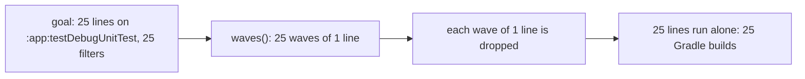
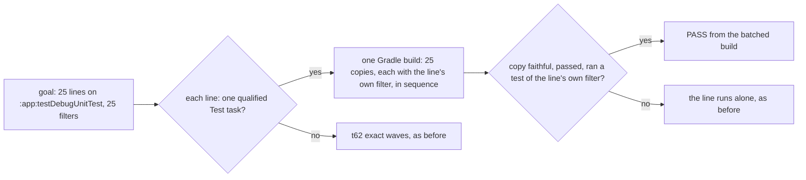

# Stage 05b — t100-isolated-gradle-merge — SPEC

## Problem and scope

`tests/loop.sh` gives consecutive plain Gradle lines to `tests/lib/gradle_runner.py` (t62, USAGE.md §B9). In exact
mode, the default, `waves()` (`tests/lib/gradle_runner.py:223`) puts lines that use one test task with different
`--tests` filters into separate waves. A wave that holds one line is dropped (`plan = [b for b in plan if
len(b["lines"]) > 1]`), and that line runs alone. A goal of 25 lines on `:composeApp:testDebugUnitTest` with 25
filters therefore runs 25 Gradle builds, as before t62. A product user measured about 40 s for each, almost all of it
Gradle start and configuration: about 17 minutes for each loop pass (report of 2026-11-09).

Merged mode (`merged()`, `:239`) unions the filters into one build. It needs a signed `LOOP_GRADLE_MERGE: on`, because
the lines' classes then share one test JVM, and it never merges a D# `check:` line.

This slice adds a third way for one Gradle build to prove many lines: **one Test-task copy per line**, each with the
line's own filter, in one build. A line's copy runs its classes in the same JVM arrangement as the line run alone, so
the verdict is the same. The t64 law harness already registers and checks such copies (`tests/lib/law_harness.init.gradle`);
this slice reuses that init script in a check-only mode.

**Decision of 2026-11-09 (the human, at this GENERATE hop).** The brief asked for `forkEvery = 1` on a merged test task.
That gives each class its own JVM. A line whose own classes fail together when they share a JVM would then pass.
The human chose per-line copies (`docs/cascade/05b-briefs.md`, t100 entry).

Out of scope: `LOOP_GRADLE_MERGE` (unchanged), the law harness's own behaviour (B10), Xcode lines (t98), the verdict
cache for goal lines (t101), and lines on more than one task.

## Approaches considered

| Approach | Decision | Reason |
|---|---|---|
| `forkEvery = 1` on one merged test task (the brief) | Rejected by the human | A line whose classes fail together alone passes when each class has its own JVM. AC0 shows such a pair. |
| Make `LOOP_GRADLE_MERGE` the default | Rejected | Classes of different lines share one JVM, so a test can pass only because another line's test ran first. |
| One Test-task copy per line, in one build, reusing t64's copy and faithfulness code | **Chosen** | One Gradle configuration for all lines. Each copy runs the line's own filter with the original task's settings, so its JVMs hold the same classes as the line alone. |
| A new init script for the loop copies | Rejected | The copy and faithfulness code would exist two times and could drift apart. |

## Before vs after

Before (exact mode, the default):

After:

## Benefits and trade-offs

| Item | Benefit | Cost or limit |
|---|---|---|
| One build for all eligible lines | Gradle start and configuration are paid once, not once for each line. | The copies run one after the other. Their test time adds up, as it does when the lines run alone. |
| Same JVM arrangement as alone | A line's verdict is the same as alone. The D# `check:` lines can be taken. | None found. |
| Faithfulness check from t64 | A copy that could differ from the original (an extra action, `onlyIf`, a different input, a finalizer) is not used, and its line runs alone. | **Android (AGP) test tasks are not checked.** `testDebugUnitTest` may have inputs that a plain `Test` copy does not have. Then every such line runs alone, as today, and this slice gives the reporting user no gain. |
| Copies can be UP-TO-DATE | An unchanged second pass skips the test run. | The premise is t62's A1: a task's outcome depends on its declared inputs. |
| Failures run again alone | Every FAIL is the alone verdict. | A failing line costs the batched build plus its own build, as in t62. |

## Decision contract

### Which lines (`tests/lib/gradle_runner.py`)

1. The segment rules of t62 stay: consecutive plain Gradle lines, grouped by entry command and global options, on a
   verified Gradle version.
2. In a group, when `LOOP_GRADLE_MERGE` is signed, the plan is t62's merged plan, unchanged.
3. Otherwise a line is a **copy line** when it has exactly one selector, the selector names a project path
   (`:core:test`, not `test`), and it is not refused by item 4. A copy line may have `--tests` filters or none.
4. `BDD_LOOP_COPIES=off` makes no line a copy line (t62 exact mode, as before). `BDD_LOOP_RUNNER=shell` still turns
   all batching off.
5. When a group has two or more copy lines, they go to one **copy build**. The other lines of the group go to t62's
   exact waves, unchanged.

### The copy build

6. The runner writes a plan with one row for each copy line: `<id>\t<selector>\t<pattern>…`, where `<id>` is `L`
   followed by the first 12 hex digits of the SHA-256 of the line's text. Equal lines share one copy.
7. It runs `<entry> <globals> <harness tuning> --no-configuration-cache --continue -I tests/lib/law_harness.init.gradle bddLaws`
   with `BDD_LAW_PLAN`, `BDD_LAW_OUT=.cascade/gradle/copies`, `BDD_GRADLE_RANGE` and `BDD_LAW_KINDS=check`. The tuning is
   what `gradle_tuning.flags(root, entry, globals, "harness")` returns, less `BDD_LAW_FORKS` (a loop copy keeps the
   original's forks).

### The init script (`tests/lib/law_harness.init.gradle`)

8. With `BDD_LAW_KINDS=check`, it registers only `bddLawCheck_<id>` for each row, no mutant copy, and the faithfulness
   check (`sameRun(t, c, 'check')`, `ignoreFailures`, `enabled`, `finalizedBy`, the forks) is the same as for a law. The
   `INV_MUTANT` environment rule does not apply, because no mutant runs. The check copy's forks must equal the
   original's.
9. In that mode a copy keeps Gradle's own up-to-date check (no `upToDateWhen { false }`), and never comes from the
   build cache (`cacheIf { false }`). Its reports go to `BDD_LAW_OUT/<id>/check`.
10. With `BDD_LAW_KINDS` unset, the script does exactly what it does today. The law harness never sets it.

### A copy line's PASS

11. A copy line passes from the copy build only when all of these are true:
    - `eligible.tsv` says `yes` for its id;
    - its copy's outcome is `SUCCESS` or `UP-TO-DATE`;
    - the copy's JUnit XML holds at least one test that is not skipped and that the line's own patterns surely select
      (t79; with no patterns, any test), and no failed test;
    - the build's failure count equals its count of FAILED tasks (as in t62).
12. The runner never prints FAIL. Every copy line that is not proven runs alone in `tests/loop.sh`, by the path every
    line took before t62.
13. The `loop:` line keeps its format: `N lines — K proven in B gradle build(s) …`.

### What does not change

14. `tests/loop.sh`, `tests/dsharp_strength.sh`, `tests/regress.sh`, `tests/lib/law_harness.py`, `tests/barbar.sh`,
    `VERIFIED` and the merged plan do not change.

### CI, docs, release

15. The `gradle-runner` job in `.github/workflows/pack-self-check.yml` runs
    `bash tests/ac/t100_isolated_gradle_merge.sh "$RUNNER_TEMP/gradle-8.5/bin/gradle" "$RUNNER_TEMP/gradle-9.1.0/bin/gradle"`.
16. USAGE.md §B9 describes copy lines, the AGP limit and `BDD_LOOP_COPIES=off`.
17. Products get a changed runner, so this is 3.5.3: `VERSION`, the Claude, Codex and marketplace manifests,
    `README.md`, and a dated `## 3.5.3` section in `CHANGELOG.md`.

### Files that may change on EXECUTE

`tests/lib/gradle_runner.py`, `tests/lib/law_harness.init.gradle`, `.github/workflows/pack-self-check.yml`, `USAGE.md`,
`CHANGELOG.md`, `VERSION`, `.claude-plugin/plugin.json`, `.claude-plugin/marketplace.json`, `.codex-plugin/plugin.json`,
`README.md`, `docs/cascade/goal.md`, `docs/cascade/regress.md`.

### Files that must not change on EXECUTE

`tests/ac/t100_isolated_gradle_merge.sh`, `docs/cascade/05b-t100-isolated-gradle-merge.oracle`, the files of item 14,
`tests/ac/t62_loop_runners.sh`, `tests/ac/t64_*`, `tests/stress/*`.

## Acceptance criteria and the frozen oracle

The oracle is `tests/ac/t100_isolated_gradle_merge.sh`. It needs a JDK and a verified Gradle; it finds the oldest and
newest verified Gradle in `~/.gradle/wrapper/dists` (8.5 and 9.1.0 on this machine), or takes them as arguments.
No verified Gradle is a FAIL, not a skip. The fixture is a two-module JUnit 5 cascade repo on an EXECUTE hop, with one
law (D1) whose `check:` is a goal line.

| AC | Requirement | How the oracle proves it |
|---|---|---|
| AC0 | The fixture can catch class isolation. | The claim pair (`ClaimA`, `ClaimB`: each claims a JVM-wide system property in `@BeforeAll`) fails in one JVM and passes with `forkEvery = 1`. |
| AC1 | Each line's verdict equals alone (items 11–12). | It compares the default loop with `BDD_LOOP_RUNNER=shell` for 8 lines: the claim pair, a failing class, an all-`@Disabled` class, a filter that matches nothing, the D# line, a line on `:app`, and two passing lines. It also checks the alone verdicts are the expected ones. |
| AC2 | The passing `:core:test` lines, the D# line included, are proven from one build (items 3–7). | The `loop:` line says `K proven in 1 gradle build(s)` with K ≥ 3, and those lines are PASS. |
| AC3 | An unchanged second pass proves them from one build, with the same verdicts (item 9). | A second loop run. |
| AC4 | `BDD_LOOP_RUNNER=shell` batches nothing (item 4). | The shell run's `loop:` line says `8 lines ran alone`. |
| AC5 | Nothing leaks into the user's build. | `gradle tasks --all` lists no `bddLaw*`/`bddLoop*` task, and no file outside the build directories and `.cascade/` changed. |

On the unfixed code, AC2 and AC3 fail: each `:core:test` line is its own wave of one, so every line runs alone.

## Laws and boundaries

- `NO LAW IN FORCE`: this repo declares no D#.
- A copy line's verdict is the alone verdict, so a D# `check:` line may be a copy line. The merge gate never uses the
  runner.

## Evidence limits

- **AGP is not tested.** No Android fixture exists here. A copy of `testDebugUnitTest` may fail the faithfulness check;
  then its lines run alone. The reporting user's gain is not known until their repo or an AGP fixture runs it.
- The oracle runs on Gradle 8.5 and 9.1.0 on macOS, with JUnit 5 only. JUnit 4 copies use the same t64 code.
- A user's build that changes test-task configuration after `projectsEvaluated` may differ from the copy in a way
  that the input comparison does not see. t64 has the same limit.
- The 40 s for each build and the 17 minutes are the user's figures, from log timestamps.
