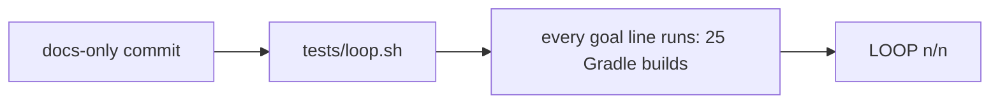
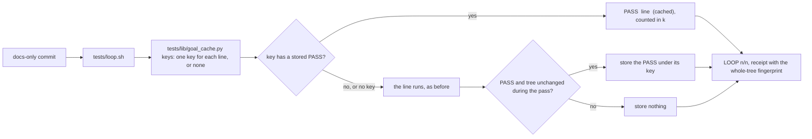

# Stage 05b — t101-goal-verdict-cache — SPEC

## Problem and scope

`tests/loop.sh` runs every goal line again on each pass (`tests/loop.sh:281–305`). It does this also after a commit
that changes only documents. The t65 verdict cache (`tests/lib/verdict_cache.py`, USAGE.md §B12) reuses a law's GREEN
when no input that the law declares changed. Goal lines do not get that cache. A product user lost about 83 minutes in
one day to two loop passes after a docs-only commit (report of 2026-11-09; brief t101 in `docs/cascade/05b-briefs.md`).

This slice reuses a goal line's PASS when the line's key did not change. The key comes from t65's code. A line that has
no key always runs. Only a PASS is stored. Gates that decide a merge, an audit, a regression or an autopilot edge never
read the cache.

Out of scope: affected selection for goal lines (which lines a hop needs), running lines at the same time, the t65 law
cache (unchanged), and the Gradle runner's batching (t62, unchanged).

## Approaches considered

| Approach | Decision | Reason |
|---|---|---|
| Skip the whole loop when the tree fingerprint did not change | Rejected | A docs-only commit changes the fingerprint. It gives no gain for the reported case. |
| Skip every line when only `docs/` and `*.md` changed since the last n/n | Rejected | A line can read a document (`grep -q X docs/api.md`). One rule for all lines is not safe. |
| One key for each line, built with t65's helpers (module closure, build logic, unowned files, toolchain, pack, environment) | **Chosen** | It is the brief. The key rules are t65's, which the pack already tests (t65 AC, `tests/stress/verdict_cache.sh`). |
| Let the autopilot gate read the cache too | Rejected | The gate is the mechanical proof for an EXECUTE edge. A cache entry is a file in `.cascade/` that any agent can write. The gate must run the lines. |

## Before vs after

Before:

After:

## Benefits and trade-offs

| Item | Benefit | Cost or limit |
|---|---|---|
| Docs-only commit | No Gradle line runs again. The reported 83 minutes go to about one module-map configure for each Gradle entry. | Each pass that has Gradle lines runs one Gradle configure for the module map (t66), as t65 does. |
| Module closure | An edit in `:core` runs again only the lines of `:core` and of modules that depend on it. | A Gradle line whose module is not known (`./gradlew test`) has no key and always runs. |
| Unowned non-doc files | A change to a file no module holds (a script, `gradlew`) runs every Gradle line again. Nothing a build could read is left out. | Edits to `tests/` or `tools/` in the product repo invalidate every Gradle line. |
| Signed paths for other lines | A human can give an `xcodebuild` or a shell line a key with a signed `LOOP_CACHE_PATHS:` line. | Without that signature the line always runs. The signed paths must be right: the cache trusts them. |
| PASS only | A FAIL always runs again. | None. |
| Gates do not read the cache | Merge, audit, regress and the autopilot edge stay full runs. | The EXECUTE→next edge still runs every line (`hop_guard` and `pre-commit`). This slice does not make that edge faster. |
| Premise | — | A line's verdict depends only on what its key holds. A line that reads the network, the clock or a file outside the repo can pass from the cache when a fresh run would fail. `BDD_LOOP_CACHE=off` is the way out. |

## Decision contract

### Which lines have a key (`tests/lib/goal_cache.py`, new)

1. A **plain Gradle line** has a key. A plain Gradle line starts with `./gradlew ` or `gradle `, has no shell
   metacharacter (`;`, `|`, `&`, `<`, `>`, `` ` ``, `$`, `(`, `)`), and `affected.module_of` names one module for it.
2. A **signed-path line** has a key. A signed-path line is a goal line that is equal, character for character, to the
   text after ` :: ` on a `- LOOP_CACHE_PATHS: <path> [<path> …] :: <line>` line. That line must be inside an `<EDIT>`
   block of `docs/cascade/envelope.md` **as committed at `HEAD`** (`git show HEAD:docs/cascade/envelope.md`). A line in
   the worktree only, or outside `<EDIT>`, gives no key. The brief names `xcodebuild` lines; the same rule applies to
   every line that is not a plain Gradle line.
3. Every other line has no key, and always runs.

### What a key holds

4. Every key holds: the schema `bdd-goal-cache/1`; the line's text; the toolchain (`uname`, `bash --version`, the
   Python version, and `<entry> --version` for each Gradle entry in the goal); the pack (`pack_version`, and the SHA-256
   of `tests/loop.sh`, `tests/lib/goal_cache.py` and t65's `SCORERS`); and the environment
   (`verdict_cache.ENV_NAMES`, every variable with a prefix in `ENV_PREFIXES`, and every variable the line names with
   `$NAME` or `${NAME}`).
5. A plain Gradle line's key also holds the content of every file under its module's directory and under the
   directories of every module in its closure (`affected.closure`), every build-logic file (`affected.is_build_logic`),
   every shared module (`DSHARP_SHARED_MODULES`), and every non-doc file (`not affected.is_docs`) that no module holds.
   This is t65's `own` plus `global` for a law on that module.
6. A signed-path line's key also holds the content of every file in the tree under each signed path (a file path or a
   directory prefix). A path that matches no file is part of the key as empty.
7. File contents come from `verdict_cache.fingerprint` and `Tree`: tracked and untracked files that git does not ignore.

### When the cache is read

8. `tests/loop.sh` calls `goal_cache.py keys` once, before the first line runs, with all goal lines. It prints one row
   for each line: `K <index> <key> hit|miss`, or `N <index> <reason>`, and one `F <fingerprint>` row.
9. A line whose row is `hit` prints `PASS  <line>  (cached)` and counts in `k`. It does not run, and the Gradle runner
   does not get it. Every other line runs as before (the runner, then alone; t79's count check applies).
10. The cache is not read, and nothing is stored, when any of these is true: `BDD_LOOP_CACHE=off`; `CASCADE_HOPSTATE` or
    `CASCADE_ENVELOPE` is set (the autopilot gate, `tests/lib/autopilot.py`). `BDD_LOOP_RUNNER=shell` does not change
    the cache. `tests/barbar.sh merge`, `tests/audit.sh` and `tests/regress.sh` do not read `.cascade/goal-verdicts/`.
11. If the module map or a toolchain command fails, no line has a key. The loop prints `cache: off (<reason>)` and
    every line runs.

### What is stored

12. After the last line, `tests/loop.sh` calls `goal_cache.py store` with the `F` row and each line that ran and printed
    `PASS` and has a key. A cached line is not stored again.
13. `store` takes the fingerprint again. If it differs from the `F` row, it stores nothing and the loop prints
    `cache: nothing stored (the worktree changed during the pass)`.
14. An entry is `.cascade/goal-verdicts/<id>.json`, where `<id>` is the first 16 hex digits of the SHA-256 of the line's
    text. It holds `schema`, `line`, `key`, `verdict: "PASS"` and the time. It is written to a temporary file and then
    renamed.
15. A lookup is a hit only when the entry is a regular file (not a symlink), its JSON parses, and `schema`, `line` and
    `key` are equal to the current ones and `verdict` is `PASS`. Anything else is a miss.
16. A FAIL is never stored. A line that fails removes its entry.

### What does not change

17. The receipt keeps `cascade_worktree_sha` of the whole tree (`tests/loop.sh:338`). The `LOOP k/n` line keeps its
    format. The `loop:` summary line adds `, C cached` when C > 0.
18. `tests/lib/verdict_cache.py`, `tests/lib/affected.py`, `tests/lib/gradle_runner.py`, `tests/dsharp_strength.sh`,
    `tests/regress.sh`, `tests/audit.sh` and `tests/barbar.sh` do not change.

### Docs and release

19. USAGE.md gets §B20 for the goal cache: the key rules, `LOOP_CACHE_PATHS`, `BDD_LOOP_CACHE=off`, the premise, and
    which gates never read it.
20. The `gradle-runner` job in `.github/workflows/pack-self-check.yml` runs
    `bash tests/ac/t101_goal_verdict_cache.sh "$RUNNER_TEMP/gradle-9.1.0/bin/gradle"`.
21. Products get a changed loop, so this is 3.5.3: `VERSION`, the Claude, Codex and marketplace manifests, `README.md`,
    and a dated `## 3.5.3` section in `CHANGELOG.md`.

### Files that may change on EXECUTE

`tests/loop.sh`, `tests/lib/goal_cache.py` (new), `USAGE.md`, `.github/workflows/pack-self-check.yml`, `CHANGELOG.md`,
`VERSION`, `.claude-plugin/plugin.json`, `.claude-plugin/marketplace.json`, `.codex-plugin/plugin.json`, `README.md`,
`docs/cascade/goal.md`, `docs/cascade/regress.md`.

### Files that must not change on EXECUTE

`tests/ac/t101_goal_verdict_cache.sh`, `docs/cascade/05b-t101-goal-verdict-cache.oracle`, the files of item 18,
`tests/lib/autopilot.py`, `tests/ac/t6*`, `tests/stress/*`.

## Acceptance criteria and the frozen oracle

The oracle is `tests/ac/t101_goal_verdict_cache.sh`. It needs a JDK and a verified Gradle (an argument,
`BDD_T101_GRADLE`, or the newest verified one in `~/.gradle/wrapper/dists`). No Gradle is a FAIL, not a skip. The
fixture is a two-module JUnit 5 cascade repo (`:app` depends on `:core`) on an EXECUTE hop with a signed autopilot
list. Its goal has two plain Gradle lines, two signed-path shell lines and one shell line with no key.

| AC | Requirement | How the oracle proves it |
|---|---|---|
| AC1 | A docs-only commit runs no keyed line again (items 5, 9). | Both Gradle lines and the signed-path line print `(cached)`; the unkeyed line runs; `LOOP 4/4`. |
| AC2 | A module edit runs that module's lines and its dependents' lines again (item 5). | A `:core` edit runs both Gradle lines; an `:app` edit runs only the `:app` line. |
| AC3 | Build logic and unowned files are in every Gradle key; signed paths key their line (items 5, 6). | A `build.gradle` edit runs both Gradle lines; a `tools/` edit runs the signed-path line and the Gradle lines. |
| AC4 | The pack version and the environment are in every key (item 4). | A new `.claude-plugin/plugin.json` version, then a new `JAVA_TOOL_OPTIONS`, each run every keyed line. |
| AC5 | A FAIL is never reused (item 16). | A failing signed-path line runs again, and fails, after a docs-only commit. |
| AC6 | The switch and the signature rule (items 2, 10). | `BDD_LOOP_CACHE=off` prints no `(cached)`; an uncommitted `LOOP_CACHE_PATHS` line and one outside `<EDIT>` give no key. |
| AC7 | Forged entries and a moving tree (items 13, 15). | An entry with a changed key and a symlinked entry are misses; a pass whose line edits the tree stores nothing. |
| AC8 | The receipt is the whole-tree fingerprint (item 17). | After a cached `LOOP 4/4`, `.cascade/loop-receipt` is `EXECUTE 05b <cascade_worktree_sha>`. |
| AC9 | The autopilot gate never reads the cache (item 10). | An autopilot edge committed through the real `pre-commit` hook runs the signed-path line although its entry is fresh. |

On the unfixed code, AC1, AC2, AC7 and AC8 fail: no line is ever `(cached)` and `.cascade/goal-verdicts/` does not
exist (run of 2026-11-09, 83 s). AC3–AC6 and AC9 pass there, because every line runs: they are guards that the fixed
code must not break by reusing too much.

## Laws and boundaries

- `NO LAW IN FORCE`: this repo declares no D#.
- A product's D# `check:` line on a goal is a goal line like any other: it can be cached in the loop. The law's own
  verdict comes from `tests/dsharp_strength.sh` and the merge gate, which never read this cache.

## Evidence limits

- The oracle runs on one Gradle version on macOS with JUnit 5. The key rules are t65's, which run on 8.5 and 9.1.0.
- No AGP or `xcodebuild` fixture. An `xcodebuild` line gets a key only through a signed `LOOP_CACHE_PATHS` line; the
  oracle proves that rule with shell lines.
- The 83 minutes are the user's figure, from log timestamps.
