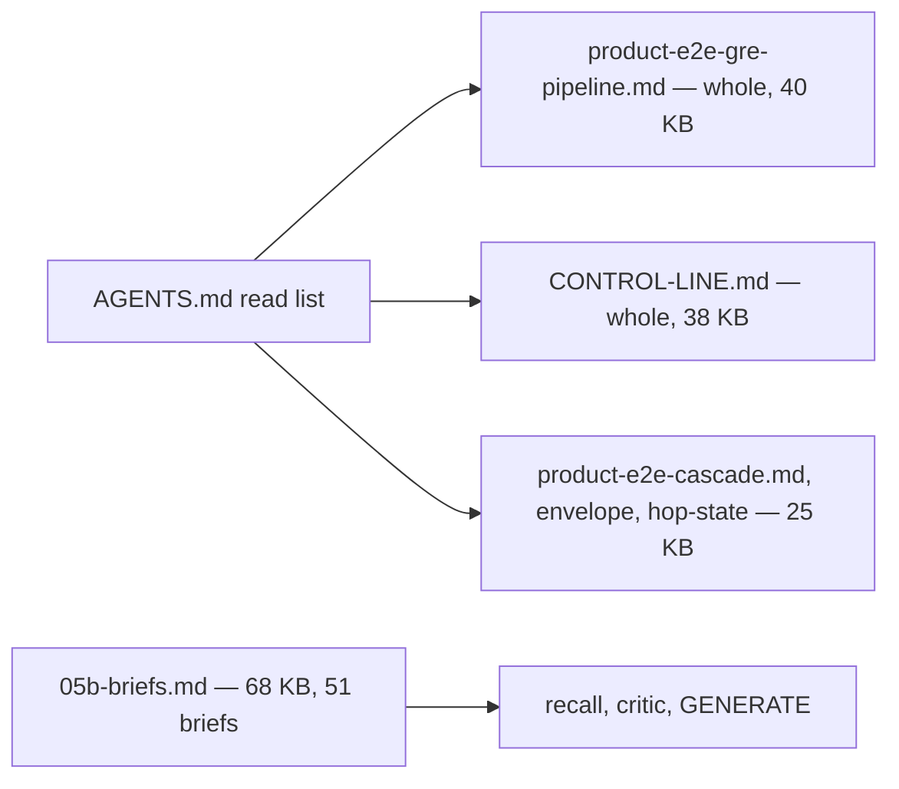
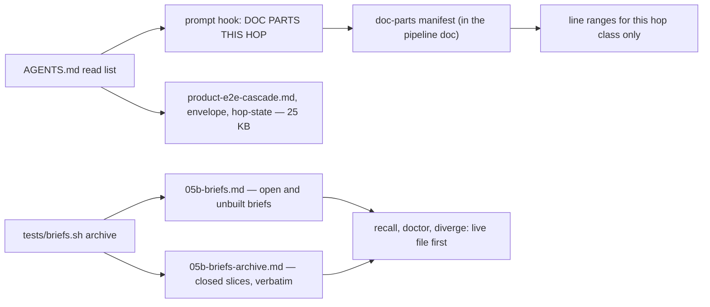

# Stage 05b — t102-doc-disclosure — SPEC

## Problem and scope

Before an agent starts work, `AGENTS.md` ("Read these first") tells it to read five files whole:

| File | Bytes (2026-11-12) |
|---|---|
| `docs/cascade/hop-state.md` | 2,264 |
| `docs/cascade/envelope.md` | 3,971 |
| `docs/cascade/product-e2e-gre-pipeline.md` | 40,319 |
| `docs/cascade/product-e2e-cascade.md` | 18,564 |
| `CONTROL-LINE.md` | 38,436 |
| **Total** | **103,554** (about 26k tokens) |

A hop uses a small part of the two large files. `CONTROL-LINE.md` is 85 % evidence tables (T1–Tn) for the human and
for `tests/lint.sh`; the agent needs its first three sections. The pipeline doc's conductor prompt is one 16 KB code
block; a hop needs I1–I18, the hard rules and the procedure for its own hop kind (spec critic, switch review,
divergence). Long instruction files lose effect (the talk "Learning While You Sleep", AI Native DevCon London 2026:
"context blurred"). t67 solved this for laws with shards and `LAW SHARDS THIS HOP`. This slice does the same for the
two docs.

`docs/cascade/05b-briefs.md` is 675 lines and 68 KB. It holds every brief since the first slice. 36 of its 51 briefs
have a spec, so their slice was generated in the past. GENERATE, the spec critic, the recall index and `/barbar auto`
read this file.

This slice:

1. Adds a **doc-parts manifest** to the pipeline doc. The manifest names, for each hop class, the parts of the two
   docs that the hop reads.
2. Adds `tests/doc_parts.sh` (with `tests/lib/doc_parts.py`). It resolves each part to a line range, checks the
   manifest, and measures the reads.
3. Makes the prompt hook print `DOC PARTS THIS HOP:` with the line ranges, as it prints `LAW SHARDS THIS HOP:`.
4. Changes the two `AGENTS.md` read items that name the two docs, so they point to the parts.
5. Moves each brief of a closed slice to `docs/cascade/05b-briefs-archive.md` with `bash tests/briefs.sh archive`.
   Every reader that finds a brief by slug looks in the live file first, then in the archive.

The slice adds text. It does not move, change or delete a line of the pipeline doc or of `CONTROL-LINE.md`.

Out of scope: rewriting rule text; `product-e2e-cascade.md` (18.5 KB, a later slice); `USAGE.md` size; the law
shards (t67); the reads manifest of product artifacts (`<!-- reads-manifest -->`, unchanged); `preserve.py`'s
injected block (unchanged).

This slice absorbs two old briefs: `invariant-card` (I1–I18 as a small card; here the INVARIANTS part does this
without a copy) and `t88-briefs-archive` (the archive; its acceptance rule is replaced, see "Approaches").

## Approaches considered

| Approach | Decision | Reason |
|---|---|---|
| Split each doc into small files (`docs/cascade/pipeline/*.md`) | Rejected | `tests/i17_dune.sh`, `tests/control-line.sh`, `tests/reads_manifest.sh`, `tests/ac/t63_quiet_stop_guard.sh`, `stop_guard.py` and `install.sh` read the docs by path and by text. A split changes all of them and changes the "paste this conductor" use of the pipeline doc. |
| Copy I1–I18 to a separate card (`invariant-card`) | Rejected | Two copies of one rule drift. The INVARIANTS part points at the one copy. |
| A manifest of parts inside the pipeline doc, resolved by a script to line ranges, printed by the prompt hook | **Chosen** | No text moves. It is t67's way (`LAW SHARDS THIS HOP`) applied to prose. A script checks that each part resolves. |
| Archive a brief when `### <slug>` is in `docs/cascade/regress.md` (`t88-briefs-archive`) | Rejected | `regress.md` starts at t77. Older accepted slices and dropped slices (t100) never get a section, so their briefs stay live. |
| Archive a brief when its spec exists and its slice is not open and not on the `AUTOPILOT:` list | **Chosen** | A script can check all three conditions from the tree. A re-opened slice still finds its brief, because readers also read the archive. |

## Before vs after

Before:

After:

## Benefits and trade-offs

| Item | Benefit | Cost or limit |
|---|---|---|
| Required reads | Drop from 103,554 bytes to at most half for every hop class (AC2). | The agent must read by line range. A hop that needs another part reads it on purpose. |
| No text moves | Every existing reader and test of the two docs keeps working. | The pipeline doc grows by the manifest (about 2 KB). |
| One copy of each rule | I1–I18 stay in one place. | None. |
| Manifest check | A renamed heading or label fails `bash tests/doc_parts.sh --check`, so a part cannot point at nothing. | A part that resolves but covers the wrong text is not detected. Review catches that. |
| Briefs archive | The live briefs file drops to the briefs not yet built. | Readers read two files. A brief in both files is an error (AC6). |
| Advice, not a gate | Nothing refuses a hop that reads more. | A hop can still read the whole files. The manifest is a budget, as the reads manifest is. |

## Decision contract

### The doc-parts manifest (in `docs/cascade/product-e2e-gre-pipeline.md`)

1. The manifest is a new section `## Doc parts — what a hop reads (t102)` placed directly before
   `## Loop constitution (invariants + slash commands)`. It holds a table between the lines
   `<!-- doc-parts:begin -->` and `<!-- doc-parts:end -->`.
2. Each table row is `| <hop class> | <part>; <part>; … |`. The hop classes are the values of `hop_class()` in
   `.claude/hooks/seam.py`, with GENERATE split by stage: `GENERATE 05b`, `GENERATE`, `EXECUTE-BUILD`,
   `EXECUTE-DESIGN`, `EXECUTE-AUDIT`, `EXECUTE-PRR`. One more row, `ALL`, names the parts that every hop class reads.
3. A part is `<file>#<heading>` or `<file>@<label>`:
   - `<file>` is `gre` (`docs/cascade/product-e2e-gre-pipeline.md`) or `cl` (`CONTROL-LINE.md`).
   - `#<heading>` names a Markdown heading by its exact text after the `#` marks. The part runs from that line to the
     line before the next heading of the same or a higher level. Lines inside a fenced code block are never
     headings.
   - `@<label>` names a line inside the conductor prompt's code block that starts with `<label>`. The labels are
     exactly: `INVARIANTS`, `PRESERVE protocol`, `ADD protocol`, `COMMAND BINDING:`, `Hard rules:`, `Spec critic`,
     `Switch review`, `Divergence`. The part runs from that line to the line before the next line that starts with
     another label from this list, or to the line before the code block's closing fence.
4. The first manifest is:

   | Hop class | Parts |
   |---|---|
   | `ALL` | `gre@INVARIANTS`; `gre@Hard rules:`; `gre@COMMAND BINDING:`; `gre@PRESERVE protocol`; `cl#`/loop` (ours, GRE)`; `cl#`/barbar` (hers, enhanced)`; `cl#Sequence` |
   | `GENERATE 05b` | `gre@Spec critic`; `gre@Divergence`; `gre#Generate hop — required output shape`; `gre#Stage 05b — how the product actually gets built` |
   | `GENERATE` | `gre#Generate hop — required output shape`; `gre#What each stage reads` |
   | `EXECUTE-BUILD` | `gre@Switch review`; `gre#Execute hop — required output shape`; `gre#Stage 05b — how the product actually gets built` |
   | `EXECUTE-DESIGN` | `gre#Execute hop — required output shape`; `gre#What each stage reads` |
   | `EXECUTE-AUDIT` | `gre#Stage 10 — audit hop output shape`; `gre#Execute hop — required output shape` |
   | `EXECUTE-PRR` | `gre#Execute hop — required output shape`; `gre#What each stage reads` |

   `ADD protocol` is a label (it ends `PRESERVE protocol`) but no row names it: the human adds laws, and the agent's
   law work follows AGENTS rule 5.
5. The manifest section also says, in prose: the parts are a budget, not a gate; read a whole file when a part points
   elsewhere; the prompt hook prints the line ranges.

### `tests/doc_parts.sh` and `tests/lib/doc_parts.py` (new)

6. `bash tests/doc_parts.sh` with no option prints the parts for the current hop (from `docs/cascade/hop-state.md`,
   or the envelope in a pre-split repo). Each line is `<path>:<start>-<end>  <bytes>  <part>`. On `CURRENT_HOP: NONE`
   it prints `no hop running` and exits 0.
7. `--hop <GENERATE|EXECUTE> --stage <stage>` prints the parts for that hop instead of the current one.
8. `--check` resolves every part of every row. It exits 1 and prints one `DOC PARTS red: <part> — <reason>` line for
   each part that resolves to no line, to more than one line, or to an empty range, and for a row with an unknown hop
   class. It also checks that each of `I1 ` … `I18 ` starts a line inside `gre@INVARIANTS`. It exits 0 and prints
   `DOC PARTS ok: <rows> rows, <parts> parts` when all hold.
9. `--measure` prints, for each hop class, the baseline bytes and the bytes after, and the ratio:
   - Baseline: the sum of the bytes of the five files in the table under "Problem and scope", read whole.
   - After: `hop-state.md` + `envelope.md` + `product-e2e-cascade.md` whole, plus the bytes of each distinct line in
     the union of the `ALL` row and the class row. A line in two parts counts once.
   - It exits 1 when any class has after > 0.5 × baseline.
10. A missing manifest block prints `DOC PARTS red: no <!-- doc-parts:begin/end --> block` and exits 1 for `--check`
    and `--measure`. For the no-option form it prints nothing and exits 0: an older doc is not an error at hop time.
11. `tests/lib/doc_parts.py` exposes `parts(root, hop, stage) -> list[(path, start, end, name)]` for the hook.

### The prompt hook (`.claude/hooks/seam.py`)

12. On an open hop, after the `LAW SHARDS THIS HOP` line, the hook adds one line:
    `DOC PARTS THIS HOP: <path>:<start>-<end> <name>, … — read these ranges, not the whole files.`
    Consecutive parts in the same file show the path once. The line is at most 700 characters; a longer line ends
    with `… (bash tests/doc_parts.sh lists all)`.
13. When `tests/lib/doc_parts.py` is missing, raises, or returns no part, the hook adds no line and the rest of its
    output does not change. On `CURRENT_HOP: NONE` the hook adds no line.

### `AGENTS.md`

14. Read item 3 becomes: `` `docs/cascade/product-e2e-gre-pipeline.md` — the conductor, invariants I1–I18. Read the
    ranges the prompt hook lists (`DOC PARTS THIS HOP`, or `bash tests/doc_parts.sh`), not the whole file. ``
15. Read item 5 becomes: `` `CONTROL-LINE.md` — `/loop` vs `/barbar`. Its parts are in the same list; the T1–Tn
    tables are evidence for the human and for `tests/lint.sh`. ``
16. No other line of `AGENTS.md` changes.

### The briefs archive

17. `bash tests/briefs.sh archive` (with `tests/lib/briefs.py`) moves each **closed** brief from
    `docs/cascade/05b-briefs.md` to the end of `docs/cascade/05b-briefs-archive.md`, in the live file's order. It
    creates the archive with the first line `# Archived briefs (t102) — closed slices, verbatim` when it is missing.
18. A brief is the line `- <slug>:` at column 0 plus the lines that follow it and start with a space or a tab. A blank
    line or a column-0 line ends it (`tests/lib/recall.py`'s rule).
19. A brief is closed when all three hold: `docs/cascade/05b-<slug>.md` exists; `<slug>` is not `CURRENT_SLICE`; and
    `<slug>` is not an entry on the `AUTOPILOT:` line.
20. The text in the archive is byte-identical to the text removed from the live file. The live file keeps every other
    line, in order.
21. It refuses, changes nothing and exits 1 when `git status --porcelain` shows either file changed or untracked-and-
    modified, or when a slug is in both files. It prints `briefs: moved <n> (<slugs>)` or `briefs: nothing to move`
    and exits 0 otherwise. A second run moves nothing.
22. `bash tests/briefs.sh find <slug>` prints `<path>:<line>` of the brief, live file first, then the archive, and
    exits 1 when neither file has it.
23. Readers use `briefs.find`: `tests/lib/recall.py` (`brief()`) and `tests/lib/diverge.py` (`tag()`). A slice that is
    opened again after its brief was archived still gets its recall line and its `[diverge]` tag. The prompt hook's
    idle text still tells the agent to write new briefs into `05b-briefs.md`.
23a. `tests/doctor.sh` does not change. Its AUTOPILOT check accepts an entry with a spec before it looks for a brief,
    and every archived brief has a spec (item 19).
24. `commands/barbar.md`, `.claude/commands/barbar.md` and the critic brief in the pipeline doc say "brief" without a
    file; they need no change. USAGE.md gets one paragraph (item 27).

### Install, docs and release

25. `install.sh` copies `tests/doc_parts.sh`, `tests/briefs.sh` and the two libs with the rest of `tests/`. It does not
    copy `05b-briefs-archive.md`: a product repo starts with no archive.
26. `.opencode/skills/bdd/SKILL.md` and `skills/cascade-farm/SKILL.md` keep their links to the pipeline doc.
27. USAGE.md gets `### B21. Doc parts and the briefs archive (t102)`. `CHANGELOG.md` gets `## 3.5.4`. `VERSION`, the
    three manifests and `README.md` say 3.5.4.

### Files that may change on EXECUTE

- `docs/cascade/product-e2e-gre-pipeline.md` (the new section only, item 1)
- `tests/doc_parts.sh`, `tests/lib/doc_parts.py`, `tests/briefs.sh`, `tests/lib/briefs.py` (new)
- `.claude/hooks/seam.py`, `tests/lib/recall.py`, `tests/lib/diverge.py`
- `AGENTS.md` (items 14–15 only)
- `docs/cascade/05b-briefs.md`, `docs/cascade/05b-briefs-archive.md` (by `tests/briefs.sh archive` only)
- `install.sh`, `USAGE.md`, `CHANGELOG.md`, `VERSION`, `README.md`, the three plugin manifests
- `docs/cascade/goal.md`, `docs/cascade/regress.md` (by `tests/goal.sh`)
- `tests/enforcement.sh`, `CONTROL-LINE.md` — only to add a T-row if `tests/lint.sh` needs one for a new check

### Files that must not change on EXECUTE

- Any existing line of `docs/cascade/product-e2e-gre-pipeline.md` and of `CONTROL-LINE.md` (lines may be added;
  CONTROL-LINE gets at most one new T-row)
- `.claude/hooks/preserve.py`, `tests/doctor.sh`, `tests/reads_manifest.sh`, `tests/i17_dune.sh`, `tests/control-line.sh`
- `tests/ac/*` other than the oracle, `tests/inv/*`, `docs/cascade/envelope.md`, `docs/cascade/hop-state.md`

## Acceptance criteria and the frozen oracle

The oracle is `tests/ac/t102_doc_disclosure.sh`. It runs on the real tree (AC1–AC4) and on scratch git repos
(AC5–AC8). It needs `git` and `python3` only.

| AC | Requirement | How the oracle proves it |
|---|---|---|
| AC1 | The manifest resolves (items 1–4, 8). | `bash tests/doc_parts.sh --check` exits 0. For each hop class the oracle prints the parts, and each range lies inside the file. Each `I1 `…`I18 ` line is inside the INVARIANTS range. |
| AC2 | Reads drop by at least half (item 9). | The oracle computes the baseline from the five files itself, computes "after" itself from the ranges that `doc_parts.sh --hop … --stage …` prints, and requires after ≤ 0.5 × baseline for all six classes. `--measure` exits 0. |
| AC3 | A broken part fails the check (items 8, 10). | In a scratch copy, a renamed `## Stage 10 — audit hop output shape` heading makes `--check` exit 1 and name that part; a deleted manifest block makes it exit 1. |
| AC4 | No line of the two docs moves or changes (item 1). | `git diff 5b26e2c -- docs/cascade/product-e2e-gre-pipeline.md CONTROL-LINE.md` has no removed line. Only items 14–15 change in `AGENTS.md`: its diff removes at most 2 lines. |
| AC5 | The prompt hook prints the ranges (items 12–13). | In a scratch repo on GENERATE 05b, `seam.py` output holds `DOC PARTS THIS HOP:` with the Spec critic range and is ≤ 700 characters on that line. On NONE it holds no such line. With `doc_parts.py` removed, the output is byte-identical to the output with the doc-parts line deleted. |
| AC6 | The archive moves exactly the closed briefs (items 17–21). | A scratch repo has briefs `a` (spec, closed), `b` (spec, `CURRENT_SLICE`), `c` (spec, on `AUTOPILOT:`), `d` (no spec). `archive` moves only `a`; the archive text equals the removed bytes; live + archive hold every original line once; a second run prints `nothing to move`; a dirty briefs file is refused with no change; a slug in both files is refused. |
| AC7 | Readers find an archived brief (items 22–23). | After AC6, `briefs.sh find a` names the archive; `recall.brief(root, "a")` names the archive; `diverge.tag` reads `[diverge 2]` from a brief that is only in the archive; `briefs.sh find` of a missing slug exits 1. |
| AC8 | Preserve output does not change (item 13, "Out of scope"). | `preserve.py` from `git show 5b26e2c` and the current one give byte-identical output for the same scratch repo on GENERATE (compact) and on NONE (startup). |

On the unfixed code, AC1, AC2, AC3, AC5, AC6 and AC7 fail: `tests/doc_parts.sh`, `tests/briefs.sh` and the manifest
do not exist. AC4 and AC8 pass there: they are guards that the fixed code must not break.

## Laws and boundaries

- `NO LAW IN FORCE`: this repo declares no D#.
- The manifest is advice. No gate reads it, and no gate gets a new way to pass.

## Evidence limits

- The byte counts are from 2026-11-12. AC2 recomputes them at test time, so it does not depend on these numbers.
- Bytes are a proxy for tokens. Whether a smaller read changes what an agent does is not measured here.
- A part that resolves but covers the wrong text passes AC1. The spec critic and the human review the manifest.
