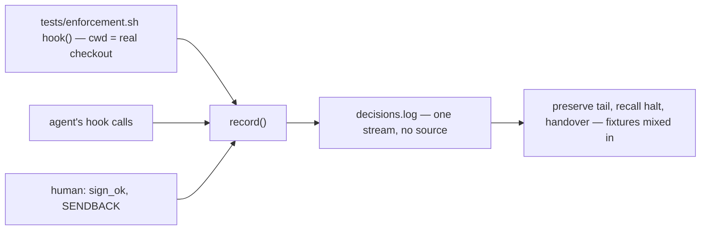
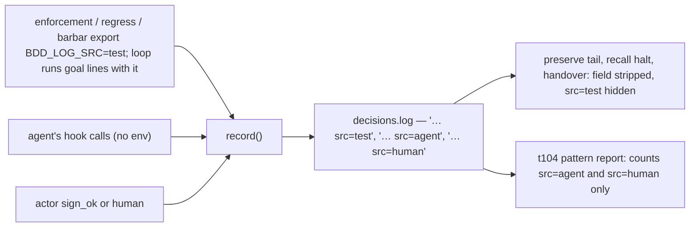

# Stage 05b — t103-log-source — SPEC

## Problem and scope

`.cascade/decisions.log` records one line for each decision a layer makes (`tests/lib/decisions.py`). On 2026-11-12 it
held 3,497 lines: 2,872 `bash_guard`, 300 `dsharp`, 203 `stop_guard`, 61 `sign_ok`, 61 `hop_guard`, 53 `loop`. 1,796
lines arrived in bursts of five or more in the same second. Most bursts are acceptance-test fixtures, not agent
actions. The cause: `tests/enforcement.sh:38` runs each hook as `python3 -B "$L2/.claude/hooks/$1"` with no `cwd` in
the event, so a hook logs to `ev.get("cwd") or os.getcwd()` (`.claude/hooks/bash_guard.py:234`) — the real checkout
the suite runs from — and every denial the suite provokes
(`git push origin main`, `gh pr merge`, the signature-ledger probes) is written to the real log.

A report over this log learns from fixtures (the talk "Learning While You Sleep", AI Native DevCon London 2026: look
at tool calls and metadata, and choose which transcripts an analysis sees). t104 needs to tell real events from test
events. This slice adds a source field to each new line and tags the test runs.

This slice:

1. Appends `src=<test|agent|human>` to each new line, after the detail.
2. Sets the source from `BDD_LOG_SRC` when it is `test`, `agent` or `human`; else from the actor.
3. Tags test runs: `tests/enforcement.sh` and `tests/regress.sh` export `BDD_LOG_SRC=test`; `tests/barbar.sh` runs
   its farm (not its merge gate) with it; `tests/loop.sh` runs each goal line with it.
3a. Makes rotation drop test lines first, so fixture lines cannot push out real history.
4. Makes the display readers (`decisions.tail`, the recall index's halt line, `tests/handover.sh`) strip the field and
   hide `src=test` lines.

Out of scope: rewriting or deleting old lines; the pattern report (t104); log rotation (unchanged: 2,000 lines kept
above 2 MB); the hooks' decisions themselves.

## Approaches considered

| Approach | Decision | Reason |
|---|---|---|
| Run the enforcement hooks from a scratch `cwd` so they never reach the real log | Rejected for this slice | `hook()` serves about 40 enforcement checks; moving their root means reviewing each one, a larger change than this slice. It also leaves every other test path (regress lines, goal lines) untagged. A later slice can move them; the tag stays useful then. |
| A separate log for tests, so rotation never drops real lines | Rejected | The writer still needs the same signal to pick the file. Item 3a gets the rotation benefit in one file: when the log passes 2 MB, `src=test` lines go first. |
| A separate log file for tests (`.cascade/decisions.test.log`) | Rejected | The writer cannot know it runs in a test without the same signal, and two files split one timeline. A field in one file keeps the order. |
| A source column after the verdict (`ts actor verdict src detail`) | Rejected | `recall.halt` and other readers split by position; a new column shifts the detail and changes what `preserve.py` prints. |
| A trailing `src=<x>` field, set from `BDD_LOG_SRC` or the actor, stripped by display readers | **Chosen** | Positional readers (`bits[1]`, `bits[2]`) and the T40 greps (`hop_guard.*DENY.*src/x.kt`) keep working. Old lines stay valid. |

## Before vs after

Before:

After:

## Benefits and trade-offs

| Item | Benefit | Cost or limit |
|---|---|---|
| Source field | t104 can count real events only. | Old lines read as `src=unknown`; the report must decide what to do with them. |
| Trailing position | No reader that splits by position changes; old and new lines parse the same way. | The field adds about 10 bytes per line. |
| Tagged suites | The enforcement suite, the regression suite, the farm and every goal line write `src=test`. | An acceptance test run by hand, outside those four, writes `src=agent`. USAGE.md says to prefix that one command (`BDD_LOG_SRC=test bash tests/ac/…`), never to export it in a shell. |
| A leaked export | — | If `BDD_LOG_SRC=test` is exported in the shell that starts the agent, every agent hook line becomes `src=test` and is hidden from display. Signatures (`sign_ok`, `human`) stay `src=human` (item 2). USAGE.md names this. |
| Hidden test lines | The tail after a compact shows the last 12 real decisions, not fixture denials. | A human who wants the test lines reads the file. |
| Env override | A wrapper can tag its own runs. | Any process can set `BDD_LOG_SRC=human`. The log is a record, never a gate (`decisions.py` docstring), so no verdict depends on the field. |

## Decision contract

### The writer (`tests/lib/decisions.py`)

1. `record(root, actor, verdict, detail)` writes `{ts}  {actor:<11} {verdict:<7} {detail}  src={src}` — the line it
   writes today, then two spaces, then `src=` and the source. The detail is cut to 400 characters before the field is
   added, as today.
2. The source is `human` when the actor is `sign_ok` or `human`, whatever `BDD_LOG_SRC` says: a signature is never
   hidden. For every other actor it is the value of `BDD_LOG_SRC` when that is exactly `test`, `agent` or `human`, and
   `agent` otherwise.
2a. Rotation: when the file passes `MAX_BYTES` (2 MB), `record` keeps the last 2,000 lines that are not `src=test`, then
   fills up to 2,000 with the newest `src=test` lines, in file order. Today it keeps the last 2,000 lines of any kind.
3. `record` never raises, as today.
4. A new helper `source(line) -> str` returns the field's value, or `unknown` for a line with no field. A new helper
   `display(line) -> str` returns the line with a trailing `  src=<x>` removed.
5. `tail(root, n)` returns at most `n` lines: the last `n` lines that are not `src=test`, each through `display()`, in
   file order. It scans the whole file (at most 2,000 lines after rotation).
6. `decisions.py <root> --tail [n]` prints `tail()`. A new `decisions.py <root> --tail-all [n]` prints the last `n`
   raw lines, test lines and fields included.

### The readers

7. `tests/lib/recall.py` `halt()` drops `src=test` lines first and then works on the rest as today: the C8 window
   (`i >= len(lines) - TAIL_SHOWN`) counts the remaining lines only, so a HALT that `preserve.py`'s tail shows is never
   printed twice. It prints the line through `display()`. Its positional test (`bits[2] in HALTS`) does not change.
8. `tests/handover.sh` prints `python3 -B tests/lib/decisions.py "$ROOT" --tail 5` in place of `tail -5` on the file.
9. `.claude/hooks/preserve.py` and `.claude/hooks/_common.py` do not change: they read through `decisions.tail`.
   `tests/lib/watchdog.py`, named in the brief, does not read the log (`grep -n decisions tests/lib/watchdog.py` finds
   nothing); it needs no change.

### Tagging test runs

10. `tests/enforcement.sh` and `tests/regress.sh` each `export BDD_LOG_SRC=test` in their first 25 lines, before any
    test runs. `tests/barbar.sh` does not export it: each call of `run_farm` is written `BDD_LOG_SRC=test run_farm`, so
    the farm's suites are tagged and `merge_gate` (the real `dsharp_strength.sh` verdicts of `/barbar merge` and
    `/barbar auto`) keeps the caller's source.
11. `tests/loop.sh` runs each goal line with `BDD_LOG_SRC=test` in that line's environment only (the `tests/loop.sh:323`
    subshell). The Gradle runner's batched lines are Gradle builds; they never call `decisions.py`, so they need no tag.
    The loop's own `loop PASS` record keeps the caller's source: an agent's loop writes `src=agent`.
12. A git hook, an agent hook and `tests/dsharp_strength.sh` set nothing: in an agent session they write `src=agent`,
    and inside a tagged suite they inherit `src=test`.

### Docs and release

13. USAGE.md gets `### B22. Where a log line came from (t103)`. `CHANGELOG.md` gets `## 3.5.5`. `VERSION`, the three
    manifests and `README.md` say 3.5.5.
14. The `decisions.py` docstring documents the field and `BDD_LOG_SRC`.

### Files that may change on EXECUTE

- `tests/lib/decisions.py`, `tests/lib/recall.py`, `tests/handover.sh`
- `tests/enforcement.sh`, `tests/regress.sh`, `tests/barbar.sh`, `tests/loop.sh` (items 10–11 only)
- `tests/ac/t69_gradle_tuning.sh` only if its install allowlist needs it (this slice adds no shipped file, so it should not)
- `USAGE.md`, `CHANGELOG.md`, `VERSION`, `README.md`, the three plugin manifests
- `docs/cascade/goal.md`, `docs/cascade/regress.md`, `docs/cascade/05b-briefs.md`,
  `docs/cascade/05b-briefs-archive.md` (by `tests/goal.sh` only)

### Files that must not change on EXECUTE

- `.claude/hooks/*.py`, `.githooks/*`, `tests/dsharp_strength.sh`
- `tests/ac/*` other than the oracle, `tests/inv/*`, `docs/cascade/envelope.md`, `docs/cascade/hop-state.md`
- `.cascade/decisions.log` (no rewrite of old lines)

## Acceptance criteria and the frozen oracle

The oracle is `tests/ac/t103_log_source.sh`. It uses scratch git repos and needs `git` and `python3` only.

| AC | Requirement | How the oracle proves it |
|---|---|---|
| AC1 | The writer adds the field (items 1–3). | `record` with `BDD_LOG_SRC=test` ends `  src=test`; actor `sign_ok` and actor `human` end `src=human`; actor `hop_guard` ends `src=agent`; `BDD_LOG_SRC=bogus` gives `src=agent`; `BDD_LOG_SRC=test` with actor `sign_ok` gives `src=human`; the text before the field equals the line the code at `0a3d5ce` writes for the same call (timestamp masked). |
| AC2 | A real hook call is tagged (items 2, 12). | `bash_guard.py` fed `git push origin main` in a scratch repo writes a `DENY` line ending `src=agent`; with `BDD_LOG_SRC=test` in its environment, `src=test`. |
| AC3 | Old lines still read (items 4, 7). | A log of `0a3d5ce`-format lines: `source()` is `unknown`, `display()` returns each line unchanged, `tail()` returns them all, and `recall.halt` finds an old `HALT` line. |
| AC4 | Display output does not change for a log with no test lines (items 5, 8, 9). | For the same 7 decisions (more than handover's 5), `preserve.py` (compact, on GENERATE) and `tests/handover.sh` print the same "Last decisions" lines with the new code and a new-format log as `0a3d5ce`'s code with an old-format log. |
| AC5 | Test lines are hidden from display (items 5, 7). | With `src=test` lines after the real ones (a test `HALT` included), `tail(12)` returns exactly the 12 newest real lines, `preserve.py`'s tail and `recall.halt` show only real lines, and `--tail-all` shows all of them. A real `HALT` followed by 2 real and 20 test lines is not printed by `recall.halt` (preserve's tail shows it). |
| AC6 | The loop tags goal lines, not itself (item 11). | A scratch repo on EXECUTE with a goal line that calls `decisions.py … t103probe` runs `tests/loop.sh` to `LOOP 1/1`: the probe line ends `src=test`, and the loop's `loop PASS` line ends `src=agent`. |
| AC7 | The suites tag test runs, not the merge gate (item 10). | `tests/enforcement.sh` and `tests/regress.sh` hold `export BDD_LOG_SRC=test` in their first 25 lines; `tests/barbar.sh` has no `export BDD_LOG_SRC` line, and every `run_farm` call in it is `BDD_LOG_SRC=test run_farm`; a scratch `regress.md` line that calls `decisions.py` writes `src=test` through `tests/regress.sh`. |
| AC8 | Rotation drops test lines first (item 2a). | A log above 2 MB with 500 real lines followed by 3,000 `src=test` lines: after one more `record`, all 500 real lines and the new line remain, and the file holds at most 2,000 old lines. |

On the unfixed code, AC1, AC2, AC3, AC5, AC6, AC7 and AC8 fail: no line has a field, and `source()` and `display()` do not
exist (AC3 fails at that call; its old-line halt check is the guard). AC4 passes there: it is a guard that the fixed
code must not break.

## Laws and boundaries

- `NO LAW IN FORCE`: this repo declares no D#.
- No gate reads the log or the field (`decisions.py`: "No gate reads it").

## Evidence limits

- The counts are from this repo on 2026-11-12. The cause of the bursts is inferred from `tests/enforcement.sh:38` and
  the matching detail texts; this slice does not re-run the suite to attribute each old line.
- `BDD_LOG_SRC` is not authenticated. The field is a label for reports, not evidence.
