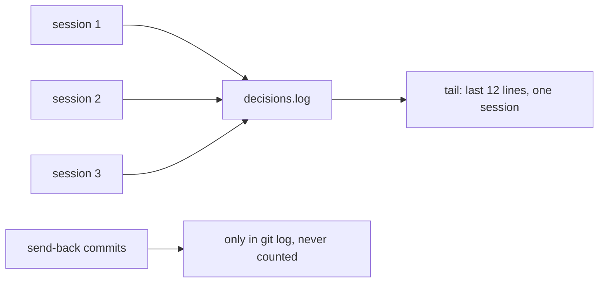
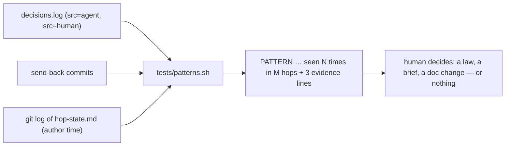

# Stage 05b — t104-pattern-report — SPEC

## Problem and scope

`.cascade/decisions.log` records each decision that a layer makes. One session sees only its own part of the log, so
the same mistake can occur in many sessions and nobody sees it. The talk "Learning While You Sleep" (AI Native DevCon
London 2026) says: a proposal to change memory must show example evidence and a prevalence count.

On 2026-11-13 the log held about 3,600 lines: 2,918 `bash_guard DENY`, 300 `dsharp RED`, 79 `stop_guard NOEDGE`, 75
`stop_guard CONTINUE`, 61 `sign_ok SIGNED`, 61 `hop_guard SIGN?`, 54 `loop PASS`, 23 `stop_guard HALT`, 14
`stop_guard NOEVID`, 12 `stop_guard NOSPECGATE`, 5 `stop_guard DRIFT`. Only 66 lines have the `src=` field of t103:
60 are `src=test`, 6 are `src=agent`, 0 are `src=human`. All the other lines were written before 3.5.5, and most of
them are test fixtures. So today the report has almost no log data. It gets data as new lines arrive.

Send-backs are not in the log. `/barbar` tells the agent to write `human SENDBACK` (`.claude/commands/barbar.md:66`),
but no real line exists: real send-backs are commit subjects (`8ae7436 cascade: send back to GENERATE 05b t93-…`,
`2373443 Send back EXECUTE 05b t76-…`). The brief names "the cascade commits"; this slice reads send-backs from there.

This slice adds `bash tests/patterns.sh [--root DIR] [--since DATE] [--min N]`. It is a read-only report in the style
of `tests/laws_report.sh`:

1. It reads the `src=agent` and `src=human` lines of the log, and the send-back commits.
2. It keeps the lines that show a problem (an event) and ignores the lines that show a success.
3. It puts the events into groups by actor, verdict and reason.
4. For each group that has at least `--min` events, it prints `seen N times in M hops` and up to three evidence lines.
5. Each evidence line names a log line number or a commit, and the hop commit, so a script can find both.

Out of scope: an LLM analysis ("dreaming"); a proposal that edits laws, docs or memory; a signed focus or ignore list;
counting lines with no `src=` field; any gate that reads the report; commit kinds other than send-backs.

## Approaches considered

| Approach | Decision | Reason |
|---|---|---|
| An LLM reads the log and writes the lessons | Rejected | The brief excludes it. A count that a script makes can be checked; an LLM summary cannot. |
| Group by the exact detail text | Rejected | Each `bash_guard` denial quotes the command, so the same reason gives a different text each time and no group forms. |
| Group by actor and verdict only | Rejected | `stop_guard HALT` then puts every halt reason in one group and hides the reason. |
| Group by actor, verdict and a normalized reason (quoted commands and numbers removed, law ids kept) | **Chosen** | The same denial for different commands forms one group; different reasons and different laws stay apart. |
| Count lines with no `src=` field as `agent` | Rejected | Most of them are test fixtures (t103's problem). Counting them gives the false counts that t103 was built to stop. The report prints how many it did not count. |
| Send-backs from `human SENDBACK` log lines only | Rejected | No real line exists (critique C1). Send-back commits are the real record; the report reads both. |
| A new library `tests/lib/patterns.py` | Rejected | A new shipped `.py` file needs one more `tests/ac/t69_gradle_tuning.sh` allowlist entry. One script with an inline Python block (as `tests/laws_report.sh` does) needs one entry, for the script. |

## Before vs after

Before:



After:



## Benefits and trade-offs

| Item | Benefit | Cost or limit |
|---|---|---|
| Counts across hops | A mistake that occurs in many sessions becomes visible with a number. | The count is only as good as the `src=` field. An unknown source is not counted. |
| Evidence with line numbers and hashes | A human or a script can open each example. | Rotation (above 2 MB) moves line numbers; the evidence is correct for the file at the time of the run. |
| Read-only, no gate | It cannot block work and it cannot change a file. | It does nothing by itself: a human must act on it. |
| Normalized reason | Denials of different commands for one reason form one group; `D3` and `D49` stay apart. | Two reasons that differ only in another number (`t9`, `t12`) join one group. |
| No old lines | No fixture noise. | Today the report has almost no log data (6 `src=agent` lines). It becomes useful as new lines arrive. |
| `NOEDGE` events | — | Brief t105 says `stop_guard` writes `NOEDGE` also for a question or a status reply. Until t105 is built, part of the `NOEDGE` group is a false positive of the guard, not an agent mistake. |
| Hops by author time | A rebase keeps the author time, so events stay in their hop. | A commit with a wrong author date puts events in the wrong hop. A shallow clone can lose old hop commits. |

## Decision contract

### Command

1. `bash tests/patterns.sh [--root DIR] [--since DATE] [--min N]`. `--root` defaults to the repository that holds the
   script. `--since` takes `YYYY-MM-DD` (UTC) and keeps events with a time on or after that day. `--min` takes a whole
   number of 1 or more; the default is 3. Any other argument, a bad date or a bad number prints a usage line to stderr
   and exits 64.
2. The script exits 0 in all other cases, also when the log does not exist or is empty. It writes no file and makes
   no directory: not in the repository, not in `.git`, not under `HOME` or `TMPDIR`. It runs git read commands only
   (`git log`).
3. It uses no network and no LLM.

### What counts

4. A log line counts when its `src=` field is `agent` or `human` (`decisions.source()` of t103). A `src=test` line and
   a line with no field never count.
5. A log event is a counted line whose verdict (the third field) is not one of `PASS`, `CONTINUE`, `SIGNED`, `SIGN?`.
   These four show a success or a request for a signature, not a problem. Its time is its timestamp.
5a. A commit event is a commit, on the current branch's history (`git log`), whose subject matches
   `^(cascade: )?send back\b` with no regard to case. Its actor is `git`, its verdict is `SENDBACK`, its detail is the
   subject, and its time is the author time.
6. The group key is `(actor, verdict, reason)`. The reason is the detail (for a log line: the text after the verdict,
   with the `src=` field removed) after these steps, in this order: each span between two backticks becomes `` `…` ``;
   each run of digits becomes `N`, but a law id (`D` and digits, as a whole word) stays as it is; each run of spaces
   becomes one space; the text is cut to 120 characters.

### Hops

7. A hop starts at each commit that changed `docs/cascade/hop-state.md` (`git log --format='%H %at' --
   docs/cascade/hop-state.md`). An event belongs to the hop commit with the latest author time at or before the
   event's time. An event before the first hop commit, or in a repository with no hop commit, belongs to hop `-`.
   Other commits (a send-back commit that does not change `hop-state.md`, for example) do not start a hop. `M` is the
   number of different hops of the group's events; hop `-` counts as one hop.

### Output

8. Groups print in order of count (highest first), then by actor, verdict and reason. Each group prints:

   ```
   PATTERN  <actor> <verdict>  seen <N> times in <M> hops
     reason: <normalized reason>
     evidence: .cascade/decisions.log:<line> hop <short hash or -> <the line without its src= field>
     evidence: commit <short hash> hop <short hash or -> <the subject>
   ```

   with up to three `evidence:` lines: the three latest events of the group by time. `<line>` is the 1-based line
   number in the log. A short hash is 7 characters. When `N` is 1 the word is `time`; when `M` is 1 the word is `hop`.
9. The last line is always
   `PATTERNS: <k> group(s) at --min <n> from <e> event(s); <t> test line(s) and <u> line(s) with no src= not counted`.
   `<e>` counts the events that pass `--since`. `<t>` and `<u>` count every such line in the whole log, with no regard
   to `--since`: they describe the file.
10. A group with fewer than `--min` events does not print. It still counts in `<e>`.

### Docs and release

11. `USAGE.md` gets `### B23. Repeated mistakes across sessions (t104)`. `CHANGELOG.md` gets `## 3.5.6`. `VERSION`,
    `.claude-plugin/plugin.json`, `.claude-plugin/marketplace.json`, `.codex-plugin/plugin.json` and `README.md` show
    3.5.6.
12. `install.sh:98` copies every `tests/*.sh`, so `tests/patterns.sh` is a new shipped file.
    `tests/ac/t69_gradle_tuning.sh` AC9 lists the shipped files, and `tests/enforcement.sh` runs it, so the loop
    cannot pass without a change. **Human decision at this edge:** add `patterns` to the `tests/(…)\.sh` group of that
    allowlist (`tests/ac/t69_gradle_tuning.sh:368`), as for t102. This is the recommendation. The other option is an
    `install.sh` exception that does not ship the script; then plugin users do not get it.

## Acceptance criteria

The oracle is `tests/ac/t104_pattern_report.sh`. It builds a scratch git repository with three hop-state commits
(author times 2026-01-01, 2026-01-02 and 2026-01-03, 00:00 UTC; the second has a committer time one month later), one
send-back commit that does not change `hop-state.md` (2026-01-01 06:00), and a fixture log with one event before the
first hop.

| AC | Check |
|---|---|
| AC1 | The fixture's known repeats print the expected groups in the expected order: `stop_guard NOEDGE  seen 4 times in 3 hops`, `bash_guard DENY  seen 3 times in 1 hop` (three different quoted commands, one reason), two `dsharp RED  seen 3 times in 1 hop` groups (`D3` and `D49` stay apart), `human SENDBACK  seen 3 times in 2 hops`. With `--min 1`, the send-back commit prints as `git SENDBACK  seen 1 time in 1 hop`. |
| AC2 | `src=test` lines and lines with no field never count: a group made only of them does not print, 10 more such lines change only the `not counted` numbers, and the last line gives the right `<t>` and `<u>`. |
| AC3 | `PASS`, `CONTINUE`, `SIGNED` and `SIGN?` lines are not events. A group below `--min` (default 3) does not print; with `--min 2` it prints. `--min 0`, `--min x`, `--since 2026-13-01`, `--since yesterday` and an unknown flag exit 64. |
| AC4 | Each evidence line resolves: a log line, with its `src=` field removed, equals the printed text; a commit's subject equals the printed text; each hop hash names a commit that changed `hop-state.md`. The hops follow author time and only hop-state commits (an event after the send-back commit stays in the first hop; events of 2026-01-02 are in the second hop although its committer time is later). The event before the first hop is in hop `-`. At most three evidence lines per group; they are the latest. |
| AC5 | `--since 2026-01-03` keeps only events (log lines and commits) of that day and later, and the counts change to match; `<t>` and `<u>` do not change. |
| AC6 | Read-only: the scratch repository's files including `.git` (content and modification time; not `.git/index`, which the check's own `git status` can refresh), `git status --porcelain` and `HEAD` are the same before and after five runs, and a `HOME` and a `TMPDIR` set to empty directories stay empty. Each run exits 0, also with no log and with an empty log, and a run with no log makes no `.cascade/`. |
| AC7 | The script holds no network or LLM call (`curl`, `wget`, `http://`, `https://`, `anthropic`) and no write call (`open(` with mode `w`, `a` or `x`, `write_text`, `write_bytes`, `makedirs`, `os.mkdir`, `mkdir`, `tee`, a shell redirect to a variable path). |
| AC8 | On this repository `bash tests/patterns.sh` exits 0 and its last line starts `PATTERNS: `. `USAGE.md` has `### B23.` and names `tests/patterns.sh`. `VERSION` is 3.5.6, the three manifests show it, `CHANGELOG.md` has `## 3.5.6`, and `README.md` shows 3.5.6. |

On unfixed code (no `tests/patterns.sh`) AC1–AC8 fail. Checked at GENERATE with a throwaway prototype outside the tree:
it passes AC1–AC7, and five wrong versions each fail the AC aimed at them — committer time (AC1, AC2, AC4), every
commit a hop (AC4), law ids merged (AC1–AC4), a write to the repository (AC6, AC7), a write to `TMPDIR` (AC6, AC7).
