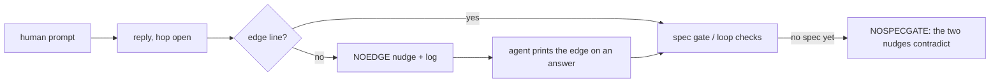
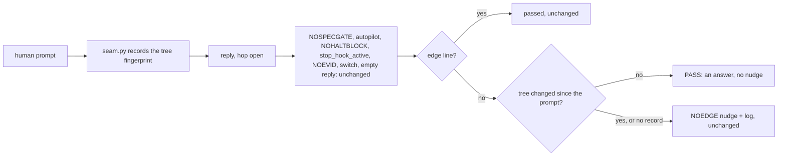

# Stage 05b — t105-question-not-a-hop — SPEC

## Problem and scope

`AGENTS.md` says that a question, an explanation, a status check or a refusal is not a hop, and that it ends with no
edge line. The Stop hook (`.claude/hooks/stop_guard.py`) does not apply this rule. While `CURRENT_HOP` is `GENERATE`
or `EXECUTE`, each reply with no edge line gets the `NOEDGE` nudge (`Hop not closed (I1)`) and a `NOEDGE` log line.

Seen on 2026-11-12, GENERATE 05b t103-log-source (`.cascade/decisions.log` lines 3513 and 3514). The human asked a
question. The agent answered and wrote no file. The hook demanded the edge line. The agent printed it, and the next
stop refused that line with `NOSPECGATE`, because no spec, critique or oracle existed. Thus:

- the two nudges contradict each other;
- the first nudge makes the agent ask for a review of work that does not exist;
- each such `NOEDGE` line is a false event for the pattern report (t104) and for lesson L1 (t106, t107).

The hook must tell an answer from an unfinished hop by evidence that a script can check, not by the words of the
reply. The evidence is the tree: if no tool call in this prompt changed it, the reply did no hop work.

1. The prompt hook (`.claude/hooks/seam.py`) records a fingerprint of the tree when a human prompt arrives, in
   `<git dir>/cascade-tree-<session>`. It adds no byte to the prompt context.
2. At the stop, if the hop is open, the reply has no edge line, and the tree has the recorded fingerprint, the Stop
   hook sends no nudge, writes no `NOEDGE` line, and logs `stop_guard PASS`.
3. All other verdicts stay as they are (I18). A reply that changed the tree in this prompt still needs its edge line.
   `NOSPECGATE`, `NOEVID`, `NOHALTBLOCK`, the switch check and autopilot run before the new rule and do not change.
4. With no record for this session, or when git fails, the hook judges as before t105.

4a. The accepted test `tests/ac/t63_quiet_stop_guard.sh` AC4 changes in one probe only: after its `seam.py` prompt,
    the fixture writes a file before the stop, so that stop is hop work and the probe still proves that a human
    prompt resets the nudge count (human decision 2026-11-16, recorded under the brief; critique C8).

Out of scope: the prompt hook's route classifier; any change to when an edge is legal; the reply text as evidence;
files git ignores outside `.cascade/` (build output, caches: walking them has no bound, and they are not what the
human reviews at an edge); writes inside a nested git repository below the root (git lists it as one directory, so
only its own entries count).

## Approaches considered

| Approach | Decision | Reason |
|---|---|---|
| A. Read the reply: a reply that ends in `?` or that the route classifier calls a question is an answer | rejected | The brief forbids it. Words are easy to fake and easy to get wrong; AC6 is this approach as the red twin. |
| B. Count write tool calls in the transcript (`Edit`, `Write`, `Bash`) | rejected | The transcript format changes between hosts (`stop_guard.py` says so); a `Bash` call may or may not write; Codex has a different transcript. |
| C. Fingerprint the tree at the prompt, compare at the stop | **chosen** | It is the effect, not the intent. Works on every host that runs both hooks. Uses only git. |
| D. Compare with `HEAD` only (a clean tree is an answer) | rejected | A dirty tree from an earlier prompt would make every later answer an unfinished hop, and a write on a dirty tree that leaves it dirty is missed only by chance. |

## Before vs after

Before:

After (every check before the edge test is unchanged and runs first, as in `stop_guard.py` today):

| Case (hop open, no edge line) | Before | After |
|---|---|---|
| The reply wrote nothing in this prompt | nudge + `NOEDGE` | no nudge, `PASS` |
| The reply changed a tracked file, made a new file, staged, or committed | nudge + `NOEDGE` | nudge + `NOEDGE` |
| The reply ran the loop (`.cascade/loop-receipt`) or another test that writes under `.cascade/` | nudge + `NOEDGE` | nudge + `NOEDGE` |
| The reply wrote only the hooks' own files (`.cascade/decisions.log`, `.cascade/builders`, `.cascade/manifest`) | nudge + `NOEDGE` | no nudge, `PASS` |
| No record for this session (a host that runs only the Stop hook, an old hook) | nudge + `NOEDGE` | nudge + `NOEDGE` |
| Edge line with a red spec gate / accept with no loop / halt with no `WHAT TO DO` | sent back | sent back |

## Benefits and trade-offs

| Item | Effect | Kind |
|---|---|---|
| No contradiction | An answer during an open hop gets no request for a review of work that does not exist (the 2026-11-12 case in the brief) | benefit |
| True `NOEDGE` counts | A `NOEDGE` line means a reply did hop work and stopped without its edge, so t104 patterns and lesson L1 count real events (critique C2: L1's `since:` needs a new date, a human row) | benefit |
| Cost | Four git calls and one `stat` per new file and per `.cascade/` file, per prompt and per stop; no file is read. About 40 ms on this repo. One fingerprint has a 3 s budget in total; over it there is no fingerprint and the Stop hook judges as before, so a slow repo loses the new rule, not the prompt context | trade-off |
| Prompt context | Unchanged: AC7 compares it byte for byte, so law D1 does not move | benefit |
| Earlier work | A reply that only talks, after hop work in an earlier prompt, passes. Correct: the edge is owed by the reply that did the work, and that reply was nudged at its own stop | trade-off |
| Writes by others | A change made outside the agent (the human edits a file) during the prompt counts as a write, which gives the old verdict, never a weaker one | trade-off |
| Not counted | Files git ignores outside `.cascade/`, and writes inside a nested repository (Out of scope) | trade-off |

## Decision contract

### The record (`.claude/hooks/_common.py`)

5. `tree_path(root, session)` is `<git dir>/cascade-tree-<session>`. The session id has the same filter as
   `nudges_path` (letters, digits, `-`, `_`; at most 120 characters).
6. `tree_fingerprint(root)` is the sha256 of, in this order:
   - `git rev-parse -q --verify HEAD` (empty on an unborn branch);
   - `git diff --cached --binary --no-ext-diff --no-color`;
   - `git diff --binary --no-ext-diff --no-color`;
   - for each path of `git ls-files -z -o --exclude-standard` that is not under `.cascade/`, sorted: the path, its
     size and its modification time in nanoseconds;
   - for each file under `.cascade/`, sorted, except the files the hooks write themselves (`HOOK_OWNED`:
     `.cascade/decisions.log`, `.cascade/builders`, `.cascade/manifest`): the path, its size and its modification
     time. A loop receipt is hop work (critique C1).

   It returns `None` when a git command fails or when the whole fingerprint takes more than `TREE_BUDGET` (3 s).
   The index part is defence in depth: in each case tried, an index change also changed the worktree diff or the
   untracked list (`git add` of a new file removes it from that list), so the mutation check cannot isolate it.
7. `record_tree(root, session)` writes the fingerprint and a newline. With no fingerprint or no session it removes the
   record. It never raises.
8. `wrote_this_prompt(root, session)` is `True` when the tree changed since the record, `False` when it did not, and
   `None` when there is no record, no session or no fingerprint.

### The prompt hook

9. `seam.py` calls `record_tree(root, session_id)` once per human prompt: after the duplicate-event check, before any
   branch that returns. It runs on idle prompts too, so a hop that opens later has a record. It prints nothing.

### The Stop hook

10. The new rule sits right before the `NOEDGE` verdict, after every other check: `if wrote_this_prompt(root,
    session) is False`, log `PASS` with the text `<HOP> <stage> reply wrote nothing this prompt — an answer, no edge
    line needed`, and return as a passed stop (the nudge count clears).
11. `PASS` is not an event for `tests/patterns.sh` (its `NOT_EVENTS`), so the new log line adds no pattern.
12. No other branch changes. A `True` or `None` result gives the `NOEDGE` verdict as before.

### Docs and release

13. `USAGE.md` gets `### B26. A question is not a hop (t105)`: the rule, the record path `cascade-tree-<session>`, and
    the fallback.
14. Release 3.5.9: `VERSION`, `.claude-plugin/plugin.json`, `.codex-plugin/plugin.json`,
    `.claude-plugin/marketplace.json`, a `## 3.5.9` entry in `CHANGELOG.md`, and `README.md`.

## Acceptance criteria

The frozen oracle is `tests/ac/t105_question_not_a_hop.sh` (pinned in `docs/cascade/05b-t105-question-not-a-hop.oracle`).
Each AC runs the real hooks on a copy of this tree with its own git repository.

| AC | Checks | Items |
|---|---|---|
| AC1 | Open GENERATE hop, a reply that wrote nothing: no nudge, no `NOEDGE`, a `PASS` line | 2, 10 |
| AC2 | Open EXECUTE hop: the same | 2, 10 |
| AC3 | A write in this prompt (tracked, new, `docs/cascade/` tracked and new, an edit to an untracked file, staged, a loop receipt, commit; both hops) still gets the nudge and `NOEDGE`; a write only to the hooks' own `.cascade/` files, or one from an earlier prompt in the same session, does not | 3, 6, 9 |
| AC4 | No record for this session (none, or another session's) gives the old verdict | 4, 5, 8 |
| AC5 | On replies that wrote nothing: red spec gate, accept with no loop, halt with no `WHAT TO DO` are still sent back | 3, 12 |
| AC6 | Red twin: a hook that reads the reply text (`?` at the end) lets a hop that wrote a file pass; the real hook does not | 2, 3 |
| AC7 | The record is in the git dir, the tree is unchanged, the prompt context is byte-identical to the same hook with the record call removed, each hook takes under 5 s | 1, 5, 9 |
| AC8 | t107, t106 and t63 tests pass (t63 with the probe of item 4a); `USAGE.md` B26; release 3.5.9 or later | 4a, 13, 14 |
