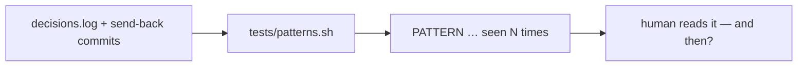
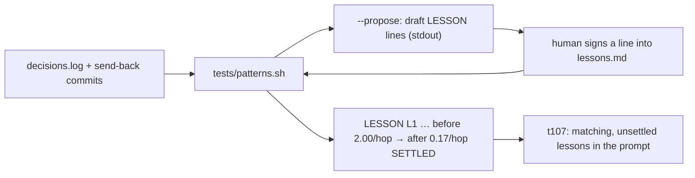

# Stage 05b — t106-lessons — SPEC

## Problem and scope

t104 (`tests/patterns.sh`) shows which problems recur across sessions. Nothing turns a pattern into a change, and
nothing measures whether a change worked. So an agent cannot get better over time in a way that a human or a script
can check. The human asked for focus and learning over time "not just nonsense token overhead".

This slice adds the signed, measured half of that loop. t107 adds the other half (it shows matching lessons to the
agent in the prompt, under a byte budget).

1. `docs/cascade/lessons.md` holds lessons. A lesson is one line inside `<EDIT>`, so the pre-commit `<EDIT>` scan
   (`.githooks/pre-commit:246-253`) makes each lesson a human signature. No hook changes.
2. A lesson points at a t104 group (actor, verdict, reason prefix), has a scope (a hop class), a `since:` day and one
   imperative sentence.
3. `bash tests/patterns.sh --propose` prints a draft lesson for each printed group that no lesson covers. It prints
   only; the human signs a lesson in through the permission dialog.
4. `bash tests/patterns.sh` prints, for each lesson, the group's rate per hop before and after the lesson, and a mark:
   `SETTLED`, `WORKING`, `NOT WORKING` or `NEW`.

Out of scope: lessons in the prompt (t107); an LLM; any automatic edit of `lessons.md`; shipping `lessons.md` with
`install.sh` (a repository makes its own; `tests/patterns.sh` works without it); a gate that reads lessons.

## Approaches considered

| Approach | Decision | Reason |
|---|---|---|
| Lessons as D# laws | Rejected | A law needs a validator and a red twin, and it admits no exception. "End a reply that wrote files with the edge line" is advice to an agent, not a property of the product that a command can check. |
| Lessons in `CLAUDE.md` or agent memory | Rejected | Not versioned with the evidence, loaded in full on every prompt (the token overhead the human named), and no script can tell whether a lesson worked. |
| A lesson file the agent writes freely | Rejected | Memory that the agent writes to itself without review drifts. The talk's rule: human approval for memory changes. |
| One line per lesson inside `<EDIT>`, keyed to a t104 group, measured per hop | **Chosen** | The signature costs no new code; the key ties the lesson to evidence; the before/after rate shows whether it worked; a settled lesson can leave the prompt (t107), so memory cost falls as the agent improves. |

## Before vs after

Before:



After:



## Benefits and trade-offs

| Item | Benefit | Cost or limit |
|---|---|---|
| Signed lessons | Each lesson is a human decision in git, with a date. | A human must sign each one. That is the point; it is also a step. |
| Before/after rate | Shows whether a lesson changed behavior, per hop, with no LLM. | Correlation, not proof: a lesson can look like it worked because the work changed. The evidence lines (t104) let a human check. |
| `SETTLED` | A lesson that did its work can leave the prompt (t107), so the per-prompt cost falls over time. | Five quiet hops is a heuristic. A settled lesson stays in the file and still gets measured; if events return, it stops being `SETTLED`. |
| `NOT WORKING` | A lesson that does not help is visible, so the human can rewrite or drop it. | Needs 3 hops after the lesson before it judges. |
| No new shipped file | `install.sh` and the T69 allowlist do not change. | A new repository has no `lessons.md` until the human signs a first lesson. |
| Little data today | — | This repository has 6 `src=agent` lines (t104). The first lessons will come from send-back commits and new log lines. |

## Decision contract

### The lesson line

1. `docs/cascade/lessons.md` is read only when it exists. Only lines that start at column 0 with `LESSON ` and lie
   between a line `<EDIT>` and a line `</EDIT>` are lesson lines. Any other line is ignored.
2. A valid lesson line has exactly this form:

   ```
   LESSON L<n>: <actor> <verdict> "<reason prefix>" | scope: <scope> | since: <YYYY-MM-DD> | do: <sentence>
   ```

   - `<n>` is 1 or more digits. `<actor>` and `<verdict>` have no spaces.
   - `<reason prefix>` is 1–120 characters with no `"`. It is compared with the start of a t104 normalized reason.
   - `<scope>` is one of `ANY`, `GENERATE`, `EXECUTE-BUILD`, `EXECUTE-DESIGN`, `EXECUTE-AUDIT`, `EXECUTE-PRR` (the
     hop classes of `.claude/hooks/seam.py hop_class`).
   - `<YYYY-MM-DD>` is a real calendar day.
   - `<sentence>` is 1–160 characters and does not start with `TODO`.
3. A lesson line that does not have this form, or that repeats an id already seen above it, is malformed. Each
   malformed line prints `LESSON ?  malformed: docs/cascade/lessons.md:<line> — <why>` and is not used for anything
   else (no rate, no cover for `--propose`).

### Cover

4. A valid lesson covers a t104 group when the actor and the verdict are equal and the group's normalized reason
   starts with the reason prefix.

### Rates and marks

5. Hops are t104's hops (commits that changed `docs/cascade/hop-state.md`, by author time). A lesson takes effect at
   the first hop whose start is on or after its `since:` day, 00:00 UTC. The before hops are the hops that start
   earlier; the after hops are the others.
6. A lesson's events are the events (t104 items 4, 5, 5a, with no `--since` filter) of every group it covers. An event
   is before or after by the hop it belongs to; an event in hop `-` is before.
7. The rate is events divided by hops, printed with two decimals as `(<x.xx>/hop)`, or `(-)` when there are 0 hops on
   that side.
8. The mark is the first that applies:
   - `SETTLED` — at least 5 after hops, and no event in the latest 5 after hops;
   - `NOT WORKING` — at least 3 after hops, and the after rate is not lower than the before rate;
   - `WORKING` — at least 3 after hops;
   - `NEW` — otherwise.

### Output of `tests/patterns.sh`

9. When `lessons.md` has at least one lesson line, the report prints, after the groups and before the last line:
   the malformed lines (item 3), then one line per valid lesson in id order:

   ```
   LESSON L<n>  <actor> <verdict>  before: <b> in <hb> hop(s) <rate>  after: <a> in <ha> hop(s) <rate>  <MARK>
   ```

   and then `LESSONS: <v> signed, <m> malformed`. With no lesson line, it prints none of these, and the output is the
   t104 output.
10. The last line is the t104 `PATTERNS:` line, unchanged.

### `--propose`

11. `--propose` adds, after the groups and before the lesson block, one line for each printed group (count at or
    above `--min`) that no valid lesson covers, in the order of the groups:

    ```
    PROPOSE  LESSON L<n>: <actor> <verdict> "<prefix>" | scope: ANY | since: <today UTC> | do: TODO — one imperative sentence
    ```

    `<prefix>` is the normalized reason, cut before its first `"` and to 60 characters, with trailing spaces removed.
    `<n>` counts up from 1 + the highest id on any lesson line, valid or malformed (1 when there is none). Then it
    prints `PROPOSALS: <k>`. The draft line, with the `do:` text replaced, is a valid lesson line.
12. `--propose` writes nothing, as all of `tests/patterns.sh` (t104 item 2).

### Docs and release

13. `USAGE.md` gets `### B24. Lessons: sign one, then see whether it worked (t106)`. `CHANGELOG.md` gets `## 3.5.7`.
    `VERSION`, `.claude-plugin/plugin.json`, `.claude-plugin/marketplace.json`, `.codex-plugin/plugin.json` and
    `README.md` show 3.5.7.

## Acceptance criteria

The oracle is `tests/ac/t106_lessons.sh`. It builds a scratch git repository with nine hop-state commits (author times
2026-01-01 … 2026-01-09, 00:00 UTC), a fixture log, and a `lessons.md`.

| AC | Check |
|---|---|
| AC1 | The format: four valid lessons are used; five malformed lines (bad scope, `do:` still `TODO`, a repeated id, a day that does not exist, a 161-character sentence) each print `LESSON ?  malformed:` with a line number that points at that line; a valid-looking line outside `<EDIT>` is ignored; the count line is `LESSONS: 4 signed, 5 malformed`; the last line is still `PATTERNS:`. |
| AC2 | `--propose` prints a draft for each printed group that no valid lesson covers (two groups), with ids L11 and L12 (after the highest id, L10, of a malformed line), and none for a covered group or a group below `--min`; `PROPOSALS: 2`. A draft with its `do:` text replaced, added inside `<EDIT>`, becomes a valid lesson marked `NEW`. |
| AC3 | Rates and marks on the fixture: `SETTLED` (2.00/hop before, 0.17/hop after, latest 5 after hops quiet), `NOT WORKING` (0.20 → 0.50), `NEW` (2 after hops), `WORKING` (1.00 → 0.20, an event in the latest 5). |
| AC4 | A malformed lesson is not used: it gets no rate line, and the group it would cover is still proposed. |
| AC5 | With no `lessons.md`, the output has no `LESSON`, `LESSONS:` or `PROPOSE` line, except that `--propose` still prints its drafts and `PROPOSALS:`. `--propose` writes nothing (files, `.git`, `HOME`, `TMPDIR`). |
| AC6 | The signature: in a scratch copy of this repository with `core.hooksPath=.githooks`, a commit that changes a lesson line inside `<EDIT>` with no signature is refused, and the refusal names `<EDIT>`. |
| AC7 | `tests/ac/t104_pattern_report.sh` still passes (the t104 output is unchanged when there is no lesson). |
| AC8 | `USAGE.md` has `### B24.` and names `lessons.md` and `--propose`; `VERSION` is 3.5.7, the three manifests show it, `CHANGELOG.md` has `## 3.5.7`, and `README.md` shows 3.5.7. |
