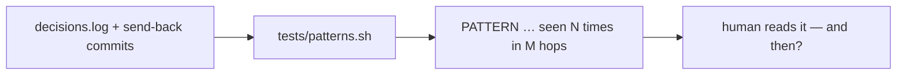
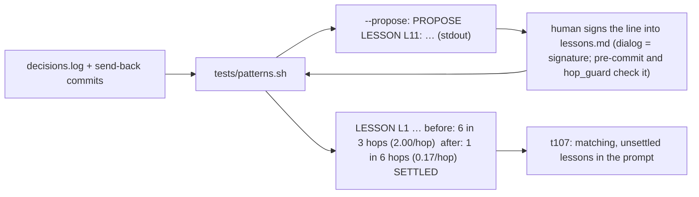

# Stage 05b — t106-lessons — SPEC

## Problem and scope

t104 (`tests/patterns.sh`) shows which problems recur across sessions. Nothing turns a pattern into a change, and
nothing measures whether a change worked. So an agent cannot get better over time in a way that a human or a script
can check. The human asked for focus and learning over time "not just nonsense token overhead".

This slice adds the signed, measured half of that loop. t107 adds the other half: it shows matching lessons to the
agent in the prompt, under a byte budget.

1. `docs/cascade/lessons.md` holds lessons, one line each. Each `LESSON` line is human-owned: pre-commit and
   `hop_guard` need the human's signature to add, change or remove one, a new file included, as for a law shard.
2. A lesson points at a t104 group (actor, verdict, reason prefix), has a scope (a hop class), a `since:` day and one
   imperative sentence.
3. `bash tests/patterns.sh --propose` prints a draft lesson for each printed group that no lesson covers. It prints
   only; the human signs a lesson in through the permission dialog.
4. `bash tests/patterns.sh` prints, for each lesson, the group's rate per hop (in the lesson's scope) before and after
   the lesson, and a mark: `NO MATCH`, `SETTLED`, `WORKING`, `NOT WORKING` or `NEW`.
5. A hop is a real hop edge: a `hop-state.md` commit that opens GENERATE or EXECUTE on a new (hop, stage, slice). This
   also changes t104's `in M hops` count, which today counts every commit that touched `hop-state.md`.

Out of scope: lessons in the prompt (t107); an LLM; any automatic edit of `lessons.md`; shipping `lessons.md` with
`install.sh` (a repository makes its own; `tests/patterns.sh` works without it); a gate that reads lessons; regrouping
send-back commits by kind.

## Approaches considered

| Approach | Decision | Reason |
|---|---|---|
| Lessons as D# laws | Rejected | A law needs a validator and a red twin, and it admits no exception. "End a reply that wrote files with the edge line" is advice to an agent, not a property of the product that a command can check. |
| Lessons in `CLAUDE.md` or agent memory | Rejected | Not versioned with the evidence, loaded in full on every prompt (the token overhead the human named), and no script can tell whether a lesson worked. |
| A lesson file the agent writes freely | Rejected | Memory that the agent writes to itself without review drifts. The talk's rule: human approval for memory changes. |
| Lesson lines inside `<EDIT>` | Rejected (critique C1) | `tests/lib/edit_tags.py:4-5` lets an agent add a new `<EDIT>` block, so a new lesson would need no signature. |
| `LESSON` lines as human-owned lines in a guarded file, keyed to a t104 group, measured per real hop in scope | **Chosen** | The guard is the one used for law shards (`tests/lib/laws.py` `PROTECTED`, pre-commit, `hop_guard`); the key ties the lesson to evidence; the rate shows whether it worked; a settled lesson can leave the prompt (t107), so memory cost falls as the agent improves. |

## Before vs after

Before:



After:



## Benefits and trade-offs

| Item | Benefit | Cost or limit |
|---|---|---|
| Signed lessons | Each lesson is a human decision in git, with a date; an agent cannot add one alone. | A human must sign each one. |
| Before/after rate per real hop in scope | Shows whether a lesson changed behavior, with no LLM, on the hops it is about. | Correlation, not proof: the work can change too. The evidence lines (t104) let a human check. |
| `SETTLED` | A lesson that did its work can leave the prompt (t107), so the per-prompt cost falls over time. | Five quiet hops is a heuristic. The lesson stays in the file and is still measured; if events return, it is no longer `SETTLED`. |
| `NO MATCH` | A lesson whose prefix covers no event in its scope (a typo, a wrong scope) is visible. | If a later release rewords a hook message, a lesson can show `SETTLED` although its group only changed text (critique C4). A release that rewords a hook message must say so in CHANGELOG; the human then re-keys the lesson. |
| `NOT WORKING` / `WORKING` | Needs a baseline: at least one before hop and three after hops. | With no before hop the mark stays `NEW` or `SETTLED`. |
| No new shipped file | `install.sh` and the T69 allowlist do not change. | A new repository has no `lessons.md` until the human signs a first lesson. |
| Little data today | — | This repository has 6 `src=agent` log lines (t104), and each send-back commit is its own group of one (critique C2). `--propose --min 1` or `--min 2` drafts from what exists; the default `--min 3` drafts as tagged lines arrive. |

## Decision contract

### The lesson line and its signature

1. `docs/cascade/lessons.md` is read only when it exists. A lesson line is a line that starts at column 0 with
   `LESSON `. Any other line is ignored.
2. A valid lesson line has exactly this form:

   ```
   LESSON L<n>: <actor> <verdict> "<reason prefix>" | scope: <scope> | since: <YYYY-MM-DD> | do: <sentence>
   ```

   - `<n>` is 1 or more digits. `<actor>` and `<verdict>` have no spaces.
   - `<reason prefix>` is 1–120 characters with no `"`.
   - `<scope>` is one of `ANY`, `GENERATE`, `EXECUTE-BUILD`, `EXECUTE-DESIGN`, `EXECUTE-AUDIT`, `EXECUTE-PRR` (the
     hop classes of `.claude/hooks/seam.py` `hop_class`).
   - `<YYYY-MM-DD>` is a real calendar day.
   - `<sentence>` is 1–160 characters and does not start with `TODO`.
3. A lesson line that does not have this form, or that repeats an id already seen above it, is malformed. Each
   malformed line prints `LESSON ?  malformed: docs/cascade/lessons.md:<line> — <why>`. `<why>` names the fault:
   the word `scope` for a bad scope, `since` for a bad day, `TODO` for a draft sentence, `160` for a long sentence,
   the id (`L<n>`) for a repeated id, and the expected form otherwise. A malformed line is not used for anything else.
4. `LESSON` lines are human-owned. `tests/lib/laws.py` `PROTECTED` (the one definition of a human-owned line) matches
   them. `.githooks/pre-commit` and `.claude/hooks/hop_guard.py` guard `docs/cascade/lessons.md` as they guard a law
   shard: a commit or an agent write that adds, changes or removes a `LESSON` line — a new or removed file included —
   needs the human's signature (the dialog, `bash tests/sign.sh`, or `CASCADE_HUMAN=1`). A change to other lines does
   not.

### Cover

5. A valid lesson covers a t104 group when the actor and the verdict are equal and the group's normalized reason, with
   each `"` replaced by `'`, starts with the reason prefix.

### Hops

6. A hop starts at a commit that changed `docs/cascade/hop-state.md` when, in that commit's version, `CURRENT_HOP` is
   `GENERATE` or `EXECUTE` and (`CURRENT_HOP`, `CURRENT_STAGE`, `CURRENT_SLICE`) differs from the version before it.
   A hop ends at the next such start, or at a commit whose version has any other `CURRENT_HOP` (`NONE`). Commits are
   taken in author-time order. An event in no hop (before the first, or while none runs) is in hop `-`. A hop's class
   is `.claude/hooks/seam.py` `hop_class` of its hop and stage. t104's `in M hops` uses these hops.

### Rates and marks

7. A lesson's hops are the hops of its scope's class (all hops for `ANY`). A lesson takes effect at the first of its
   hops that starts on or after its `since:` day, 00:00 UTC: the before hops start earlier, the after hops are the
   others.
8. A lesson's events are the events (t104 items 4, 5, 5a, with no `--since` filter) of every group it covers that lie
   in one of its hops. An event in hop `-` or in a hop of another class does not count.
9. The rate is events divided by hops, printed with two decimals as `(<x.xx>/hop)`, or `(-)` when there are 0 hops on
   that side. One hop prints `hop`; any other number prints `hops`.
10. The mark is the first that applies:
    - `NO MATCH` — no event before and no event after;
    - `SETTLED` — at least 5 after hops, and no event in the latest 5 after hops;
    - `NOT WORKING` — at least 1 before hop, at least 3 after hops, and the after rate is not lower than the before
      rate;
    - `WORKING` — at least 1 before hop and at least 3 after hops;
    - `NEW` — otherwise.

### Output of `tests/patterns.sh`

11. When `lessons.md` has at least one lesson line, the report prints, after the groups (and after the drafts of
    `--propose`) and before the last line: the malformed lines (item 3), then one line per valid lesson in id order:

    ```
    LESSON L<n>  <actor> <verdict>  before: <b> in <hb> hop(s) <rate>  after: <a> in <ha> hop(s) <rate>  <MARK>
    ```

    and then `LESSONS: <v> signed, <m> malformed`. With no lesson line, it prints none of these.
12. The last line is the t104 `PATTERNS:` line, unchanged.

### `--propose`

13. `--propose` prints, after the groups, one line for each printed group (count at or above `--min`) that no valid
    lesson covers, in the order of the groups:

    ```
    PROPOSE  LESSON L<n>: <actor> <verdict> "<prefix>" | scope: ANY | since: <today UTC> | do: TODO — one imperative sentence
    ```

    `<prefix>` is the normalized reason with each `"` replaced by `'`, cut to 60 characters, trailing spaces removed.
    `<n>` counts up from 1 + the highest id on any lesson line, valid or malformed (from 1 when there is none). Then it
    prints `PROPOSALS: <k>`. The draft line, with its `do:` text replaced, is a valid lesson line.
14. `--propose` writes nothing, as all of `tests/patterns.sh` (t104 item 2).

### Docs and release

15. `USAGE.md` gets `### B24. Lessons: sign one, then see whether it worked (t106)`, and §B23 says how a hop is counted
    now. `CHANGELOG.md` gets `## 3.5.7`. `VERSION`, `.claude-plugin/plugin.json`, `.claude-plugin/marketplace.json`,
    `.codex-plugin/plugin.json` and `README.md` show 3.5.7.

## Acceptance criteria

The oracle is `tests/ac/t106_lessons.sh`. Its fixture has nine GENERATE hops (author times 2026-01-01 … 2026-01-09),
a `hop-state.md` commit on 2026-01-04 12:00 that keeps the triple (not a hop), a `NONE` close on 2026-01-10, an event
after that close, and a `"` in one reason.

| AC | Check |
|---|---|
| AC1 | The format: six valid lessons are used, one with a 160-character sentence and scope `EXECUTE-AUDIT`; each of five malformed lines (bad scope, `TODO`, repeated `L1`, a day that does not exist, 161 characters) prints `LESSON ?  malformed:` at its line, with the fault word; an indented line is ignored; `LESSONS: 6 signed, 5 malformed`; the last line is still `PATTERNS:`. |
| AC2 | `--propose` drafts the two uncovered printed groups as L11 and L12 (after the highest id, L10, of a malformed line); the `"` in a reason becomes `'`; no draft for a covered group or a group below `--min`; `PROPOSALS: 2`. The L12 draft with its `do:` text replaced, added to the file, is a valid lesson marked `NEW`. |
| AC3 | Rates and marks: `SETTLED` (2.00 → 0.17/hop), `NOT WORKING` (0.20 → 0.50), `NEW` (2 after hops), `WORKING` (1.00 → 0.20), `NO MATCH` (scope `EXECUTE-AUDIT`, no such hop), `NEW` with no before hop. The same-triple commit is not a hop, the `NONE` close ends one, and the event after it does not count; the t104 head is `seen 8 times in 5 hops`. |
| AC4 | A malformed lesson is not used: it gets no rate line, and the group it would cover is still proposed. |
| AC5 | With no `lessons.md`, the output has no `LESSON`, `LESSONS:` or `PROPOSE` line; `--propose` drafts from L1 and prints `PROPOSALS: 5`. `--propose` writes nothing (files, `.git`, `HOME`, `TMPDIR`). |
| AC6 | Pre-commit, on a scratch copy of this repository: a `lessons.md` with no `LESSON` line commits; adding a `LESSON` line in a new file, changing one, adding one, and removing the file are each refused unsigned, and the refusal names `lessons.md`; a change to another line commits; `CASCADE_HUMAN=1` commits. |
| AC7 | `hop_guard` on the scratch copy: a Write that adds a `LESSON` line and an Edit that changes one get `ask` (the human's dialog); with `bypassPermissions` the Write gets `deny`; an Edit of another line gets no answer (allowed). |
| AC8 | `tests/ac/t104_pattern_report.sh` still passes; `USAGE.md` has `### B24.` and names `lessons.md` and `--propose`; `VERSION` is 3.5.7, the three manifests show it, `CHANGELOG.md` has `## 3.5.7`, and `README.md` shows 3.5.7. |

Checked at GENERATE with a throwaway prototype outside the tree. On unfixed code AC1–AC8 fail. With the prototype,
AC1–AC5 pass, t104's frozen oracle passes 7/7 under the new hop rule, and with the four-line hook change on a scratch
pack AC6 and AC7 pass. Wrong versions each fail the AC aimed at them: next id ignoring malformed lines (AC2, AC4),
exact match instead of a prefix (AC2–AC4), a wrong `SETTLED` rule (AC3), every `hop-state.md` commit a hop (AC2, AC3),
scope ignored (AC3), `NONE` not ending a hop (AC3), a verdict with no baseline (AC3).
