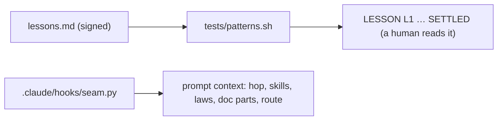
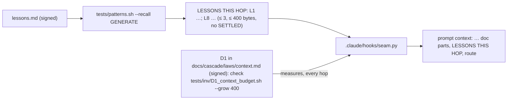

# Stage 05b — t107-lesson-recall — SPEC

## Problem and scope

t106 gives signed lessons (`docs/cascade/lessons.md`) and measures each one per hop. The agent does not see them. A
lesson that the agent does not read cannot change what the agent does. The human asked for focus and learning over
time "not just nonsense token overhead". Thus the agent must see only the lessons that apply to the current hop, and
the cost of each prompt must have a limit that only the human can change.

1. `bash tests/patterns.sh --recall <hop class>` prints one line or nothing. The line holds the signed lessons whose
   scope is that class or `ANY`, and that are not `SETTLED` and not `NO MATCH`. The lessons that are active now come
   first. There are at most 3 lessons, and at most 400 bytes with the newline.
2. The prompt hook (`.claude/hooks/seam.py`) adds that line to the context of each prompt while a hop runs. It adds
   nothing when no hop runs. If the recall fails, is slow or prints a wrong line, the hook adds nothing and changes
   nothing else.
3. The first law of this repository, **D1**, in a new shard `docs/cascade/laws/context.md`: the prompt hook must not
   add more than 400 bytes per prompt over release 3.5.6. Its check, `tests/inv/D1_context_budget.sh`, measures the
   prompt hook's context for each hop class and four kinds of prompt. The law, its check and break lines, and the
   test file are human-owned (AGENTS.md rule 5). Human decision of 2026-11-14 (critique C1).

A lesson leaves the prompt when it is `SETTLED` (t106: five quiet hops). Thus the memory cost falls when the agent
improves.

Out of scope: lesson text in the recall index (`tests/handover.sh`, the SessionStart hook); embeddings or semantic
matching; an LLM; lessons on idle prompts; any change to `docs/cascade/lessons.md` or to the t106 marks; laws for
product repositories (the shard is not shipped).

## Approaches considered

| Approach | Decision | Reason |
|---|---|---|
| All signed lessons on every prompt | Rejected | The cost grows with each lesson and never falls. Lessons for another hop class are noise. This is the "token overhead" the human named. |
| Lessons in `CLAUDE.md` or agent memory | Rejected | Loaded in full on each session, not measured, and an agent can write them without review (t106 rejected this too). |
| Semantic match of the prompt text to lessons | Rejected | Needs embeddings or an LLM in a prompt hook: slow, not deterministic, and not testable by a script. The hop class is known, exact and cheap. |
| Budget as a `--grow` number on a `REGRESS:` line | Rejected (critique C1) | Only the number is human-owned. The script that measures stays agent-editable, so a later slice can make it weaker without a signature. |
| Budget line in `envelope.md` | Rejected | `install.sh` copies the envelope into new repositories; a pack-internal limit does not belong there. |
| Select by hop class in `tests/patterns.sh` (the one place that computes marks), print from the prompt hook, cap by count and bytes; the budget as law D1 in a pack-only shard with its test under `tests/inv/` | **Chosen** | One code path for marks (t106). The hook stays thin and fails open. The caps are exact. A law, its lines and its `tests/inv/` file are human-owned, and every hop's loop, CI and the merge gate run it. Any growth of the prompt context, from any slice, needs a signed change to D1. |

## Before vs after

Before:



After:



## Benefits and trade-offs

| Item | Benefit | Cost or limit |
|---|---|---|
| Scope filter | The agent reads only the lessons for this hop class. | A lesson with the wrong scope never shows. t106 marks it `NO MATCH` when no event is in its scope. |
| Active-now ranking | A problem in the latest hops comes before an old one with a long history (critique C9). | A lesson with many old events and no recent ones can wait behind newer ones. |
| No `SETTLED` lesson | The prompt gets shorter when lessons do their work. | Hiding the lesson can let the problem come back (critique C2). Then the latest 5 hops are no longer quiet, the lesson is not `SETTLED`, and it shows again on the next prompt. The cost is at most one problem per return. |
| t106 rates after t107 | — | t106 splits before/after at the `since:` day. The "after" side measures "signed, and shown while not `SETTLED`", not "shown on every prompt" (critique C2). No lesson exists yet, so no lesson has hops from before 3.5.8. |
| No `NO MATCH` lesson | A lesson with a wrong key does not use bytes. | A lesson for a problem with no event yet does not show. `--propose` drafts only from events, so this is rare. |
| 3 lessons, 400 bytes | A fixed maximum cost per prompt: about 100 tokens. | The fourth lesson waits until one settles. The human chooses which lessons to keep. |
| Fail open | A broken or slow `tests/patterns.sh` never blocks or changes a prompt. | A recall slower than 5 s shows no lessons on that prompt. Today it takes about 0.1 s. |
| D1 | Human-owned limit and measurer. Runs in each hop's loop (about 10 s), in CI, nightly and at the merge gate. | It needs the 3.5.6 commit, so a shallow clone fails it (exit 2). The nightly regress job gets full history (critique C7). |
| Net growth | — | D1 limits the total context. If a later slice makes another line shorter, the room it frees can be used without a signature. This is intentional: the limit is on the total cost. |
| Pack-only law | Product repositories get no law they did not sign. | `install.sh` must remove the pack's shard rows from a new envelope (item 17). |

## Decision contract

### `tests/patterns.sh --recall`

1. `--recall <class>` takes one of `GENERATE`, `EXECUTE-BUILD`, `EXECUTE-DESIGN`, `EXECUTE-AUDIT`, `EXECUTE-PRR` (the
   hop classes of `.claude/hooks/seam.py` `hop_class`). It can have `--root DIR`. Any other option with it (`--since`,
   `--min`, `--propose`), a missing class or another class (`ANY` and lower case included) exits 64 with the usage
   line.
2. It uses the t106 lessons, cover rule, hops, events and marks, unchanged (t106 items 1–10).
3. A lesson is a candidate when it is valid (t106 item 2), its scope is the class or `ANY`, and its mark is not
   `SETTLED` and not `NO MATCH`. A malformed or indented line is never a candidate.
4. Candidates are ranked by: (a) their events in the latest 5 hops of their scope, most first; (b) their events in all
   hops of their scope (before plus after, t106 item 8), most first; (c) lesson id, lowest first.
5. In rank order, each candidate is added as `L<n> <do sentence>` when the line, with it, and with one newline, is at
   most 400 bytes in UTF-8. A candidate that does not fit is skipped, and the next one is tried. It stops at 3
   lessons.
6. If at least one lesson is added, it prints exactly one line and exits 0:

   ```
   LESSONS THIS HOP: L<n> <do>; L<m> <do>; L<k> <do>
   ```

   If none is added (no `lessons.md`, no candidate, no event), it prints nothing and exits 0.
7. It writes nothing (t104 item 2).

### The prompt hook

8. While a hop runs (`hop_class` is not `None`), `.claude/hooks/seam.py` runs `bash tests/patterns.sh --recall
   <class>` in the repository, with a 5-second timeout.
9. It adds the first line of the output, on its own line, right after the `DOC PARTS THIS HOP:` line (or where that
   line would be), only when all of these are true: the exit code is 0, the line starts with `LESSONS THIS HOP: `,
   and the line with its newline is at most 400 bytes in UTF-8.
10. In all other cases (no script, an exception, a timeout, another exit code, other output, a line too long) it adds
    nothing. The rest of the context and the exit code (0) do not change.
11. When no hop runs, the hook does not run the recall and adds no lesson.

### Law D1 and its check

12. The human signs, in the dialog, a new shard `docs/cascade/laws/context.md` with:

    ```
    ### D1 — the prompt hook MUST NOT add more than 400 bytes per prompt over release 3.5.6
    check:  bash tests/inv/D1_context_budget.sh --grow 400
    break:  BUDGET_PAD=1024 bash tests/inv/D1_context_budget.sh --grow 400
    reason: ALLOWED_OVERFLOW — the prompt hook adds 1 KB to every context it prints
    path:   .claude/hooks/seam.py
    tier:   all
    ```

    and a row for it in the envelope's `## Law shards` index, inside a new `<EDIT>` block (`tests/lint.sh` checks the
    index).
13. `bash tests/inv/D1_context_budget.sh [--grow N] [--root DIR]`. `N` is a whole number of bytes, 400 when not given.
    `--root DIR` measures that directory (a copy of this pack) in place of this tree. `BUDGET_PAD=N` (a whole number)
    is the red twin: the measured tree's prompt hook is wrapped so that it adds N bytes to every context it prints. A
    bad argument or a bad `BUDGET_PAD` exits 64. If the 3.5.6 commit `c75e048fc5b22d3d5b4ad50825b3d2f1545c8777` is not
    in this clone, it says so and exits 2.
14. It makes two scratch repositories: 3.5.6 (`git archive`) and the current tree (tracked files and new files that
    git does not ignore, as on disk; or `DIR`). It gives each the same fixture: no law shard; a git history of four
    `GENERATE` hops; a `decisions.log` with `src=agent` events in them; a `lessons.md` whose lessons are all
    candidates in scope `ANY` and fill the line; and an empty `AUTOPILOT:` line.
15. For each class — `GENERATE`, `EXECUTE-BUILD` (05b), `EXECUTE-DESIGN` (03), `EXECUTE-AUDIT` (10), `EXECUTE-PRR`
    (11), `IDLE` (`NONE`) — and each prompt — `plain` ("continue"), `feature` ("add a feature: export the report as
    CSV"), `bug-fix` ("fix the bug where login fails with a 500 error"), `refactor` ("refactor the parser into two
    modules") — it runs each tree's prompt hook with a new `prompt_id`, and counts the bytes of `additionalContext` (0
    when there is no output). The four prompts give the four route outputs of `tests/lib/route.py` (critique C4). It
    prints one row per class and prompt:

    ```
    BUDGET <class>/<prompt>  3.5.6: <a> bytes  now: <b> bytes  grew: <+/-d>  limit: +<N>  PASS|FAIL
    ```

    then `BUDGET fixture: the lessons line is <n> bytes on GENERATE/plain` and `BUDGET <k>/24  (each prompt may grow
    at most +<N> bytes over 3.5.6)`. A row passes when `b − a ≤ N`. Exit 0 when all 24 pass, else 1.
16. It is under `tests/inv/`, so `install.sh` does not ship it (it needs this pack's history), and the T69 install
    paths do not change.
17. `install.sh`, when it creates `docs/cascade/envelope.md` in a new repository, removes from its `## Law shards`
    section each index row that names a shard the new repository does not have. An envelope that already exists is
    not changed.
18. `.github/workflows/nightly.yml`: the `regress` job checks out full history (`fetch-depth: 0`), as the `pack` job
    does (critique C7).

### Docs and release

19. `USAGE.md` gets `### B25. Lesson recall and the context budget (t107)`, naming `--recall` and
    `tests/inv/D1_context_budget.sh`. `CHANGELOG.md` gets `## 3.5.8`. `VERSION`, `.claude-plugin/plugin.json`,
    `.claude-plugin/marketplace.json`, `.codex-plugin/plugin.json` and `README.md` show 3.5.8.
20. Human decision of 2026-11-14 (asked in this session; recorded under the t107 brief in `docs/cascade/05b-briefs.md`,
    critique C6): t106's release check (`tests/ac/t106_lessons.sh` AC8) is relaxed from exactly 3.5.7 to 3.5.7 or
    later, with `## 3.5.7` in `CHANGELOG.md` and 3.5.7 in `README.md`, as was done for t104. t107's own oracle asks for
    3.5.8 or later, so a later release does not have to change it.

## Acceptance criteria

The oracle is `tests/ac/t107_lesson_recall.sh`. Its fixture has 8 hops: `GENERATE` on 2026-01-02, 04, 08, 10;
`EXECUTE` 05b on 01-03, 05, 09; `EXECUTE` 10 on 01-06; `NONE` closes on 01-07 and 01-11. It has an event on 01-07 (no
hop). Lessons, as (events in the latest 5 hops of the scope, all events): L1 `GENERATE` (3, 3), L2 `EXECUTE-BUILD`
(1, 1), L3 `ANY` (2, 4), L4 `EXECUTE-AUDIT` (2, 2), L5 `ANY` `SETTLED` (5 events, the most), L6 `ANY` `NO MATCH`, L7
malformed (`TODO`), L8 `GENERATE` (3, 3), L9 `GENERATE` (1, 1), and an indented L10.

| AC | Check |
|---|---|
| AC1 | For each of the 5 classes, `--recall` prints exactly the expected line, and no lesson of another scope. |
| AC2 | Order: on `GENERATE`, L1 and L8 (3 recent) before L3 (2 recent, 4 in all); L1 before L8 (equal, lower id). On `EXECUTE-AUDIT`, L3 before L4 (2 recent each; 4 against 2 in all). On `EXECUTE-BUILD`, L3 before L2. |
| AC3 | L9 (the fourth candidate) is not shown. With 150-character sentences, L3 does not fit and is skipped, and L9 fits after it. With L9's sentence as 34 × `é` (68 bytes) the line is exactly 400 bytes with its newline and shows; with 35 × `é` (70 bytes, 35 characters) L9 does not show: the cap counts bytes. |
| AC4 | The full report shows L5 `SETTLED`, L6 `NO MATCH` and L7 malformed; no class shows L5, L6, L7 or L10; each class shows at least one lesson (so AC4 cannot pass by silence, critique C10). |
| AC5 | Only L5–L7 in `lessons.md`, or no `lessons.md`: no output and exit 0. `--recall` changes no file. `--recall ANY`, `--recall` alone, a lower-case class, and `--recall` with `--propose`, `--min` or `--since` exit 64. |
| AC6 | On a copy of this tree with the fixture: on `GENERATE` the context has exactly one `LESSONS THIS HOP:` line, equal to the `--recall` line, right after the `DOC PARTS THIS HOP:` line; on `EXECUTE` 10 it is the `EXECUTE-AUDIT` line; idle has none. With `tests/patterns.sh` that exits 1, exits 3 after a valid line, sleeps 30 s, prints a 418-character line, prints other text, or is missing: the hook exits 0 in less than 15 s, shows no lesson line, and the rest of the context equals the `GENERATE` context. The hook's own cap: a stub line of 400 bytes with its newline shows; 401 bytes does not; a line of 211 characters and 401 bytes (`é`) does not (critique C10). |
| AC7 | `tests/lib/laws.py --in-force` has D1 from `docs/cascade/laws/context.md` with exactly the check and break of item 12, and `dsharp_strength.sh` scores it `GREEN`. The check on this tree: exit 0, 24 rows in the form of item 15, `BUDGET 24/24`, and a fixture lessons line of 300–399 bytes (the budget measures a full line, without a growth range that a later slice could break, critique C5). The red twin (`BUDGET_PAD=1024`): 24 `FAIL`, `BUDGET 0/24`, exit 1. `BUDGET_PAD=1024 --grow 2000`: exit 0. `--grow x`, `--grow` alone, a missing `--root` directory, an unknown option and `BUDGET_PAD=x` exit 64. `tests/lint.sh` prints no `SHARDS` line. A new install (`install.sh --no-plugin` into an empty repository) ships neither the shard nor the test, its envelope names no `laws/context.md`, and its lint prints no `SHARDS` line. The nightly `regress` job has `fetch-depth: 0`. |
| AC8 | `tests/ac/t104_pattern_report.sh` and `tests/ac/t106_lessons.sh` pass; `USAGE.md` has `### B25.` naming `--recall` and `context_budget.sh`; `VERSION` is 3.5.8 or later and the manifests show it; `CHANGELOG.md` has `## 3.5.8`; `README.md` shows 3.5.8. |

Checked at GENERATE with a throwaway prototype outside the tree. On the current tree AC1–AC8 fail (AC4 too: no class
shows a lesson). With the prototype (the recall mode, the hook change, D1's shard, index row
and check, the install change, the nightly change, the release and item 20), AC1–AC8 pass, D1 is `GREEN`, the t104 and
t106 oracles pass, and the budget is `BUDGET 24/24` at +369 bytes for each hop prompt and +0 for idle. The red twin
needs no text of `seam.py`: it wraps the hook (critique C5). Wrong versions each fail an AC aimed at them: `SETTLED`
shown, `NO MATCH` shown, order by id, a cap of 4, no scope filter (AC1–AC6); rank by all events first (AC1–AC3,
AC6); a cap in characters, stop at the first lesson that does not fit (AC3); a hook cap in characters, a hook cap of
401 bytes, the exit code not checked in the hook, no byte cap in the hook (AC6); no strip in `install.sh`, a shallow
nightly regress job, a `BUDGET_PAD` that does nothing (AC7).
