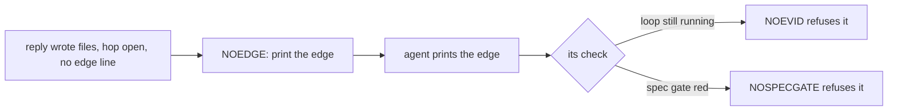
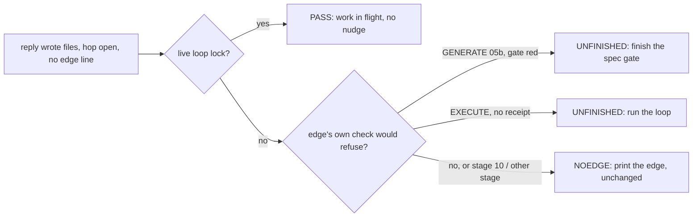

# Stage 05b — t108-work-in-flight — SPEC

## Problem and scope

The Stop hook's `NOEDGE` nudge can demand an edge that its own next check refuses. Seen 4 times on 2026-11-16, on
t105 GENERATE and EXECUTE and on t108's opening stop:

- a reply wrote files and started `bash tests/loop.sh` in the background (lesson L2). The hook said `Hop not closed
  (I1)`. Had the agent printed `STITCH NEEDED: accept execute`, `NOEVID` would refuse it: no receipt yet;
- a reply wrote a spec while the spec critic still ran. The hook demanded `STITCH NEEDED: review spec+plan`, which
  `NOSPECGATE` refuses while the gate is red.

The agent learns to ignore a nudge that is wrong, and each such stop is a false `NOEDGE` event for the pattern report
(t104) and for lesson L1 (since 2026-11-17).

1. **Work in flight.** While a live process holds `<git dir>/cascade-loop.lock`, a stop with no edge line gets no
   nudge, no `NOEDGE`, and a `stop_guard PASS` line (`work in flight`), which `tests/patterns.sh` does not count.
2. **Unfinished step.** With no work in flight: on GENERATE 05b with a red spec gate, or on EXECUTE (not stage 10)
   with no loop receipt for this tree, the nudge names the step (`Hop not finished (I1)`) and does not ask for the
   edge. Its log verdict is `UNFINISHED`, not `NOEDGE`.
3. **No verdict weaker (I18).** A green spec gate, a fresh receipt, stage 10, and every other stage still get `Hop
   not closed (I1)` and `NOEDGE`. `NOSPECGATE`, `NOEVID`, `NOHALTBLOCK`, the switch check, autopilot and t105's
   answer rule run before the new rules and do not change.
4. **Accepted test change.** `tests/ac/t105_question_not_a_hop.sh` AC3, AC4 and AC6 accept either nudge for a reply
   that wrote (`Hop not closed` + `NOEDGE`, or `Hop not finished` + `UNFINISHED`). Human decision 2026-11-16,
   recorded under the brief. A reply that wrote still never passes there.

Out of scope: background subagents and other work with no lock a script can check (the spec critic: its stop gets the
step-naming nudge of item 2, which is correct but repeats up to the nudge cap); stage 10 (its check runs
`tests/audit.sh`, up to 900 s, too slow for a stop); any change to when an edge is legal; the cost of the gates.

## Approaches considered

| Approach | Decision | Reason |
|---|---|---|
| A. Read the reply: "waiting for the loop" or "in the background" means work in flight | rejected | Words are not evidence (t105). AC6 is this approach as the red twin. |
| B. Check the host's background-task list | rejected | Not visible to a hook; differs per host. |
| C. The loop lock for work in flight, and the edge's own check for the unfinished step | **chosen** | Both exist and are cheap: the lock (`tests/loop.sh:207-219`), `spec_gate_red` (about 0.3 s), `hop_evidence_ok` outside stage 10 (about 0.1 s). The hook asks only for an edge that would pass. |
| D. Drop the `NOEDGE` nudge on every red gate, with no new nudge | rejected | Weaker: a hop that stops half done would end silently. |

## Before vs after

Before:

After (every earlier check, and t105's answer rule, runs first and is unchanged):

| Case (hop open, the reply wrote, no edge line) | Before | After |
|---|---|---|
| A live process holds the loop lock | `NOEDGE` nudge | no nudge, `PASS` |
| A lock with a dead pid, or no pid and over 1 minute old | `NOEDGE` nudge | as if no lock |
| GENERATE 05b, spec gate red | `NOEDGE`: print the edge | `UNFINISHED`: finish the gate |
| EXECUTE (not 10), no receipt for this tree | `NOEDGE`: print the edge | `UNFINISHED`: run the loop |
| Green gate, fresh receipt, stage 10, other stage | `NOEDGE` | `NOEDGE` |

## Benefits and trade-offs

| Item | Effect | Kind |
|---|---|---|
| No false demand | The hook never asks for an edge that its next check refuses | benefit |
| True `NOEDGE` | `NOEDGE` means "the edge would pass, and it was not printed". L1 (key `NOEDGE`) counts only that | benefit |
| `UNFINISHED` is an event | It is counted by `tests/patterns.sh` under its own key: a reply that stopped mid-hop is worth seeing, and it does not mix with L1 | trade-off |
| Cost | Per stop with no edge line: one `stat` of the lock; on GENERATE 05b the spec gate (about 0.3 s); on EXECUTE the receipt fingerprint (about 0.1 s) | trade-off |
| Background critic | No lock: its stops get the `UNFINISHED` nudge, up to the nudge cap (t63), then the human is told | trade-off |
| Lock abuse | Holding the lock needs a live process; the lock is under the git dir and is the loop's own | trade-off |

## Decision contract

### The Stop hook (`.claude/hooks/stop_guard.py`)

5. `loop_in_flight(root)`: `True` when `<git dir>/cascade-loop.lock` is a directory and either its `pid` file names
   a live process (`os.kill(pid, 0)`; `PermissionError` counts as live) or it has no `pid` and its modification time
   is under 60 s old. Otherwise `False`. Same rule as `tests/loop.sh:207-219`.
6. `unfinished_step(root, hop, stage, slice_)`: on GENERATE 05b, `spec_gate_red(root, "review spec+plan")`; when
   red, a step that names the gate and its failing lines. On EXECUTE with stage other than 10,
   `hop_evidence_ok(root, hop, stage, slice_)`; when not good, a step that names the reason and `bash tests/loop.sh`.
   Otherwise `''`.
7. Order, right before the `NOEDGE` verdict and after t105's rule: `loop_in_flight` → log `PASS` with `<HOP> <stage>
   work in flight — tests/loop.sh holds the loop lock` and return as a passed stop; else `unfinished_step` → log
   `UNFINISHED` with the step's first line (at most 160 characters) and send the nudge `Hop not finished (I1). This
   is <HOP> stage <stage>: <step>` plus the instruction to do the step first, never an edge line. The nudge counts
   toward the nudge cap.
8. No other branch changes.

### Tests and docs

9. `tests/ac/t105_question_not_a_hop.sh`: `sentback` and `sent` helpers; AC3, AC4 and AC6 use them (item 4). No
   other line changes.
10. `USAGE.md` gets `### B27. Work in flight (t108)`, naming `cascade-loop.lock` and the two unfinished steps.
11. Release 3.5.10: `VERSION`, `.claude-plugin/plugin.json`, `.codex-plugin/plugin.json`,
    `.claude-plugin/marketplace.json`, `## 3.5.10` in `CHANGELOG.md`, and `README.md`.

## Acceptance criteria

The frozen oracle is `tests/ac/t108_work_in_flight.sh` (pinned in `docs/cascade/05b-t108-work-in-flight.oracle`).
Each AC runs the real hooks on a copy of this tree with its own git repository, real lock directories and a real
receipt fingerprint.

| AC | Checks | Items |
|---|---|---|
| AC1 | A live lock (live pid, or no pid and fresh) on GENERATE and EXECUTE: no nudge, no `NOEDGE`/`UNFINISHED`, a `work in flight` PASS line | 1, 5, 7 |
| AC2 | A dead-pid lock, and a no-pid lock over a minute old, are no lock: the reply is sent back | 5 |
| AC3 | GENERATE 05b with a red gate and EXECUTE with no receipt: `Hop not finished (I1)` naming the step, no edge line in the nudge, `UNFINISHED` not `NOEDGE` | 2, 6, 7 |
| AC4 | A green gate, a fresh receipt, stage 10, GENERATE 06: `Hop not closed (I1)` and `NOEDGE` | 3 |
| AC5 | During a live lock: accept with no receipt is `NOEVID`, a halt with no `WHAT TO DO` is `NOHALTBLOCK`, an edge with a red gate is `NOSPECGATE` | 3, 8 |
| AC6 | Red twin: a hook that reads "waiting for the loop" lets an unfinished hop with no lock pass; the real hook does not | 1, 5 |
| AC7 | A stop under 5 s; t105 (widened) and t63 pass; USAGE.md B27; release 3.5.10 or later | 4, 9–11 |
