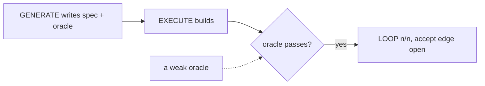
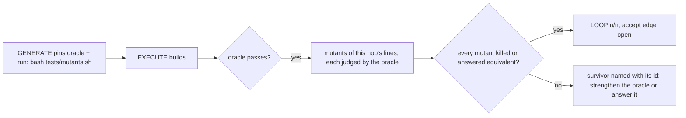

# Stage 05b — t109-oracle-strength — SPEC

## Problem and scope

The frozen oracle (t89) is the exam that every build must pass. The agent that writes the spec also writes the oracle,
and no check measures how strong that exam is. A weak oracle lets a weak build pass, and the loop still prints
`LOOP n/n`. On t108 GENERATE the agent ran 14 mutants of the hook by hand and all were caught. That was the agent's
choice, not a gate. The human wants results that are predictable whatever the model: the strength of the exam must be
a number that a script computes, as a red twin is for a law.

1. **Mutants from the change.** On EXECUTE 05b, `bash tests/mutants.sh` makes mutants from the lines that this hop
   added since the commit that opened it: a flipped comparison, a flipped boolean, a swapped `and`/`or` (`&&`/`||`),
   a dropped `not` (`!`), a deleted statement. A script makes them, never an agent, so the same tree gives the same
   mutants, ids and verdicts for every builder and every model.
2. **The oracle judges each mutant.** Each mutant runs in a disposable clone of the tree. The oracle's `run:` lines,
   read from the manifest frozen at the hop-opening commit, judge it. A failing line kills the mutant; a line that
   does not finish in time also kills it (`KILLED (timeout)`). A mutant that passes every line is a survivor. Before
   any mutant, the oracle must pass on the unmutated clone; if it fails, no mutant is judged and the result is red.
3. **A survivor blocks the accept edge until it is answered.** The script prints `MUTANTS k/n killed` and exits 1
   while a survivor has no answer. There are two answers: a stronger oracle (send the slice back to GENERATE, because
   the oracle is frozen on EXECUTE), or a row `| <id> | equivalent <reason> |` in
   `docs/cascade/05b-<slug>-mutants.md` for a mutant that cannot change behavior. The human reads those rows at the
   accept edge.
4. **The gate binds it.** When the tree ships `tests/mutants.sh`, the GENERATE 05b oracle gate (`tests/oracle.sh`)
   is red until the manifest has a `run: bash tests/mutants.sh` line. On EXECUTE, `tests/oracle.sh --loop` already
   refuses a goal without every `run:` line (t89). So the loop cannot print `LOOP n/n` with an open survivor, and the
   accept edge (I10, `NOEVID`) needs that loop receipt. No new hook is necessary.
5. **Measured on this repository.** The run on t108 (diff `7e2c539..ef9c6f7`, judged by t108's frozen oracle) is
   reported in the hop report, with its time.

Out of scope: lines outside the hop's diff; files that are `.md`, under `docs/`, or in the frozen oracle; mutants
written by an agent; stages other than 05b; a cache of mutant verdicts between loop passes (each pass runs them
again); any change to who signs an edge; changes to accepted tests.

## Approaches considered

| Approach | Decision | Reason |
|---|---|---|
| A. The spec critic, or a second agent, writes mutants | rejected | An agent's mutants change with the model and the prompt: the opposite of predictable. The brief prefers script-made mutants. |
| B. A general mutation tool (mutmut, Stryker, PIT) | rejected | One tool per language, not installed in a product repo, and it mutates the whole module, not this hop's change. |
| C. Text operators on the lines this hop added, judged by the frozen oracle | **chosen** | Deterministic, no new dependency, one engine for Python, shell and C-like languages, and the cost is bounded by the change and `MUTANTS_MAX`. |
| D. Coverage of the changed lines | rejected | A covered line can still be unchecked: coverage does not show that an assertion fails. |

## Before vs after

Before:

After:

| Case | Before | After |
|---|---|---|
| A strong oracle | `LOOP n/n` | `MUTANTS n/n killed`, `LOOP n/n` |
| An oracle with a missing assertion | `LOOP n/n` | a survivor, `FAIL bash tests/mutants.sh`, no `LOOP n/n` |
| A survivor that cannot change behavior | — | `| <id> | equivalent <reason> |`, green, the count names it |
| A docs-only hop | `LOOP n/n` | `MUTANTS 0/0 killed — nothing to mutate`, green |
| A GENERATE 05b manifest with no mutants line (the tree ships the script) | `ORACLE n/n` | red, names the line to add |

## Benefits and trade-offs

| Item | Effect | Kind |
|---|---|---|
| Exam strength is a number | A weak oracle is found by a script, the same for every model | benefit |
| No new gate | The `run:` line rule (t89) and the loop receipt (I10) carry it to the accept edge | benefit |
| Deterministic | Same tree, same mutants, same ids, same bytes; `MUTANTS_MAX` keeps the lowest ids | benefit |
| Cost | Each mutant runs the oracle once: time is about (mutants + 1) × oracle time, on every loop pass | trade-off |
| Text operators | They can make a mutant that does not parse; that mutant is killed and tells nothing. They also miss deep faults (a wrong constant, a wrong call) | trade-off |
| Equivalent rows | The builder writes them; the human must read them at the accept edge | trade-off |
| Boundary | The rule starts when a repository ships `tests/mutants.sh`; older slices are not judged again | trade-off |

## Decision contract

### The engine (`tests/lib/mutants.py`, wrapper `tests/mutants.sh`)

6. `mutants.py <root>`: on any hop other than EXECUTE 05b, print `MUTANTS n/a — …` and exit 0. With a signed
   `- ORACLE: off`, print `MUTANTS off …` and exit 0. With `BDD_MUTANT_RUN` set (inside a mutant run), print
   `MUTANTS n/a — inside a mutant run` and exit 0.
7. The base is `affected.hop_base`; the manifest is `oracle.base_manifest`. The judge is every `run:` line except the
   one that names `tests/mutants.sh`. No base, no manifest, or no judge line: `FAIL` and exit 1.
8. Files: tracked files changed since the base and untracked files that git does not ignore. Not mutated: the frozen
   oracle files, the manifest, `*.md`, `docs/`, `.cascade/`, symbolic links. A family by extension: `.py` → py;
   `.sh`, `.bash` → sh; `.kt`, `.java`, `.js`, `.ts`, `.swift`, `.go`, `.c`, `.cpp`, `.rs`, `.cs` and similar → c; no
   extension → the shebang (python or sh), else not mutated.
9. Lines: only the lines added since the base (`git diff -U0`), every line of an untracked file. Text in quotes and
   comments is blanked before an operator is matched.
10. Operators, the first match on the line: py — `==`/`!=`, `<=`→`>`, `>=`→`<`, `<`→`>=`, `>`→`<=`, `and`/`or`,
    `True`/`False`, drop `not`; sh — `-eq`/`-ne`, `-lt`/`-ge`, `-gt`/`-le`, `&&`/`||`, `==`/`!=`; c — `==`/`!=`,
    `<=`→`>`, `>=`→`<`, `&&`/`||`, `true`/`false`, drop `!`. Statement deletion: py → `pass`, sh → `:`, at the same
    indent, only for a simple, balanced statement (not a block header, a continuation, a heredoc or an assignment
    in sh). No deletion for c.
11. Id: the first 8 hex of sha1 over the path, the operator, the stripped line text and its repeat count. An id does
    not change when other lines move. The mutants are sorted by id; `MUTANTS_MAX` (default 40) judges the lowest ids.
12. Workspace: one clone of HEAD (`git clone --shared`) with this tree's uncommitted and untracked work committed on
    top. Per mutant: write the line, give the file a new mtime, run the judge, then `git reset --hard` and
    `git clean -fdx`. The runs have `PYTHONDONTWRITEBYTECODE=1` and `BDD_MUTANT_RUN=1`. Each run line has
    `MUTANTS_TIMEOUT` seconds (default 600); on time out the process group is killed. The working tree is not changed.
13. Output: `MUTANT  <id>  <KILLED|KILLED (timeout)|SURVIVED>  <file>:<line>  <op>  \`<old line>\``, one line per
    mutant, then a `FAIL  survivor <id>: …` line for each open survivor, then
    `MUTANTS k/n killed[ (the n lowest ids of N)][, s answered equivalent]`. No time values: the output of the same
    tree is the same bytes. Exit 0 when no survivor is open, else 1.
14. Answers: rows that match `| <8 hex id> | equivalent <reason> |` in `docs/cascade/05b-<slug>-mutants.md`. A row
    with no reason, another word, or an id that is not a survivor does not answer anything.

### The gate (`tests/lib/oracle.py`)

15. In the GENERATE 05b gate only, when `tests/mutants.sh` is a file in the tree: one more check, green when a `run:`
    line names `tests/mutants.sh`, red otherwise with the line to add. No other oracle behavior changes.

### Docs and release

16. `USAGE.md` gets `### B28. Oracle strength: mutants of this hop's change (t109)`, naming `tests/mutants.sh`,
    `MUTANTS_MAX`, `MUTANTS_TIMEOUT` and the `equivalent` row.
17. Release 3.5.11: `VERSION`, `.claude-plugin/plugin.json`, `.codex-plugin/plugin.json`,
    `.claude-plugin/marketplace.json`, `## 3.5.11` in `CHANGELOG.md`, and `README.md`.

## Acceptance criteria

The frozen oracle is `tests/ac/t109_oracle_strength.sh` (pinned in `docs/cascade/05b-t109-oracle-strength.oracle`,
with `run: bash tests/mutants.sh`, so this slice is judged by its own mutants). Each AC builds scratch repositories
with the real hooks, a product file `app.py` and a script `tools/limit.sh` changed on EXECUTE.

| AC | Checks | Items |
|---|---|---|
| AC1 | A strong oracle kills all 14 mutants: `MUTANTS 14/14 killed`, exit 0, one `MUTANT` line per mutant | 1, 2, 6–13 |
| AC2 | Red twin: an oracle with one assertion removed lets `delete return 2` survive: exit 1, the survivor named with its id and the answer to give | 2, 3, 13 |
| AC3 | Only `| <id> | equivalent <reason> |` answers a survivor; an empty reason, another id or another word stay red | 3, 14 |
| AC4 | Only lines this hop added (not the base, not `.md`); the same tree, the same bytes; `MUTANTS_MAX=5` judges the 5 lowest ids | 9, 11, 13 |
| AC5 | The GENERATE gate needs `run: bash tests/mutants.sh` once the tree ships it; on EXECUTE a survivor keeps the loop from n/n and a strong oracle reaches `LOOP 2/2` | 4, 15 |
| AC6 | The operator set for py and sh; the working tree is byte-identical after a run | 10, 12 |
| AC7 | A docs-only hop is `0/0` and green; GENERATE is `n/a`; an oracle that fails unmutated is red; a hanging mutant is `KILLED (timeout)`; no mutant run starts the mutants again | 2, 6, 12 |
| AC8 | `USAGE.md` B28; release 3.5.11 or later; the fixture run takes under 120 s | 16, 17 |
