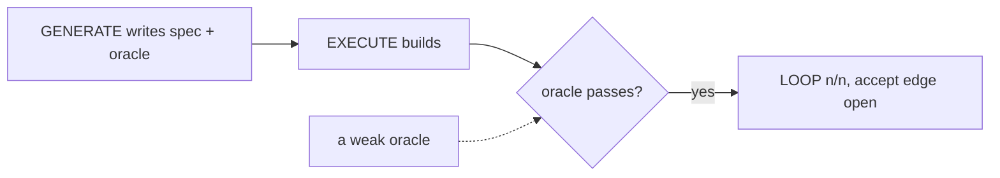
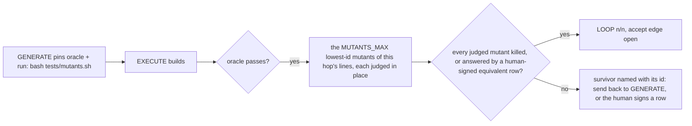

# Stage 05b — t109-oracle-strength — SPEC

## Problem and scope

The frozen oracle (t89) is the exam that every build must pass. The agent that writes the spec also writes the oracle,
and no check measures how strong that exam is. A weak oracle lets a weak build pass, and the loop still prints
`LOOP n/n`. On t108 GENERATE the agent ran 14 mutants of the hook by hand and all were caught. That was the agent's
choice, not a gate. The human wants results that are predictable whatever the model: the strength of the exam must be
a number that a script computes, as a red twin is for a law.

Human decisions (2026-11-18, critique C1, C2, C6, recorded under the brief in `docs/cascade/05b-briefs.md`):
only a human-signed row answers a survivor; "a test added" means a send-back to GENERATE; mutants run in place in the
real working tree, and a signed `- MUTANTS: off` lets a repository opt out.

1. **Mutants from the change.** On EXECUTE 05b, `bash tests/mutants.sh` makes mutants from the lines that this hop
   added since the commit that opened it: a flipped comparison, a flipped boolean, a swapped `and`/`or` (`&&`/`||`),
   a dropped `not` (`!`), a deleted statement. A script makes them, never an agent, so the same tree gives the same
   mutants and ids for every builder and every model.
2. **The oracle judges each mutant, in place.** The script writes one mutated line into the real working tree, runs
   the oracle's `run:` lines (read from the manifest frozen at the hop-opening commit), and puts the original file
   back. Ignored build inputs (`node_modules`, `.venv`, `local.properties`, Gradle and Xcode caches) stay, so a
   product repository keeps its warm build. A failing line kills the mutant; a line that does not finish in time also
   kills it (`KILLED (timeout)`). A mutant that passes every line is a survivor. Before any mutant, the oracle must
   pass on the unmutated tree; if it fails, no mutant is judged and the result is red.
3. **A survivor blocks the accept edge until the human answers it.** The script prints `MUTANTS k/n killed` and exits
   1 while a survivor has no answer. There are two answers: a stronger oracle (send the slice back to GENERATE; the
   oracle is frozen on EXECUTE, so a test added in the hop does not count), or a human-signed row
   `| <id> | equivalent <reason> |` in `docs/cascade/05b-<slug>-mutants.md`. These rows are human-owned like LESSON
   lines: the builder cannot answer its own survivor, and on autopilot a survivor halts the run for the human.
4. **The gate binds it.** When the tree ships `tests/mutants.sh` and `- MUTANTS: off` is not signed, the GENERATE 05b
   oracle gate (`tests/oracle.sh`) is red until the manifest has the exact line `run: bash tests/mutants.sh`. On
   EXECUTE, `tests/oracle.sh --loop` already refuses a goal without every `run:` line (t89). So the loop cannot print
   `LOOP n/n` with an open survivor, and the accept edge (I10, `NOEVID`) needs that loop receipt. No new hook is
   necessary.
5. **Measured on this repository.** The run on t108 (diff `7e2c539..ef9c6f7`, judged by t108's frozen oracle) is
   reported in the hop report, with its time. A GENERATE sample (8 of 60 mutants, the old clone engine) found 3
   survivors, all in t108's module docstring; the prose rule (item 9) now skips those lines.

Out of scope: lines outside the hop's diff; files that are `.md`, under `docs/`, or in the frozen oracle; mutants
written by an agent; stages other than 05b; a cache of mutant verdicts between loop passes (each pass runs them
again); any change to who signs an edge; changes to accepted tests.

## Approaches considered

| Approach | Decision | Reason |
|---|---|---|
| A. The spec critic, or a second agent, writes mutants | rejected | An agent's mutants change with the model and the prompt: the opposite of predictable. The brief prefers script-made mutants. |
| B. A general mutation tool (mutmut, Stryker, PIT) | rejected | One tool per language, not installed in a product repo, and it mutates the whole module, not this hop's change. |
| C. Text operators on the lines this hop added, judged by the frozen oracle | **chosen** | Deterministic, no new dependency, one engine for Python, shell and C-like languages, and the cost is bounded by the change and `MUTANTS_MAX`. |
| D. Coverage of the changed lines | rejected | A covered line can still be unchecked: coverage does not show that an assertion fails. |
| Workspace: a fresh clone per run | rejected (human, C6) | `git clean -fdx` and a clone drop ignored inputs: a product build breaks or runs cold. |
| Workspace: in place, with a backup and a lock | **chosen** (human, C6) | Warm caches, real inputs; the backup in the git dir puts every file back on exit, on a signal, or at the next run. |

## Before vs after

Before:

After:

| Case | Before | After |
|---|---|---|
| A strong oracle | `LOOP n/n` | `MUTANTS n/n killed`, `LOOP n/n` |
| An oracle with a missing assertion | `LOOP n/n` | a survivor, `FAIL bash tests/mutants.sh`, no `LOOP n/n` |
| A survivor that cannot change behavior | — | the human signs `| <id> | equivalent <reason> |`; green, the count names it |
| More mutants than `MUTANTS_MAX` | — | the lowest ids are judged; the count says `(the n lowest ids of N)` |
| A docs-only hop | `LOOP n/n` | `MUTANTS 0/0 killed — nothing to mutate`, green |
| A GENERATE 05b manifest with no exact mutants line (the tree ships the script) | `ORACLE n/n` | red, names the line to add |
| A repository that signed `- MUTANTS: off` | — | `MUTANTS off (signed)`, no gate check |

## Benefits and trade-offs

| Item | Effect | Kind |
|---|---|---|
| Exam strength is a number | A weak oracle is found by a script, the same for every model | benefit |
| No new gate | The `run:` line rule (t89) and the loop receipt (I10) carry it to the accept edge | benefit |
| Deterministic | Same tree, same mutants, same ids; `MUTANTS_MAX` keeps the lowest ids | benefit |
| In place | Warm caches and ignored inputs stay; the fixture run is about 30 s, not about 300 s with a clone | benefit |
| Cost | Each mutant runs the oracle once: time is about (mutants + 1) × oracle time, on every loop pass | trade-off |
| In place | The working tree changes for the duration of one run line; a second run, or an editor that writes the file then, conflicts. The lock stops a second mutants run; the backup repairs a killed run | trade-off |
| Text operators | They can make a mutant that does not parse; that mutant is killed and tells nothing. They also miss deep faults (a wrong constant, a wrong call) | trade-off |
| A sample | With more than `MUTANTS_MAX` mutants only the lowest ids are judged. Ids hash the line text, so a builder can change which lines fall in the sample by rewording; the count shows N so the human sees the size | trade-off |
| Timeouts | A mutant near `MUTANTS_TIMEOUT` can be killed on a slow machine and survive on a fast one: the one part of a verdict that depends on the machine | trade-off |
| Equivalent rows | Only the human signs them: correct, but a real equivalent mutant stops autopilot | trade-off |
| Boundary | The rule starts when a repository ships `tests/mutants.sh`; older slices are not judged again | trade-off |

## Decision contract

### The engine (`tests/lib/mutants.py`, wrapper `tests/mutants.sh`)

The GENERATE prototype that passes AC1–AC7 is committed at `docs/cascade/prototypes/t109/` (reference, not
shipped).

6. `mutants.py <root>`, in this order: a signed `- ORACLE: off` → `MUTANTS off (the oracle is off, signed)`, exit 0;
   a signed `- MUTANTS: off` → `MUTANTS off (signed)`, exit 0; any hop other than EXECUTE 05b →
   `MUTANTS n/a — mutants judge an EXECUTE 05b build (this hop: …)`, exit 0; `BDD_MUTANT_RUN` set →
   `MUTANTS n/a — inside a mutant run`, exit 0.
7. The base is `affected.hop_base`; the manifest is `oracle.base_manifest`. The judge is every `run:` line except the
   exact line `bash tests/mutants.sh` (whitespace collapsed). No base, no manifest, or no judge line: `FAIL` and
   `MUTANTS 0/0 killed`, exit 1.
8. Files: tracked files changed since the base and untracked files that git does not ignore. Not mutated: the frozen
   oracle files, the manifest, `*.md`, `docs/`, `.cascade/`, `.git/`, symbolic links. A family by extension only:
   `.py` → py; `.sh`, `.bash` → sh; `.kt .kts .java .js .mjs .cjs .jsx .ts .tsx .swift .go .c .cc .cpp .h .hpp .rs .cs
   .scala .dart .m .mm` → c; no extension → the shebang (`python` → py, `sh`/`bash` → sh), else not mutated. Any
   other extension (`.json`, `.yml`, `.toml`) is not mutated.
9. Lines: only the lines added since the base (`git diff -U0`), every line of an untracked file. Never mutated: a
   Python row that holds only strings and comments (a docstring), a shell heredoc body, a C-family comment row. On
   other lines, text in quotes and a trailing `#` comment is blanked before an operator is matched.
10. Operators, each operator at most once per line (its first match), each applied alone. Labels:
    py — `eq-ne` `==`→`!=`, `ne-eq`, `le-gt` `<=`→`>`, `ge-lt` `>=`→`<`, `lt-ge` `<`→`>=`, `gt-le` `>`→`<=`,
    `and-or`, `or-and`, `true-false`, `false-true`, `drop-not`;
    sh — `eq-ne` `-eq`→`-ne`, `ne-eq`, `lt-ge`, `ge-lt`, `gt-le`, `le-gt`, `and-or` `&&`→`||`, `or-and`,
    `streq-ne` ` == `→` != `, `strne-eq`;
    c — `eq-ne`, `ne-eq`, `le-gt`, `ge-lt`, `and-or`, `or-and`, `true-false`, `false-true`, `drop-not` `!`.
    `delete`: py → `pass`, sh → `:`, at the same indent, only for a simple, balanced statement (not a block header, a
    continuation, a heredoc, a string-only row or an assignment in sh). No deletion for c.
11. Id: the first 8 hex of sha1 over the path, the operator, the stripped line text and its repeat count. An id does
    not change when other lines move. The mutants are sorted by id; the `MUTANTS_MAX` lowest ids are judged.
12. Settings, signed only: the last `- MUTANTS: off`, `- MUTANTS_MAX: <n>` (default 40) and
    `- MUTANTS_TIMEOUT: <s>` (default 600, per run line) inside `<EDIT>` in `docs/cascade/envelope.md` count only when
    HEAD and the working tree say the same, as `GOAL_CARRY_MAX` (t96). Environment variables of these names are
    ignored. A value that is not a positive integer is the default.
13. Workspace, in place: a lock `<git dir>/cascade-mutants.lock` (a directory with the holder's pid; a live holder →
    `FAIL  another mutants run holds …`, exit 1; a dead holder's lock is taken over). Per mutant: copy the file to
    `<git dir>/cascade-mutants-backup/<path>`, write the mutated line, give the file a new, later mtime, run the
    judge, write the original back (a new, later mtime again), remove the backup. At start, any file left in the
    backup by a killed run is written back first: `mutants: restored <path> from an interrupted run`. On SIGINT,
    SIGTERM or SIGHUP, and on exit, every backup is written back. Runs have `PYTHONDONTWRITEBYTECODE=1` and
    `BDD_MUTANT_RUN=1` in their environment. On time out the run line's process group is killed. After a run the
    working tree, its ignored files and the git dir have the same content as before.
14. Output: `MUTANT  <id>  <KILLED|KILLED (timeout)|SURVIVED>  <file>:<line>  <op>  \`<old line>\``, one line per
    mutant, then `FAIL  survivor <id>: <file>:<line> <op> passes the oracle — strengthen the oracle (send back to
    GENERATE) or have the human sign \`| <id> | equivalent <reason> |\` in docs/cascade/05b-<slug>-mutants.md` for
    each open survivor, then `MUTANTS k/n killed[ (the n lowest ids of N)][, s answered equivalent]`. Other
    messages: `MUTANTS 0/0 killed — nothing to mutate: this hop added no mutable line` (exit 0);
    `FAIL  the oracle fails on the unmutated tree: no mutant can be judged` (exit 1). No time values: the same tree
    prints the same bytes, except a verdict near the timeout (trade-offs). Exit 0 when no survivor is open, else 1.
15. Answers: a row `| <8 hex id> | equivalent <reason> |` in `docs/cascade/05b-<slug>-mutants.md` that is committed at
    HEAD and is still in the working tree. A row with no reason, another word, or an id that is not a survivor does
    not answer anything. These rows are human-owned: `tests/lib/laws.py` `PROTECTED` matches them, so
    `.githooks/pre-commit` (the file guarded like `docs/cascade/lessons.md`) refuses an unsigned commit that adds,
    changes or removes one, and `.claude/hooks/hop_guard.py` sends the edit to the permission dialog.

### The gate (`tests/lib/oracle.py`)

16. In the GENERATE 05b gate only, when `tests/mutants.sh` is a file in the tree and `- MUTANTS: off` is not signed:
    one more check. Green when a `run:` line is exactly `bash tests/mutants.sh` (whitespace collapsed):
    `the manifest runs the mutants (run: bash tests/mutants.sh)`. Red otherwise:
    `the manifest has no \`run: bash tests/mutants.sh\` line, exactly — pin it with --write --run (t109)`. A line
    with extra tokens (`|| true`, an environment prefix) is red. No other oracle behavior changes.

### Docs and release

17. `USAGE.md` gets `### B28. Oracle strength: mutants of this hop's change (t109)`, naming `tests/mutants.sh`, the
    signed `MUTANTS: off`, `MUTANTS_MAX` and `MUTANTS_TIMEOUT`, in-place runs with the backup, and the human-signed
    `equivalent` row.
18. Release 3.5.11: `VERSION`, `.claude-plugin/plugin.json`, `.codex-plugin/plugin.json`,
    `.claude-plugin/marketplace.json`, `## 3.5.11` in `CHANGELOG.md`, and `README.md`.

## Acceptance criteria

The frozen oracle is `tests/ac/t109_oracle_strength.sh` (pinned in `docs/cascade/05b-t109-oracle-strength.oracle`,
with `run: bash tests/mutants.sh`, so this slice is judged by its own mutants). Each AC builds scratch repositories
with the real hooks, a product file `app.py` and a script `tools/limit.sh` changed on EXECUTE, and an ignored input
`.venv/marker` that the oracle needs.

| AC | Checks | Items |
|---|---|---|
| AC1 | A strong oracle kills all 14 mutants: `MUTANTS 14/14 killed`, exit 0, one `MUTANT` line per mutant with id, verdict, file:line, operator | 1, 2, 6–11, 13, 14 |
| AC2 | Red twin: an oracle with one assertion removed lets `delete return 2` survive: exit 1, the survivor named with its id and the answer to give | 2, 3, 14 |
| AC3 | Only a committed, human-signed `| <id> | equivalent <reason> |` answers a survivor; an uncommitted row, an agent commit (refused by pre-commit, naming the file), an empty reason, another word or another id stay red | 3, 15 |
| AC4 | Only lines this hop added (not the base, not `.md`, not `docs/`); the same tree, the same bytes; ids do not move with line numbers; `MUTANTS_MAX` in the environment and uncommitted is ignored, signed `- MUTANTS_MAX: 5` judges the 5 lowest ids | 8, 9, 11, 12, 14 |
| AC5 | The GENERATE gate needs exactly `run: bash tests/mutants.sh` (`|| true` and an env prefix red; signed `MUTANTS: off` lifts it); on EXECUTE a survivor keeps the loop from n/n and a strong oracle reaches `LOOP 2/2` | 4, 12, 16 |
| AC6 | The operator labels for py and sh; in place, the tree, the ignored `.venv/marker` and the git dir are the same after a run; a killed run's file is restored by the next run | 10, 13 |
| AC7 | Docs-only `0/0` green; GENERATE `n/a`; signed `MUTANTS: off` and `ORACLE: off`; red when the oracle fails unmutated; a hang is `KILLED (timeout)` with a signed `MUTANTS_TIMEOUT: 3`; `BDD_MUTANT_RUN` reaches the judge and stops recursion; a held lock is red; docstrings, heredocs, quotes and comments are never mutated | 2, 6, 9, 12, 13, 14 |
| AC8 | `USAGE.md` B28; release 3.5.11 or later; the fixture run takes under 240 s | 17, 18 |
