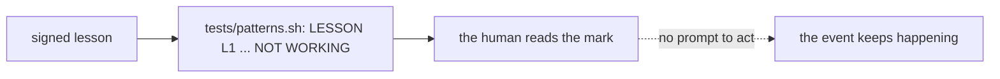
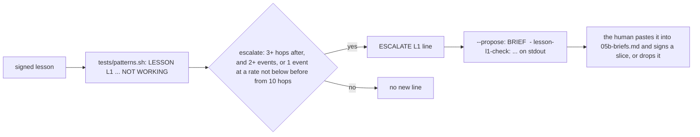

# Stage 05b — t110-lesson-escalation — SPEC

## Problem and scope

A signed lesson (t106, t107) is a line of prompt text. The agent can ignore it, and nothing happens when it does. When
the lesson's event keeps happening after its `since:` day, that is evidence that a prompt line is not enough: the
event needs a check (a hook rule or a test) that refuses it. Today `tests/patterns.sh` measures each lesson and
prints a mark (NO MATCH, SETTLED, NOT WORKING, WORKING, NEW), but it does not say "this lesson needs a check", and
it does not help the human write the brief for that check. The human wants results that are predictable whatever
the model: a check holds for every model, a prompt line does not.

This slice adds the mark `ESCALATE` and, with `--propose`, a draft brief for each ESCALATE lesson. The script only
reads and prints. It signs nothing, builds nothing and writes no file. The lesson stays until the human removes it.

Out of scope (brief): building the proposed check; any change to how lessons are signed or measured (the five marks,
the rates, the hops, the `--recall` line and its ranking stay as they are).

Human decision (2026-11-24, recorded under the brief in `docs/cascade/05b-briefs.md`): the rule and the text go in a
new module `tests/lib/escalate.py`, so `bash tests/mutants.sh` (t109) can mutate them (it does not mutate the lines
of a shell heredoc, and `tests/patterns.sh` is one heredoc). T69 AC9's shipped-path allowlist adds `escalate` to its
`tests/lib/*.py` alternation, and nothing else in T69.

## Approaches considered

| Approach | Decision | Reason |
|---|---|---|
| A. A sixth mark that replaces NOT WORKING | rejected | It changes how lessons are measured (out of scope), and t106 AC3 pins every `LESSON L…` line byte for byte. |
| B. A suffix on the `LESSON L…` line | rejected | The same t106 AC3 lines would change. |
| C. A separate `ESCALATE L<n> …` line after the `LESSON` lines | **chosen** | No accepted line changes; a reader and a script find it by its first word. |
| D. `--propose` writes the draft into `docs/cascade/05b-briefs.md` | rejected | The brief forbids it, and the script is read-only (t104 AC6, AC7). The draft goes to stdout; the human pastes it. |
| E. The rule inside the heredoc of `tests/patterns.sh` | rejected (human, 2026-11-24) | `tests/mutants.sh` cannot mutate heredoc lines, so the oracle's strength on the rule is not measured. |
| F. The rule in `tests/lib/escalate.py`, imported after `--recall` | **chosen** (human, 2026-11-24) | Mutants measure it; the prompt hook's `--recall` path does not load it, so a missing or broken module cannot break the prompt. |

## Before vs after

Before:

After:

| Case | Before | After |
|---|---|---|
| A lesson with 2 or more events after its day, in 3 or more hops after it | `LESSON L1 … NOT WORKING` | the same line, then `ESCALATE L1 …`; `--propose` adds a `BRIEF` line |
| A lesson with no event after its day | `LESSON … WORKING` or `SETTLED` | no change, no ESCALATE |
| A lesson with fewer than 3 hops after its day | `LESSON … NEW` | no change, no ESCALATE |
| A SETTLED lesson (its last 5 hops are clean) | `LESSON … SETTLED` | no ESCALATE, even with events earlier in the window |
| The prompt hook (`--recall`) | `LESSONS THIS HOP: …` | the same line; it does not load `tests/lib/escalate.py` |
| `--propose` | `PROPOSE` lines, `PROPOSALS: k` | the same, then `BRIEF` lines, `BRIEFS: k` |

## Benefits and trade-offs

| Item | Effect | Kind |
|---|---|---|
| The script says when a prompt line failed | The human sees which lesson needs a check, from numbers, the same for every model | benefit |
| A draft brief | The human signs a slice with one paste, not a blank page | benefit |
| No accepted line changes | t104, t106 and t107 stay green with no change to them | benefit |
| Read-only | No file is written; nothing is signed; the human decides | benefit |
| Thresholds are fixed numbers | 3 hops, 2 events, 10 hops are a judgment, not a measurement; a slow repository needs weeks to reach 10 hops | trade-off |
| Two events can be bad luck | With 3 hops after, 2 events can be noise; the human can drop the draft | trade-off |
| One more shipped file | `tests/lib/escalate.py`; T69's allowlist changes (human decision) | trade-off |

## Decision contract

The GENERATE prototype that passes AC1–AC4 is committed at `docs/cascade/prototypes/t110/` (reference, not shipped):
`escalate.py` and `patterns.patch`.

### The rule (`tests/lib/escalate.py`)

1. `escalate(b, a, hb, ha, mark)` returns `True` only when all of these are true: `ha >= 3`; `mark` is not
   `NO MATCH` and not `SETTLED`; and either `a >= 2`, or (`ha >= 10` and `hb > 0` and `a > 0` and
   `a * hb >= b * ha`). `b` and `a` are the events before and after the lesson's day, `hb` and `ha` the hops before
   and after, `mark` the mark that `measure()` gives. Integer arithmetic only: equal rates are `True`.
2. `line(lid, actor, verdict, a, ha)` returns exactly
   `ESCALATE L<lid>  <actor> <verdict>  after: <a> in <ha> hop|hops  a prompt line is not enough: tests/patterns.sh --propose drafts a check`
   (`hop` when `ha` is 1).
3. `brief(lid, actor, verdict, prefix, on, do, b, a, hb, ha, today)` returns exactly one line:
   `BRIEF  - lesson-l<lid>-check: [feature] drafted <today> by tests/patterns.sh --propose from lesson L<lid>. The event <actor> <verdict> "<prefix>" happened <a> times in <ha> hops after <on> (<b> in <hb> hops before), so the prompt line "<do>" is not enough. Build a check (a hook rule or a test) that refuses this event. Done when a test shows the event is refused. Out of scope: changing or removing lesson L<lid>.`
   After `BRIEF  `, the text is a brief head that `tests/lib/briefs.py` reads (`- <slug>:` at column 0).
4. The module has no file write, no process, no network call. It imports nothing outside the standard library.

### The report (`tests/patterns.sh`)

5. The script passes its own `tests/lib` directory (`$HERE/lib`, not `--root`) to the Python part, and imports
   `escalate` there only after the `--recall` branch has exited. `--recall` works with no `tests/lib/escalate.py`;
   a full run without it fails (a non-zero exit, not a silent pass).
6. After all `LESSON L…` lines and before `LESSONS:`, the script prints one `ESCALATE` line (item 2) per lesson for
   which item 1 is true, in id order. No `LESSON L…` line, `LESSONS:` line or `PATTERNS:` line changes; `PATTERNS:` is
   still the last line.
7. With `--propose`, after `PROPOSALS: k`, the script prints one `BRIEF` line (item 3) per ESCALATE lesson, in id
   order, then `BRIEFS: k`. `today` is the UTC day. Without `--propose` there is no `BRIEF` and no `BRIEFS:` line.
   The `BRIEF` lines measure every event (no `--since`), as the lesson lines do.
8. The script writes nothing: the worktree, `docs/cascade/05b-briefs.md`, `docs/cascade/lessons.md` and the git dir
   are the same after any run (t104 AC6 and AC7 still hold).
9. The header comment names the rule and the two new lines.

### Docs and release

10. `USAGE.md` B29 "Lesson escalation (t110)": what ESCALATE means (item 1 in plain words), the `BRIEF` draft, that
    the human pastes it into `docs/cascade/05b-briefs.md` or drops it, and that nothing is signed or built.
11. Release 3.5.12: `VERSION`, the three manifests, `CHANGELOG.md` (it names the T69 allowlist change), the README
    release line. T69 AC9's allowlist adds `escalate` to its `tests/lib/*.py` alternation (human, 2026-11-24).

## Acceptance criteria

Oracle: `tests/ac/t110_lesson_escalation.sh`, pinned in `docs/cascade/05b-t110-lesson-escalation.oracle` with
`run: bash tests/ac/t110_lesson_escalation.sh` and `run: bash tests/mutants.sh`. The goal also holds D1's check
`bash tests/inv/D1_context_budget.sh --grow 400` (the prompt hook's recall line stays inside law D1's budget),
`bash tests/lint.sh # standing`, `bash tests/enforcement.sh # standing` and `bash tests/regress.sh # standing`
(it runs t104, t106 and t107).

| AC | Checks | Items |
|---|---|---|
| AC1 | A fixture of 22 hops and 10 lessons: ESCALATE for 2 after-window events in 3 or more hops (L1, L9) and for 1 event at a rate not below the before-rate from 10 hops (L4); not for 0 events (L2, L10), 2 hops (L3), a lower rate (L5), 9 hops (L6), no before hop (L7) or SETTLED (L8). The `LESSON` lines are exact and unchanged in form; ESCALATE lines come after them, before `LESSONS:`; `PATTERNS:` is last | 1, 2, 6 |
| AC2 | `--propose`: the three exact `BRIEF` lines (a `"` in `do:` kept), `BRIEFS: 3`, a valid brief head after `BRIEF  `; `PROPOSALS:` still printed; no `BRIEF` line without `--propose`; `BRIEFS: 0` and no ESCALATE when no lesson escalates; the fixture (with its `05b-briefs.md` and `lessons.md`) is unchanged and clean | 3, 7, 8 |
| AC3 | `--recall GENERATE` is the t107 line (`LESSONS THIS HOP: L1 One.; L3 Three.; L9 Nine.`), names no ESCALATE, is at most 400 bytes, and works with no `tests/lib/escalate.py`; a full run without the module fails; the module is loaded from the script's own `tests/lib` | 5 |
| AC4 | `escalate()` at 18 boundary cases (3 vs 2 hops, 2 vs 1 events, 10 vs 9 hops, equal rates, `hb = 0`, `a = 0`, SETTLED, NO MATCH); the module has no write, process or network call | 1, 4 |
| AC5 | `USAGE.md` B29 names ESCALATE, `--propose` and `tests/patterns.sh`; release 3.5.12 or later in `VERSION`, the three manifests and `CHANGELOG.md`; T69's allowlist names `escalate` | 10, 11 |
