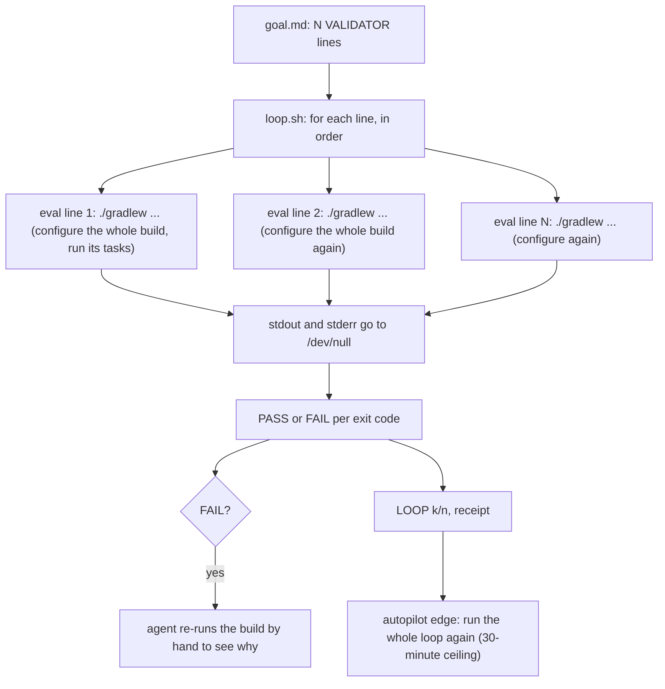
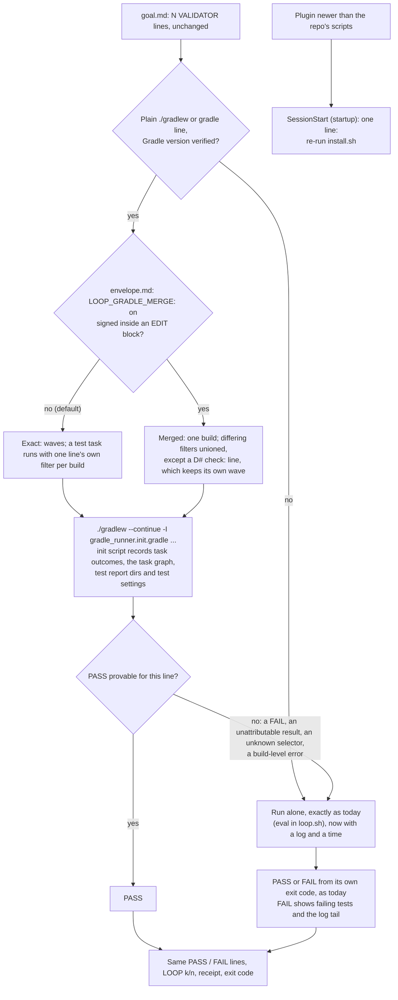

# Stage 05b — t62-loop-runners — SPEC

## User story IDs from the PRD

BDD's product is the cascade itself; the stories this slice serves:

- **S-LR1** — As an operator of a Gradle product, a `/loop` pass costs one Gradle build per *wave*, not one
  per `VALIDATOR:` line. A wave is a set of lines whose tasks do not clash. On a pass over unchanged code,
  the test tasks are up to date and are not run again.
- **S-LR2** — As an operator, the faster loop never reports a verdict that running each line alone would
  not report. The one exception, tests from different lines sharing a test JVM, exists only if I sign it in
  the envelope, and never applies to a law's `check:` line.
- **S-LR3** — As an operator upgrading from 2.5.0, I change nothing: `goal.md`, `envelope.md`, `hop-state.md`,
  every law and the receipt work as they are. Re-running `install.sh` is the whole upgrade, and in plugin mode
  the session tells me at start when I need to.
- **S-LR4** — As the agent, a `FAIL` shows the failing tests and Gradle's own "What went wrong", so I do not
  re-run the build to find out.

## The problem, stated as cost

`tests/loop.sh` runs each `VALIDATOR:` line as its own process, one after another, and discards the output
(`tests/loop.sh:107-115`: `( cd "$ROOT" && eval "$v" ) >/dev/null 2>&1`). The pack is right to be
toolchain-agnostic, but it pays for that by treating a build tool as a process spawner. Gradle already owns a
task graph, a scheduler and a cache keyed on each task's inputs.

Measured this hop on Gradle 8.14.3, warm daemon, a two-module Java fixture (JUnit 5) with four validators of
the usual shape (`:core:test --tests com.x.core.BalanceTest`, `:core:test --tests com.x.core.LedgerTest`,
`:app:test --tests com.x.app.CheckoutTest`, `:app:test --tests '*RefundTest'`). The build script sleeps
5s during configuration, standing in for a real build's configuration phase (plugins, AGP variant wiring).
That 5s is a stand-in: your build's own configuration time is what gets multiplied. Each mode was run both
with and without Gradle's configuration cache, since many builds enable it (critic C1).

| Mode | Config cache | Pass 1 | Next passes, nothing changed |
|---|---|---|---|
| Today: one build per line | off | 28.9s | 29.5s |
| Today: one build per line | on | 31.4s | 9.8s, then 8.4s |
| **This slice, default (exact)**: one build per wave, here 2 waves | off | 16.4s | 17.1s |
| **This slice, default (exact)** | on | 15.9s | 4.4s, then 4.8s |
| This slice, **signed merge**: one build, filters merged | off | 8.4s | 6.7s |
| This slice, **signed merge** | on | 8.0s | 1.3s, then 1.3s |

Why each number:

- **Today, a repeat pass costs a full pass.** Two lines alternate `--tests` filters on the same task. The
  filter is a task input, so the task is never up to date, and every test re-runs on every pass. The
  configuration cache removes the configuration part, not the re-runs.
- **Exact mode** puts lines that do not clash into one build. Two lines clash when they run the same test
  task with different filters. Configuration is paid once per wave. The waves still alternate filters, so
  tests still re-run.
- **Merged mode** runs the union of filters once, so on an unchanged pass the test tasks are `UP-TO-DATE`.
  The price is that tests from different lines share a test JVM. That is a real verdict risk, so it is
  yours to sign (Decision 1).

Exact mode's gain is N lines ÷ the largest number of distinct filters on one test task. A goal with six
lines on one test task gets six waves: no fewer builds than today. It still gets the logs, timing and
failure detail, and the other tasks in those waves stop costing a configuration each.

Three things multiply the cost further:

1. **Autopilot runs the loop twice per hop.** The EXECUTE→next edge re-runs `tests/loop.sh` from the git
   hook, with a 30-minute ceiling (`tests/lib/autopilot.py:111-116`). On a large Gradle product that second
   run can hit the ceiling, which refuses the edge with "could not run tests/loop.sh".
2. **A failing line shows nothing.** It prints only `FAIL <cmd>`, so the agent re-runs the build by hand to
   see why. Every failure costs at least two builds.
3. **An upgraded plugin goes unnoticed in-session.** In plugin mode the repo's `tests/loop.sh` stays at the
   old version until `install.sh` is re-run. `install.sh --check` and `/doctor` report the drift when someone
   runs them (`install.sh:37`, `tests/doctor.sh:136-141`). The session's own drift notice fires only on
   `compact|resume|clear` (`hooks/hooks.json:46`), never at start.

## Before vs after

Before — every line is a separate build, and the output is discarded:

After — the build tool runs what it can prove, and everything else runs alone exactly as today:

## Benefits and trade-offs

| | What you get | What it costs | How the cost is contained | What remains |
|---|---|---|---|---|
| **Exact batching** (default) | One build per wave instead of per line (28.9s → 16.4s; with the configuration cache, 9.8s → 4.4s on repeat passes) | A Gradle-aware component in a toolchain-agnostic pack | Behind a fixed contract: the runner may only report a proven PASS; every other line runs alone by today's code. Shell lines never touch it. `BDD_LOOP_RUNNER=shell` turns it off | Lines that use the same test task with different filters still cost one build each. Maven, pytest and others get no speedup yet |
| **Every FAIL confirmed alone** | A FAIL is always today's verdict, from today's code path (critic C5) | A failing line costs the batch plus its own run | Batch + f failing lines ≤ N + 1 builds | A pass where every line fails (a compile error) costs one build more than today |
| **Signed merge** (Decision 1) | Lines that share a test task cost one task run; repeat passes 1.3s with the configuration cache | Their tests share one test JVM, as `./gradlew test` and CI run them | Off unless you sign `LOOP_GRADLE_MERGE: on` inside `<EDIT>` in the envelope; no env var can turn it on. Never applies to an in-force D# `check:` line. Every FAIL still runs alone | A non-law line whose test passes only because another line's test ran first in the same JVM can PASS the loop. Nothing re-runs it alone unless it is also a stage-10 audit `test:` |
| **Logs, times, failure detail** | Every line gets a log under `.cascade/loop/` and a time; a FAIL shows the failing tests and Gradle's "What went wrong" | A few lines of output per FAIL; files under `.cascade/` | At most 25 detail lines, 200 characters each; the directory is reset each pass and gitignored | — |
| **Init script** | Structured task outcomes, not log scraping | `-I` adds one init script to the batched build | It registers a listener only. No task gets an action or input, so up-to-date state and build-cache keys are unchanged (AC7). It reads only stable paths, so the configuration cache still hits | The first batched pass after upgrade misses the configuration cache once (new init script = new cache key) |
| **Verified versions only** | Batching only on Gradle versions where AC7 passed | Other versions get no speedup | They run alone, exactly as today | The verified range is as wide as the versions AC7 could run on during EXECUTE |
| **Upgrade notice at start** | A plugin newer than the repo's scripts is reported when the session starts | One line of context, only while drifted | Prints nothing when versions match; T15's "nothing on plain startup" stays true | Standalone installs have no plugin to drift from; they upgrade by re-running `install.sh` as today |

## What the slice adds — and the line it must not cross

### 1. The runner contract (`tests/loop.sh`)

Before the per-line loop, `loop.sh` checks whether any line starts with `./gradlew ` or `gradle `. If one does
and `BDD_LOOP_RUNNER` is not `shell`, it pipes the validator list to `python3 -B tests/lib/gradle_runner.py
"$ROOT"`. The runner prints **only proven passes**, `<i>\tPASS\t
`, one per line index. Any index it
does not print **runs alone, exactly as today**: `( cd "$ROOT" && eval "$v" )` inside `loop.sh`'s own shell,
so `set -uo pipefail` and the sourced helpers behave as before. The only difference is that output goes to
`.cascade/loop/<i>.log` instead of `/dev/null`. `loop.sh` accepts only well-formed `PASS` lines for indexes
it sent. A crash, a non-zero exit or garbage from the runner therefore makes every line run alone.

`BDD_LOOP_RUNNER` has two values: `auto` (default) and `shell` (runner off). Any other value counts as `auto`.
No environment variable can turn merging on; only the signed envelope line can (§2, critic C9).

Output keeps its contract. The `PASS  <line>` and `FAIL  <line>` lines are byte-identical and in declared
order. Under a FAIL come up to 10 indented lines matching Gradle's failed-test format (` > … FAILED`) from
its log, then the log's last 15 lines, each at most 200 characters. One summary line comes before the blank
line and `LOOP k/n`, for example: `loop: 6 lines — 4 passed in 1 gradle build (8s), 2 ran alone (11s); logs
in .cascade/loop/`. The `WAIVED`, `OMITTED`, `REFUSED` and receipt logic, the exit codes and `--list` are
untouched. Time comes from bash's `SECONDS`, which needs no extra process and works in bash 3.2.

### 2. The Gradle runner (`tests/lib/gradle_runner.py`, `tests/lib/gradle_runner.init.gradle`)

**Which lines it takes.** A line qualifies only if all of these hold. Anything else runs alone.

- `shlex` (posix, with punctuation detection) finds no shell operator (`; & | < > ( )`), and the line has no
  `$`, no backtick, no backslash, no leading `VAR=value`, and no `~` at the start of a token.
- No token holds a glob character (`*?[`) that would expand to a file in the repo root. `eval` would expand
  it; the runner passes arguments without a shell, so it refuses rather than differ.
- The first token is exactly `./gradlew` or `gradle`.
- Every other token is either a task selector (a qualified path such as `:app:testDebugUnitTest` or
  `app:test`, or a plain task name such as `test`), the task option `--tests <pattern>` directly after a
  selector, or a global option on an allowlist with known arity. Zero-arity:
  `-q -w -i -d -s -S --quiet --warn --info --debug --stacktrace --full-stacktrace --offline
  --refresh-dependencies --rerun-tasks --build-cache --no-build-cache --configuration-cache
  --no-configuration-cache --parallel --no-parallel --daemon --no-daemon --continue --scan --no-scan
  --watch-fs --no-watch-fs`, plus the `=` forms of `--console --warning-mode --max-workers`, and attached
  `-Dk=v`/`-Pk=v`. One-argument: `-x --exclude-task --console --warning-mode --max-workers -D -P
  --system-prop --project-prop`. Anything else (`-p`, `-b`, `-c`, `-I`, `--include-build`, `-t`, other task
  options such as `--fail-fast` or `--rerun`) makes the line run alone.
- **Verified Gradle version** (critic C7). The runner carries the range of versions AC7 passed on during
  EXECUTE (at least 8.14.3, the version installed here; EXECUTE also tries the latest 7.6.x and 9.x and
  widens the range only for versions that pass). With `./gradlew`, the version is read from
  `gradle/wrapper/gradle-wrapper.properties` without starting a JVM. With `gradle`, the init script checks
  `GradleVersion.current()` and stops the build within about a second if it is outside the range, which
  turns every line in that group into a run-alone line.

**Groups and waves.** Lines are grouped by their first token plus their global options, in order, and each
group is planned into one or more builds. A line's *filter set* on a selector is its `--tests` patterns
there, or "none". A task runs **for its own line** when it runs with that line's own filter set.

- **Exact (default).** Each line goes to the first wave in which none of its selectors is already taken with
  a different filter set, treating "none" as different from any patterns (critic C4). Lines with identical
  filter sets share a wave. Every test task therefore runs for its own line, in every wave.
- **Merged.** This mode applies only when `docs/cascade/envelope.md` holds a line matching
  `- LOOP_GRADLE_MERGE: on`, with no `{{`, inside an `<EDIT>` block. The pre-commit hook and `hop_guard`
  keep `<EDIT>` human-only, so this is a signed, committed decision (critic C9). A selector's filter sets
  are unioned: "none" in any line means none, otherwise the union of the patterns. The exception is a line
  equal to an in-force D# `check:`, which keeps its own wave in every mode (critic C3).
- Each wave is one build: `<first token> <global options> --continue -I tests/lib/gradle_runner.init.gradle
  <selectors with their filters, in first-seen order>`, run from the repo root. It inherits the environment
  plus `BDD_GRADLE_OUT=<root>/.cascade/gradle`. Its log is `.cascade/loop/gradle-<g>-<w>.log`.

**The init script records** two files under `.cascade/gradle/`:

- `outcomes.tsv`: one row per finished task, with its path, `SUCCESS`, `UP-TO-DATE`, `FROM-CACHE`,
  `SKIPPED:<msg>` or `FAILED`, and the failure message with all nested causes. It comes from a build-service
  `OperationCompletionListener` registered through `BuildEventsListenerRegistry`. Prototyped this hop: this
  is compatible with the configuration cache (no problems reported; entry stored, then reused). A test-JVM
  crash ("Process 'Gradle Test Executor N' finished with non-zero exit value") is told apart from "There
  were failing tests" through the nested causes.
- `graph-<sha of the command>.tsv`: written from `taskGraph.whenReady`, one row per task in the graph. Each
  row holds its path, whether it is an `AbstractTestTask`, its JUnit XML directory, `ignoreFailures`,
  `filter.failOnNoMatchingTests`, its direct dependencies and its finalizers. Prototyped: `whenReady` does
  not run when the configuration cache is reused, so this file is keyed by the command and kept between
  passes. The configuration cache is reused only for the same command and build logic, so the file is the
  one written when that entry was stored. A missing file means no line in that build can be proven.
- The env var and every path the script reads are stable across passes. They are configuration inputs, and
  changing them would defeat the user's configuration cache.

**When a PASS is proven.** A line's tasks are its selectors resolved against the graph: a path matched
exactly, or a name matched to every graph task with that name. Abbreviations do not resolve, so that line
runs alone. Its *alone graph* is the closure of those tasks over dependencies and finalizers. A line PASSes
from the batch only if all of the following hold. Otherwise it runs alone.

1. The build's failure count matches its task failures. The build exited 0, or the count in its
   `FAILURE: Build completed with N failures.` / `Build failed with an exception.` line (1) equals its
   number of `FAILED` outcomes. This proves every failure was a task failure. An unreadable summary counts
   as a mismatch.
2. Every task in the alone graph finished `SUCCESS`, `UP-TO-DATE`, `FROM-CACHE` or `SKIPPED`. The one
   exception is a test task that did not run for this line (merged mode only); it is handled by rule 4.
3. No test task in the alone graph that is *not* one of the line's own tasks ran with a filter. A `check`
   line next to a filtered `test` line runs alone.
4. **Attribution (merged mode only).** For each of the line's own test tasks that did not run for this line:
   - The task finished, its graph row exists and its XML directory parses. If it `FAILED`, every recorded
     cause is Gradle's "There were failing tests", and `ignoreFailures` is false.
   - *surely(i)* holds if at least one test case is surely selected by the line's patterns.
   - *clean(i)* holds if no failing test case could be selected by them. (Definitions below.)
   - surely(i) is required unless `failOnNoMatchingTests` is false. A filtered line next to an unfiltered
     one needs it too: alone, an empty filter fails with "No tests found for given includes" (critic C4).
   - clean(i) must hold unless `ignoreFailures` is true.
5. Two different selectors do not resolve to the same task with different filter sets.

No FAIL is ever reported from a batch (critic C5). A line that cannot be proven to PASS runs alone, and its
verdict is today's.

**What a batched PASS assumes** (assumption A1, stated rather than buried). A task's outcome depends on its
declared inputs and the tasks it depends on, not on which other tasks share the build. This is the same
assumption Gradle's own up-to-date checks and build cache rest on, and Gradle 7+ rejects a task that reads
another task's output without declaring it. The batch keeps the user's own `org.gradle.parallel` setting,
so tasks from different lines can run at the same time, as they do in the user's own `./gradlew check`.
A1 is what C5 called the shared daemon, build directories and outside state. In exact mode it is the only
assumption. In merged mode the shared test JVM is added on top, and only for non-law lines.

**Pattern matching**, mirrored from Gradle and checked this hop against Gradle 8.14.3 for each form below.
For pattern `p`, `rx(p)` is `p` with `*` as `.*`, anchored. A class `C` matches `p` when `rx(p)` matches C's
simple name (if `p` starts with an upper-case letter) or C's fully qualified name (otherwise). The XML
`classname` gives `C`; the XML `name` gives the method `m` when it is an identifier, optionally followed by
`(…)` or `[…]`, and nothing when it is a display name.

- *Surely selects* (used only to prove the line matched at least one test, so it may only be narrower than
  Gradle): `C` matches `p`, or `m` is known and `rx(p)` matches `C.m` (simple or full form as above). Probes
  this hop: `BalanceTest`, `Bal*`, `com.x.core.Bal*`, `*BalanceSpec`, `BalanceSpec$Inner`, `*Inner` and
  `com.x.core.BalanceTest.one` all select what this predicts. `core.BalanceTest` selects nothing, as
  predicted.
- *Could select* (used only to decide whether a failing test might be the line's, so it may only be wider):
  surely-selects; or the outer class of a nested `C` (the part before `$`) matches `p`, since
  `com.x.core.BalanceSpec` also runs `BalanceSpec$Inner`; or `m` is unknown and `p` contains `*` or `.`; or
  `p` minus its last `.segment` matches `C` or C's outer class. Probe: `*Test` also ran the *method*
  `BalanceSpec.balanceTest()`, which the method clause catches.

### 3. Upgrade path

- `install.sh` adds `.cascade/loop/` and `.cascade/gradle/` to the product's `.gitignore`, on the same line
  that adds today's generated paths (`install.sh:160`). This repo's `.gitignore` gets the same two entries.
  A run must not dirty the tree (T16).
- `hooks/hooks.json` (plugin mode; the plugin is what drifts) gets a SessionStart entry with matcher
  `startup`, running `preserve.py`. When the event's `source` is `startup`, `preserve.py` prints **only** the
  version-drift line (today's text, `.claude/hooks/preserve.py:104-118`) and nothing at all when versions
  match or `BDD_PLUGIN_ROOT` is unset. It does not re-inject the control line on a plain start. T15's
  assertion that startup prints nothing (`tests/enforcement.sh:158-159`) stays true and unchanged, because
  its fixture has no plugin root (critic C10).
- `goal.md`, `envelope.md` and `hop-state.md` are `keep` in `install.sh`, so an upgrade leaves them
  byte-identical (AC5). `.claude/settings.json` is merged (standalone) or stripped (plugin) exactly as today;
  this slice does not touch that code (critic C10).

**The line it must not cross (I18):**
- For every line the runner reports, the PASS is one that running the line alone would give, under A1. In
  merged mode, and only for non-law lines, it additionally assumes the shared test JVM changes nothing.
- Every line the runner cannot prove runs alone by today's code path. Every FAIL is today's FAIL.
- Shell-only goals never start the runner.
- No law, `tests/inv/*` file, `<EDIT>` block, validator or `goal.md` changes.
- `dsharp_strength.sh`, `audit.sh` and the merge gate keep running every check alone.

## Acceptance criteria

The AC script uses a **stub `gradlew`** (a script in the fixture) so CI needs no JVM, as t56's AC5 required.
The stub reads a scenario file listing tasks, dependencies, finalizers and test classes. For each `--tests`
pattern it lists the selected tests **as recorded from real Gradle** in this hop's probes (or in AC7's), not
as computed by the runner's rules. That keeps AC2 from grading the runner against itself (critic C7). The
stub writes `outcomes.tsv`, the graph file and JUnit XML in the init script's and Gradle's formats, prints
Gradle's failure summary line, and appends one line per invocation to a counter file. Real Gradle and the
real init script are checked by AC7.

- **AC1 — builds per pass.** A goal of six Gradle lines across two modules, where four share one test task
  with two distinct filter sets, makes exactly 2 stub invocations in exact mode and 1 with the signed merge
  line, on an all-green scenario. A second identical pass reports the test tasks `UP-TO-DATE` in merged mode.
  **Red twin:** `BDD_LOOP_RUNNER=shell` makes six invocations, so the count check fails.
- **AC2 — verdict identity.** For each scenario in a matrix, every line's PASS/FAIL under the runner (exact
  mode) equals its PASS/FAIL under `BDD_LOOP_RUNNER=shell`, and `LOOP k/n` and the exit code are equal. The
  same holds in merged mode for every scenario except "shared-JVM side effect", where only the non-law line
  may differ. The matrix:
  - all pass;
  - a failing test in an unshared task;
  - a failing test in a merged task, next to a `*`-pattern line that could select it but does not;
  - a compile error upstream of two test tasks;
  - a line whose filter matches nothing, next to one that matches;
  - **a filtered line next to an unfiltered line on the same task**, with the filter matching nothing and
    with another test failing (C4);
  - a test-JVM crash in a merged task;
  - `ignoreFailures=true` with a failing test;
  - `failOnNoMatchingTests=false` with an empty filter;
  - an unknown task in one line;
  - a build-level failure that is not a task failure, raised after one line's tasks ran (the stub prints
    `Build completed with 2 failures.` with one `FAILED` outcome);
  - a `check` line next to a filtered `test` line;
  - mixed shell and Gradle lines;
  - two groups with different `-P` options;
  - a line with a shell operator;
  - a glob that matches a repo file;
  - **shared-JVM side effect**: the stub fails test X when it runs alone and passes it when class Y runs in
    the same task. Run with X as both a plain line and a D# `check:` line, the D# line FAILs in both modes.

  **Red twins**, each a copy of the runner with one rule removed:
  - Without surely(i), the empty-filter line next to the unfiltered one is reported PASS.
  - Without the failure-count check, the line hit by the build-level failure is reported PASS.
  - Without the D# exclusion, the D# line in the shared-JVM scenario is reported PASS.

  Each produces a verdict that differs from the shell run, so the identity check fails.
- **AC3 — fallback is today's path.** Lines the runner does not print run through `eval` in `loop.sh`. A
  validator that depends on `pipefail` (`false | true`) or calls a sourced `cascade_*` function gives the same
  verdict as 2.5.0. A runner that exits non-zero, prints `FAIL`, prints an index it was not sent, or prints
  garbage makes the affected lines run alone, and the verdicts equal the shell run.
- **AC3b — only a signature turns merging on.** `BDD_LOOP_RUNNER=merge` (or any value other than `shell`)
  plans exact waves. `LOOP_GRADLE_MERGE: on` outside an `<EDIT>` block, or as the `{{…}}` template, plans
  exact waves. Only the line inside `<EDIT>` plans a merged build.
- **AC4 — output contract.** On a fixture of shell-only goals (pass, fail, waived D#, omitted D#, CRLF,
  pre-split envelope), the lines matching `^(PASS|FAIL|WAIVED|LOOP|LOOP REFUSED|not n/n|Hop edge)`, the exit
  code, and `.cascade/loop-receipt` all equal those of 2.5.0's `loop.sh`. A frozen copy is committed as
  `tests/ac/fixtures/loop-2.5.0.sh`, since products cannot assume the pack's history. A FAIL prints at most
  25 indented detail lines, each at most 200 characters.
- **AC5 — upgrade.** A fixture repo installed by the current `install.sh` is made "old": `tests/loop.sh` is
  replaced by the 2.5.0 copy, the two new `.gitignore` lines are removed, and the manifest version is set to
  2.5.0. Re-running `install.sh` leaves `goal.md`, `envelope.md` and `hop-state.md` byte-identical, adds the
  two `.gitignore` lines, installs the new `loop.sh` and runner, and after one loop pass with a Gradle stub
  goal, `git status --porcelain` is empty. `preserve.py` with `source=startup`, `BDD_PLUGIN_ROOT` set and a
  plugin `VERSION` newer than the manifest prints the drift line and no control-line block. With equal
  versions, or with no plugin root, it prints nothing.
- **AC6 — nothing else moves.** These stay green, with T62 documented in README, CONTROL-LINE and AUDIT:
  - `bash tests/enforcement.sh`: T8–T61 with **T15 unchanged**, plus a new **T62** that drives AC1, AC2's
    filtered-next-to-unfiltered and compile-error cases, AC3b and AC5's ignore check through a real
    `loop.sh` in a throwaway repo;
  - `bash tests/ac/t59_scale_hardening.sh`, `t57` and `t58`;
  - `bash tests/lint.sh`.
- **AC7 — real Gradle, gating on this hop.** `bash tests/stress/gradle_runner.sh <gradle>…` builds this hop's
  fixture with a configuration-phase counter: the build script appends a line to a file each time it is
  configured. Per Gradle version given, it checks:
  - **(a)** For each probe pattern above, the runner's *surely* set ⊆ Gradle's own selection running the
    pattern alone ⊆ the runner's *could* set.
  - **(b)** Every AC2 scenario that real Gradle can express gives identical verdicts in exact mode and the
    shell run.
  - **(c)** Configurations per pass are exactly the number of waves in exact mode and 1 in merged mode.
    Running each line alone takes one configuration per line (critic C6).
  - **(d)** A build without `-I`, then the batched build, shows the same tasks `UP-TO-DATE`: the init script
    moves no task's state.
  - **(e)** With `--configuration-cache`, the second batched pass reports the entry reused and still proves
    its passes from the stored graph file.
  - **(f)** It prints the timing table above.

  It is a `VALIDATOR:` in this hop's `goal.md`, so `/loop` cannot reach n/n without it. It runs on 8.14.3,
  and on every other version EXECUTE can download; the runner's verified range is set from the versions that
  passed. Whether CI also runs it is Decision 3.

## Laws

`NO D# IN FORCE`. `envelope.md` declares no law (its only `###` block is the `{{…}}` template). This slice
proposes none: it is pipeline tooling, not product physics. It neither changes nor adds anything under
`tests/inv/*` (I13). The new tests are `tests/ac/t62_loop_runners.sh` and `T62` in `tests/enforcement.sh`
(T61 is the last one taken). The `LOOP_GRADLE_MERGE` line is a locked decision, not a law, and this slice
does not write it: only you can, inside `<EDIT>`.

## PLAN

0. **`tests/lib/gradle_runner.init.gradle`** — the listener, the graph dump and the version guard (§2).
   Groovy, with dynamic property access for `outputLocation` versus `destination`.
1. **`tests/lib/gradle_runner.py`** — stdlib only (`shlex`, `xml.etree`, `hashlib`, `subprocess`, `glob`),
   Python 3.8+. Line parsing, the allowlist, the version range, reading the signed merge line, D# `check:`
   lines (through `tests/lib/laws.py`), groups, waves, commands, runs, outcomes and graph parsing,
   resolution, closures, attribution, the failure-count check, and `PASS`-only output (§1, §2).
2. **`tests/loop.sh`** — the runner call; accepting only well-formed `PASS` lines for indexes it sent; the
   per-line logs; `SECONDS` timing; the FAIL detail; the summary line; `BDD_LOOP_RUNNER` (`auto`, `shell`).
   `.cascade/loop/` is reset at the start of each pass.
3. **`install.sh`** — the two `.gitignore` entries. **`.gitignore`** — the same. **`hooks/hooks.json`** — the
   `startup` SessionStart entry. **`.claude/hooks/preserve.py`** — the `startup` branch (§3).
4. **`tests/ac/fixtures/loop-2.5.0.sh`** — frozen from `4e4d6f2:tests/loop.sh`.
   **`tests/ac/fixtures/gradlew-stub`** — the stub, plus scenario files whose selection tables are recorded
   from real Gradle.
5. **`tests/ac/t62_loop_runners.sh`** — AC1–AC5 with their red twins, in scratch repos, with
   `GIT_CONFIG_GLOBAL=/dev/null`.
6. **`tests/enforcement.sh` T62** — per AC6. T16 gets the two new ignored paths in its "a run must not dirty
   the tree" list. T15 is not touched.
7. **`tests/stress/gradle_runner.sh`** — AC7, standalone, cleans up after itself. It is not shipped to
   products (`install.sh` copies `tests/*.sh`, not `tests/stress/`).
8. **Docs** — CONTROL-LINE.md row `| T62 |` and the `T8–T62` ranges in README.md, CONTROL-LINE.md and AUDIT.md
   (lint). USAGE.md covers:
   - what the loop now prints, and `.cascade/loop/`;
   - which Gradle lines are batched, and why a line runs alone;
   - `BDD_LOOP_RUNNER=shell`;
   - how to sign `LOOP_GRADLE_MERGE: on` and what it costs;
   - that `org.gradle.configuration-cache=true` in the product's own `gradle.properties` is the user's
     biggest lever (critic C1). The pack never turns it on.
9. **Version** — `VERSION`, `.claude-plugin/plugin.json` and `marketplace.json` (T31), set to the version you
   pick (Decision 2). A CHANGELOG entry covers:
   - exact batching and its run-alone fallback, and every FAIL confirmed alone;
   - signed merge, its cost, and the D# exclusion;
   - the verified Gradle range;
   - logs and times;
   - the one-time configuration-cache miss;
   - the startup drift notice;
   - the upgrade command.
10. **Verify** — `goal.md` holds these `VALIDATOR:` lines:
    - `bash tests/ac/t62_loop_runners.sh`
    - `bash tests/stress/gradle_runner.sh gradle`
    - `bash tests/ac/t59_scale_hardening.sh`
    - `bash tests/ac/t57_spec_critic.sh`
    - `bash tests/ac/t58_divergence.sh`
    - `bash tests/enforcement.sh`
    - `bash tests/lint.sh`

    Then run `bash tests/loop.sh` to n/n, paste AC7's table into the hop report, and re-read the diff
    adversarially.

**Not in this slice** (each its own brief):
- **A Maven runner** (`mvn -pl … -Dtest=…`, surefire XML), then pytest and jest. Same contract: prove a PASS
  or run the line alone.
- **Shell lines in parallel** in `loop.sh`, using t56's pool (`DSHARP_JOBS`), collected in declared order.
- **Placing a `check` line in its own wave ahead of time**, from the previous pass's graph file. Today it
  runs alone once per pass.
- **Batching `audit.sh`'s `test:` commands.** The merge gate and `dsharp_strength.sh` stay alone by design.
- **Red twins as data** (a mutation patch applied in a separate worktree, for an incremental build). That
  changes the D# line format, which is yours.

## Decisions for the human (flag at the edge)

Critique: `05b-t62-loop-runners-critique.md` — 10 findings, all answered `fixed`; none left for you.

1. **Sign merging or not.** This slice ships exact by default. On this fixture, exact cuts the first pass
   from 28.9s to 16.4s, and repeat passes from 9.8s to 4.4s with the configuration cache. Merged cuts them to
   8.4s and 1.3s.
   - Merging's cost: tests from different non-law lines share a test JVM, as `./gradlew test` and CI run
     them. A test that passes only because another line's test ran first can then PASS the loop, and
     nothing re-runs a plain AC line alone afterwards.
   - Laws are never merged, and every FAIL is still confirmed alone.
   - To opt in, add `- LOOP_GRADLE_MERGE: on — locked <date> — reason: <why>` inside the `<EDIT>` block of
     `envelope.md`'s Locked decisions and sign it.
   - My recommendation: sign it only if your tests are known to be order-independent.
2. **Version number.** I recommend **2.6.0**: a new capability, no contract changed, every old `goal.md`
   runs unchanged and exact by default.
3. **Real-Gradle check in CI.** AC7 gates this hop either way. The question is whether every future PR
   re-proves it. I recommend **yes**, as a separate job in `.github/workflows/pack-self-check.yml`. That file
   is pack-only: `install.sh` ships only `control-line.yml` (critic C8). The job would have its own
   `timeout-minutes: 15`, use the JDK the GitHub runner image already has, and download the Gradle versions
   with `curl` against pinned checksums. No new third-party action, roughly 3 minutes per PR, and it needs
   Maven Central for JUnit.
4. **The startup notice.** A plugin-mode session now gets one line at start while the repo's scripts are
   older than the plugin. Without it, an upgraded user keeps the slow loop until a compaction happens to show
   the notice. It prints nothing when versions match, so T15 is unchanged.
