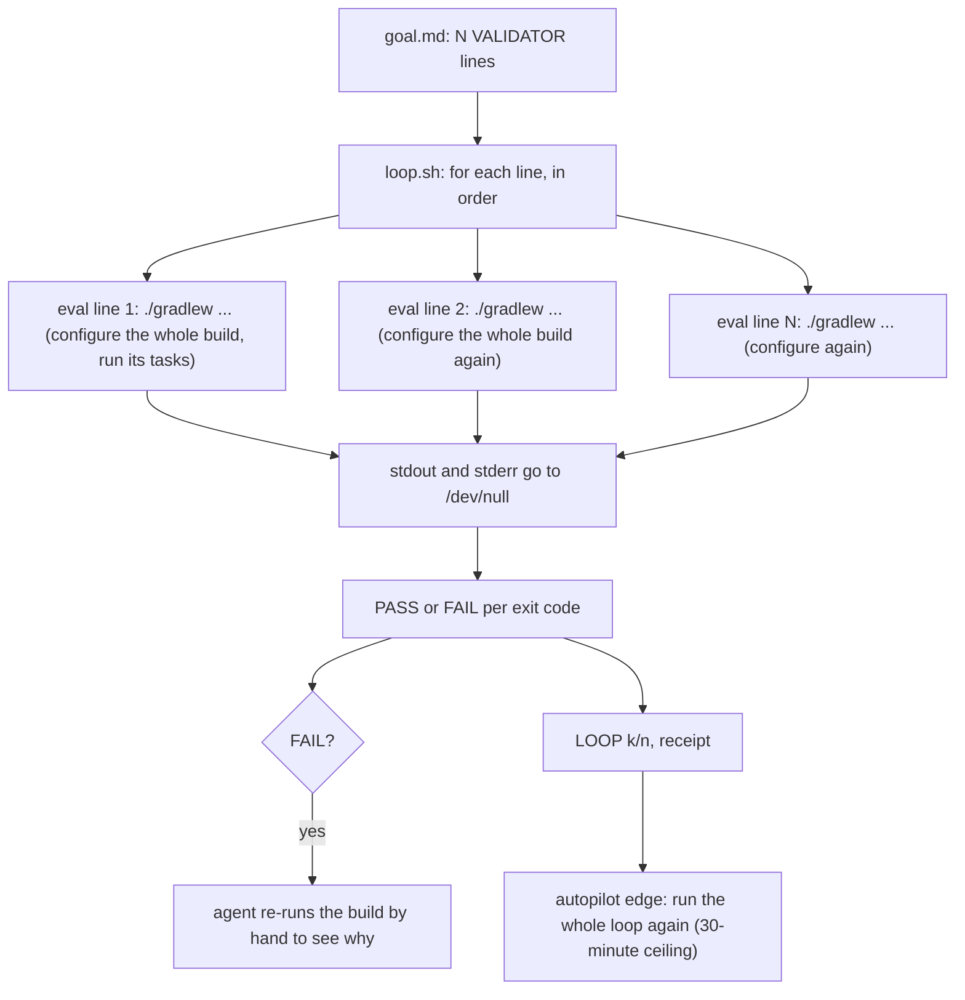
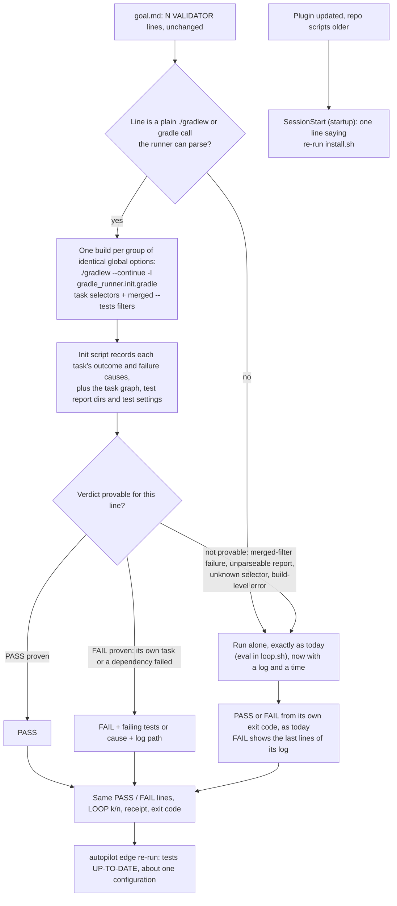

# Stage 05b — t62-loop-runners — SPEC

## User story IDs from the PRD

BDD's product is the cascade itself; the stories this slice serves:

- **S-LR1** — As an operator of a Gradle product, one `/loop` pass costs one Gradle configuration, not one
  per `VALIDATOR:` line, and a pass over unchanged code costs about one configuration and nothing more.
- **S-LR2** — As an operator, the faster loop never reports a verdict that running each line alone would
  not report. The one exception is named, measured and mine to switch off (Decision 1).
- **S-LR3** — As an operator upgrading from 2.5.0, I change nothing: `goal.md`, the envelope, every law and
  the receipt work as they are. Re-running `install.sh` is the whole upgrade, and the session tells me
  when I need to.
- **S-LR4** — As the agent, a `FAIL` tells me which tests failed, or shows the log tail, without my
  re-running the build to find out.

## The problem, stated as cost

`tests/loop.sh` runs each `VALIDATOR:` line as its own process, one after another, and discards the output
(`tests/loop.sh:107-115`: `( cd "$ROOT" && eval "$v" ) >/dev/null 2>&1`). The pack is right to be
toolchain-agnostic, but it pays for that by treating a build tool as a process spawner. Gradle already owns a
task graph, a scheduler and a cache keyed on each task's inputs, and the loop throws all three away.

Measured this hop on Gradle 8.14.3, warm daemon, a two-module Java fixture (JUnit 5) with four validators of
the usual shape (`:core:test --tests com.x.core.BalanceTest`, `:core:test --tests com.x.core.LedgerTest`,
`:app:test --tests com.x.app.CheckoutTest`, `:app:test --tests '*RefundTest'`). The build script sleeps
5s during configuration, standing in for a real build's configuration phase (plugins, AGP variant wiring).
That number is a stand-in; your build's own configuration time is what gets multiplied.

| What | Today | One batched build | Why |
|---|---|---|---|
| First pass | **28.9s** (7.1–7.4s per line) | **8.4s** | Each line configures the whole build again |
| Second pass, nothing changed | **29.5s** | **6.7s** | Today, two lines alternate `--tests` on the same task. The filter is a task input, so the task is never up to date and every test re-runs on every pass. Batched, the union filter is stable and the task is `UP-TO-DATE` |
| A failing line | `FAIL <cmd>`, output gone | Failing test names, plus a log | The agent re-runs the build by hand to see why, so every failure costs at least two builds |

Today's cost is about N × (startup + configuration + up-to-date checks) + test time. Batched, it is about
1 × (startup + configuration + up-to-date checks) + test time.

Three things multiply that cost further:

1. **Autopilot runs the loop twice per hop.** The EXECUTE→next edge re-runs `tests/loop.sh` from the git
   hook, with a 30-minute ceiling (`tests/lib/autopilot.py:111-116`). On a large Gradle product that second
   run can hit the ceiling, which refuses the edge with "could not run tests/loop.sh".
2. **Upgrading doesn't reach the loop.** In plugin mode, updating the plugin does not update the repo's
   `tests/loop.sh` until `install.sh` is re-run. The only notice is `preserve.py`'s drift line, and that
   fires on `compact|resume|clear` only (`hooks/hooks.json:46`), never at session start. An upgraded user
   keeps the slow loop and is not told.
3. **Nothing reports time.** The operator cannot see which line is slow.

## Before vs after

Before — every line is a separate build, and the output is discarded:

After — the build tool runs the lines, the pack keeps the verdict, and anything uncertain runs alone as
today:

## Benefits and trade-offs

| | What you get | What it costs | How the cost is contained | What remains |
|---|---|---|---|---|
| **Batched Gradle lines** | One configuration per pass instead of N (28.9s → 8.4s measured; unchanged pass 29.5s → 6.7s) | A Gradle-aware component in a toolchain-agnostic pack | Behind a fixed contract (each line gets a proven verdict or runs alone). Shell lines never touch it. `BDD_LOOP_RUNNER=shell` turns it off | Other build tools (Maven, pytest) get no speedup yet; same contract, later slices |
| **Proven verdicts only** | The runner reports a verdict only when it can prove it; everything else falls back to today's path | Fallback lines cost what they cost today | Fallbacks are counted and printed (`2 run alone: <why>`) | A goal that is mostly fallbacks is as slow as today, never slower by more than one build |
| **Merged `--tests` filters** (Decision 1) | Lines that share a test task with different filters cost one task run, not one each | Their tests share one test JVM, as `./gradlew test` and CI run them | Every FAIL from a merged task is confirmed by running that line alone. Only a PASS can come from the shared JVM. The merge gate (`dsharp_strength.sh`) and stage 10 (`audit.sh`) still run every check alone | A test that passes only because another line's test ran first in the same JVM can PASS the loop. The gates catch it; the loop does not. `BDD_LOOP_RUNNER=gradle-isolated` removes this, at today's cost for that pattern |
| **Logs, times, failure detail** | Every line has a log under `.cascade/loop/` and a time; a FAIL shows failing tests or the log tail | A few lines of output per FAIL; files under `.cascade/` | Detail is capped (15 lines, 200 chars each); the directory is reset each pass and gitignored | — |
| **Init script** | Structured task outcomes, not log scraping | `-I` adds one init script to the batched build | It registers a listener only. No task gets an action or input, so up-to-date state and build-cache keys are unchanged (AC7). It reads only stable paths, so the configuration cache still hits | The first batched pass after upgrade misses the configuration cache once (new init script = new cache key) |
| **Upgrade notice at start** | A plugin newer than the repo's scripts is reported when the session starts, not only after a compaction | One line of context, only while drifted | Prints nothing when versions match | Standalone installs have no plugin to drift from; they upgrade by re-running `install.sh` as today |

## What the slice adds — and the line it must not cross

### 1. The runner contract (`tests/loop.sh`)

Before the per-line loop, `loop.sh` checks whether any line starts with `./gradlew ` or `gradle `. If one does
and `BDD_LOOP_RUNNER` is not `shell`, it pipes the validator list to `python3 -B tests/lib/gradle_runner.py
"$ROOT" "$LOGDIR"`. The runner prints only verdicts it can prove, one per line index:
`<i>\tPASS\t
` or `<i>\tFAIL\t
`, optionally followed by `<i>\t+\t<detail line>`. Any index it
does not print **runs alone, exactly as today**: `( cd "$ROOT" && eval "$v" )` inside `loop.sh`'s own shell,
so `set -uo pipefail` and the sourced helpers behave as before. The only difference is that output goes to
`.cascade/loop/<i>.log` instead of `/dev/null`. If the runner crashes or prints garbage, every line runs alone.

Output keeps its contract. The `PASS  <line>` and `FAIL  <line>` lines are byte-identical and in declared
order. Detail goes on indented lines under a FAIL; one summary line comes before the blank line and
`LOOP k/n`. The `WAIVED`, `OMITTED`, `REFUSED` and receipt logic, the exit codes and `--list` are untouched.
Time comes from bash's `SECONDS`, which needs no extra process and works in bash 3.2.

### 2. The Gradle runner (`tests/lib/gradle_runner.py`, `tests/lib/gradle_runner.init.gradle`)

**Which lines it takes.** A line qualifies only if all of these hold. Anything else runs alone.

- `shlex` (posix, with punctuation detection) finds no shell operator (`; & | < > ( )`), and the line has no
  `$`, no backtick, no backslash, no leading `VAR=value`, and no `~` at the start of a token.
- No token holds a glob character (`*?[`) that would expand to a file in the repo root. `eval` would expand
  it; the runner passes arguments without a shell, so it refuses rather than differ.
- The first token is exactly `./gradlew` or `gradle`.
- Every other token is either a task selector (a qualified path such as `:app:testDebugUnitTest` or
  `app:test`, or a plain task name such as `test`), the task option `--tests <pattern>` directly after a
  selector, or a global option on an allowlist with known arity. Zero-arity:
  `-q -w -i -d -s -S --quiet --warn --info --debug --stacktrace --full-stacktrace --offline
  --refresh-dependencies --rerun-tasks --build-cache --no-build-cache --configuration-cache
  --no-configuration-cache --parallel --no-parallel --daemon --no-daemon --continue --scan --no-scan
  --watch-fs --no-watch-fs`, plus the `=` forms of `--console --warning-mode --max-workers`, and attached
  `-Dk=v`/`-Pk=v`. One-argument: `-x --exclude-task --console --warning-mode --max-workers -D -P
  --system-prop --project-prop`. Anything else (`-p`, `-b`, `-c`, `-I`, `--include-build`, `-t`, other task
  options such as `--fail-fast` or `--rerun`) makes the line run alone.
- Version: with `./gradlew`, `gradle/wrapper/gradle-wrapper.properties` must name Gradle 6.1 or later, read
  from the file without starting a JVM. With `gradle`, the init script checks the version itself and stops
  the build within about a second if it is older, which turns every line in that group into a run-alone
  line. 6.1 is when the event-listener API the init script needs arrived.

**Groups and filters.** Lines are grouped by their first token plus their global options, in order. Each
group is one build. Within a group, the filters of each selector are combined as follows:

- All of a selector's lines carry the same `--tests` set, or none: passed as given.
- Any of its lines carries no `--tests`: no filter, so the task runs all its tests. That is exactly that
  line's own run.
- Different `--tests` sets: their union, which is "merged". Under `BDD_LOOP_RUNNER=gradle-isolated` the
  first set is passed and the other lines on that selector run alone.

The command is `<first token> <global options> --continue -I tests/lib/gradle_runner.init.gradle
<selectors with their filters, in first-seen order>`, run from the repo root. It inherits the environment
plus `BDD_GRADLE_OUT=<root>/.cascade/gradle`. Its log is `.cascade/loop/gradle-<g>.log`.

**The init script records** two files under `.cascade/gradle/`:

- `outcomes.tsv`: one row per finished task, with its path, `SUCCESS`, `UP-TO-DATE`, `FROM-CACHE`,
  `SKIPPED:<msg>` or `FAILED`, and the failure message with all nested causes. It comes from a build-service
  `OperationCompletionListener` registered through `BuildEventsListenerRegistry`. Prototyped this hop: this
  is compatible with the configuration cache (no problems reported; entry stored, then reused).
- `graph-<sha of the command>.tsv`: written from `taskGraph.whenReady`, one row per task in the graph. Each
  row holds its path, whether it is an `AbstractTestTask`, its JUnit XML directory, `ignoreFailures`,
  `filter.failOnNoMatchingTests`, its direct dependencies and its finalizers. Prototyped: `whenReady` does
  not run when the configuration cache is reused, so this file is keyed by the command and kept between
  passes. The configuration cache is reused only for the same command and build logic, so the file is the
  one written when that entry was stored. A missing file makes every line in the group run alone.
- The env var and every path the script reads are stable across passes. They are configuration inputs, and
  changing them would defeat the user's configuration cache.

**Verdict rules, per line.** A line's tasks are its selectors resolved against the graph: a path matched
exactly, or a name matched to every graph task with that name. Abbreviations do not resolve, so that line
runs alone. Its *alone graph* is the closure of those tasks over dependencies and finalizers. A task counts
as succeeded if it finished `SUCCESS`, `UP-TO-DATE`, `FROM-CACHE` or `SKIPPED`.

1. **PASS proven.** Every task in the alone graph succeeded, or (for merged test tasks) passes attribution
   below.
2. **FAIL proven.** A task in the alone graph that is not a merged test task finished `FAILED`. Or one of the
   line's own tasks has no outcome while a task in its closure finished `FAILED`: with `--continue`, Gradle
   skips a task only when something it depends on failed. Prototyped: after a compile error, the downstream
   test tasks simply had no outcome.
3. **Merged test task T, for a filtered line i.**
   - T must have finished, with a graph row and a readable XML directory. If T `FAILED`, every recorded
     cause must be Gradle's "There were failing tests" (prototyped: a test-JVM crash reports "Process 'Gradle
     Test Executor N' finished with non-zero exit value", which is told apart), and `ignoreFailures` must be
     false. Otherwise line i runs alone.
   - From the XML: *certain(i)* holds if some test case is surely selected by i's patterns. *suspect(i)*
     holds if some failing test case could be selected by them (both defined below).
   - PASS if (certain(i) or not `failOnNoMatchingTests`) and (not suspect(i) or `ignoreFailures`).
   - Otherwise line i runs alone. A merged FAIL is never reported from the batch: it is always confirmed
     alone. This is what keeps a shared-JVM side effect from ever producing a false FAIL.
4. **Run alone instead** whenever any of these holds:
   - A merged, filtered test task sits in the line's alone graph without being one of its own tasks (for
     example a `check` line next to a filtered `test` line).
   - Two different selectors resolve to the same task with different filters.
   - The build exits non-zero and the count in its `FAILURE: Build completed with N failures.` /
     `Build failed with an exception.` line (1) does not equal the number of `FAILED` outcomes. That catches
     failures that are not task failures, such as configuration errors, unknown tasks or service errors. An
     unreadable summary counts as unequal.
   - Anything the rules above do not cover.

**Pattern matching**, mirrored from Gradle and checked this hop against Gradle 8.14.3 for each form below.
For pattern `p`, `rx(p)` is `p` with `*` as `.*`, anchored. A class `C` matches `p` when `rx(p)` matches C's
simple name (if `p` starts with an upper-case letter) or C's fully qualified name (otherwise). The XML
`classname` gives `C`; the XML `name` gives the method `m` when it is an identifier, optionally followed by
`(…)` or `[…]`, and nothing when it is a display name.

- *Surely selects* (used only to prove the line matched at least one test, so it may only be narrower than
  Gradle): `C` matches `p`, or `m` is known and `rx(p)` matches `C.m` (simple or full form as above). Probes
  this hop: `BalanceTest`, `Bal*`, `com.x.core.Bal*`, `*BalanceSpec`, `BalanceSpec$Inner`, `*Inner` and
  `com.x.core.BalanceTest.one` all select what this predicts. `core.BalanceTest` selects nothing, as
  predicted.
- *Could select* (used only to decide whether a failing test might be the line's, so it may only be wider):
  surely-selects; or the outer class of a nested `C` (the part before `$`) matches `p`, since
  `com.x.core.BalanceSpec` also runs `BalanceSpec$Inner`; or `m` is unknown and `p` contains `*` or `.`; or
  `p` minus its last `.segment` matches `C` or C's outer class. Probe: `*Test` also ran the *method*
  `BalanceSpec.balanceTest()`, which the method clause catches.

**What a FAIL shows.** For a batched FAIL: up to 10 failing test cases (`class.method — first line of the
message`) from the XML, or the failed task and its first cause, plus the log path. For a line run alone:
the last 15 lines of its log. Each detail line is capped at 200 characters.

### 3. Upgrade path

- `install.sh` adds `.cascade/loop/` and `.cascade/gradle/` to the product's `.gitignore`, on the same line
  that adds today's generated paths (`install.sh:160`). This repo's `.gitignore` gets the same two entries.
  A run must not dirty the tree (T16).
- `hooks/hooks.json` gets a SessionStart entry with matcher `startup`, running `preserve.py`. When the event's
  `source` is `startup`, `preserve.py` prints **only** the version-drift line (today's text,
  `.claude/hooks/preserve.py:104-118`) and nothing at all when versions match. It does not re-inject the
  control line on a plain start. `compact|resume|clear` behave exactly as today.
- No product-owned file changes on upgrade: `goal.md`, `envelope.md`, `hop-state.md` and `settings.json` are
  `keep`. That is today's `install.sh` behaviour, and AC5 pins it.

**The line it must not cross (I18):** for every line the runner reports, the verdict equals the verdict of
that line run alone today. The one exception is the shared-JVM case in Decision 1, which is named, confirmed
on every FAIL, re-checked alone by the merge gate and stage 10, and switched off by `gradle-isolated`. Every
line the runner cannot prove runs alone, by today's code path. Shell-only goals never start the runner. No
law, `tests/inv/*` file, `<EDIT>` block, validator or `goal.md` changes. `dsharp_strength.sh`, `audit.sh`
and the merge gate keep running every check alone.

## Acceptance criteria

The AC script uses a **stub `gradlew`** (a script in the fixture) so CI needs no JVM, as t56's AC5 required.
The stub reads a scenario file describing tasks, dependencies, test classes and results. It writes
`outcomes.tsv`, the graph file and JUnit XML the way the init script and Gradle do, applies `--tests` with
the matching rules above, prints Gradle's failure summary line, and logs each invocation to a counter file.
Run alone, it behaves like Gradle run alone. Real Gradle is checked by AC7.

- **AC1 — one configuration per group.** A goal of six Gradle lines across two modules and two test tasks
  (four sharing one test task with different filters) runs exactly one stub invocation on an all-green
  scenario. A second identical pass runs one invocation and reports the test tasks `UP-TO-DATE`.
  **Red twin:** with `BDD_LOOP_RUNNER=shell` the same goal makes six invocations, so "one invocation" fails.
- **AC2 — verdict identity.** For each scenario in a matrix, every line's PASS/FAIL under the runner equals
  its PASS/FAIL under `BDD_LOOP_RUNNER=shell`, and `LOOP k/n` and the exit code are equal. The matrix:
  all pass; a failing test in an unshared task; a failing test in a merged task, next to a `*`-pattern line
  that could select it but does not (only the failing line FAILs, after one alone run); a compile error
  upstream of two test tasks; a line whose filter matches nothing next to one that matches; a test-JVM
  crash in a merged task; `ignoreFailures=true` with a failing test; `failOnNoMatchingTests=false` with an
  empty filter; an unknown task in one line; a build-level failure that is not a task failure, raised after
  one line's tasks ran (the stub prints `Build completed with 2 failures.` with one `FAILED` outcome); a
  `check` line next to a filtered `test` line; mixed shell and Gradle lines; two groups with different `-P`
  options; a line with a shell operator; a glob that matches a repo file.
  **Red twins**, each a copy of the runner with one rule removed:
  - Without "a FAIL from a merged task runs alone", the `*`-pattern line is reported FAIL.
  - Without the failure-count check, the line hit by the build-level failure is reported PASS.

  Either way a verdict differs from the shell run, so the identity check fails.
- **AC3 — fallback is today's path.** Lines the runner does not print run through `eval` in `loop.sh`. A
  validator that depends on `pipefail` (`false | true`) or calls a sourced `cascade_*` function gives the same
  verdict as 2.5.0. A runner that exits non-zero or prints garbage makes every line run alone, and the
  verdicts equal the shell run.
- **AC4 — output contract.** On a fixture of shell-only goals (pass, fail, waived D#, omitted D#, CRLF,
  pre-split envelope), the lines matching `^(PASS|FAIL|WAIVED|LOOP|LOOP REFUSED|not n/n|Hop edge)`, the exit
  code, and `.cascade/loop-receipt` all equal those of 2.5.0's `loop.sh`. A frozen copy is committed as
  `tests/ac/fixtures/loop-2.5.0.sh`, since CI cannot assume history. A FAIL prints at most 15 indented
  detail lines, each at most 200 characters.
- **AC5 — upgrade.** A fixture repo installed by the current `install.sh` is made "old": `tests/loop.sh` is
  replaced by the 2.5.0 copy, the two new `.gitignore` lines are removed, and the manifest version is set to
  2.5.0. Re-running `install.sh` leaves `goal.md`, `envelope.md`, `hop-state.md` and `settings.json`
  byte-identical, adds the two `.gitignore` lines, installs the new `loop.sh` and runner, and after one loop
  pass `git status --porcelain` is empty. `preserve.py` with `source=startup` and a plugin `VERSION` newer
  than the manifest prints the drift line and no control-line block; with equal versions it prints nothing.
- **AC6 — nothing else moves.** `bash tests/enforcement.sh` (T8–T61, plus a new **T62** that drives AC1, AC2's
  merged-FAIL and compile-error cases and AC5's ignore check through a real `loop.sh` in a throwaway repo),
  `bash tests/ac/t59_scale_hardening.sh`, `t57`, `t58` and `bash tests/lint.sh` stay green, with T62
  documented in README, CONTROL-LINE and AUDIT.
- **AC7 — real Gradle.** `bash tests/stress/gradle_runner.sh` (opt-in, needs a JDK, Gradle and Maven
  Central) builds this hop's fixture. It then checks five things:
  - (a) For each probe pattern above, Gradle's own selection, running the pattern alone, contains the
    runner's *surely* set and is contained in its *could* set.
  - (b) Every AC2 scenario that real Gradle can express gives identical verdicts in both modes.
  - (c) A build without `-I`, then the batched build, shows the same tasks `UP-TO-DATE`: the init script
    moves no task's state.
  - (d) With `--configuration-cache`, the second batched pass reports the entry reused and still gives
    verdicts.
  - (e) It prints both modes' times at `CONF_MS=5000`.

  On the EXECUTE hop it runs once on 8.14.3 and its output goes into the hop report. Whether CI runs it
  too is Decision 3.

## Laws

`NO D# IN FORCE`. `envelope.md` declares no law (its only `###` block is the `{{…}}` template). This slice
proposes none: it is pipeline tooling, not product physics. It neither changes nor adds anything under
`tests/inv/*` (I13). The new tests are `tests/ac/t62_loop_runners.sh` and `T62` in `tests/enforcement.sh`
(T61 is the last one taken).

## PLAN

0. **`tests/lib/gradle_runner.init.gradle`** — the listener, the graph dump and the version guard (§2).
   Groovy, with dynamic property access for `outputLocation` versus `destination` across 6.x–9.x.
1. **`tests/lib/gradle_runner.py`** — stdlib only (`shlex`, `xml.etree`, `hashlib`, `subprocess`, `glob`),
   Python 3.8+. Line parsing, the allowlist, groups, the command, the run, outcomes and graph parsing,
   resolution, closures, attribution, the failure-count check, and the protocol output (§1, §2). `loop.sh`
   reads only well-formed protocol lines for indexes it sent, so a bug or crash here can only make lines
   run alone.
2. **`tests/loop.sh`** — the runner call, the per-line logs, `SECONDS` timing, the FAIL detail, the summary
   line and `BDD_LOOP_RUNNER` (`auto` default, `shell`, `gradle-isolated`). `.cascade/loop/` is reset at the
   start of each pass.
3. **`install.sh`** — the two `.gitignore` entries. **`.gitignore`** — the same. **`hooks/hooks.json`** — the
   `startup` SessionStart entry. **`.claude/hooks/preserve.py`** — the `startup` branch (§3).
4. **`tests/ac/fixtures/loop-2.5.0.sh`** — frozen from `4e4d6f2:tests/loop.sh`.
   **`tests/ac/fixtures/gradlew-stub`** — the stub described under the ACs.
5. **`tests/ac/t62_loop_runners.sh`** — AC1–AC5 with their red twins, in scratch repos, with
   `GIT_CONFIG_GLOBAL=/dev/null`.
6. **`tests/enforcement.sh` T62** — per AC6. T16 gets the two new ignored paths in its "a run must not dirty
   the tree" list.
7. **`tests/stress/gradle_runner.sh`** — AC7, standalone, cleans up after itself.
8. **Docs** — CONTROL-LINE.md row `| T62 |` and the `T8–T62` ranges in README.md, CONTROL-LINE.md and AUDIT.md
   (lint). USAGE.md: what the loop now prints, `.cascade/loop/`, `BDD_LOOP_RUNNER`, which Gradle lines are
   batched and why a line runs alone, and Decision 1 in one paragraph.
9. **Version** — `VERSION`, `.claude-plugin/plugin.json` and `marketplace.json` (T31), set to the version you
   pick (Decision 2). A CHANGELOG entry covering: the batched Gradle loop and its fallback, the merged-filter
   semantics and how to switch them off, logs and times, the one-time configuration-cache miss, the startup
   drift notice, and the upgrade command.
10. **Verify** — `goal.md`: `VALIDATOR: bash tests/ac/t62_loop_runners.sh`, `bash tests/ac/t59_scale_hardening.sh`,
    `bash tests/ac/t57_spec_critic.sh`, `bash tests/ac/t58_divergence.sh`, `bash tests/enforcement.sh`,
    `bash tests/lint.sh`. Run `bash tests/loop.sh` to n/n. Run `bash tests/stress/gradle_runner.sh` once and
    paste its output (AC7). Re-read the diff adversarially.

**Not in this slice** (each its own brief):
- **A Maven runner** (`mvn -pl … -Dtest=…`, surefire XML), then pytest and jest. Same contract, same rule:
  prove it or run it alone.
- **Shell lines in parallel** in `loop.sh`, using t56's pool (`DSHARP_JOBS`), collected in declared order.
- **Batching `audit.sh`'s `test:` commands.** The merge gate and `dsharp_strength.sh` stay alone by design:
  they are where the shared-JVM exception is re-checked.
- **Red twins as data** (a mutation patch applied in a separate worktree, for an incremental build). That
  changes the D# line format, which is yours.

## Decisions for the human (flag at the edge)

1. **Merged filters by default.** I recommend `auto` (merge) as the default. Your ask was "no more slow",
   and the most common Gradle goal is several `--tests` lines on one test task; without merging, that goal
   gets almost nothing. The cost: those lines' tests share a JVM, as `./gradlew test` and CI already run
   them. Every FAIL is confirmed alone, and the merge gate and stage 10 re-check every law and audit row
   alone. `BDD_LOOP_RUNNER=gradle-isolated` gives strict per-line JVMs. If you would rather strict be the
   default, say so; merging then becomes the opt-in.
2. **Version number.** I recommend **2.6.0**: a new capability, no contract changed, every old `goal.md`
   runs unchanged. A loop that now writes `.cascade/loop/` is covered by the `.gitignore` entries `install.sh`
   adds.
3. **Real-Gradle check in CI.** AC7 needs a JDK, Gradle and Maven Central. Option A: keep it opt-in, like
   `tests/stress/ten_year.sh`; CI proves the runner's logic through the stub, not its fidelity to Gradle.
   Option B: a CI job with `actions/setup-java` and `gradle/actions/setup-gradle`, about 2 minutes per PR,
   which proves the matching rules against real Gradle on every change. I recommend **B**, because pattern
   fidelity is the one claim the stub cannot make. It does add two third-party actions to CI.
4. **The startup notice.** A plugin-mode session now gets one line at start while the repo's scripts are
   older than the plugin. Without it, an upgraded user keeps the slow loop until a compaction happens to
   show the notice. It prints nothing when versions match.
