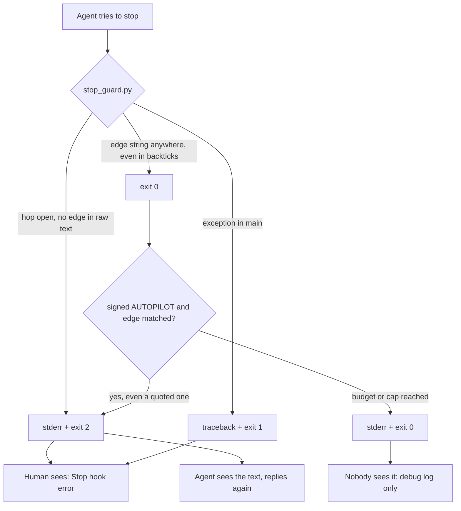
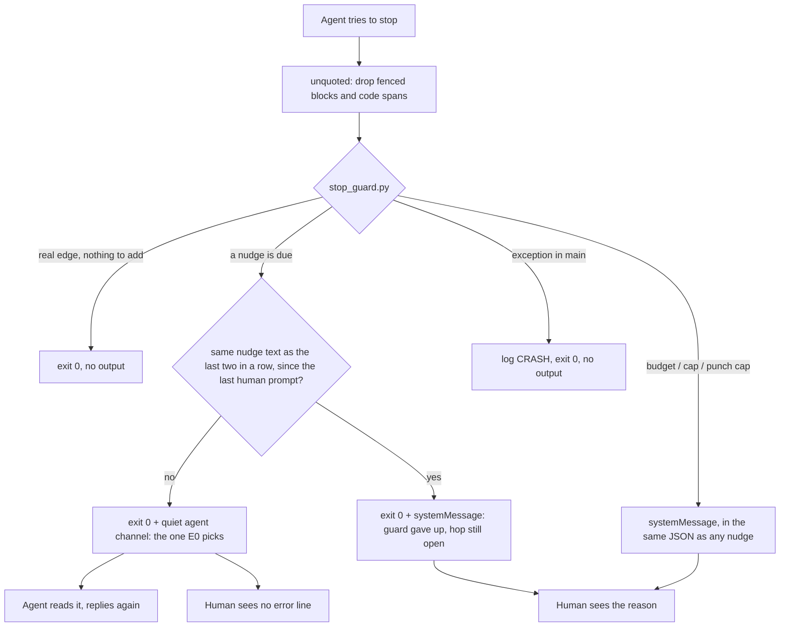

# Stage 05b — t63-quiet-stop-guard — SPEC

## User story IDs from the PRD

BDD's product is the cascade itself; the stories this slice serves:

- **S-QS1** — As an operator, when the Stop hook sends the agent back to finish a hop, I do not see a red
  "Stop hook error" that reads like a crash. The agent gets the instruction; I see the agent's corrected reply.
- **S-QS2** — As an operator, the stops that are *for me* — the autopilot time budget, the continuation cap,
  the stage-10 punch cap, and the guard giving up after repeated identical nudges — do reach me. Today they
  reach nobody.
- **S-QS3** — As an operator, an explanation that quotes an edge string *in code* (an inline code span or a
  fenced block, e.g. `` `STITCH NEEDED:` ``) does not start a signed autopilot run or count as closing a hop.
  Unquoted prose that contains an edge string still counts, as today (critic C10).
- **S-QS4** — As the agent, the I1 nudge and the conductor tell me the same thing: what AGENTS.md says to
  print at an edge, and nothing it forbids.

## The problem, stated exactly

1. **Every agent-facing nudge is rendered to the human as an error.** `stop_guard.py` sends all five of
   them by printing to stderr and exiting 2 (`.claude/hooks/stop_guard.py:303-308`, `:314-317`, `:323-331`,
   `:366-370`, `:379-387`). Claude Code shows exit-2 stderr from a Stop hook to the human as
   `Stop hook error: [<command>]: <text>` — observed by the operator in this repo on 2026-10-20, Claude Code
   2.1.280. The hook is working; the label says it is not.
2. **The stops meant for the human reach nobody.** The budget and cap messages print to stderr and then the
   hook exits 0 (`stop_guard.py:111-113`, `:116`). The hooks reference says: "Claude never sees stderr from a
   hook that exits 0", and a successful hook's output goes to the debug log only. The human is not shown it
   either. An overnight run that stops on its budget leaves no visible reason.
3. **Code-quoted edge strings count as real ones.** `halting()` strips fenced blocks and inline code spans
   before looking for `AUTOPILOT HALT` (`stop_guard.py:44-58`). The other edge matches do not:
   `any(e in last for e in EDGES)` at `stop_guard.py:313` (autopilot continuation) and `:375` (I1 closed-hop
   check), and the substring tests at `:151` (`review spec+plan`) and `:360` (`STITCH NEEDED: accept execute`).
   On 2026-10-20 an explanation in this repo that quoted `` `STITCH NEEDED:` `` inside backticks, with no hop
   running and a signed `AUTOPILOT:` line, made the hook order the agent to start GENERATE 05b
   t56-dsharp-parallel.
4. **The edge instructions contradict each other.** The I1 text says a hop ends by "printing the invariant
   block and then exactly one edge line" (`stop_guard.py:380-381`), and the conductor's GENERATE shape ends
   "Then stop. Print I1–I18. Last line STITCH NEEDED." (`docs/cascade/product-e2e-gre-pipeline.md:411`).
   AGENTS.md says "Do not reprint I1–I18 at a hop edge", and the conductor's own INVARIANTS header says the
   reprint is "NOT at ordinary hop edges" (`product-e2e-gre-pipeline.md:31`).
5. **A crash is visible too.** Only the import is guarded (`stop_guard.py:16-19`). An exception inside
   `main()` prints a traceback and exits 1 (`stop_guard.py:390-391`), which the human also sees as a hook
   error (critic C6).

What already bounds the guard, measured this hop: Stop events carry `prompt_id`. The guard records
`stop_guard.py-<prompt_id>-Stop-` under `.git/cascade-seen/` on its first judgment (`stop_guard.py:292`,
`_common.py:82-88`) and returns 0 on any later Stop with the same id. This is also why the plugin copy and the
repo copy never both judge one stop (`ls -t .git/cascade-seen | grep stop_guard`). `stop_hook_active` is the
second bound (`:299`, `:322`, `:333`, `:361`). No existing test passes a `prompt_id`, so the first bound is
untested today (critic C5).

## Before vs after

Before:



After:



## Benefits and trade-offs

| | Today | After t63 |
|---|---|---|
| What you see when the agent forgot the edge line | Red `Stop hook error` with the full instruction | Nothing extra; the agent's next reply carries the edge line |
| Budget / cap / punch-cap stop | Invisible (stderr on exit 0) | One visible warning line naming the reason and `/barbar auto` |
| An explanation quoting `` `STITCH NEEDED:` `` in code | Can start autopilot or count as a closed hop | Ignored; only an edge outside code counts |
| An agent that ends with the edge line *only* inside code | Counted as closed | Nudged to print it plainly (Ask 1) |
| An agent stuck repeating the same mistake | Nudged once per stop chain (`stop_hook_active`) | Nudged twice with identical text, then you get a warning (Ask 3) |
| Claude Code without the chosen quiet channel | Works | If E0 picks `additionalContext`, the nudge is dropped and the guard fails open; git hooks and CI are unaffected. If E0 picks `decision: block`, it works wherever exit 2 works (Ask 2) |
| A crash inside the guard | Visible traceback, exit 1 | Silent exit 0, a `CRASH` line in `.cascade/decisions.log` |
| How you audit why the agent replied twice | Visible in the error line | `.cascade/decisions.log`: every nudge logs a line after this slice (today only two of five do, critic C9) |
| Test churn | — | Every `stop_guard` assertion in `tests/enforcement.sh` reads the verdict through one helper; a lint fails on any rc-based stop_guard check left |

## What the slice adds — and the line it must not cross

### 1. One output function, one channel switch

`stop_guard.py` gains `emit(to_agent: str = "", to_human: str = "") -> int`. It prints at most one JSON object
on stdout and returns 0. It never prints to stderr. With both texts empty it prints nothing.

Two documented quiet channels exist for a Stop hook on exit 0 (critic C1):

- **(Q1) `{"decision": "block", "reason": to_agent}`**: blocks the stop the way exit 2 does, so
  `stop_hook_active` should keep its meaning. Older Claude Code honours it.
- **(Q2) `{"hookSpecificOutput": {"hookEventName": "Stop", "additionalContext": to_agent}}`**: lets the turn
  end, then gives Claude the text as a system reminder and continues.

`to_human`, when present, goes in the same object as the universal `"systemMessage"` field.

The channel is one constant, `CHANNEL`, set by E0 (PLAN). **The rule:** use Q1 unless E0 shows that Claude
Code 2.1.280 renders Q1's `reason` to the human. In that case use Q2. If both render visibly, HALT at E0 with
the evidence: neither channel delivers S-QS1. No setting or env var switches the channel at run time.

`main()` is wrapped: any exception logs `CRASH <type>: <message>` through `log()` and returns 0 with no
output (critic C6). A Stop hook that cannot run must not trap the session, and it must not show a traceback.

### 2. Which message goes where

| Message | Today | After | Logged |
|---|---|---|---|
| Spec gate red (t57/t58), `:303` | stderr, exit 2 | `to_agent` | `NOSPECGATE` (as today) |
| Autopilot "signed edges remain", `:314` | stderr, exit 2 | `to_agent` | `CONTINUE` (new) |
| HALT missing its instruction block, `:323` | stderr, exit 2 | `to_agent` | `NOHALTBLOCK` (new) |
| I10 accept without evidence, `:366` | stderr, exit 2 | `to_agent` | `NOEVID` (as today) |
| I1 hop not closed, `:379` | stderr, exit 2 | `to_agent` | `NOEDGE` (new) |
| Autopilot wall-clock budget reached, `:111` | stderr, exit 0 (lost) | `to_human` | `BUDGET` (as today) |
| Autopilot continuation cap reached, `:116` | stderr, exit 0 (lost) | `to_human` | `CAP` (as today) |
| Stage-10 punch cap, `:242-247` | inside the I10 nudge | `to_agent` (unchanged text) **and** `to_human`: "stage-10 punch cap reached for `<slice>`: the audit is still DIRTY after 3 rounds" | `CAP` (as today) |
| Nudge limit (new, §4) | — | `to_human` only | `NUDGECAP` (new) |

Message texts stay byte-identical except the I1 text (§5). `continue_autopilot` returns
`(continue: bool, to_human: str)` instead of a bool and stops printing. `main()` collects the `to_human` text
of every message the stop triggers and passes them to the single `emit` call that ends the stop, joined by a
newline. So a budget stop that then falls through to the I1 check yields one object carrying both texts. A
budget stop on a real edge yields `systemMessage` alone (critic C7).

### 3. One quoting rule

`halting()`'s filter becomes `unquoted(text) -> str`: drop fenced blocks (```` ``` ```` / `~~~`) and inline
code spans. `halting()` becomes `HALT in unquoted(text)`. Every other edge test reads `unquoted(last_msg)`:
the autopilot match (`:313`), the I1 match (`:375`), the I10 trigger (`:360`), the spec-gate trigger (`:151`)
and both `WHAT TO DO` tests (`:318`, `:322`). Edge strings in unquoted prose keep counting wherever they
appear on the line, as today. Making only the last line count would change the verdict of every reply that
carries an edge mid-line, e.g. T28's fixture `INVARIANTS held. STITCH NEEDED: …` (`tests/enforcement.sh:422`).
That is out of scope (critic C10).

### 4. The bound

The two existing bounds stay unchanged: the `prompt_id` marker and `stop_hook_active`. If E0 shows that a
Q2 continuation reuses `prompt_id`, the marker already ends the chain after one nudge, exactly as
`stop_hook_active` does today. If it does not, nothing else bounds the chain. So the guard adds a third
bound of its own (critic C4):

- `.git/cascade-nudges-<session_id>` holds `<sha256 of the last to_agent text> <count>`.
- A nudge whose text equals the stored one increments the count. A different text starts it at 1. The
  punch-list rounds of I10 carry a different round number and score each time, so they never accumulate;
  the punch cap (`PUNCH_CAP = 3`, `:181`) keeps firing at round 4 as today.
- **A third identical nudge in a row** is not sent. It logs `NUDGECAP` and emits only `to_human`: "the stop
  guard asked the agent twice to close the hop and it did not; the hop is still open — read the last reply,
  then sign or send back."
- **Reset:** a stop that passes with no nudge deletes the file. `seam.py`, on every UserPromptSubmit (a real
  human prompt), deletes it too. So three human prompts that each forget the edge line each get their own
  nudge.
- **Autopilot continuation** is not a nudge: it neither counts nor resets. It keeps its own cap
  (`continue_autopilot`, `4 × slices + 4`).

Compared with today, no stop chain gets fewer nudges. Today the retry stop passes on `stop_hook_active`
after one nudge. After t63 an identical retry is nudged once more before the human is told.

### 5. The edge instructions

```diff
--- .claude/hooks/stop_guard.py
-        f"Hop not closed (I1). This is {hop} stage {stage or 'N'}. Every hop ends by "
-        f"printing the invariant block and then exactly one edge line:\n"
+        f"Hop not closed (I1). This is {hop} stage {stage or 'N'}. End the reply with exactly one "
+        f"edge line, as plain text, not in a code span or block:\n"
--- docs/cascade/product-e2e-gre-pipeline.md
-Then stop. Print I1–I18. Last line STITCH NEEDED.
+Then stop. State the D# in force (or NO LAW IN FORCE). Last line STITCH NEEDED.
```

Line 411 is outside every `<EDIT>` block (`grep -n '<EDIT>' docs/cascade/product-e2e-gre-pipeline.md`).

### What the slice must not touch

- **Verdicts.** The brief says both "verdicts must not change" and "match every edge string with code
  stripped"; the second changes one verdict (critic C2). The spec resolves it by naming every change and
  nothing else: (a) Ask 1, an edge only inside code no longer closes a hop; (b) Ask 3, a third identical nudge
  in a row becomes a warning. Every other case that sends the agent back today still does, and every case
  that passes still passes. The brief's "keep the human-facing stops visible" is read as "make them visible":
  today they are not (critic C2).
- `.githooks/*`, `tests/loop.sh`, `tests/barbar.sh`, `tests/lib/autopilot.py`, every `tests/inv/*`.
- `hooks/hooks.json` and `.claude/settings.json` wiring: same commands, same events.
- The duplicate-install question (plugin plus repo copy). The `prompt_id` marker already stops a double
  judgment.

## Acceptance criteria

All in `tests/ac/t63_quiet_stop_guard.sh`, wired into `tests/enforcement.sh` as **T63**. A helper
`sg_verdict` reads the hook's stdout and returns exactly one of `nudge` (the chosen channel's agent field is
present), `warn` (`systemMessage` only), `nudge+warn`, or `pass` (no output), plus the texts.

- **AC1 — the agent channel.** For each of the five agent-facing nudges, built from the fixtures T28, T41,
  T57 and T59 already use: exit 0, stdout is one JSON object in the `CHANNEL` shape, the agent text equals the
  stderr text before this slice (except I1, AC6), stderr is empty.
  RED TWIN: `emit` patched back to `print(..., file=sys.stderr); return 2` makes AC1 fail.
- **AC2 — the human channel.** Budget (`BDD_AUTOPILOT_MINUTES` with a back-dated start file), continuation cap
  (the T28 loop of 14 stops) and punch cap (T36's four rounds) each yield `systemMessage` holding the reason. A
  budget stop on a real edge yields `warn`; one that falls through to I1 yields `nudge+warn`.
  RED TWIN: the old stderr print on these paths leaves `systemMessage` absent and AC2 fails.
- **AC3 — quoting.** With a signed `AUTOPILOT:` list and `CURRENT_HOP: NONE`, a message whose only edge
  strings are in a code span or a fence yields `pass`. On an open hop the same message yields `nudge` (I1). An
  edge as plain text, on the last line or mid-line, yields `pass` on the open hop. An unquoted edge mid-prose
  with `CURRENT_HOP: NONE` and a signed list still continues autopilot, as today.
  RED TWIN: `unquoted` replaced by the identity function makes the idle code-quoted case continue autopilot.
- **AC4 — the identical-nudge bound.** One session, fresh `prompt_id`s, `stop_hook_active: false`: three
  identical would-nudge stops yield `nudge`, `nudge`, `warn` (+ `NUDGECAP` logged). Two stops with different
  nudge texts in between reset the count. A clean stop resets it. Running `seam.py` with a UserPromptSubmit
  event resets it. Four I10 punch rounds on one slice reach the punch cap at round 4, not `NUDGECAP`.
  RED TWIN: the counter removed lets the third identical stop nudge again.
- **AC4b — the prompt marker.** Two stops with the same `prompt_id`: the second yields `pass` with no output
  and logs nothing. RED TWIN: `already_event` patched to return False makes the second stop nudge again.
  This closes the brief's "a guard that nudges twice for the same prompt is a red twin" (critic C5).
- **AC5 — no verdict drift, mechanically.** Every existing stop_guard assertion in `tests/enforcement.sh`
  (T28, T36, T37, T41, T57, T58, T59 and the closed-hop check at `tests/enforcement.sh:148-154`) reads
  `sg_verdict`. A former `rc -eq 2` becomes `nudge`; a former `rc -eq 0` becomes `pass`. The only exceptions
  are the cap cases, each named: T28's 14-stop loop (`tests/enforcement.sh:434-435`) and T36's round-4 check
  become `warn` / `nudge+warn` respectively. The T59 red twin (`tests/enforcement.sh:1435`) keeps `pass`.
  A lint inside AC5 fails if any line in `tests/enforcement.sh` or `tests/ac/*.sh` that pipes into
  `stop_guard.py` is followed by an `rc`/`$?` comparison instead of `sg_verdict` (critic C8).
- **AC6 — the edge texts.** The I1 agent text does not contain `invariant block` and names this hop's edge
  line. `grep -n 'Print I1–I18' docs/cascade/product-e2e-gre-pipeline.md` prints nothing.
- **AC7 — crash.** `main()` with `hopstate` monkeypatched to raise returns 0, prints nothing on stdout or
  stderr, and logs `CRASH`. RED TWIN: the wrapper removed makes the test see a traceback.
- **AC8 — logging.** Each of the five nudges writes its `Logged` value from §2 to `.cascade/decisions.log`.
- **AC9 — live check (human, at the accept edge).** In a Claude Code session on this repo with a GENERATE hop
  open, a reply that omits the edge line produces no `Stop hook error` line, and the agent's next reply prints
  the edge line. The operator records the Claude Code version in the hop report.

Gate: `bash tests/enforcement.sh` green, `bash tests/ac/t63_quiet_stop_guard.sh` green.

## Laws

`bash tests/dsharp_strength.sh` prints `DSHARP 0/0`: NO LAW IN FORCE in this repo. The envelope's only D#
block is the `{{…}}` template. The slice can break no D#; the `/goal` is the ACs above plus
`bash tests/enforcement.sh`.

# Stage 05b — PLAN

## Goal

EXECUTE produces a `stop_guard.py` that talks to the agent through the quiet channel E0 picks and to the human
through `systemMessage`, never through exit 2, stderr or a traceback. It matches edge strings only outside
code, logs every nudge, and bounds identical nudges per human prompt. The I1 text and the conductor agree
with AGENTS.md. `tests/ac/t63_quiet_stop_guard.sh` proves it with red twins, and `tests/enforcement.sh`
reads every old assertion through `sg_verdict` with the verdicts §"must not touch" allows.

## In scope this execute

- [ ] **E0 — live experiment first** (U1, U2). In a scratch repo under the session scratchpad, with only a
      Stop hook that answers once and then passes, run Claude Code 2.1.280 interactively for each channel:
      (Q1) `decision: block` + `reason`, (Q2) `additionalContext`. Record for each: (a) does Claude continue,
      (b) what the UI shows the human, verbatim, (c) the continuation Stop's `prompt_id` (same or new) and
      `stop_hook_active`. The UI observation needs the operator's eyes: the run asks for it rather than
      guessing. Apply §1's rule, set `CHANNEL`, and write the table into the EXECUTE report. If neither
      channel is invisible, HALT with the table.
- [ ] `.claude/hooks/stop_guard.py` — `emit`, `CHANNEL`, `unquoted`, routing and logging per §2, the
      `continue_autopilot` return change, the counter per §4, the `main()` wrapper, the I1 text per §5
- [ ] `.claude/hooks/seam.py` — one call that deletes `.git/cascade-nudges-<session_id>` on UserPromptSubmit
- [ ] `docs/cascade/product-e2e-gre-pipeline.md:411` — per §5
- [ ] `tests/ac/t63_quiet_stop_guard.sh` — AC1–AC8 with their red twins
- [ ] `tests/enforcement.sh` — `sg_verdict`; T28, T36, T37, T41, T57, T58, T59 and `:148-154` read it per
      AC5; new `t T63` line
- [ ] `CHANGELOG.md` — an "Unreleased" entry for t63, naming the channel E0 picked and the Claude Code version
      it was measured on (the version bump is t69's)

## Out of scope this execute

- Removing the duplicate plugin and repo install, or changing `install.sh`
- Any other hook's output channel (`hop_guard.py`, `bash_guard.py`, `preserve.py`, `sign_ok.py`; `seam.py`
  gets only the reset call)
- Last-line-only edge matching (critic C10)
- The `CHANGELOG.md` `<EDIT>` false positive in `.githooks/pre-commit` (seen 2026-10-20; a separate brief)
- A version bump

## Definition of done

- `bash tests/ac/t63_quiet_stop_guard.sh` exits 0, and each red twin in it is shown to fail.
- `bash tests/enforcement.sh` exits 0 with T63 present.
- `grep -nE 'return 2|file=sys\.stderr|sys\.exit\(2\)' .claude/hooks/stop_guard.py` prints nothing.
- `grep -n 'Print I1–I18' docs/cascade/product-e2e-gre-pipeline.md` prints nothing.
- `bash tests/loop.sh` prints `LOOP n/n`.
- E0's table is in the EXECUTE report, with the channel chosen and why.

## Risks / UNKNOWNs that still block

- **U1 — continuation identity.** Whether a Q1 or Q2 continuation reuses `prompt_id` or sets
  `stop_hook_active` is undocumented. E0 measures it. §4 bounds the guard either way.
- **U2 — what the UI shows.** Undocumented for both channels. E0 measures it with the operator. If both are
  as visible as exit 2, S-QS1 cannot be met and the slice HALTs at E0.
- **U3 — older Claude Code.** Only if E0 picks Q2: a version that ignores Stop `additionalContext` drops the
  nudge and the guard fails open at Layer 2. Layers 0/1 still hold (Ask 2).
- **E0 needs a human at the keyboard.** Autopilot cannot see the UI. If the EXECUTE hop runs unattended, it
  HALTs at E0 with `decision needed — what did the UI show?` rather than guess.

## Ask of you

1. **Code-quoted edges stop counting.** A reply whose only edge line is in a code span or fence will be nudged
   to print it plainly, where today it passes. This is the brief's own instruction and the first of two
   verdict changes. Recommended: yes.
2. **Channel and fail-open.** E0 picks Q1 (`decision: block`) unless it renders visibly. Q1 works wherever
   exit 2 works, so there's no fail-open. If E0 falls back to Q2, older Claude Code fails open at Layer 2.
   Recommended: accept, with the measured version in the CHANGELOG. The alternative is a signed envelope
   switch back to exit 2: a setting to keep forever for a version nobody may run.
3. **Identical nudges are capped at two.** The third identical nudge in a row, within one human prompt,
   becomes a visible warning to you instead. Today the retry passes after one nudge, so no chain gets fewer
   nudges. Recommended: yes.
4. **New visible warnings.** Budget, continuation-cap, punch-cap and nudge-limit stops will each show you one
   warning line where today they show nothing. Recommended: yes. These are the stops that are for you.

**Answered by the operator, 2026-10-20 (AskUserQuestion at the spec edge):** 1 — yes, code-quoted edges stop counting. 2 — let E0 decide by §1's rule. 3 — yes, cap identical nudges at two. 4 — yes, show the warnings.

## Invariants this hop

- PRESERVE run: no (no compact/clear/resume this hop; envelope read from git)
- /goal set to: n/a — GENERATE; EXECUTE's goal is AC1–AC8 + `bash tests/enforcement.sh`
- /model /effort: claude-opus-5-5, effort as set by the session
- /plan: skipped — this document is the plan
- INVARIANTS I1–I18: held
- Skills: none invoked; brainstorming skipped (the brief is signed and specific)
- reads: AGENTS.md, hop-state.md, envelope.md, product-e2e-gre-pipeline.md, 05b-briefs.md, stop_guard.py,
  _common.py, seam.py, enforcement.sh (stop_guard cases), critique.py; no stage file exists for 05b under
  `docs/cascade/stages/`, so the pipeline's "Stage 05b" section was used
