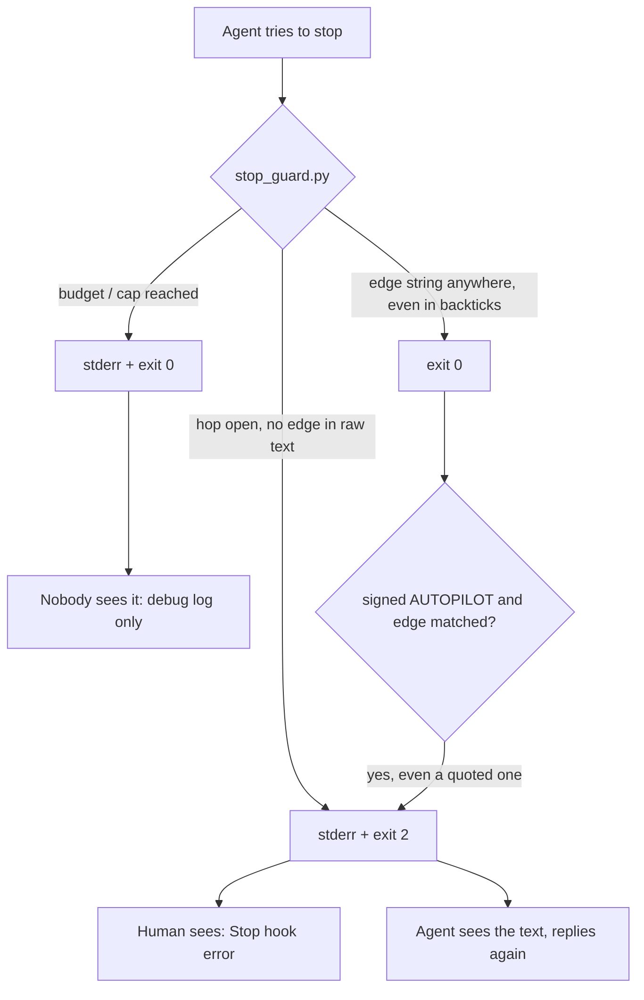
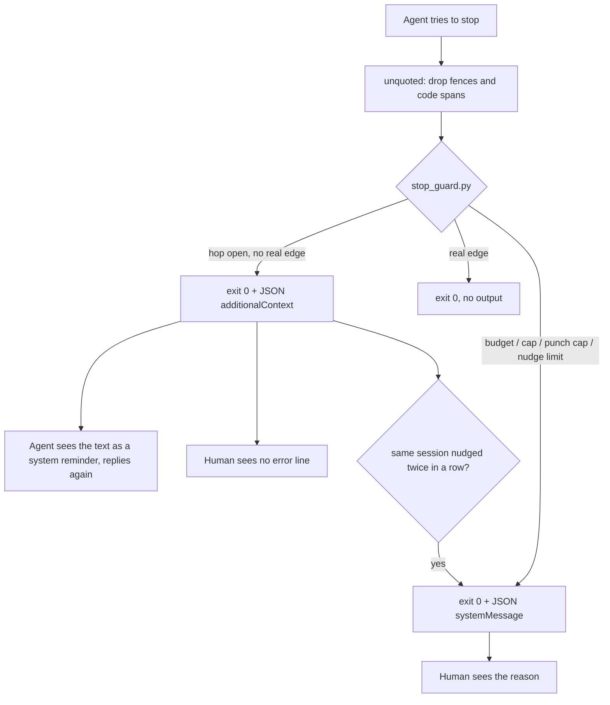

# Stage 05b — t63-quiet-stop-guard — SPEC

## User story IDs from the PRD

BDD's product is the cascade itself; the stories this slice serves:

- **S-QS1** — As an operator, when the Stop hook sends the agent back to finish a hop, I do not see a red
  "Stop hook error" that reads like a crash. The agent gets the instruction; I see the agent's corrected reply.
- **S-QS2** — As an operator, the stops that are *for me* — the autopilot time budget, the continuation cap,
  the stage-10 punch cap, and the guard giving up after repeated nudges — do reach me. Today they reach nobody.
- **S-QS3** — As an operator, an explanation that quotes an edge string in a code span (`` `STITCH NEEDED:` ``,
  `` `AUTOPILOT HALT` ``) does not start a signed autopilot run or count as closing a hop.
- **S-QS4** — As the agent, the I1 nudge tells me exactly what AGENTS.md says to print, and nothing it forbids.

## The problem, stated exactly

1. **Every agent-facing nudge is rendered to the human as an error.** `stop_guard.py` sends all five of
   them by printing to stderr and exiting 2 (`.claude/hooks/stop_guard.py:303-308`, `:314-317`, `:323-331`,
   `:366-370`, `:379-387`). Claude Code shows exit-2 stderr from a Stop hook to the human as
   `Stop hook error: [<command>]: <text>` — observed by the operator in this repo on 2026-10-20, Claude Code
   2.1.280. The hook is working; the label says it is not.
2. **The stops meant for the human reach nobody.** The budget and cap messages print to stderr and then the
   hook exits 0 (`stop_guard.py:111-113`, `:116`). The hooks reference says: "Claude never sees stderr from a
   hook that exits 0", and a successful hook's output goes to the debug log only. The human is not shown it
   either. An overnight run that stops on its budget leaves no visible reason.
3. **Quoted edge strings count as real ones.** `halting()` strips fenced blocks and inline code spans before
   looking for `AUTOPILOT HALT` (`stop_guard.py:44-58`). The other two edge matches do not:
   `any(e in last for e in EDGES)` at `stop_guard.py:313` (autopilot continuation) and `:375` (I1 closed-hop
   check), and the substring tests at `:151` (`review spec+plan`) and `:360` (`STITCH NEEDED: accept execute`).
   On 2026-10-20 an explanation in this repo that quoted `` `STITCH NEEDED:` `` inside backticks, with no hop
   running and a signed `AUTOPILOT:` line, made the hook order the agent to start GENERATE 05b
   t56-dsharp-parallel.
4. **The I1 text contradicts AGENTS.md.** It says a hop ends by "printing the invariant block and then exactly
   one edge line" (`stop_guard.py:380-381`). AGENTS.md: "Do not reprint I1–I18 at a hop edge."

What already bounds the guard, measured this hop: Stop events carry `prompt_id`. The guard records
`stop_guard.py-<prompt_id>-Stop-` under `.git/cascade-seen/` on its first judgment (`stop_guard.py:292`,
`_common.py:82-88`) and returns 0 on any later Stop with the same id, which is also why the plugin copy and the
repo copy never both judge one stop (`ls -t .git/cascade-seen | grep stop_guard`). `stop_hook_active` is the
second bound (`:299`, `:322`, `:333`, `:361`).

## Before vs after

Before:



After:



## Benefits and trade-offs

| | Today | After t63 |
|---|---|---|
| What you see when the agent forgot the edge line | Red `Stop hook error` with the full instruction | Nothing extra; the agent's next reply carries the edge line |
| Budget / cap / punch-cap stop | Invisible (stderr on exit 0) | One visible warning line naming the reason and `/barbar auto` |
| An explanation quoting `` `STITCH NEEDED:` `` | Can start autopilot or count as a closed hop | Ignored; only an unquoted edge counts |
| An agent that ends with the edge line *only* inside backticks | Counted as closed | Nudged once to print it plainly (the one deliberate verdict change, Ask 1) |
| Older Claude Code without Stop `additionalContext` | Works | The nudge is dropped and the hop ends without it: the guard fails open. Git hooks and CI are unaffected (Ask 2) |
| How you audit why the agent replied twice | Visible in the error line | `.cascade/decisions.log` (already written on every nudge) |
| Test churn | — | Every `stop_guard` assertion in `tests/enforcement.sh` reads the new channel through one helper; no verdict changes |

## What the slice adds — and the line it must not cross

### 1. One output function

`stop_guard.py` gains `emit(to_agent: str = "", to_human: str = "") -> int`. It prints one JSON object on
stdout and returns 0:

```json
{"hookSpecificOutput": {"hookEventName": "Stop", "additionalContext": "<to_agent>"}, "systemMessage": "<to_human>"}
```

with either key left out when its text is empty. No path in `main()` exits 2 or prints to stderr after this
slice. A crash still exits 0 silently, as today (`stop_guard.py:16-19`): a Stop hook that cannot run must not
trap the session.

### 2. Which message goes where

| Message | Today | After |
|---|---|---|
| Spec gate red (t57/t58), `:303` | stderr, exit 2 | `to_agent` |
| Autopilot "signed edges remain", `:314` | stderr, exit 2 | `to_agent` |
| HALT missing its instruction block, `:323` | stderr, exit 2 | `to_agent` |
| I10 accept without evidence, `:366` | stderr, exit 2 | `to_agent` |
| I1 hop not closed, `:379` | stderr, exit 2 | `to_agent` |
| Autopilot wall-clock budget reached, `:111` | stderr, exit 0 (lost) | `to_human` |
| Autopilot continuation cap reached, `:116` | stderr, exit 0 (lost) | `to_human` |
| Stage-10 punch cap, `:242-247` | inside the I10 nudge | `to_agent` (unchanged text) **and** `to_human`: "stage-10 punch cap reached for `<slice>`: the audit is still DIRTY after 3 rounds" |
| Nudge limit (new, §4) | — | `to_human` |

Message texts stay byte-identical except the I1 text (§5).

### 3. One quoting rule

`halting()`'s filter becomes `unquoted(text) -> str`: drop fenced blocks (```` ``` ```` / `~~~`) and inline
code spans. `halting()` becomes `HALT in unquoted(text)`. Every other edge test in `main()` and in
`spec_gate_red()` reads `unquoted(last_msg)`: the autopilot match (`:313`), the I1 match (`:375`), the I10
trigger (`:360`) and the spec-gate trigger (`:151`). `WHAT TO DO` (`:318`, `:322`) is read from
`unquoted` too, so a quoted template does not satisfy the halt check.

### 4. The bound

The two existing bounds stay: the `prompt_id` marker and `stop_hook_active`. Neither is guaranteed to hold
for the quiet channel: whether a continuation after `additionalContext` reuses the `prompt_id`, and whether
it sets `stop_hook_active`, is not documented (Risks, U1). So the slice adds a third, owned by the guard:
`.git/cascade-nudges-<session_id>` holds the number of consecutive nudges in that session. A stop that
passes clean deletes it. A stop that would nudge a third time in a row does not nudge: it logs `NUDGECAP`
to the decisions log and emits `to_human`: "the stop guard asked the agent twice to close the hop and it
did not; the hop is still open — read the last reply, then sign or send back". Autopilot continuation is not
a nudge: it keeps its own cap (`continue_autopilot`, `4 × slices + 4`).

### 5. The I1 text

```diff
-        f"Hop not closed (I1). This is {hop} stage {stage or 'N'}. Every hop ends by "
-        f"printing the invariant block and then exactly one edge line:\n"
+        f"Hop not closed (I1). This is {hop} stage {stage or 'N'}. End the reply with exactly one "
+        f"edge line, as plain text, not in a code span or block:\n"
```

### What the slice must not touch

- No verdict changes except Ask 1: every case that sends the agent back today still sends it back, and
  every case that passes still passes.
- `.githooks/*`, `tests/loop.sh`, `tests/barbar.sh`, `tests/lib/autopilot.py`, every `tests/inv/*`.
- `hooks/hooks.json` and `.claude/settings.json` wiring: same commands, same events.
- The duplicate-install question (plugin plus repo copy). The `prompt_id` marker already stops a double
  judgment; removing one install is the operator's choice, not this slice's.

## Acceptance criteria

All in `tests/ac/t63_quiet_stop_guard.sh`, wired into `tests/enforcement.sh` as **T63**.

- **AC1 — the agent channel.** For each of the five agent-facing nudges, built from the fixtures T28, T41,
  T57 and T59 already use: exit 0, stdout parses as JSON, `hookSpecificOutput.hookEventName == "Stop"`,
  `additionalContext` holds the same text the stderr held before, stderr is empty.
  RED TWIN: `stop_guard.py` with `emit` patched to the old `print(..., file=sys.stderr); return 2` must make
  AC1 fail.
- **AC2 — the human channel.** Budget (`BDD_AUTOPILOT_MINUTES` with a back-dated start file), continuation cap
  (the T28 loop of 14 stops) and punch cap (the T36 four rounds) each emit `systemMessage` holding the reason.
  RED TWIN: the old stderr print on these paths leaves `systemMessage` absent and AC2 fails.
- **AC3 — quoting.** With a signed `AUTOPILOT:` list and `CURRENT_HOP: NONE`, a message whose only edge
  strings are inside backticks or a fence produces no output. On an open hop, the same message is nudged by
  I1. A message with the edge as a plain last line passes on the open hop.
  RED TWIN: `unquoted` replaced by the identity function makes the idle case continue autopilot.
- **AC4 — the bound.** Three consecutive would-nudge stops in one session with fresh `prompt_id`s and
  `stop_hook_active: false`: the first two emit `additionalContext`, the third emits `systemMessage` only and
  logs `NUDGECAP`. A clean stop in between resets the count.
  RED TWIN: the counter removed lets the third stop nudge again.
- **AC5 — no verdict drift.** Every existing stop_guard assertion in `tests/enforcement.sh` (T28, T36, T37,
  T41, T57, T58, T59 and the closed-hop check at `tests/enforcement.sh:148-154`) keeps its verdict, read
  through one helper `sg_verdict` that returns `nudge`, `warn` or `pass` from the JSON. A literal rc-2 test
  becomes `nudge`; a literal rc-0 test becomes `pass` or `warn`.
- **AC6 — the I1 text.** The I1 `additionalContext` does not contain `invariant block` and names the edge
  line for the hop it is on.
- **AC7 — live check (human, at the accept edge).** In a Claude Code session on this repo with a GENERATE hop
  open, an agent reply that omits the edge line produces no `Stop hook error` line, and the agent's next reply
  prints the edge line. The operator records the Claude Code version they saw it on in the hop report.

Gate: `bash tests/enforcement.sh` green, `bash tests/ac/t63_quiet_stop_guard.sh` green.

## Laws

`bash tests/dsharp_strength.sh` prints `DSHARP 0/0`: NO LAW IN FORCE in this repo. The envelope's only D#
block is the `{{…}}` template. The slice can break no D#; the `/goal` is the ACs above plus
`bash tests/enforcement.sh`.

# Stage 05b — PLAN

## Goal

EXECUTE produces a `stop_guard.py` that talks to the agent through `additionalContext` and to the human
through `systemMessage`, never through exit 2. It matches edge strings only outside code. It bounds its own
nudges per session. The I1 text matches AGENTS.md. `tests/ac/t63_quiet_stop_guard.sh` proves it with red
twins, and `tests/enforcement.sh` reads every old assertion through the new channel with the same verdicts.

## In scope this execute

- [ ] E0 — live experiment first (U1, U2): in a scratch repo with only a Stop hook that emits
      `additionalContext` once, record (a) whether Claude continues, (b) whether the UI shows any hook line,
      (c) whether the continuation's Stop carries the same `prompt_id` and what `stop_hook_active` is. Write
      the results into the EXECUTE report. If (a) is no, HALT: the design does not hold.
- [ ] `.claude/hooks/stop_guard.py` — `emit`, `unquoted`, routing per §2, nudge counter per §4, I1 text per §5
- [ ] `tests/ac/t63_quiet_stop_guard.sh` — AC1–AC6 with their red twins
- [ ] `tests/enforcement.sh` — `sg_verdict` helper; T28, T36, T37, T41, T57, T58, T59 and `:148-154` read it;
      new `t T63` line
- [ ] `CHANGELOG.md` — an "Unreleased" entry for t63 (the version bump is t69's)

## Out of scope this execute

- Removing the duplicate plugin and repo install, or changing `install.sh`
- Any other hook's output channel (`hop_guard.py`, `bash_guard.py`, `seam.py`, `preserve.py`, `sign_ok.py`)
- The `CHANGELOG.md` `<EDIT>` false positive in `.githooks/pre-commit` (seen 2026-10-20; a separate brief)
- A version bump

## Definition of done

- `bash tests/ac/t63_quiet_stop_guard.sh` exits 0, and each red twin in it is shown to fail.
- `bash tests/enforcement.sh` exits 0 with T63 present.
- `grep -n 'return 2\|file=sys.stderr' .claude/hooks/stop_guard.py` prints nothing.
- `bash tests/loop.sh` prints `LOOP n/n`.
- E0's three answers are in the EXECUTE report.

## Risks / UNKNOWNs that still block

- **U1 — continuation identity.** Whether a continuation after `additionalContext` reuses `prompt_id` or sets
  `stop_hook_active` is undocumented. The §4 counter bounds the guard either way. If the `prompt_id` is reused,
  the `already_event` marker makes the retry stop pass unjudged, exactly as `stop_hook_active` does today.
- **U2 — what the UI shows for Stop `additionalContext`.** Undocumented. If 2.1.280 renders it as visibly as
  exit 2, S-QS1 fails and the slice HALTs at E0 with that evidence. Spending the build would buy nothing.
- **U3 — older Claude Code.** A version that ignores Stop `additionalContext` drops the nudge: the hop ends
  without its edge line. That is the guard failing open at Layer 2. Layers 0/1 still hold (Ask 2).
- **Autopilot across repeated stops** depends on U1 as much today as after. This slice does not change it and
  records E0's answer.

## Ask of you

1. **Quoted edges stop counting.** A reply whose only edge line is inside backticks or a fence will be nudged
   to print it plainly, where today it passes. This is the brief's own instruction, and the one verdict change.
   Recommended: yes.
2. **Older Claude Code fails open.** On a version without Stop `additionalContext`, the guard's nudges are
   dropped. Recommended: accept it and state the Claude Code version E0 was measured on in the CHANGELOG entry. The
   alternative is a signed envelope switch `STOP_GUARD_CHANNEL: loud` that restores exit 2. That adds a
   setting to keep forever for a version nobody may run.
3. **Two new visible warnings.** Budget, continuation-cap and punch-cap stops, and the nudge limit, will now
   show you one warning line where today they show nothing. Recommended: yes. These are the stops that are for
   you.

## Invariants this hop

- PRESERVE run: no (no compact/clear/resume this hop; envelope read from git)
- /goal set to: n/a — GENERATE; EXECUTE's goal is AC1–AC6 + `bash tests/enforcement.sh`
- /model /effort: claude-opus-5-5, effort as set by the session
- /plan: skipped — this document is the plan
- INVARIANTS I1–I18: held
- reads: AGENTS.md, hop-state.md, envelope.md, product-e2e-gre-pipeline.md, 05b-briefs.md, stop_guard.py,
  _common.py, enforcement.sh (stop_guard cases), critique.py; no stage file exists for 05b under
  `docs/cascade/stages/`, so the pipeline's "Stage 05b" section was used
