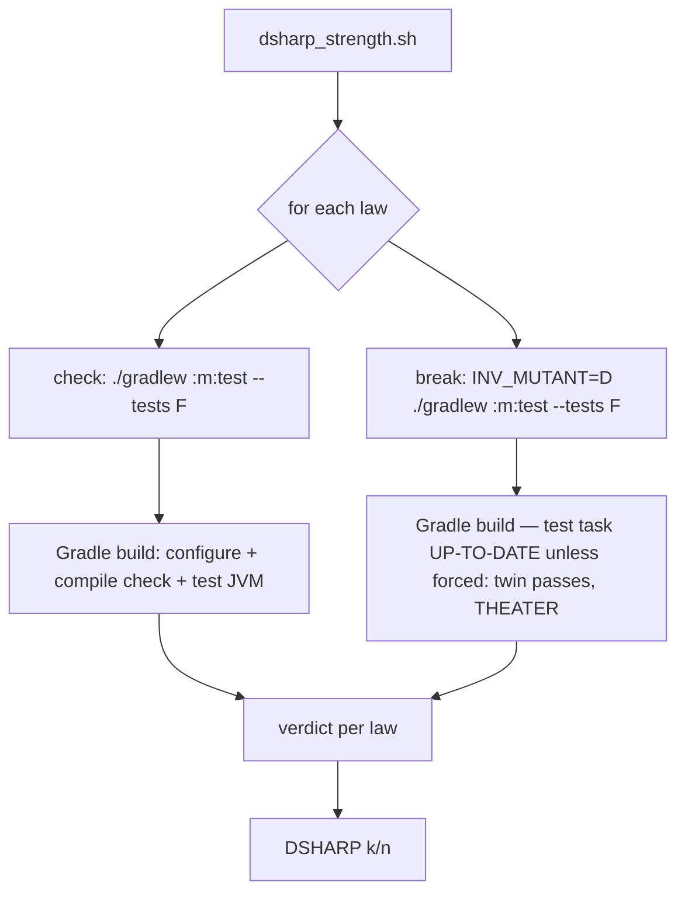
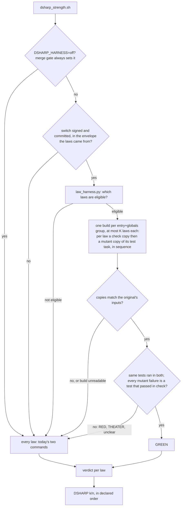

# Stage 05b — t64-law-harness-jvm — SPEC

## User story IDs from the PRD

BDD's product is the cascade itself; the stories this slice serves:

- **S-LH1** — As the operator of a Gradle product with many laws, `bash tests/dsharp_strength.sh` scores the
  laws it can in **one Gradle build per (entry, global options) group**, split into chunks of at most K laws
  (§3). Today each law costs two builds. The `DSHARP k/n` line and every per-law line stay what they are
  today.
- **S-LH2** — As the operator, the fast path is mine to turn on. It runs only when I sign and commit one line
  in the envelope's Locked decisions. The merge gate never uses it: not for its own law check, and not for
  the law check inside `tests/audit.sh`.
- **S-LH3** — As the operator, a law the fast path cannot prove GREEN is scored exactly as today. That covers
  an odd line, an unverified Gradle version, a test task the copy might not reproduce, and every RED or
  THEATER. The fast path can only shorten the run. It never decides a failure.
- **S-LH4** — As a law author, a Gradle law has one documented shape that works on both paths:
  `check: ./gradlew :core:test --tests 'com.x.D7*'` and
  `break: INV_MUTANT=D7 ./gradlew :core:test --tests 'com.x.D7*' --rerun`. The test applies its mutation in
  test wiring when `System.getenv("INV_MUTANT")` is its own id. Product code needs nothing new.

## The problem, stated as cost — and the bug under it

**Cost.** `tests/dsharp_strength.sh` scores each law with two shell commands, `check:` then `break:`
(`tests/dsharp_strength.sh:63-79`). On a Gradle product each command is a full `./gradlew` invocation, paying
client start, configuration of every project, and an up-to-date check of compilation before one assertion
runs. N laws cost 2N builds. `DSHARP_JOBS` (t56) runs commands side by side, but it does not cut their number,
and concurrent builds on one project directory contend for Gradle's locks. That is unmeasured; E1 measures it.

**The bug under it (critic C1, C3, measured this hop on Gradle 9.7.1, JUnit 4 fixture):**

- `-Dinv.mutant=D7` on the `./gradlew` line, the brief's proposed switch, sets a property in the build JVM,
  not in the forked test JVM. A test reading it never sees the mutant. The twin passes: THEATER.
- `INV_MUTANT=D7 ./gradlew :m:test --tests 'p.D7*'` run right after the passing `check:` prints
  `:test UP-TO-DATE` and exits 0. The client's environment is not a task input, so the test task does not run
  again and the twin passes: THEATER for the wrong reason.
- The same line with `--rerun` (Gradle's task option, 7.6+) runs the test task, the test sees `INV_MUTANT=D7`,
  and the twin fails as it should: `:test FAILED`, `D7Test > law FAILED`.

So a Gradle law today is scored correctly only if its `break:` forces the test task to run. This slice makes
that the documented shape (S-LH4) and builds the fast path only for laws that have it. Laws written another way
keep the per-command path and its verdict. Detecting a twin that passed only because its task was up to date is
a separate change to the per-command verdict, so it is briefed as t72, not done here.

Back of the envelope, to be replaced by E1's numbers. Suppose configuration plus the up-to-date check costs 20s
per build, a test JVM starts in 1.5s, and a law's tests take 2s:

| Laws | Today: 2N builds | This slice: one build, 2N test JVMs run one after another |
|---|---|---|
| 50 | ~37 min | ~20s + 100 × 3.5s ≈ 6 min |
| 1,000 | ~12 h | ~20s + 2,000 × 3.5s ≈ 2 h |

Running the JVMs side by side would cut that further. Inside one project Gradle runs tasks in parallel only with
the configuration cache, and copies sharing a working directory, ports and files could race (critic C5). That
belongs with t69, which owns Gradle parallelism; this slice runs the copies strictly in sequence.

## Before vs after

Before:



After:



## Benefits and trade-offs

| | Today | After t64 (signed) |
|---|---|---|
| Builds for N eligible Gradle laws | 2N | one per (entry, globals) group and chunk of K, plus today's two for every law not proven GREEN |
| Who decides RED / THEATER | the two commands | still the two commands: the harness only proves GREEN |
| Test JVMs | 2N, one per build | 2N, run one after another inside the build (parallelism is t69's) |
| Law shape | anything | eligible only as `break: INV_MUTANT=<id> <check> --rerun`; anything else is scored as today |
| Product code | — | nothing new: the mutation is applied in test wiring, read from `INV_MUTANT` |
| Fidelity risk | none | the copies are *copies* of the law's test task. §3 fails closed when a copy's declared inputs differ from the original's, or when the original carries something inputs cannot show (an action, `onlyIf`, `finalizedBy`, an environment difference) |
| Merge gate | per-command path | per-command path, for its own check and for `audit.sh`'s |
| Not chosen: one JVM running each test twice (the brief's extension) | — | faster, but static state, cached contexts and parallel execution can carry a mutation into another test or into the plain run, which changes verdicts (I18). Ask 1 |

## What the slice adds — and the line it must not cross

### 1. The switch

`tests/lib/law_harness.py` turns the harness on only when all three hold:

- The last line matching `- DSHARP_GRADLE_HARNESS: (on|off)` inside an `<EDIT>` block says `on`, both in the
  file as committed at `HEAD` and in the working tree. It reads the two texts with t62's
  `gradle_runner._envelopes` and the blocks with `signed.BLOCK`. Its own six-line `_decision()` follows the
  same rule as `gradle_runner._merge_decision`, but `gradle_runner.py` is not changed (critic C7).
- The file the laws were read from is `$ROOT/docs/cascade/envelope.md`. When `CASCADE_ENVELOPE` points
  anywhere else, as the t56 AC and enforcement fixtures do, the harness is off (critic C10).
- `DSHARP_HARNESS` is not `off`.

`tests/barbar.sh`'s `merge_gate` exports `DSHARP_HARNESS=off` before it runs `tests/audit.sh`, which calls
`dsharp_strength.sh` itself (`tests/audit.sh:18`), and before its own call (`tests/barbar.sh:32`). So every
law verdict in the merge decision is per-command (critic C6). No environment variable can turn the harness on.

### 2. Which laws are eligible

A law is eligible only when every one of these holds. Otherwise it runs today's two commands.

1. `check:` is accepted by t62's `parse()` (`tests/lib/gradle_runner.py:71`) with exactly one selector. Its
   globals contain no `-D`/`-P`, because those change the build and cannot be shared.
2. `break:` is byte-for-byte `INV_MUTANT=<the law's own id> ` + its `check:` + ` --rerun`.
3. The wrapper version is in t62's verified range (`VERIFIED`, `tests/lib/gradle_runner.py:53`) and
   `./gradlew` is executable. For a `gradle` entry, the version on PATH must be in range.
4. The init script finds, at configuration time, that the selector resolves to exactly one `Test` task, and
   that the fidelity checks of §3 hold for it.
5. Laws are grouped by (entry, globals), as t62 groups lines. Each group becomes builds of at most K laws, with
   K = 100 until E1 measures memory (Risks U3).

### 3. The build, and what makes a copy faithful

`law_harness.py` writes the plan, `{id, project path, task path, patterns}` per law, and runs, per group and
chunk:

```
<entry> <globals without --configuration-cache> --no-configuration-cache --continue -I tests/lib/law_harness.init.gradle bddLaws
```

with `BDD_LAW_PLAN` and `BDD_LAW_OUT` set. The law build never reads or writes the user's configuration-cache
entries. Its configuration always runs, so the eligibility file is always written (critic C9).

`tests/lib/law_harness.init.gradle`, for each plan row:

- Registers `bddLawCheck_<id>` and `bddLawMutant_<id>` (`Test`). Each is configured from the original by
  copying `testClassesDirs`, `classpath`, the test framework and its options, `javaLauncher`, `jvmArgs`,
  `jvmArgumentProviders`, `systemProperties`, `environment`, `minHeapSize`, `maxHeapSize`, `workingDir`,
  `forkEvery`, `maxParallelForks`, `failFast`, `filter.includePatterns`, `filter.excludePatterns`,
  `filter.failOnNoMatchingTests`, `includes`, `excludes` and `dependsOn`. The law's patterns are added the
  way `--tests` adds them: as command-line include patterns, which Gradle intersects with the build's own
  (critic C4). The mutant adds `environment 'INV_MUTANT', '<id>'`.
- Reports go to `BDD_LAW_OUT/<id>/{check,mutant}`. Both copies are `outputs.upToDateWhen { false }` and keep
  `ignoreFailures = false`.
- Orders every copy with `mustRunAfter` into one chain, check before mutant and laws in declared order. No two
  copies run at the same time, even when the user's build allows parallel tasks (critic C5).
- **Fidelity — fail closed.** The law is ineligible (`eligible.tsv`: `no <why>`) when any of these differ or
  cannot be read:
  - **declared inputs:** the check copy's input property names and values, and the fingerprints of its input
    file collections, must equal the original's. The only allowed differences are the filter's command-line
    patterns and the report locations. Gradle's own up-to-date checks rest on these inputs describing what a
    test run does; this is t62's assumption A1.
  - **what inputs cannot show:** the original task's actions must be exactly Gradle's own `Test` actions (no
    `doFirst`/`doLast`). It must have no `onlyIf` beyond Gradle's own and no `finalizedBy`, and it must be
    `enabled`. Its `environment` must equal the copy's: environment is not an input, which is why C3 happens.
  - `ignoreFailures` is false on the original.

  E0(c) establishes which Gradle API reads each of these on the verified versions. A check that has no API on a
  version makes every law on that version ineligible. A missing check never passes.
- Records every task's outcome with t62's listener code (`tests/lib/gradle_runner.init.gradle:32-62`).
- Registers `bddLaws`, depending on every copy. The copies exist only in a build started with this init
  script. t62's loop builds and the user's own builds never see them.

### 4. What proves GREEN

A law is GREEN from the harness only when all of these hold:

- `eligible.tsv` says `yes`.
- `bddLawCheck_<id>` is `SUCCESS`, and its JUnit XML lists at least one executed test case.
- `bddLawMutant_<id>` is `FAILED`, its failure cause is only "There were failing tests", and its JUnit XML
  lists **the same test cases** as the check copy's. Every failing case in it passed in the check copy. So
  the mutant failed on the law's own tests and nothing else (critic C4).
- Every task the copies depend on is `SUCCESS`, `UP-TO-DATE` or `FROM-CACHE`.
- The build's failure count equals its number of FAILED tasks (`tests/lib/gradle_runner.py:264`).

Every other law, and every law in a build that cannot be read, goes through `score_one` exactly as today. So a
RED or a THEATER is always the two-command verdict. `law_harness.py` prints only `<index>\tGREEN` rows, and
`dsharp_strength.sh` fills those laws' `res.<i>` before its loop. Collection in declared order
(`tests/dsharp_strength.sh:111-125`) does not change.

### What the slice must not touch

- No verdict changes. A harness GREEN is only ever printed for a law whose per-command run is GREEN (AC4).
  The harness never writes RED, THEATER or UNPROVEN.
- The envelope's D# format, `tests/lib/laws.py`, the mutation-type registry, every `tests/inv/*`.
- `tests/lib/gradle_runner.py` and `tests/lib/gradle_runner.init.gradle`. The harness imports `parse`,
  `verified`, `wrapper_version`, `_envelopes` and `failure_count`, and copies no code from them except the
  listener (an init script cannot import another one).
- `DSHARP_JOBS`/`DSHARP_SERIAL` for laws the harness does not prove.

## Acceptance criteria

`tests/ac/t64_law_harness.sh` runs on the Gradle stub (`tests/ac/fixtures/gradlew-stub.py`, extended: a test
task's environment is not part of its up-to-date key, `--rerun` forces it, and it understands `bddLaws` and
the plan). So CI needs no JVM. `tests/stress/law_harness.sh` checks the same claims on real Gradle. It is opt-in
like t62's AC7: it needs a JDK and downloads the verified Gradle versions through the wrapper. It is wired into
`tests/enforcement.sh` as **T64**.

- **AC1 — fewer builds.** A fixture with 6 eligible laws over two modules, one group, makes one law build. Its
  `DSHARP` lines and `k/n` equal the per-command run (`DSHARP_HARNESS=off`).
  RED TWIN: unsigned, or signed only in the working tree, the run makes 12 invocations.
- **AC1b — a leaked mutant is caught** (the brief's done-when). A stub run where the check copy also sees
  `INV_MUTANT` makes every check copy fail, so no law is proven by the harness and all go per-command. The same
  leak with §4's "check is SUCCESS" condition removed proves a false GREEN on the THEATER law, which the AC
  asserts can happen only with the condition removed.
- **AC2 — only GREEN is the harness's.** One RED law, one THEATER law and one law with no matching tests are
  each scored by their two commands, with the per-command verdict.
  RED TWIN: a `law_harness.py` that prints `RED` for a failing check makes AC2 fail.
- **AC3 — eligibility.** Each of these sends its law to the per-command path, and exactly the others are
  proven: a `-P` in globals, a `break:` without `--rerun` or with another id, an unverified wrapper version, two
  selectors, and each fidelity condition in §3 broken one at a time in the stub (a differing input, an action,
  `onlyIf`, `finalizedBy`, an environment difference).
- **AC4 — verdict equality on real Gradle** (`tests/stress/law_harness.sh`). A two-module JUnit 5 fixture runs
  on the oldest and newest verified Gradle. Its laws cover GREEN, RED, THEATER, no matching tests, a test
  reading a `systemProperty` and an env var the build sets, `jvmArgumentProviders`, a build-script include
  filter, a task with `doFirst`, a task with `onlyIf`, and a module that does not compile. Every law that the
  harness calls GREEN is GREEN per-command. Every other law's verdict is the per-command one.
  RED TWINS: the leaked-mutant init script; a copy that skips `filter.excludePatterns`, which must surface as
  ineligible through the inputs comparison rather than as a false GREEN.
- **AC5 — up-to-date state untouched.** After a law build, the original `:core:test` and `:app:test` are as up
  to date as before, and the user's configuration-cache entry for `./gradlew :core:test` is reused.
- **AC6 — the merge gate.** `tests/barbar.sh merge` in the stub fixture, with the switch signed, makes the
  per-command number of invocations, counting the ones made through `tests/audit.sh`.
- **AC7 — measured.** E1's table (today, today with `DSHARP_JOBS=4`, harness), warm daemon, on the AC4 fixture
  scaled to 50 laws, with peak daemon RSS. It goes in the EXECUTE report and the CHANGELOG.

Gate: `bash tests/ac/t64_law_harness.sh` and `bash tests/enforcement.sh` green.
`bash tests/stress/law_harness.sh` green here and in CI's stress job.

## Laws

`bash tests/dsharp_strength.sh` prints `DSHARP 0/0`: NO LAW IN FORCE in this repo. The slice changes how laws
are scored, so every assertion is about verdict equality with today's path. `/goal` is the ACs above plus
`bash tests/enforcement.sh` and `bash tests/ac/t56_dsharp_parallel.sh`.

# Stage 05b — PLAN

## Goal

EXECUTE produces `tests/lib/law_harness.py` and `tests/lib/law_harness.init.gradle`, wired into
`tests/dsharp_strength.sh` behind a signed, committed `DSHARP_GRADLE_HARNESS: on` that the merge gate always
overrides. Eligible Gradle laws (S-LH4's shape, faithful copies) are proven GREEN from one build per group, and
everything else is scored exactly as today. The stub AC suite, the real-Gradle stress check and E1's
measurements prove it.

## In scope this execute

- [ ] **E0 — probes on the verified Gradle versions**, before any code, recorded in the report:
      (a) S-LH4's `break:` fails and its `check:` passes on a warm daemon after each other, in both orders;
      (b) a copy configured as in §3 runs the same test cases with the same results as the original on the AC4
      fixture;
      (c) the API that reads each fidelity condition (input properties and file fingerprints, actions,
      `onlyIf`, `finalizedBy`, environment) on each verified version.
      If (a) fails, the law shape needs the human (HALT). If (c) finds no API for a condition, that condition
      makes laws ineligible on that version.
- [ ] `tests/lib/law_harness.py`, `tests/lib/law_harness.init.gradle`
- [ ] `tests/dsharp_strength.sh` — call the harness before `score_one`; `DSHARP_HARNESS=off`
- [ ] `tests/barbar.sh` — `merge_gate` exports `DSHARP_HARNESS=off` before `audit.sh` and its own call
- [ ] `tests/ac/fixtures/gradlew-stub.py` — environment outside the up-to-date key, `--rerun`, `bddLaws`
- [ ] `tests/ac/t64_law_harness.sh` (AC1–AC3, AC5 on the stub, AC6); `tests/stress/law_harness.sh` (AC4, AC5, E1)
- [ ] `tests/enforcement.sh` T64; `CONTROL-LINE.md`/`README.md` ranges; `.github/workflows/pack-self-check.yml`
      runs the stress script beside t62's
- [ ] `USAGE.md` — how to write a Gradle law (S-LH4), why `--rerun`, and how to sign the switch
- [ ] `docs/cascade/05b-briefs.md` — brief t72 (a Gradle twin that passed only because its task was up to date)
- [ ] `CHANGELOG.md` — the Unreleased entry gains t64 with E1's table

## Out of scope this execute

- The in-JVM "run each test twice" extension (Ask 1)
- Running copies in parallel (t69), caching verdicts (t65), choosing affected laws (t66), shards (t67)
- Changing the per-command verdict of a Gradle twin that was up to date (t72)
- Maven, sbt or other JVM builds; non-Gradle laws
- Signing the switch in this repo (the human's act; this repo has no Gradle laws)

## Definition of done

- `bash tests/ac/t64_law_harness.sh` exits 0, and each red twin in it is shown to fail.
- `bash tests/stress/law_harness.sh` exits 0 on the verified Gradle versions.
- `bash tests/enforcement.sh` and `bash tests/ac/t56_dsharp_parallel.sh` exit 0.
- `bash tests/loop.sh` prints `LOOP n/n`.
- E0's answers and E1's table are in the EXECUTE report.

## Risks / UNKNOWNs that still block

- **U1 — copy fidelity.** §3 compares declared inputs and the four things inputs cannot show. Anything else
  that changes a test's result without being an input (a build listener, a `beforeTest` closure that throws,
  an agent attached outside `jvmArgumentProviders`) is not caught by the comparison. Its damage is bounded by
  §4: the check copy must pass, and the mutant must fail on exactly the check's test cases. A false GREEN then
  needs a difference that breaks only the mutated run. AC4 hunts for one.
- **U2 — this machine.** The local Gradle is 9.7.1, outside t62's verified range (8.5 to 9.2), so the stress
  check uses wrapper-downloaded 8.5 and 9.1.0, as t62's AC7 did. A wider verified range is t62's to change.
- **U3 — memory.** One build holding 2K test tasks needs daemon heap. E1 records peak RSS at K = 100. If it
  is over 2 GB, K comes down, and the report states the value.
- **E0 can halt the slice** if S-LH4's shape does not hold on a verified version.

## Ask of you

The brief is signed. These are the places this spec departs from it, each with the default taken (the
operator asked for recommended options to be taken and recorded):

1. **Exact over fastest.** One check JVM and one mutant JVM per law, inside one build, instead of the brief's
   single JVM running each test twice. *Default taken: exact.* The single-JVM design can change verdicts.
2. **The switch is `INV_MUTANT` plus `--rerun`, not `-Dinv.mutant`.** Measured: `-D` never reaches the test JVM,
   and without `--rerun` the twin's task is up to date. *Default taken: the S-LH4 shape.*
3. **One build per (entry, globals) group and chunk of K, not "one per module."** One build for the whole
   multi-project fixture is fewer than one per module. Groups and chunks are where it cannot be one.
   *Default taken.*
4. **The harness proves GREEN only.** RED, THEATER and UNPROVEN always come from the two commands, where the
   brief had the harness write all four. *Default taken:* a false failure can only be avoided this way, and it
   keeps every non-GREEN verdict exactly today's.
5. **The leaked-mutant red twin runs on the stub (AC1b) and on real Gradle (AC4)**, not on real Gradle only.
   *Default taken.*
6. **The merge gate never uses the harness**, for its own check and `audit.sh`'s. *Default taken.*
7. **Opt-in by a signed, committed envelope line** (`DSHARP_GRADLE_HARNESS: on`). *Default taken:* off keeps
   every existing repo byte-identical.

## Invariants this hop

- PRESERVE run: no (no compact/clear/resume; envelope read from git)
- /goal set to: n/a — GENERATE; EXECUTE's goal is AC1–AC6 + enforcement + t56 AC
- /model /effort: claude-opus-5-5, effort as set by the session
- /plan: skipped — this document is the plan
- INVARIANTS I1–I18: held
- Skills: none invoked; brainstorming skipped (brief signed; departures are Asks 1–7)
- reads: AGENTS.md, hop-state.md, envelope.md, product-e2e-gre-pipeline.md, 05b-briefs.md,
  dsharp_strength.sh, audit.sh, laws.py, gradle_runner.py, gradle_runner.init.gradle, barbar.sh, signed.py,
  tests/stress/gradle_runner.sh (header); probes on Gradle 9.7.1 in the session scratchpad
