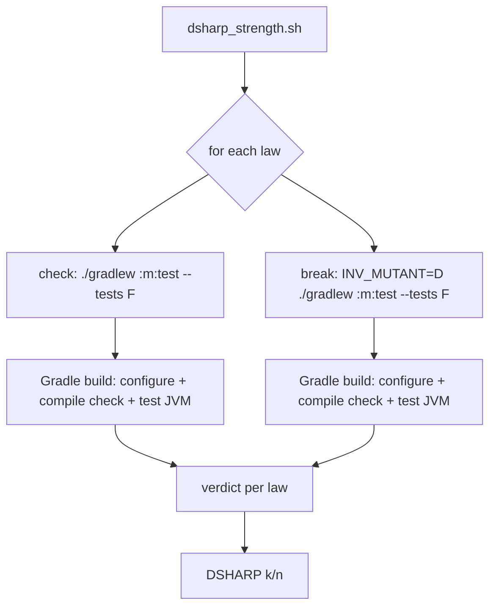
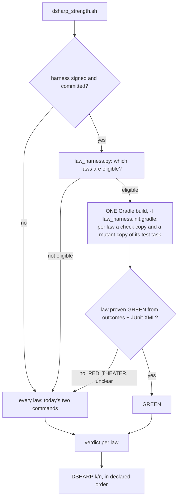

# Stage 05b — t64-law-harness-jvm — SPEC

## User story IDs from the PRD

BDD's product is the cascade itself; the stories this slice serves:

- **S-LH1** — As the operator of a Gradle product with many laws, `bash tests/dsharp_strength.sh` scores the
  laws it can in **one Gradle build**. Today each law costs two builds, a `check:` and a `break:`. The
  `DSHARP k/n` line and every per-law line stay what they are today.
- **S-LH2** — As the operator, the fast path is mine to turn on. It runs only when I sign and commit one line
  in the envelope's Locked decisions. The merge gate keeps today's per-command path, which stays the
  authoritative one.
- **S-LH3** — As the operator, a law the fast path cannot prove GREEN is scored exactly as today. That covers
  an odd line, an unverified Gradle version, a test task with extra actions, and every RED or THEATER result.
  The fast path can only shorten the run. It never decides a failure.
- **S-LH4** — As a law author, a Gradle law keeps the template's shape:
  `check: ./gradlew :core:test --tests 'com.x.D7*'` and `break: INV_MUTANT=D7 ./gradlew :core:test --tests
  'com.x.D7*'`. The test applies its mutation in test wiring when `System.getenv("INV_MUTANT")` is its own
  id. Product code needs no new code and no new dependency.

## The problem, stated as cost

`tests/dsharp_strength.sh` scores each law with two shell commands, `check:` then `break:`
(`tests/dsharp_strength.sh:64-79`). On a Gradle product each command is a full `./gradlew` invocation.
Each one pays client start, configuration of every project, and an up-to-date check of compilation before
one assertion runs. N laws cost 2N builds.

`DSHARP_JOBS` (t56) runs laws concurrently (`tests/dsharp_strength.sh:80-109`). It does not reduce the count.
Builds started at the same time on one project directory share Gradle's caches and locks. So for Gradle laws
it buys little and adds contention. That is UNMEASURED here; E1 measures it.

Back of the envelope, to be replaced by E1's numbers. Suppose a law build costs 20s of configuration and
up-to-date checking plus 2s of tests:

| Laws | Today: 2N builds | This slice: 1 build + 2N test JVMs |
|---|---|---|
| 50 | ~37 min | ~20s + 2N × (JVM start + tests) ≈ 4 min sequential, less with `--max-workers` |
| 1,000 | ~12 h | ~20s + ~70 min sequential, ~10–20 min on 4–8 workers |

The saving is the configuration and compilation that today's path repeats 2N times. The JVM forks remain.

## Before vs after

Before:



After:



## Benefits and trade-offs

| | Today | After t64 (signed) |
|---|---|---|
| Builds for N eligible Gradle laws | 2N | 1 (plus today's two for any law not proven GREEN) |
| Who decides RED / THEATER | the two commands | still the two commands: the harness only proves GREEN |
| Test JVMs | 2N, one per build | 2N, all inside one build; `--max-workers` lets Gradle run them side by side |
| Law format | `check:` / `break:` | unchanged; a law is eligible when `break:` is `INV_MUTANT=<id> ` + its `check:` |
| Product code | — | nothing new: the mutation is applied in test wiring, read from `INV_MUTANT` |
| Fidelity risk | none | the check and mutant tasks are *copies* of the law's test task. A copy that differs from the original could prove a false GREEN. Mitigated by strict eligibility (§2), a verdict-equality matrix on real Gradle (AC4), and the signed opt-in |
| Merge gate | today's path | today's path, always (Ask 2) |
| Not chosen: one JVM running each test twice (the brief's JUnit-extension idea) | — | faster still, but not exact. Static state, cached application contexts and parallel test execution can carry one law's mutation into another test or into the plain run. That changes verdicts, so it is rejected under I18 (Ask 1) |

## What the slice adds — and the line it must not cross

### 1. The switch

`dsharp_strength.sh` uses the harness only when the last line matching
`- DSHARP_GRADLE_HARNESS: (on|off)` inside an `<EDIT>` block of `docs/cascade/envelope.md` says `on`, both at
`HEAD` and in the working tree. This is the same rule as t62's `LOOP_GRADLE_MERGE`, and
`tests/lib/gradle_runner.py:_envelopes`/`merge_signed` are reused, not copied. No environment variable turns
it on. `DSHARP_HARNESS=off` turns it off for one run. The merge gate passes that variable on every call
(`tests/barbar.sh`, where it calls `dsharp_strength.sh`), so the merge verdict always comes from the
per-command path.

### 2. Which laws are eligible

A law is eligible only when every one of these holds. Otherwise it runs today's two commands.

1. `check:` is accepted by t62's `parse()` (`tests/lib/gradle_runner.py:71`) with exactly one selector. Its
   globals contain nothing outside t62's allowlist and no `-D`/`-P`, because those change the build's
   configuration and so cannot be shared.
2. `break:` is byte-for-byte `INV_MUTANT=<the law's own id> ` followed by its `check:`.
3. The Gradle wrapper version is in t62's verified range (`VERIFIED`, `tests/lib/gradle_runner.py:53`), and
   `./gradlew` is executable. For a `gradle` entry, the version on PATH must be in range.
4. Before any task runs, the init script records (§3) that the selector resolves to exactly one task. It must
   be a `Test` task with `ignoreFailures = false` and exactly the actions Gradle's own `Test` task has. Any
   `doFirst`/`doLast` added by the build makes the law ineligible. The copy would not run that action, and the
   original would.
5. Every eligible law in the build shares the same entry and the same globals. Otherwise there is one build per
   (entry, globals) group, as t62 groups lines.

### 3. The build

`tests/lib/law_harness.py` writes the plan, `{id, project path, task path, filter patterns}` per eligible
law, to a file. It runs one build:

```
./gradlew <globals> --continue -I tests/lib/law_harness.init.gradle bddLaws
```

with `BDD_LAW_PLAN=<plan file>` and `BDD_LAW_OUT=<dir>`. `tests/lib/law_harness.init.gradle`:

- For each plan row it registers two `Test` tasks in that project: `bddLawCheck_<id>` and
  `bddLawMutant_<id>`. Each copies these from the original task: `testClassesDirs`, `classpath`, the test
  framework and its options, `javaLauncher`, `jvmArgs`, `systemProperties`, `environment`, `minHeapSize`,
  `maxHeapSize`, `workingDir`, `forkEvery`, `maxParallelForks`, `filter.failOnNoMatchingTests`,
  `excludes`/`includes`, and `dependsOn` of the original task. The filter is set to the law's own patterns.
  Reports go under `BDD_LAW_OUT/<id>/{check,mutant}`. Both are `outputs.upToDateWhen { false }`, so neither is
  ever up to date and neither touches the original task's outputs or up-to-date state. The mutant copy adds
  `environment 'INV_MUTANT', '<id>'`. Both copies keep `ignoreFailures = false`, so a
  FAILED mutant is the twin failing.
- It checks eligibility rule 4 at configuration time and writes `BDD_LAW_OUT/eligible.tsv`:
  `<id> <yes|no> <why>`.
- It registers the aggregate `bddLaws`, which depends on every copy.
- It records each task's outcome with t62's `BuildEventsListenerRegistry` listener, the same code as
  `tests/lib/gradle_runner.init.gradle:34-62`, into `BDD_LAW_OUT/outcomes.tsv`.
- The copies exist only in a build started with this init script. The loop builds of t62 and the user's own
  builds never see them.

### 4. What the build proves

A law is GREEN from the harness only when all of these hold:

- `eligible.tsv` says `yes`.
- `bddLawCheck_<id>` is `SUCCESS` and its JUnit XML has at least one test case.
- `bddLawMutant_<id>` is `FAILED`, and its failure cause is "There were failing tests" (not a crash, not a
  compile error).
- Every task those two depend on is `SUCCESS`/`UP-TO-DATE`/`FROM-CACHE`.
- The build's own failure count equals the number of FAILED tasks, as t62 checks
  (`tests/lib/gradle_runner.py:264`).

Every other law, and every law when the build cannot be read, goes through `score_one` exactly as today. So a
RED or a THEATER is always the two-command verdict. `law_harness.py` prints only `<index>\tGREEN` rows, and
`dsharp_strength.sh` fills each law's `res.<i>` from them before its scoring loop. Collection in declared order
(`tests/dsharp_strength.sh:111-125`) is unchanged.

### What the slice must not touch

- No verdict changes, ever: a harness GREEN must equal the two-command GREEN (AC4). The harness never
  writes RED, THEATER or UNPROVEN.
- The envelope's D# format, `tests/lib/laws.py`, the mutation-type registry, `tests/inv/*`.
- t62's loop runner and its init script. `law_harness.py` imports `parse`, `verified`, `wrapper_version`,
  `_envelopes` and `failure_count` from `gradle_runner.py` and changes none of them.
- `DSHARP_JOBS`/`DSHARP_SERIAL` behaviour for laws that are not proven by the harness.

## Acceptance criteria

`tests/ac/t64_law_harness.sh` uses the Gradle stub, `tests/ac/fixtures/gradlew-stub.py`, extended for the law
build, so CI needs no JVM. `tests/stress/law_harness.sh` checks the same claims on real Gradle (the JDK and
Gradle are opt-in, as t62's AC7 is). It is wired into `tests/enforcement.sh` as **T64**.

- **AC1 — one build.** A fixture with 6 eligible laws over two modules runs exactly one Gradle invocation for
  them. Its `DSHARP` lines and `k/n` equal the per-command run (`DSHARP_HARNESS=off`).
  RED TWIN: with the switch unsigned (or only in the working tree), the run makes 12 invocations.
- **AC2 — only GREEN is the harness's.** In a fixture with one RED law, one THEATER law and one law with no
  matching tests, each of those is scored by its two commands (visible as invocations) with the per-command
  verdict. RED TWIN: a `law_harness.py` that prints `RED` for a failing check makes AC2 fail.
- **AC3 — eligibility.** Each rule-§2 violation sends the law to the per-command path: a `-P` in globals, a
  `break:` that is not `INV_MUTANT=<id> ` + `check:`, an unverified wrapper version, a test task with a
  `doFirst`, and two selectors. Exactly the others are proven.
- **AC4 — verdict equality on real Gradle** (`tests/stress/law_harness.sh`). A two-module JUnit 5 fixture
  runs on the oldest and newest verified Gradle. Its laws cover GREEN, RED (check fails), THEATER (mutation
  not detected), no matching tests, a test reading a `systemProperty` set by the build, a test task with a
  custom `jvmArgs` and `environment`, and a module with a compile error. Every law's harness verdict equals
  its per-command verdict.
  RED TWIN: an init script that also sets `INV_MUTANT` on the check copy (a leaked mutant) makes the matrix
  differ.
- **AC5 — up-to-date state untouched.** After a harness run, the original `:core:test` and `:app:test` are
  exactly as up to date as before (a second plain `./gradlew :core:test` is `UP-TO-DATE` if it was).
- **AC6 — the merge gate.** `tests/barbar.sh merge` scores laws with the harness off even when it is signed:
  the gate's run makes 2N invocations in the stub fixture.
- **AC7 — measured.** E1's timing table, today vs harness on the AC4 fixture, warm daemon, with and without
  `--max-workers`, is in the EXECUTE report and the CHANGELOG entry.

Gate: `bash tests/ac/t64_law_harness.sh` and `bash tests/enforcement.sh` green.
`bash tests/stress/law_harness.sh` green on this machine (Gradle 8.x) and in CI's stress job.

## Laws

`bash tests/dsharp_strength.sh` prints `DSHARP 0/0`: NO LAW IN FORCE in this repo. The slice changes how laws
are scored, so every assertion is about verdict equality with today's path. `/goal` is the ACs above plus
`bash tests/enforcement.sh` and `bash tests/ac/t56_dsharp_parallel.sh`, since `dsharp_strength.sh` changes.

# Stage 05b — PLAN

## Goal

EXECUTE produces `tests/lib/law_harness.py` and `tests/lib/law_harness.init.gradle`. It wires them into
`tests/dsharp_strength.sh` behind a signed, committed `DSHARP_GRADLE_HARNESS: on`. Eligible Gradle laws are
scored GREEN from one build, and everything else is scored exactly as today. The stub AC suite, the
real-Gradle stress check and E1's measurements prove it.

## In scope this execute

- [ ] **E0 — probes on real Gradle**, before any code, recorded in the report:
      (a) `INV_MUTANT=D7 ./gradlew :m:test` reaches the test JVM's environment through a warm daemon;
      (b) a registered `Test` copy with the listed properties runs the same tests with the same results as the
      original on the AC4 fixture;
      (c) how Gradle reports a `Test` task's own actions, so rule 4 can be checked (`task.actions.size()` and
      what a `doFirst` adds).
      If (a) fails, the `break:` convention needs the human (HALT). If (b) shows a property that cannot be
      copied, that property's presence makes a law ineligible.
- [ ] `tests/lib/law_harness.py`, `tests/lib/law_harness.init.gradle`
- [ ] `tests/dsharp_strength.sh` — read the signed switch; call the harness before `score_one`; `DSHARP_HARNESS=off`
- [ ] `tests/barbar.sh` — pass `DSHARP_HARNESS=off` to the merge gate's `dsharp_strength.sh`
- [ ] `tests/ac/fixtures/gradlew-stub.py` — understand `bddLaws`, the plan file, and copy outcomes
- [ ] `tests/ac/t64_law_harness.sh` (AC1–AC3, AC5 on the stub, AC6), `tests/stress/law_harness.sh` (AC4, AC5, E1)
- [ ] `tests/enforcement.sh` T64; `CONTROL-LINE.md` / `README.md` ranges; `.github/workflows/pack-self-check.yml`
      runs the new stress script next to t62's
- [ ] `docs/cascade/envelope.md` — under Locked decisions, a commented example of the switch, *outside* `<EDIT>`
      (the human signs it). `USAGE.md` — how to write a Gradle law that is eligible.
- [ ] `CHANGELOG.md` — the Unreleased entry gains t64 with E1's table

## Out of scope this execute

- The in-JVM "run each test twice" extension (Ask 1)
- Caching verdicts (t65), choosing affected laws (t66), sharding the envelope (t67)
- Maven, sbt or any non-Gradle JVM build
- Changing how `check:`/`break:` are written for non-Gradle laws
- Signing the switch in this repo's envelope (the human's act; this repo has no Gradle laws anyway)

## Definition of done

- `bash tests/ac/t64_law_harness.sh` exits 0; each red twin in it is shown to fail.
- `bash tests/stress/law_harness.sh` exits 0 on this machine's Gradle.
- `bash tests/enforcement.sh` and `bash tests/ac/t56_dsharp_parallel.sh` exit 0.
- `bash tests/loop.sh` prints `LOOP n/n`.
- E0's three answers and E1's table are in the EXECUTE report.

## Risks / UNKNOWNs that still block

- **U1 — copy fidelity.** A `Test` copy may differ from the original in a property this list misses: a
  plugin-added extension (JaCoCo's agent), a `testLogging` setting, a `beforeTest` closure. Of these, only the
  first can change a verdict. E0(b) and AC4 measure it. Rule 4 and "only GREEN is the harness's" bound the
  damage to a false GREEN, which AC4's matrix exists to catch.
- **U2 — env through the daemon.** S-LH4 assumes `INV_MUTANT=…` on the client reaches the test JVM. E0(a)
  measures it. If it does not, today's per-command `break:` lines would already be broken for such products,
  which is itself a finding.
- **U3 — memory.** One build holding 2N `Test` tasks may need more daemon heap at large N. E1 records peak RSS.
  Over a threshold (4 GB, or the default daemon heap), the harness splits the plan into chunks of K laws. K is
  set in E1 and stated in the report.

## Ask of you

1. **Exact over fastest.** One JVM per check and per mutant inside one build, instead of the brief's single JVM
   running each law test twice. The single-JVM version can change verdicts (static state, cached contexts,
   parallel execution). Recommended: yes, exact.
2. **The merge gate stays on the per-command path**, even when the harness is signed. The fast path speeds up
   loops and the farm; the merge verdict stays the slow, authoritative one. Recommended: yes.
3. **Opt-in by signed envelope line** (`DSHARP_GRADLE_HARNESS: on`), committed, like t62's merge mode.
   Recommended: yes. Default off keeps every existing repo byte-identical.

## Invariants this hop

- PRESERVE run: no (no compact/clear/resume; envelope read from git)
- /goal set to: n/a — GENERATE; EXECUTE's goal is AC1–AC6 + enforcement + t56 AC
- /model /effort: claude-opus-5-5, effort as set by the session
- /plan: skipped — this document is the plan
- INVARIANTS I1–I18: held
- Skills: none invoked; brainstorming skipped (brief signed; Ask 1 records the design choice)
- reads: AGENTS.md, hop-state.md, envelope.md, product-e2e-gre-pipeline.md, 05b-briefs.md,
  dsharp_strength.sh, laws.py, gradle_runner.py, gradle_runner.init.gradle, barbar.sh, signed.py,
  tests/stress/gradle_runner.sh (header)
