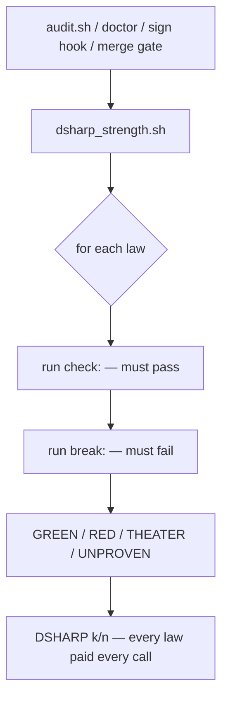
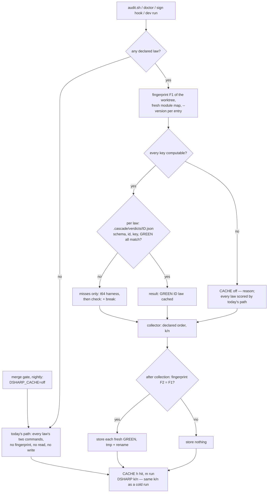

# Stage 05b — t65-verdict-cache — SPEC

## User story IDs from the PRD

BDD's product is the cascade itself; the stories this slice serves:

- **S-VC1** — As the operator of a product with many laws, a second `tests/dsharp_strength.sh` on a tree where
  nothing a law depends on has changed reuses that law's GREEN instead of paying its two builds again, and
  says so on the line: `GREEN     D7  <law>  (cached)`.
- **S-VC2** — As the operator, only GREEN is stored; RED, THEATER and UNPROVEN always re-run. Any doubt about
  computing the key — no git, an unreadable module map, a failed `--version` — is a miss for every law, and a
  change to a file no law or module owns invalidates every key (I18). A cached GREEN is a *remembered*
  verdict over the law's **declared** inputs (§1), printed `(cached)` everywhere it appears, never presented as
  fresh evidence; a law that reads undeclared files can be stale in a dev run, which is why a signed
  `DSHARP_CACHE_SCOPE: tree` exists (§1) and why no merge decision reads the cache (§4).
- **S-VC3** — As the operator, the verdicts that decide a merge never come from the cache. `tests/barbar.sh`'s
  merge gate and the nightly job run with `DSHARP_CACHE=off`; a forged entry can at most mislead a dev run.
- **S-VC4** — As a law author on Gradle, the pack's own law builds (t64's harness) use Gradle's build cache, so
  an unchanged module compiles FROM-CACHE; a remote cache is used only when a human signed its URL.

## The problem, stated as cost

`tests/dsharp_strength.sh` proves every declared law from scratch on every call: its `check:` (must pass) and
its `break:` (must fail) — two commands per law, two `./gradlew` builds per law on a Gradle product
(`tests/dsharp_strength.sh:68-82`). It is called by `tests/audit.sh:18` (every stage-10 punch round),
`tests/doctor.sh:151`, the signing hook (`.claude/hooks/sign_ok.py:39`), the merge gate (`tests/barbar.sh:35`)
and the nightly job. Nothing remembers that a law was GREEN a minute ago on the same bytes:

| Repo | Run | Builds today | After t65, unchanged tree | After t65, one-module edit |
|---|---|---|---|---|
| 20 laws, 1 module | audit / doctor | 40 | 0 law builds (+1 configure, +1 `--version`) | 40 |
| 200 laws, 8 modules | audit / doctor | 400 (or 8 with t64's harness) | 0 law builds | the edited module's and its dependents' laws |
| any | merge gate, nightly | 2N | 2N — unchanged, cache off | 2N |

**Who gains, plainly (C3).** The farm (`tests/barbar.sh run`) scores no product law, and `tests/loop.sh` runs
`VALIDATOR:` lines, not `dsharp_strength.sh`. The merge gate and the nightly keep paying 2N because they run
with the cache off (§4). What t65 speeds up is every *other* call: stage-10 punch rounds (`audit.sh` per
round), `doctor.sh`, the signing hook, and a developer re-running `dsharp_strength.sh` while fixing a law. On a
stage-10 punch hop that is the dominant cost: each round re-proves every law to fix one row. Reusing
`audit.sh`'s verdicts inside one merge-gate run (the gate scores every law twice today) is a separate,
cheaper saving that trusts nothing across runs; it changes the gate's evidence flow, so it is recorded as a
follow-up brief (U7), not folded in here.

A law's verdict is a function of its two commands, the bytes they exercise, the toolchain and the pack's own
scoring code. t65 hashes exactly those, stores GREEN under that key, and reuses it only on an exact match.
The definition of "the bytes a law exercises" is t66's guard set, unchanged — the cache and the hop selector
cannot disagree about what a law depends on.

## Before vs after

Before:



After:



## Benefits and trade-offs

| | Today | After t65 |
|---|---|---|
| Unchanged tree, second run | 2N commands | 0 law commands; two worktree fingerprints, one `--version` and one module-map configure per Gradle entry |
| One-byte edit to a guarded file | 2N | the laws whose inputs include that file; everything else `(cached)` |
| Edit to build logic, a shared module, or a file nothing maps | 2N | 2N — every key changes (fail closed) |
| RED / THEATER / UNPROVEN | re-run | re-run, never stored |
| Merge gate, nightly | 2N | 2N — `DSHARP_CACHE=off`, cache neither read nor written |
| `tests/audit.sh` | D# rows from a fresh run | D# rows may be cached and say `D# GREEN (cached)`; merge recomputes with the cache off |
| Gradle law builds (t64 harness) | compile every time | `--build-cache`: compile tasks FROM-CACHE; the law test copies still always run (t64 `cacheIf { false }`) |
| Remote build cache | none | only a URL signed in `<EDIT>`, read-only (`push = false`) |
| Risk | none | a law whose test reads a file it does not declare (owned by a module, or named by another law's `path:`) can reuse a stale GREEN in a dev run. Unlike t66's `not affected`, a hit *is* printed GREEN and counted in k — so it always carries `(cached)`, `audit.sh` marks the row, a signed `DSHARP_CACHE_SCOPE: tree` removes the gap, and the merge gate and nightly never read the cache |
| Not chosen: cache the module map | — | a cached map hides a later map failure (a fail-closed trigger) and its true inputs are wider than build logic (`-P`, `GRADLE_OPTS`, included builds); one configure per run is paid instead |
| Risk | none | anyone who can run the pack's own key code can forge a correctly keyed entry. The cache is not evidence; the gate does not read it |
| Not chosen: cache RED/THEATER | — | the brief forbids it; a stale failure hides a fix, a stale THEATER hides a twin that now works |
| Not chosen: key by `HEAD` commit | — | the tree is dirty during a hop; a commit key misses every uncommitted edit |
| Not chosen: share verdict entries across machines | — | a shared verdict store is a forging channel into every clone; only Gradle's own build cache is shared, and only read-only |
| Not chosen: "the law's test task comes back FROM-CACHE" | — | t64 deliberately marks law test copies `cacheIf { false }` (`tests/lib/law_harness.init.gradle:131`); a cached test task would prove nothing ran. See Ask 3 |

## What the slice adds — and the line it must not cross

### 1. The key

For each declared law with both commands, `tests/lib/verdict_cache.py` computes
`key = sha256(canonical JSON of)`:

| Component | Value | Why |
|---|---|---|
| `schema` | `bdd-verdict-cache/1` | a format change invalidates every entry |
| `id`, `check`, `break` | the law's id and both commands, verbatim after the trim `dsharp_strength.sh` applies | a changed command is a different law |
| `own` | sorted `(path, blob sha)` of every file in the law's **input set** (below) | the bytes the law exercises |
| `global` | sorted `(path, blob sha)` of every build-logic file, every file in a signed shared module, every **unowned** file (below), plus the signed `AFFECTED_SHARED_MODULES` value | a change nobody maps can reach any law, so it invalidates every key |
| `toolchain` | for each Gradle entry used by any in-force law, the full stdout of `<entry> --version` (Gradle, Kotlin, Groovy, JVM, OS); always `uname -srm`, `bash --version` line 1, `python3 --version` | a new JDK or Gradle can flip a verdict |
| `pack` | the pack version as installed (`.claude-plugin/plugin.json` or the install manifest) and the sha256 of the scoring files: `tests/dsharp_strength.sh`, `tests/lib/{laws,law_harness,verdict_cache,affected,gradle_runner}.py`, `tests/lib/{law_harness,affected}.init.gradle` | a fix to the scorer must not reuse the old scorer's verdicts |
| `env` | values of `INV_*`, `DSHARP_*` (except `DSHARP_JOBS`, `DSHARP_SERIAL`, `DSHARP_CACHE`, `DSHARP_HARNESS`, which by I18 cannot change a verdict), `GRADLE_OPTS`, `JAVA_HOME`, `JAVA_OPTS`, `JAVA_TOOL_OPTIONS`, `_JAVA_OPTIONS`, `ORG_GRADLE_PROJECT_*`, and every `$NAME`/`${NAME}` written in `check:` or `break:` | `INV_MUTANT=D1` exported in a shell makes D1 fail; a cached GREEN must not hide that |

**The input set** is t66's guard set, read through `tests/lib/affected.py`'s own functions (`file_parts`,
`module_of`, `module_map`, `owner`, `closure`, `is_build_logic`, `is_docs`) — no second definition:

1. every file named by the law's `path:` (`:symbol` stripped) and every existing file token in its commands;
   a directory contributes every file under it;
2. for a Gradle law naming one `:module:task`, every file under the project directory of each module in its
   closure (`{module} ∪ transitive project deps`) — the whole module directory, not only `src/`, so the
   module's own build file and resources are inputs;
3. a law with neither files nor a module, or a Gradle `check:` that does not name exactly one module, is
   **unmapped**: its input set is every non-documentation file in the tree.

**Unowned files** are non-documentation files that no module owns and no law's files match. They go into
`global`: editing one invalidates every law, exactly as t66 trigger 7 runs the full set.

**The boundary, stated (C5).** "The inputs a law depends on" means its **declared** inputs: rules 1–3 plus
`global`. A file owned by a module, or named by *another* law's `path:`, is not in this law's key; if this
law's test reads it anyway, an edit to it leaves this law's GREEN cached. The pack cannot see what a test
reads, so the slice does not pretend to: USAGE.md tells a law author to declare what a law reads (`path:` or
its module), and the envelope may carry a signed
`- DSHARP_CACHE_SCOPE: tree` inside `<EDIT>` — then every law's `own` set is the whole non-documentation
tree, so any non-doc edit invalidates every law and only an unchanged tree hits. Default (absent, unsigned or
any other value): `declared`, which is what the brief's "a one-byte edit re-runs exactly the laws that depend
on it" requires.

**Documentation** (`docs/`, `*.md`) is excluded from both sets, as in t66 — except a file a law names in
`path:` or its commands, where the file rule wins. Law text lives in the envelope, a document; the law's own
`check:`/`break:` are in the key directly.

**Blob shas** come from one worktree fingerprint per run: a temporary index copied from git's, the same
hardening as `cascade_worktree_sha` (`tests/lib/cascade.sh:106-131`: stat and ctime trusted, fsmonitor and
untracked cache off, assume-unchanged and skip-worktree cleared, `add -A` excluding `.cascade`), then
`git ls-files -s -z` on that index. Cost scales with what changed (git's stat cache), not with the repo. The
temporary object directory is deleted after; the repo's object store is never written. An AC asserts the
Python fingerprint's `write-tree` equals `cascade_worktree_sha` on the same tree, so the two cannot drift.

**No key → miss.** If the repo is not a git worktree, the fingerprint fails, `--version` fails or times out,
the module map cannot be built (t66 triggers 5 and 6), or any exception is raised, the run prints
`CACHE     off — <reason>` once and every law is scored by today's path. Nothing is stored.

### 2. Lookup, store, and the entry

Entries live at `.cascade/verdicts/<id>.json` (ignored by git; one file per law id, so the store is bounded
by the number of laws and never grows with history):

```json
{"schema": "bdd-verdict-cache/1", "id": "D7", "key": "<64 hex>", "verdict": "GREEN", "at": "<ISO-8601>"}
```

- **Hit** only when the file parses as JSON, `schema`, `id` and `key` equal the computed values, and `verdict`
  is exactly `GREEN`. Anything else — wrong key, wrong id, `RED`, unknown schema, truncated JSON, a directory,
  a symlink — is a miss and the law runs. A miss never deletes or rewrites anything until a fresh GREEN.
- **Store** only a law scored GREEN *in this run* by its own commands or the t64 harness, and only when the
  worktree fingerprint taken after scoring equals the one taken before: a law that writes into the tree, or a
  human editing during the run, stores nothing. Writes are `tmp` + `rename` in the collector (never in a
  parallel worker), so `DSHARP_JOBS` cannot race them.
- A law that was GREEN and is now RED overwrites nothing: its entry's key no longer matches (its inputs
  changed) or, if the inputs did not change and it is RED anyway (flaky, or an input the key misses), the
  stale entry would be a hit. That is the stale-GREEN risk; it is bounded in §4.

### 3. Where it runs — `dsharp_strength.sh`

`DSHARP_CACHE` unset or `on` → cache on. `off`, or any other value → today's script exactly (no fingerprint,
no `--version`, no map, no read, no write): a value the script cannot parse must not turn on the weaker path.

With no declared law (`DSHARP 0/0`), the cache is inert: no fingerprint, no `CACHE` line, nothing written —
the output is today's byte for byte, so a run against the pack repo itself (`t56`'s `--root $ROOT`) is
unchanged (C4).

With the cache on and at least one law, in order:

1. Compute every key once (fingerprint F1, one `--version` per Gradle entry, a fresh module map — t66's
   `module_map`, never cached).
2. For each hit, write the result file the collector already reads: `GREEN` and the line
   `GREEN     <id>  <law>  (cached)`. The ` (cached)` suffix is after the law text, so every existing reader
   still parses it: `tests/audit.sh:40`'s `^(GREEN|RED|THEATER|UNPROVEN)\s+(D\d+)`, `sign_ok.py:46`'s `l[:8]`,
   `doctor.sh:152`'s `DSHARP k/n`.
3. The t64 harness is fed only the laws that missed; `score_one` runs only laws with no result file — the
   existing `[[ -f "$TMP/res.$i" ]]` check already skips harness-proven laws.
4. The collector prints in declared order and computes `k/n` exactly as today. A cached GREEN counts in `k`
   like any GREEN; metadata validation (`reason:`/`path:`/tier) runs on it like any GREEN.
5. Store fresh GREENs (§2). Print one summary line before `DSHARP k/n`: `CACHE     <h> hit, <m> run`.

`DSHARP k/n` keeps its position as the last line. The exit code rule is unchanged.

### 4. Where the cache is never read — the merge gate and the nightly

- `tests/barbar.sh merge_gate` exports `DSHARP_CACHE=off` beside t64's `DSHARP_HARNESS=off`, before it calls
  `audit.sh` and `dsharp_strength.sh`. Every verdict in a merge decision comes from each law's own two
  commands, as I18:49 and AGENTS rule 6 require. The brief says the gate "may" opt out; the slice makes it
  unconditional (Ask 1).
- `.github/workflows/nightly.yml` sets `DSHARP_CACHE: off` on the `tests/dsharp_strength.sh` **step**, not the
  job, so `tests/enforcement.sh` in the same job is not handed it (C6). CI starts from an empty `.cascade/`
  anyway; the variable makes the intent machine-checked. `tests/ac/t65_verdict_cache.sh` also unsets
  `DSHARP_CACHE` at its top and sets it explicitly per run, so no inherited value can change what it asserts.
- `tests/audit.sh` run directly (a stage-10 punch round) honours the cache and marks the row
  `IMPLEMENTED  D7 … (D# GREEN (cached))`, so the human reading a CLEAN sees which rows were reused. The
  stage-10 verdict that gates a merge is the one the merge gate recomputes with the cache off.

This is the bound on every stale-GREEN and forging risk in this spec: whatever a dev run reuses, the merge is
proven from scratch, and the nightly proves the merged tree from scratch.

### 5. Gradle's build cache for the law builds

- `tests/lib/law_harness.py` adds `--build-cache` to its own law build command (`law_harness.py:200`) unless
  `DSHARP_CACHE=off`. The pack owns that command line; it does **not** add flags to a law's own `check:` or
  `break:` text, which is human-signed (Ask 3).
- t64's law test copies stay `upToDateWhen { false }` and `cacheIf { false }`
  (`tests/lib/law_harness.init.gradle:130-131`): the build cache serves compilation and other upstream tasks,
  never a law's test result.
- **Remote cache.** `- DSHARP_GRADLE_BUILD_CACHE_URL: <https URL>` inside an `<EDIT>` block of the envelope,
  read with the same signed-line reader t64 uses for `DSHARP_GRADLE_HARNESS`. When present,
  `law_harness.init.gradle` adds a `beforeSettings` block: `buildCache { remote(HttpBuildCache) { url = …;
  push = false } }`. A project's own `settings.gradle` runs after it and wins. Unsigned, `{{template}}`, or
  non-`https` → ignored with one line saying why. No credentials are read; a cache that needs them is the
  product's own `settings.gradle`'s job.

### 6. The module map is read fresh every run

The key needs t66's module map: one Gradle configure per entry, read by `affected.py`'s `module_map` on every
cache-on run that has a Gradle law. It is **not** cached (C7): a cached map would hide a later map-build
failure, which must stay a fail-closed miss, and the map's real inputs are wider than build-logic files
(`-P`/`ORG_GRADLE_PROJECT_*`, `GRADLE_OPTS`, included builds). A fully cached run therefore costs one configure
and one `--version` per entry, not zero; E1/E2 report it.

### 6b. Ignored in every repo

`.cascade/verdicts/` is added to the pack's `.gitignore` **and** to `install.sh`'s ignore list
(`install.sh:160`), so an installed product never commits an entry (C8). An entry that does reach git is still
only a local hint: it is re-checked against the computed key and never read by the merge gate.

### 7. Verdicts and invariants

- A cold run and a warm run print the same verdict per law and the same `DSHARP k/n`; the only difference is
  the ` (cached)` suffix and the `CACHE` line. AC7 diffs this against a named baseline revision.
- The cache never produces RED, THEATER or UNPROVEN, and never stores them.
- `DSHARP_CACHE=off` is byte-identical to the baseline script's output.

## What the slice must not touch

- What a law means, the D# format (`tests/lib/laws.py`), envelope D# lines, `tests/inv/*`.
- The merge gate's conditions, `tests/audit.sh`'s scoring rules (only the D# note text gains `(cached)`).
- t64's test-copy rules (`cacheIf`, `upToDateWhen`, the signed harness switch); t62's runner; t66's hop
  selector and `tests/loop.sh`.
- A law's own `check:`/`break:` text: no flag is injected into it.
- What the t56, t64 and t66 ACs assert. Each gains one line at its top, `export DSHARP_CACHE=off`, beside the
  variables it already unsets (`tests/ac/t64_law_harness.sh:15`), because each asserts uncached behaviour —
  exact invocation counts, JOBS=1 vs JOBS=4 equality, repeat runs on one fixture (C4). No assertion in them
  changes; AC11 runs them both ways to show the line is needed and sufficient.
- Shards (t67), retirement (t68), configuration cache and daemon tuning (t69).

## Acceptance criteria

`tests/ac/t65_verdict_cache.sh` runs on scratch git repos with the Gradle stub
(`tests/ac/fixtures/gradlew-stub.py`, extended with `--version` output read from a fixture file so a
toolchain change can be simulated; its argv log at `gradlew-stub.py:52-54` already exists and is reused).
The AC unsets `DSHARP_CACHE` at its top and passes it explicitly on every run. Every law command appends to a per-law counter file, so
"ran" and "cached" are counted from the tree, not from the printed line. Fixture laws: `D1`/`D2` Gradle in
`:core` and `:app` (`:app` depends on `:core`), `D3` Gradle in `:web`, `D4` shell with `path: lib/a.sh`,
`D5` shell with `path: lib/b.sh:run()`, `D6` deliberately RED, `D7` deliberately THEATER, `D8` UNPROVEN.

- **AC1 — warm run.** Run twice on an unchanged tree: run 2 prints `GREEN … (cached)` for D1–D5, re-runs D6
  and D7 (counters move), prints the same `DSHARP k/n` and per-law verdicts as run 1, and the stub's argv
  log shows no law build in run 2.
- **AC2 — exactly the dependents.** A one-byte edit in `core/` re-runs D1 and D2 only; in `web/`, D3 only;
  in `lib/a.sh`, D4 only; in `lib/b.sh`, D5 only (the `:symbol` stripped). Every other GREEN law is `(cached)`.
  **Red twin:** a fixture copy of `verdict_cache.py` whose Gradle `own` set is the law's module without its
  closure leaves D2 cached after the `core/` edit; the AC's "D2 re-ran" assertion goes red.
- **AC3 — fail closed.** Each, one at a time, re-runs every law: an edit to `settings.gradle`; to a file no
  module or law owns; to a signed shared module (and the same line unsigned does not); a law with no map
  (every edit re-runs it, and an edit anywhere non-doc re-runs it); the stub's `--version` output changed;
  the pack version changed; a scoring file changed; `INV_MUTANT=D1` exported; map build failure
  (`STUB_AFFECTED_FAIL=1`) on a run *after* a warm run — the map is read fresh, so a warm cache cannot hide
  it; `--version` failure; a non-git directory. Each prints `CACHE     off — <reason>`
  or the changed key's misses. An edit to `docs/x.md` re-runs nothing.
- **AC4 — forged entries are ignored.** Each re-runs the law: an entry copied from another law's id; an
  entry with the right id and an old key; `verdict: "RED"` and `"GREEN "` (trailing space); bad JSON;
  `schema` 2; a symlink. **Red twin:** a fixture copy of `verdict_cache.py` with the key comparison removed
  makes the AC's "law re-ran" assertion go red.
- **AC5 — only GREEN is stored.** After AC1, `.cascade/verdicts/` holds entries for D1–D5 only. A law whose
  command writes a tracked file during its run stores nothing (F2 ≠ F1). **Red twins:** a fixture copy that
  also stores THEATER, and a fixture copy that skips the F2 = F1 check, each make the AC go red.
- **AC6 — the merge gate and nightly never read it.** With a correctly keyed GREEN entry planted for D6 (the
  RED law) using the library's own key function, `DSHARP_CACHE=off bash tests/dsharp_strength.sh` prints
  `RED D6`, and `tests/barbar.sh gate` on the fixture (with a `10-audit.md`, so the gate scores laws inside
  `audit.sh` and again itself) REFUSES with `RED D6`. Counting (C10): the per-law counters after the gate equal
  the counters after the same gate run with no `.cascade/verdicts/` at all — the baseline is measured, not
  assumed to be 2N (a RED law runs only its check, an UNPROVEN law nothing, and audit doubles every count).
  The nightly's dsharp step has `DSHARP_CACHE: off` and its enforcement step does not. `DSHARP_CACHE=bogus`
  behaves as `off`.
- **AC7 — verdict parity against a named baseline.** On the t56 fixture and this AC's fixture, the output of
  `tests/dsharp_strength.sh` from `git archive 219baef` (the pre-t65 script) equals (a) the new script with
  `DSHARP_CACHE=off`, byte for byte, and (b) the new script's cold and warm runs after removing ` (cached)` and
  the `CACHE` line. Same exit code. Also under `DSHARP_JOBS=4`.
- **AC8 — readers.** `tests/audit.sh` on the fixture scores a cached D# as IMPLEMENTED with `(cached)` in its
  note; `doctor.sh` reports the same `DSHARP k/n`; the Python fingerprint's tree equals
  `cascade_worktree_sha` on the same fixture tree, clean and dirty.
- **AC9 — build cache flags.** The stub's argv log for the t64 harness build contains `--build-cache` with
  the cache on and not with `DSHARP_CACHE=off`; no law's own `check:`/`break:` invocation gains any flag; a
  signed `https` URL reaches the init script's env, an unsigned or `http` one does not.
- **AC10 — measured (E1, E2).** E1 (stub, in the AC): 20 laws over three modules, report cold, warm and
  one-module-edit runs in seconds and law-command counts. E2 (opt-in `tests/stress/verdict_cache.sh`, real
  Gradle, run beside t64's stress job): cold vs warm `dsharp_strength.sh` on a two-module build with the
  harness signed; after `./gradlew clean`, the harness build shows compile tasks `FROM-CACHE` and every law
  test copy executed; per-law verdicts identical to `DSHARP_CACHE=off`. Both tables go in the EXECUTE report
  and CHANGELOG.
- **AC11 — the existing ACs.** `bash tests/ac/t56_dsharp_parallel.sh`, `t64_law_harness.sh` and
  `t66_affected_laws.sh` pass with their new `export DSHARP_CACHE=off`; with that line removed (a fixture copy
  of each), at least the counted assertions C4 names go red — the line is load-bearing, and no other edit to
  them is made. A `DSHARP 0/0` run (the pack repo, `--root $ROOT`) prints no `CACHE` line and writes no file.
- **AC12 — installed repos ignore the store.** `install.sh` into a scratch repo leaves `.cascade/verdicts/` in
  its `.gitignore`; after a cache-on run, `git status --porcelain` shows no entry file.

Gate: `bash tests/ac/t65_verdict_cache.sh`, `bash tests/enforcement.sh` (T65), and the t56/t64/t66 ACs green.

## Laws

`bash tests/dsharp_strength.sh` prints `DSHARP 0/0`: NO LAW IN FORCE in this repo. The slice changes how often
a law's verdict is recomputed outside a merge, never what a law means or what the merge gate proves.

# Stage 05b — PLAN

## Goal

EXECUTE adds a GREEN-only, exact-key verdict cache to `tests/dsharp_strength.sh` (`tests/lib/verdict_cache.py`),
keyed on the law's commands, its t66 input set, every unmapped input, the toolchain, the pack and the
verdict-relevant environment; turns on Gradle's build cache for the pack's own law builds with an optional
signed read-only remote; and keeps the merge gate and nightly on `DSHARP_CACHE=off`.

## In scope this execute

- [ ] `tests/lib/verdict_cache.py` — fingerprint (temp index, `ls-files -s`), key, fresh map, scope, lookup, atomic
      store, `CACHE off — <reason>` on any doubt; `keys` and `store` subcommands fed rows on stdin like
      `law_harness.py`.
- [ ] `tests/dsharp_strength.sh` — cache on/off switch (`off` unless unset or `on`), hits before the harness,
      harness fed misses only, store after collection when the fingerprint is unchanged, `CACHE` line.
- [ ] `tests/lib/law_harness.py` — `--build-cache` on its own command unless off; pass a signed remote URL.
- [ ] `tests/lib/law_harness.init.gradle` — `beforeSettings` remote `HttpBuildCache`, `push = false`, only when
      the env var is set.
- [ ] `tests/barbar.sh` — `export DSHARP_CACHE=off` in `merge_gate`.
- [ ] `tests/audit.sh` — `(cached)` in the D# note.
- [ ] `.github/workflows/nightly.yml` — `DSHARP_CACHE: off` on the dsharp step only.
- [ ] `.gitignore` and `install.sh`'s ignore list (`install.sh:160`) — `.cascade/verdicts/`.
- [ ] `tests/ac/fixtures/gradlew-stub.py` — `--version` from a fixture file (argv log already exists).
- [ ] `tests/ac/t56_dsharp_parallel.sh`, `t64_law_harness.sh`, `t66_affected_laws.sh` — one line each,
      `export DSHARP_CACHE=off`; no assertion changed.
- [ ] `tests/ac/t65_verdict_cache.sh` (AC1–AC9, AC11, AC12; red twins in AC2, AC4, AC5 ×2), E1 in it; `tests/stress/verdict_cache.sh`
      (E2, opt-in).
- [ ] `tests/enforcement.sh` T65; `USAGE.md` (what is in the key, the three places it is off, the signed
      remote URL, how to clear: `rm -rf .cascade/verdicts`); `CHANGELOG.md` with E1/E2.
- [ ] `docs/cascade/goal.md` for the EXECUTE hop.

## Out of scope this execute

- Caching RED, THEATER or UNPROVEN; caching loop.sh `VALIDATOR:` lines; caching in t66's hop selector.
- Sharing verdict entries across machines or committing them.
- Injecting any flag into a law's own `check:`/`break:`.
- Configuration cache, daemon reuse, test forks (t69); shards (t67); retirement (t68).
- Credentials for a remote build cache.

## Definition of done

- `bash tests/ac/t65_verdict_cache.sh` exits 0 and every red twin (AC2, AC4, AC5 ×2, AC11) is shown to go red.
- `bash tests/enforcement.sh` exits 0 with T65; t56, t64 and t66 ACs stay green.
- AC7's parity diff against `219baef` is empty with the cache off, and empty modulo ` (cached)` with it on.
- E1 and E2 tables are in the EXECUTE report and CHANGELOG; if E2 cannot run on this machine, the report says
  so and the build-cache part (§5) is marked unmeasured, not done.

## Risks / UNKNOWNs that still block

- **U1 — the key is only as complete as t66's guard set.** A shell law whose test reads a file owned by a
  module or matched by another law's `path:` will not miss when that file changes. Same precision as t66's
  hop selection, which was accepted for the same reason: every unmapped file invalidates everything, and the
  merge gate and nightly recompute every law. USAGE.md tells law authors to name what a law reads in `path:`
  or map it to a module.
- **U2 — ignored files.** Git-ignored inputs (`local.properties`, generated sources, `.env`) are not in the key.
  A law that depends on one should name it in `path:`; an ignored file named in `path:` is hashed directly.
- **U3 — the fingerprint at scale.** The temp-index approach is t59's; AC8 ties it to `cascade_worktree_sha`,
  and E1 reports its time. On t59's 60k-file fixture it must stay under 1 s with a warm stat cache, or the
  report says so.
- **U4 — `--version` costs a launcher JVM per entry.** About a second; paid once per run, not per law. E2
  measures it.
- **U5 — the remote cache flag on a real build.** `beforeSettings` from an `-I` script and `push = false` are
  checked on real Gradle in E2 only; the stub proves the wiring, not Gradle's behaviour.
- **U7 — the merge gate scores every law twice (C3).** `audit.sh` inside the gate and the gate itself each
  run `dsharp_strength.sh`. Passing the first run's output to the second would halve merge cost without
  trusting anything across runs. It changes the gate's evidence flow, so it is a follow-up brief for the human,
  not part of t65.
- **U6 — forging.** Anyone who can run `verdict_cache.py` can write a correctly keyed GREEN. No hook can stop
  `python3 -c` (a guard that cannot hold is theater by this pack's own standard), so the slice does not
  pretend: the cache is not evidence, the merge gate and nightly never read it (AC6).

## Ask of you

The brief is signed. These are the places this spec departs from it or fills a gap, each with the default
taken (the operator asked for recommended options to be taken and recorded):

1. **The merge gate is always `DSHARP_CACHE=off`, not "may opt out".** I18:49 and AGENTS rule 6 require every
   declared D# GREEN at merge from tree evidence; a cached GREEN is a remembered verdict, and U1/U6 say how it
   can be wrong. Same choice t64 made for its harness (`tests/barbar.sh:24`). *Default taken.*
2. **The input set is t66's guard set plus a global component of every unowned file**, not only "the `path:`
   file and the module's source sets". The brief's literal key would reuse a GREEN after an edit to a helper
   no law names — "a cache that cannot compute a key misses, never hits" rules that out. The whole module
   directory (not just source sets) is hashed so a module's build file and resources count. *Default taken.*
3. **No "law test task FROM-CACHE".** t64 marks law test copies `cacheIf { false }` on purpose; a cached test
   task means no law code ran. `--build-cache` goes on the harness's own command (compilation from cache);
   nothing is injected into a law's signed `check:`/`break:`, where a cached test task would also turn a
   twin whose mutant switch is not a declared task input into THEATER. *Default taken.*
4. **The verdict-relevant environment is in the key** (`INV_*`, `DSHARP_*` minus the four I18 speed/switch
   variables, JVM/Gradle options, and every `$NAME` in a law's commands). Not in the brief; without it,
   `INV_MUTANT=D1 bash tests/dsharp_strength.sh` would print a cached GREEN. *Default taken.*
5. **The module map is read fresh every run, never cached** (C7). Costs one configure per entry on a warm
   run; keeps the map failure a fail-closed miss. *Default taken.*
6. **`DSHARP_CACHE` accepts only `on`/unset to enable; any other value is off.** *Default taken.*
7. **Entries are one file per law id, local, git-ignored** (pack and `install.sh`), not shared or committed.
   *Default taken.*
8. **`DSHARP_CACHE_SCOPE`** (C5): default `declared` — the brief's "re-runs exactly the laws that depend on it";
   a signed `- DSHARP_CACHE_SCOPE: tree` inside `<EDIT>` makes any non-doc edit invalidate every law, for a repo
   whose laws read undeclared files. Absent means `declared`. *Default taken; signing `tree` is yours.*
9. **The brief's text (C1, C2).** The brief still says the merge gate "may" opt out and that a law's test task
   comes back FROM-CACHE. This spec builds the narrower, I18-safe reading (Asks 1 and 3). The brief line is
   yours to amend if you want the text to match; the build does not depend on it. *Default taken: spec wins
   where it is stricter.*

## Invariants this hop

- PRESERVE run: no (no compact/clear/resume; envelope read from git)
- /goal set to: n/a — GENERATE; EXECUTE's goal is AC1–AC10 + T65 + t56/t64/t66 ACs
- /model /effort: as set by the session
- /plan: skipped — this document is the plan
- INVARIANTS I1–I18: held; Asks 1, 3 and 9 name the brief clauses narrowed to keep I18
- Skills: none invoked; brainstorming skipped (brief signed; departures are Asks 1–9)
- reads: AGENTS.md, hop-state.md, envelope.md, product-e2e-gre-pipeline.md, 05b-briefs.md, dsharp_strength.sh,
  audit.sh, barbar.sh, doctor.sh, sign_ok.py, law_harness.py, law_harness.init.gradle, affected.py,
  cascade.sh (`cascade_worktree_sha`), nightly.yml, .gitignore, install.sh, the t56/t64/t66 ACs, the t66 spec
  and critique, and this slice's critique (C1–C10)
