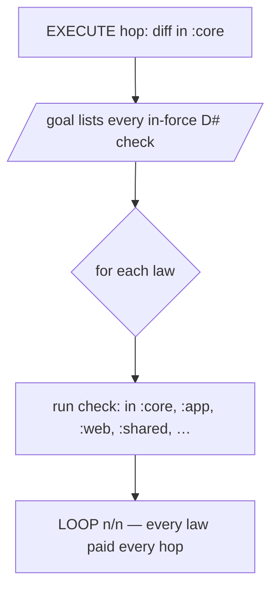
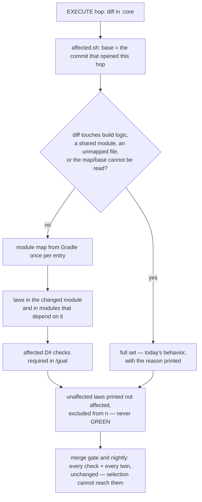

# Stage 05b — t66-affected-laws — SPEC

## User story IDs from the PRD

BDD's product is the cascade itself; the stories this slice serves:

- **S-AL1** — As the operator of a product with many laws, an EXECUTE hop that changes one module runs the
  laws that module can break — its own and those of the modules that depend on it — not every law in the
  repo. `tests/affected.sh` names that set; `tests/loop.sh` enforces it.
- **S-AL2** — As the operator, selection is never allowed to hide a law. When the diff touches something no
  law maps, build logic, or a shared module, or when the map or the hop base cannot be read, the full set
  runs. An affected law omitted from `/goal` is still a FAIL (I13), and a law not run is printed as
  `not affected`, never as a pass.
- **S-AL3** — As the operator, the schedule is explicit: each hop runs affected checks; the merge gate and
  the nightly job run every check and every Red twin. Selection never reaches a merge decision.
- **S-AL4** — As a law author, the map is the `path:` line I already write plus the Gradle module my
  `check:` names. A law that guards neither is treated as unmapped, so it keeps running everywhere until I
  map it.

## The problem, stated as cost

`tests/loop.sh` requires every in-force D# `check:` in `/goal` on every EXECUTE hop (I13,
`tests/loop.sh:81-93`). A law in `:web` whose test task takes 90 s is paid on a hop that edits `:core` —
and on every later hop, whether or not `:web` existed then. The cost grows with the age of the repo, not
with the size of the change:

| Repo | Hop edit | Laws required today | Test time at 90 s/law |
|---|---|---|---|
| 1 module, 20 laws | any module | 20 | ~30 min |
| 8 modules, 200 laws | one leaf module | 200 | ~5 h |
| 8 modules, 200 laws | one core module | 200 | ~5 h |
| same, affected selection | one leaf module | ~25 | ~37 min |

The pack already knows which files a law guards: `path:` is a required field for an IMPLEMENTED audit row
(`tests/audit.sh`), and every Gradle law's `check:` names its module (`:app:test`). Neither is used for
scheduling. t66 uses both, plus the module graph Gradle already knows, to answer one question per hop:
*which laws can this diff break?*

The selector is deliberately conservative. A wrong "affected" costs time; a wrong "not affected" loses a
law. Every ambiguity resolves to the full set, and the full set is today's behavior. **Selection applies to
the hop only.** The merge gate and the nightly run are untouched in what they prove (see §6 and Ask 3).

## Before vs after

Before:



After:



## Benefits and trade-offs

| | Today | After t66 |
|---|---|---|
| Hop law checks | every in-force law | laws whose guard set meets the diff; full set on any doubt |
| Cost driver | age of the repo | size of the change |
| New work per hop | none | one Gradle configure to read the module map, only when a Gradle law exists |
| Merge gate | every law's check and twin | unchanged: every check and twin (I18) |
| Stage-10 audit | every law | unchanged |
| Nightly | no scheduled full run | `schedule:` workflow runs every check and twin |
| Risk | none | a wrong base or map could narrow the hop — bounded by fail-closed rules, the merge gate and the nightly run |
| Verdicts | unchanged | dsharp/audit/barbar are not modified; `not affected` is a new third state in the hop, never a pass |
| Laws with no map | run everywhere | run everywhere (unmapped = full set) until mapped with `path:` or a Gradle selector |
| Not chosen: the brief's "merge gate runs only affected twins" | — | it contradicts I18:49 and AGENTS rule 6; see Ask 3 |
| Not chosen: parse `build.gradle` statically | — | the brief requires the module graph read once from Gradle; a static parse would guess at convention plugins |
| Not chosen: remember the last base | — | a stale base silently narrows; the hop-open commit is in git and is checked against the current hop |

## What the slice adds — and the line it must not cross

### 1. What a law guards, and when it is affected

For each in-force law (`tests/lib/laws.py --in-force`), the selector builds a guard set:

1. **Files.** The law's `path:` value, with the documented `:symbol` suffix stripped exactly as
   `tests/dsharp_strength.sh:187-188` does (`src/wallet.py:withdraw()` guards `src/wallet.py`); a directory
   guards every file under it. Add every existing file path written literally in the law's `check:` or
   `break:` command. A command token counts only when it is a plain relative path that exists in the tree
   and ends in a source/test suffix (`.py .sh .js .ts .java .kt .kts .rb .go .rs .cs .php .scala .groovy`);
   flags, patterns and `$`-bearing tokens never do. A token the script misses cannot widen the set: an
   unmapped change is a full-set trigger (§3).
2. **Module.** When `check:` is a Gradle line whose one selector is `:module:task` (or `module:task`), the
   law's module is `:module`. The selector comes from t62's `parse()` (`tests/lib/gradle_runner.py:78`), so
   `-D`/`-P`, two selectors or a bare `test` yields no module — the law is then file-mapped only.
3. **Module closure.** The law is affected when the changed module is its own module **or any module in
   that module's transitive project dependencies** — the modules whose code its test task exercises. The
   relation is forward: `:app` depends on `:core`, so a change in `:core` affects `:app`'s laws, not the
   reverse. A law in module `L` has closure `{L} ∪ deps(L)`.

A law is **affected** when a changed file matches its files or its module closure contains the module that
owns a changed file. Otherwise it is **not affected**.

A law with no files and no module is **unmapped**. One unmapped in-force law, or one changed file no law or
module owns, means the full set (§3). This is the conservative default the brief asks for: mapping is
opt-in per law and pays off only when laws are mapped.

### 2. The diff and its base — the hop-open commit

The base is the **commit that opened the current hop**: the most recent commit touching
`docs/cascade/hop-state.md` (or the envelope, in a repo installed before the split). That commit's tree is
the state the hop started from, so the diff contains this hop's work and nothing from earlier hops on the
same branch.

- The selector reads hop state at that commit and requires `CURRENT_HOP/CURRENT_STAGE/CURRENT_SLICE` to
  equal the working tree's. A commit that opened a different hop, or a missing file, is not a base.
- The base must be an ancestor of `HEAD` (`git merge-base --is-ancestor`).
- No such commit, a mismatched hop, or a git error → full set with the reason. This is what runs on the
  first hop after a clone, or when a human opened a hop without committing the edge.
- The diff is `git diff --name-status -M <base>` (staged, unstaged and committed since the base) plus
  untracked, non-ignored files (`git ls-files --others --exclude-standard`). Renames (`R*`) count at both
  paths, deletions (`D`) at the old path, copies (`C*`) at both. The selector reads the **working tree**, so
  it is correct before the hop commits and after a mid-hop edit.
- `--base REV` exists on `tests/affected.sh` for reports and fixtures only. `tests/loop.sh` never reads it
  and never reads an environment variable for the base: a one-line override must not be able to hide a law
  (Ask 5).

### 3. Fail-closed triggers — the full set, with the reason

The selector prints `AFFECTED full — <reason>` and makes every in-force law affected when any of these
holds. Each is a separate AC case:

1. no hop-open commit, its hop state differs, or the base is not an ancestor of `HEAD`;
2. git cannot list the diff;
3. a changed path is build logic: `build.gradle`, `build.gradle.kts`, `settings.gradle`,
   `settings.gradle.kts`, any `*.gradle`/`*.gradle.kts` outside a module's source set, `gradle.properties`,
   `gradle/libs.versions.toml`, anything under `gradle/wrapper/`, `buildSrc/`, `build-logic/`, or a
   convention-plugin directory named by a locked decision;
4. a changed path is inside a module listed by `- AFFECTED_SHARED_MODULES:` inside an `<EDIT>` block of the
   envelope (comma- or space-separated project paths). The line is read from the envelope the laws came
   from; an unsigned or `{{template}}` line declares nothing;
5. the Gradle module map cannot be built (non-zero exit, timeout, unreadable output, or an exception);
6. a law names a module the map does not contain, or a shared-module declaration names one;
7. a changed path is owned by no module and matches no law's files, and is not documentation (below);
8. an in-force law has neither files nor a module (unmapped);
9. a Gradle `check:` cannot be parsed into one module.

**Documentation is not a trigger.** A changed path under `docs/` or ending in `.md` is ignored by selection:
it cannot change a test result. Every other unmapped path is trigger 7. The exception is narrow on purpose
— specs, reports and changelogs change every hop, and treating them as product would make selection useless
in this very repo. A law that guards a document names it in `path:`; the file rule wins over the exception.

### 4. The module map, read once from Gradle

`tests/lib/affected.init.gradle` is passed with `-I` to one Gradle invocation per distinct entry
(`./gradlew` or `gradle`) among the laws that name a module:

```
<entry> -q --no-configuration-cache -I tests/lib/affected.init.gradle bddAffectedProjects
```

with `BDD_AFFECTED_OUT=<tmp>/projects.tsv`. The init script registers a no-op `bddAffectedProjects` task and,
at `projectsEvaluated`, writes one row per subproject:

```
<project path>\t<project dir relative to root>\t<comma-separated project dependencies>
```

Dependencies are the `ProjectDependency` entries declared in that project's configurations, read without
resolving them. The root project and any project whose directory is the root are not ownership candidates:
the root would own every file and defeat the "unmapped" trigger. The map is a fresh temporary file each run;
nothing is cached (t65 owns caching) and the user's configuration cache is never read or written.

A project directory that is a prefix of another resolves by longest prefix. Two projects claiming the same
path is trigger 6. A law's module not appearing in the map is trigger 6.

### 5. The CLI

```
tests/affected.sh [--root DIR] [--base REV] [--list] [--why]
```

- Default output: `AFFECTED <k>/<n> affected` then one line per law,
  `affected  D2  <law>  — module :app via :core`, or `not affected  D3  <law>`; on the full set,
  `AFFECTED full — <reason>` and every law `affected`.
- `--list`: only the ids, one per line, for `/goal` generation.
- `--why`: the full-set reason and the base/map used, for the hop report.
- `--base REV`: report/fixture only; `tests/loop.sh` does not pass it and reads no environment variable for
  it.
- Exit 0 whenever it reaches a verdict, including `full` (full is safe and must not fail a hop). Exit 64 on
  bad usage. A crash is reported by the caller as a full set, never as an empty one.
- There is **no** `AFFECTED_MUTANT` or other environment switch. The AC red twins patch a copy of
  `tests/lib/affected.py` in the fixture (the house pattern in `tests/ac/t64_law_harness.sh`), so no
  inherited variable can narrow a real hop.

`tests/loop.sh` calls the same Python (`tests/lib/affected.py`) with the same envelope and base, so the
printed advice and the enforcement cannot disagree.

### 6. Where the answer is used — the hop only

**Hop (`tests/loop.sh`).** The selector is computed with `$(cascade_envelope)` (the same envelope the law
rows come from; `CASCADE_ENVELOPE` is honoured) and the hop-open commit. Before the I13 omission check:

- full set: exactly today — every in-force D# must be in `/goal`, an omission is a FAIL entry.
- narrowed set: an affected in-force D# missing from `/goal` is still `FAIL  in-force D# omitted from
  /goal`; an unaffected one prints `not affected  D# <id>  <law>` and is counted neither in `k` nor `n`.
  A validator line the agent listed anyway still runs: selection removes a requirement, never evidence.
- `--list` prints the same affected/not-affected split.
- The receipt and `LOOP k/n` keep their machine shape: `n` is validators plus omitted affected laws.

**Merge gate and stage-10 audit — unchanged.** `tests/dsharp_strength.sh` runs every law's check and Red
twin, `tests/audit.sh` scores every D# row from that output, and `tests/barbar.sh merge_gate` keeps its
`DSHARP_HARNESS=off` export. None of the three reads the selector. This is deliberate: I18:49 and AGENTS
rule 6 require every declared D# GREEN at merge, and a twin skipped there could hide a THEATER. The brief's
"merge gate runs every check plus affected twins" is a conflict with the law, recorded as Ask 3; it is not
taken by default.

**Nightly.** `.github/workflows/nightly.yml` runs on a schedule (`cron`) and by hand: `tests/enforcement.sh`
and the stress suites with no selection. In a product repo the same job runs `tests/dsharp_strength.sh`
with no base and no selector. It is the full-set proof the brief asks for, after the merge and every night.

### 7. Verdicts and invariants

`not affected` is a new **third state**, never a pass. It is printed as its own word and excluded from `k`
and `n` in the hop. Nothing in `dsharp_strength.sh`, `audit.sh` or `barbar.sh` changes, so no merge verdict
changes. `LOOP k/n` still means "every required validator passed"; the requirement set is the affected set
plus any extra lines the agent wrote.

## What the slice must not touch

- `tests/dsharp_strength.sh`, `tests/audit.sh`, `tests/barbar.sh` merge conditions — selection does not
  reach a merge decision.
- The D# format (`tests/lib/laws.py`), the envelope's D# lines, `tests/inv/*`, and t64's signed switch.
- t62's runner (`tests/lib/gradle_runner.py`, `.init.gradle`) and t64's harness: selection feeds the hop's
  command list; it does not replace or second-guess them.
- Parallel execution (t69), verdict caching (t65), law shards (t67), retirement/grouping (t68).

## Acceptance criteria

`tests/ac/t66_affected_laws.sh` runs on the Gradle stub (`tests/ac/fixtures/gradlew-stub.py`, extended with
`projects` and a `bddAffectedProjects` handler under `-I affected.init.gradle`), so CI needs no JVM. It
builds scratch repos with three modules — `:core`, `:app` (depends on `:core`), `:web` — and laws mapped by
`path:` and by selector. Every repo has a real hop-open commit (a commit touching `hop-state.md`).

- **AC1 — one module's diff.** A hop diff in `core/` requires D-core and D-app (its dependent) in `/goal`
  and prints D-web `not affected`; `tests/affected.sh --list` names exactly that set; the hop's `LOOP k/n`
  excludes D-web.
- **AC2 — fail closed.** Each trigger in §3, one at a time, prints `AFFECTED full — <reason>` and requires
  every law: no hop-open commit, a hop-state mismatch, build logic (`settings.gradle`), a signed shared
  module (and the same line unsigned declares nothing), map failure (`STUB_AFFECTED_FAIL=1`), law names a
  missing module, unmapped file, unmapped law, unparseable selector.
- **AC3 — omission and the red twins.** An affected law omitted from `/goal` is FAIL; an unaffected one is
  `not affected` and the run passes. Twin 1: a fixture copy of `affected.py` drops D-app from the affected
  set; the AC's own assertion (the required set) goes red. Twin 2: a fixture copy of `loop.sh` treats an
  omitted affected law as `not affected`; the AC's FAIL assertion goes red.
- **AC4 — selection cannot reach the merge gate.** With a narrowed diff present, `dsharp_strength.sh` and
  `tests/barbar.sh gate` on the fixture still run every law's two commands (2N invocations), print no
  `not affected`, and give the same verdicts as a repo with no diff. A fixture that sets `AFFECTED_BASE=HEAD`
  and every other tempting variable still gets the full set (there is no reader).
- **AC5 — nightly.** The workflow exists, has a `schedule`, runs the full scripts, and a fixture run with
  the workflow's command scores every law's check and twin.
- **AC6 — mapping edges.** A shell law with `path: core/x` is affected by an edit to `core/x` and not by
  `web/y`; `path: core/x:withdraw()` guards `core/x`; a rename out of a module affects the old module's
  laws; a law with neither path nor module forces full; `CASCADE_ENVELOPE` pointing at a fixture envelope
  makes the selector read that fixture's laws, not the host's.
- **AC7 — the base is the hop, not the branch.** A two-hop fixture: hop 1 edits `core/`, opens hop 2 with a
  commit, hop 2 edits `web/`; at hop 2 the selector sees only `web/` and does not run `core/`'s laws. A
  stale base (`--base` at the previous hop's edge) is report-only; `tests/loop.sh` ignores it.
- **AC8 — measured (E1).** Fixture: 20 laws over three modules, warm daemon. Report (a) full hop — all 20
  checks, (b) affected hop — the 5 checks in the changed module and its dependents, (c) the module-map
  invocation alone, in seconds and Gradle invocations. Goes in the EXECUTE report and CHANGELOG.

Gate: `bash tests/ac/t66_affected_laws.sh`, `bash tests/enforcement.sh` (T66), and the t56/t64 ACs green.
`bash tests/loop.sh` prints `LOOP n/n` on the fixture hop.

## Laws

`bash tests/dsharp_strength.sh` prints `DSHARP 0/0`: NO LAW IN FORCE in this repo. The slice changes which
laws a hop is required to run, never what a law means or what the merge gate proves; every assertion is
about the affected set, the fail-closed triggers, and the merge gate's independence from selection.

# Stage 05b — PLAN

## Goal

EXECUTE adds affected-law selection for the hop: `tests/lib/affected.py` + `tests/lib/affected.init.gradle` +
`tests/affected.sh`, wired into `tests/loop.sh` so `/goal` must list exactly the affected D# checks and an
unaffected law prints `not affected`. Every ambiguity runs the full set. The merge gate, stage-10 audit and
the Red-twin proofs are untouched (I18); a scheduled nightly runs the full set.

## In scope this execute

- [ ] `tests/lib/affected.py` — hop-open base, `--name-status -M` diff + worktree + untracked, guard map
      (`path:` with `:symbol`, command file tokens), module closure, fail-closed reasons.
- [ ] `tests/lib/affected.init.gradle` — `bddAffectedProjects`, map writer, no configuration-cache reuse.
- [ ] `tests/affected.sh` — the CLI of §5 (`--root --base --list --why`).
- [ ] `tests/loop.sh` — affected/not-affected split, omitted-affected FAIL, full-set path unchanged.
- [ ] `tests/ac/fixtures/gradlew-stub.py` — `projects`, `bddAffectedProjects`, map-failure switch.
- [ ] `tests/ac/t66_affected_laws.sh` (AC1–AC7, two red twins); E1's fixture for AC8.
- [ ] `tests/enforcement.sh` T66; `.github/workflows/nightly.yml`.
- [ ] `USAGE.md` — how to map a law, the three states, the hop-open base, the schedule and Ask 3.
- [ ] `CHANGELOG.md` — t66 with E1's table; `CONTROL-LINE.md` ranges if it names the AC list.
- [ ] `docs/cascade/goal.md` for the EXECUTE hop.

## Out of scope this execute

- Changing `tests/dsharp_strength.sh`, `tests/audit.sh` or `tests/barbar.sh` merge conditions.
- Caching verdicts (t65), parallel laws (t69), envelope shards (t67), retirement/grouping (t68).
- Any change to what a D# means, or to a verdict in the full run.
- Static parsing of Gradle files; non-Gradle module graphs (Maven/sbt/Bazel).
- Auto-writing `/goal`; the agent writes it from `tests/affected.sh --list`.

## Definition of done

- `bash tests/ac/t66_affected_laws.sh` exits 0, and both red twins are shown to go red.
- `bash tests/enforcement.sh` exits 0 with T66.
- `bash tests/ac/t56_dsharp_parallel.sh` and `bash tests/ac/t64_law_harness.sh` stay green.
- `bash tests/loop.sh` prints `LOOP n/n` on the fixture hop; `tests/affected.sh` gives the same set as the
  hop enforced.
- The nightly workflow parses, runs the full scripts, and E1's table is in the EXECUTE report and CHANGELOG.

## Risks / UNKNOWNs that still block

- **U1 — the hop-open commit.** The base is the last commit touching hop-state.md, checked against the
  current hop. A hop opened without a commit (human `CASCADE_HUMAN` edge not committed) has no base and
  runs the full set. A human who edits hop-state mid-hop gives a later base; that can only narrow to
  changes since the edit, and the selector compares hop fields, not commit dates; AC7 pins the behavior.
- **U2 — the map call costs a configure.** On a large build, reading the map may approach the cost of a
  small law. AC8 measures it; if the map is the dominant cost, the report says so and t65's cache is the
  next lever.
- **U3 — module ownership.** A module whose `projectDir` is outside the root, or two projects sharing a
  directory, is trigger 6 (full set). A generated source directory that belongs to no module is trigger 7.
- **U4 — the stub is not Gradle.** The stub's `projects` table is a hand-written scenario, not proof of the
  real map. Add an opt-in `tests/stress/affected.sh` that reads a real multi-project build once; CI runs it
  beside t64's stress job.
- **U5 — docs exception.** Ignoring `docs/` and `*.md` is deliberate; a product whose tests read Markdown
  must map those files with `path:`, where the file rule wins.
- **U6 — the merge schedule in the brief is not taken (Ask 3).** The merge gate and stage 10 stay full-set.
  The nightly full run lands. If the human wants the brief's affected twins at merge, it needs a signed I18
  amendment and a pre-merge full-twin job, not this slice.

## Ask of you

The brief is signed. These are the places this spec departs from it, each with the default taken (the
operator asked for recommended options to be taken and recorded):

1. **The base is the commit that opened the hop**, read from git's history of `hop-state.md`, not
   `merge-base` with `main` and not an environment variable. `merge-base` makes every hop on a branch pay
   for the branch's whole life; an env override can hide a law in one line. No such commit → full set.
   *Default taken.*
2. **Shared modules are a signed locked decision** (`- AFFECTED_SHARED_MODULES: :core, :api`) inside
   `<EDIT>`, read from the envelope the laws came from. No envelope-format change; absent or unsigned means
   none. *Default taken.*
3. **CONFLICT: the brief's merge schedule vs I18.** The brief says the merge gate runs "every check plus
   affected twins". I18:49 and AGENTS rule 6 say every declared D# must be GREEN at merge (check passes,
   twin fails — THEATER/UNPROVEN refuse), and the only pre-merge strength run is the gate itself. Taking
   the brief would let a THEATER through at merge on the one status I7 calls tree evidence. **I keep the
   merge gate and stage-10 audit at the full set; affected selection is hop-only, and the nightly full run
   lands.** To take the brief's schedule, sign an I18 amendment and add a pre-merge full-twin job — a
   separate, human-signed change. *Default taken: I18 wins.*
4. **`not affected` is a third state, not a quiet pass.** It is excluded from `k/n` at the hop and printed
   by name; no merge or audit output gains it. *Default taken.*
5. **No environment switch can narrow a hop.** The selector has no `AFFECTED_BASE`/`AFFECTED_MUTANT`;
   `--base` is report/fixture only and `tests/loop.sh` never reads it. The red twins patch a fixture copy
   of the selector. *Default taken.*
6. **`docs/` and `*.md` do not force the full set.** Otherwise every spec commit would disable selection.
   A law that guards a document names it in `path:`. *Default taken.*
7. **One Gradle configure per entry, no persistent cache.** Caching belongs to t65; a stale map is a wrong
   "not affected". *Default taken.*

## Invariants this hop

- PRESERVE run: no (no compact/clear/resume; envelope read from git)
- /goal set to: n/a — GENERATE; EXECUTE's goal is AC1–AC8 + T66 + t56/t64 ACs
- /model /effort: as set by the session
- /plan: skipped — this document is the plan
- INVARIANTS I1–I18: held; Ask 3 names the one brief clause that conflicts with I18 and is not taken
- Skills: none invoked; brainstorming skipped (brief signed; departures are Asks 1–7)
- reads: AGENTS.md, hop-state.md, envelope.md, product-e2e-gre-pipeline.md, 05b-briefs.md,
  dsharp_strength.sh, loop.sh, audit.sh, barbar.sh, gradle_runner.py (parse/VERIFIED), laws.py,
  signed.py, the Gradle init scripts, the t64 spec and critique, tests/ac fixtures
