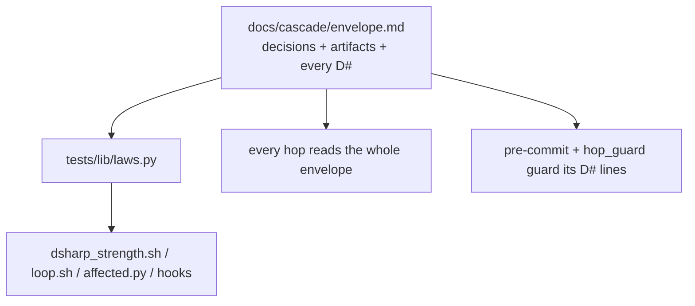
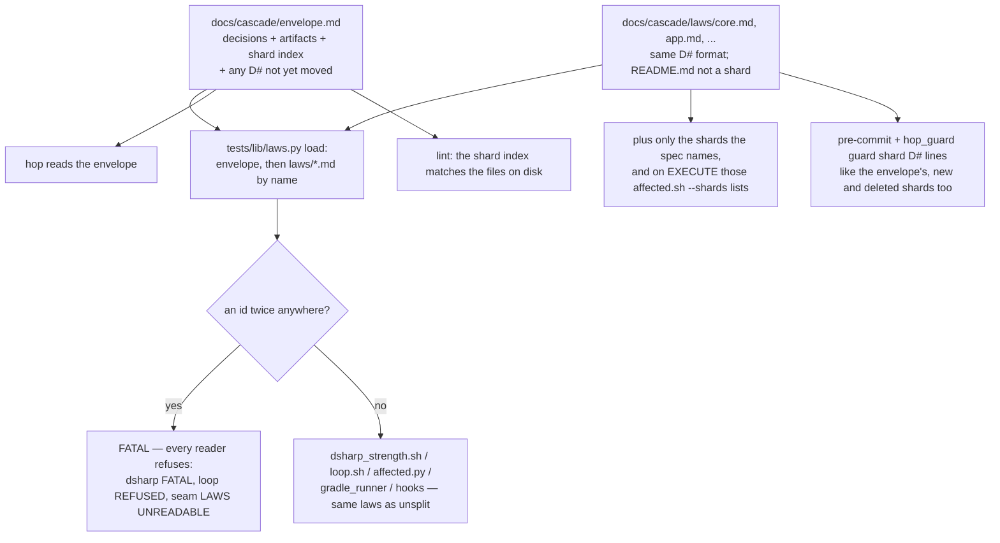

# Stage 05b — t67-envelope-shards — SPEC

## User story IDs from the PRD

BDD's product is the cascade itself; the stories this slice serves:

- **S-SH1** — As the operator of a product with thousands of laws, a hop starts by reading the envelope's
  decisions and only the law shards this hop can touch, not every D# ever written.
- **S-SH2** — As a human reviewing one module's laws, I open `docs/cascade/laws/<module>.md` and see that
  module's laws, in the same D# format, with the same signature rules as the envelope.
- **S-SH3** — As the operator, a split repo proves exactly what the unsplit one proves: the same `DSHARP k/n`,
  the same per-law verdicts, the same `laws.py --count`, the same laws required in `/goal`. A duplicate id
  anywhere is FATAL, never "the first one wins".
- **S-SH4** — As the operator, an agent cannot edit a shard's D# lines any more than the envelope's: the git
  hook and the agent hook guard both, and only a human signature lets the change in.

## The problem, stated as cost

Every hop's read-list starts with `docs/cascade/envelope.md` (`AGENTS.md:19`), and every D# lives in it. A law
in the documented `###` form is five or six lines — heading, `check:`, `break:`, `reason:`, `path:`, `tier:` —
roughly 80–120 tokens. The read cost grows with the number of laws ever written, not with what the hop touches:

| Laws | Envelope D# text | Read by every hop |
|---|---|---|
| 20 | ~2k tokens | ~2k |
| 200 | ~20k tokens | ~20k |
| 2,000 | ~200k tokens | ~200k — more than the work itself |

A human reviewing one law scrolls past all of them, and `git log docs/cascade/envelope.md` interleaves every
module's law history. t66 already knows which laws a hop can reach. t67 lets laws live in per-module files so
the read-list can follow that knowledge, without changing what any law means or how any law is proven.

## Before vs after

Before:

After:

## Benefits and trade-offs

| | Today | After t67 |
|---|---|---|
| Hop read cost | the whole envelope | the envelope's decisions + the shards the spec names + the affected ones |
| Reviewing one module's laws | scroll the envelope | open one shard; `git log` per shard |
| What a law means, how it is proven | — | unchanged: same format, same reader, same scorer |
| A repo with no `docs/cascade/laws/` | — | byte-identical outputs (AC4) |
| Duplicate id | silently scored twice | FATAL everywhere, envelope alone included (Ask 2) |
| Guarding | envelope + hop-state | + every shard, including a new or deleted shard |
| Index | — | a human-signed table in the envelope; lint checks it; reading never trusts it |
| Risk | — | a reader that opens `envelope.md` itself instead of `laws.py` would miss shard laws — every such reader is listed in §3 and gets an AC |
| Not chosen: read only shards listed in the index | — | an unindexed shard would silently drop its laws; the glob is the truth and the index is checked against it |
| Not chosen: locked decisions in shards | — | decisions are repo-wide; one place to sign and read them (Ask 6) |
| Not chosen: recursive shard dirs | — | one flat directory keeps "every shard" a single glob a human can verify |

## What the slice adds — and the line it must not cross

### 1. The layout

- Shards are `docs/cascade/laws/*.md` — one directory, not recursive — except `README.md`, which is
  documentation. The name is the human's choice (`core.md` for `:core` is the convention, not a rule).
- A shard holds D# laws in exactly the envelope's formats (`### D7 — …` blocks or the legacy one-liner),
  inside an `<EDIT>` block as in the envelope. Anything else in a shard is prose.
- Locked decisions (`DSHARP_GRADLE_HARNESS`, `AFFECTED_SHARED_MODULES`, `DSHARP_CACHE_SCOPE`,
  `DSHARP_GRADLE_BUILD_CACHE_URL`, `LOOP_GRADLE_MERGE`) and accepted artifacts stay in the envelope. A decision line
  in a shard is not read; `tests/lint.sh` names it (Ask 6).
- The envelope gains an optional `## Law shards` section: a table of shard files inside `<EDIT>`. `tests/lint.sh`
  fails when a shard on disk is missing from it or it names a file that does not exist. Reading never uses
  the index: an unindexed shard is still read and enforced (Ask 1).
- Order: envelope laws in file order, then each shard in filename order, each in file order (Ask 7).

### 2. One reader: `tests/lib/laws.py`

- `load(envelope_path, shards_dir=None)` returns every declared law with a `source` field; `shards_dir` defaults
  to `<dirname(envelope_path)>/laws`. `laws(text)` stays as the single-text parser it is today.
- The CLI keeps its modes (`--declared --in-force --unproven --protected --count`) and reads envelope + shards.
  New: `--shards DIR` overrides the directory (for a caller that holds a temporary copy), and `--sources` prints
  `id|source` for `affected.py --shards` and the seam.
- **Duplicate id → FATAL.** Two laws with one id anywhere — two shards, envelope and shard, or the envelope alone
  (Ask 2) — make every mode print `FATAL duplicate D7: <file A>, <file B>` on stderr and exit 2. No partial list
  is printed: a reader that ignored the exit code would see no laws, so every reader below checks it.
- A missing envelope with shards present still reads the shards.

### 3. Every reader, and what it does on FATAL

| Reader | Today | After t67 | On FATAL |
|---|---|---|---|
| `tests/dsharp_strength.sh` | `laws.py "$ENV_FILE"` | same call; shards found beside `$ENV_FILE` | prints `FATAL     <reason>`, exit 1 (no `DSHARP` line) |
| `tests/lib/cascade.sh` `_laws` (loop's I13, UNPROVEN) | `laws.py … \|\| true` | same, but a non-zero exit prints a sentinel | `tests/loop.sh` prints `LOOP REFUSED: the laws cannot be read — <reason>`, exit 3 |
| `tests/lib/affected.py` | `in_force(open(envelope).read())` | `laws.load(envelope)` | `AFFECTED full — the laws cannot be read` (and loop refuses anyway) |
| `tests/lib/gradle_runner.py` `law_checks` | `laws.py` on temp copies of the HEAD and worktree envelope | `laws.load` on the worktree, and on HEAD via `git show` of the envelope plus `git ls-tree`/`git show` of every shard at HEAD into a temp dir passed as `--shards` | merging is off for the whole run (exclusion can only widen) |
| `.claude/hooks/seam.py` | `laws.py env_path --in-force` | same | context says `LAWS UNREADABLE: <reason>` instead of `NO LAW IN FORCE` |
| `.claude/hooks/preserve.py` | `laws.py env_path --declared` | same | says the laws cannot be read |
| `.claude/hooks/sign_ok.py` | verifies on an envelope edit | also on a shard edit | unchanged (prints dsharp's FATAL) |
| `.githooks/pre-commit`, `hop_guard.py` tests/inv reuse check | grep `^D#\|` in the envelope | `laws.py --declared` over envelope + shards | the check treats every id as declared (blocks the reuse) |
| `tests/lib/verdict_cache.py`, `law_harness.py` | rows from dsharp; decisions from the envelope | unchanged | — (dsharp has already stopped) |

### 4. Guards

- **`.githooks/pre-commit`:** the protected-line check loops over `envelope.md`, `hop-state.md` **and every
  staged `docs/cascade/laws/*.md`** (added, modified or deleted; README.md excluded). A file new at this commit
  compares against empty, a deleted one against empty after — so adding, removing or moving a law (including the
  initial split out of the envelope) needs a human signature. The autopilot path never applies to shards:
  `tests/lib/autopilot.py` accepts hop-state edges only.
- **`.claude/hooks/hop_guard.py`:** the same paths for `Write`/`Edit`/`MultiEdit`, including a `Write` that
  creates a new shard (today's check skips a file with no current content).
- **`tests/sign.sh`:** human-owned files include every shard, tracked or new (`git ls-files --others` under
  `docs/cascade/laws/`), so a human can sign a new shard from any client.
- The `<EDIT>`-tag scan already covers `docs/**/*.md`, shards included.

### 5. The read-list

- `AGENTS.md` read-list item 2 becomes: the envelope (decisions, artifacts, the shard index and any D# still in
  it); then only the shards the seam names.
- `.claude/hooks/seam.py` adds, when `docs/cascade/laws/` holds a shard: `LAW SHARDS THIS HOP: <files>` — the
  shards the slice's spec doc (`docs/cascade/<stage>-<slice>.md`) names by path, and on an EXECUTE hop the line
  `run bash tests/affected.sh --shards for the shards this diff reaches`. The seam does not run Gradle (a
  UserPromptSubmit hook must stay fast).
- `tests/affected.sh --shards` prints the shard file of every affected law (the envelope for a law still in it);
  on `AFFECTED full` it prints every shard and says why.
- No shard directory → no new seam line; the read-list is today's.

### 6. Install

- `install.sh` ships `docs/cascade/laws/README.md` (the format, the signature rule, "README.md is not a shard")
  only when absent, as it keeps the envelope. It never creates or moves a law. `install.sh --check` and the
  manifest do not list shards (product-owned, like the envelope).
- The envelope template gains an empty, commented `## Law shards` section; existing envelopes are kept as they are.

## What the slice must not touch

- The D# format, what a law means, `dsharp_strength.sh`'s scoring, the merge gate, `tests/inv/*`.
- t64's harness rules, t65's cache key (a shard law's `path:` and commands are its inputs as before), t66's
  selection logic beyond reading laws through `load`.
- Locked decisions' home (the envelope).
- Retirement and law grouping (t68).

## Acceptance criteria

`tests/ac/t67_envelope_shards.sh` builds scratch repos (shell laws plus Gradle-stub laws) in two shapes from one
law list: **unsplit** (every law in the envelope) and **split** (some in the envelope, the rest across
`laws/core.md`, `laws/app.md`, `laws/web.md`, plus a `laws/README.md`).

- **AC1 — the split proves the same thing.** Split vs unsplit: same `DSHARP k/n`; the same verdict per id
  (compared by id: order differs by design, Ask 7); the same `laws.py --count`, `--in-force` and `--unproven`
  sets; `tests/loop.sh --list` requires the same ids; `tests/affected.sh --list` selects the same ids for a
  `core/` diff. `README.md`'s example D# is not read.
- **AC2 — a duplicate id is FATAL.** Across two shards, envelope + shard, and within the envelope alone:
  `laws.py` exits 2 naming both files; `dsharp_strength.sh` prints `FATAL` and no `DSHARP` line, exit 1;
  `tests/loop.sh` is `LOOP REFUSED`; the seam says `LAWS UNREADABLE`; `affected.sh` is `AFFECTED full`.
  **Red twin:** a fixture copy of `laws.py` without the duplicate check lets `dsharp` print `DSHARP`, and the AC's
  FATAL assertion goes red.
- **AC3 — guards.** Unsigned, the pre-commit hook blocks: editing a shard's `check:`; adding a new shard with a
  law; deleting a shard; moving a law from the envelope into a shard. With `tests/sign.sh` run first, each is
  accepted. A prose-only shard edit commits unsigned. `hop_guard.py` denies an `Edit` of a shard `break:` and a
  `Write` that creates a shard with a law. **Red twin:** a fixture copy of `pre-commit` whose guarded list lacks
  `docs/cascade/laws/` lets the unsigned shard edit through.
- **AC4 — no shards is today.** With no `docs/cascade/laws/`, `laws.py` (every mode) and `dsharp_strength.sh`
  output equal those from `git archive 505ec73` byte for byte, on this AC's fixture and the t56 fixture.
- **AC5 — every reader in §3.** `gradle_runner`'s law exclusion includes a shard law's check, at HEAD and in the
  worktree (a shard law's check is never merged with `LOOP_GRADLE_MERGE` signed); the tests/inv reuse check sees a
  legacy-format shard law; `sign_ok.py` runs dsharp after a shard edit; `preserve.py` lists shard laws.
- **AC6 — the index.** An unindexed shard makes `tests/lint.sh` red and its laws are still scored; an index row
  for a missing file makes lint red; a locked-decision line in a shard is named by lint and not read.
- **AC7 — the read-list.** The seam lists exactly the shards the spec doc names; `affected.sh --shards` lists the
  affected laws' shards for a `core/` diff and every shard on `full`; with no shard directory the seam's context
  equals today's.
- **AC8 — install.** A fresh `install.sh` creates `docs/cascade/laws/README.md` and no shard; re-running it keeps
  an edited README and existing shards; `install.sh --check` stays clean.
- **AC9 — measured (E1).** A 2,000-law fixture in 20 shards: bytes and an approximate token count of (a) the
  unsplit envelope, (b) the split envelope plus one shard; and `laws.py --declared` time unsplit vs split.

Gate: `bash tests/ac/t67_envelope_shards.sh`, `bash tests/enforcement.sh` (T67), t56/t64/t65/t66 ACs green.

## Laws

`bash tests/dsharp_strength.sh` prints `DSHARP 0/0`: NO LAW IN FORCE in this repo. The slice changes where a law
may be written and who reads which file, never what a law means or how it is proven.

# Stage 05b — PLAN

## Goal

EXECUTE adds shard-aware reading to `tests/lib/laws.py` (envelope + `docs/cascade/laws/*.md`, duplicate id FATAL),
routes every law reader in §3 through it with a fail-closed answer to FATAL, extends the git and agent guards and
`sign.sh` to shards, adds the shard index lint, the seam's shard read-list and `affected.sh --shards`, and ships an
optional `docs/cascade/laws/README.md`.

## In scope this execute

- [ ] `tests/lib/laws.py` — `load`, `--shards`, `--sources`, duplicate FATAL (exit 2, no partial output).
- [ ] `tests/dsharp_strength.sh` — FATAL on a laws.py failure; no other change.
- [ ] `tests/lib/cascade.sh` + `tests/loop.sh` — `LOOP REFUSED` when laws cannot be read.
- [ ] `tests/lib/affected.py` — read through `load`; `--shards`; `tests/affected.sh --shards`.
- [ ] `tests/lib/gradle_runner.py` — `law_checks` over HEAD and worktree envelope + shards; merging off on FATAL.
- [ ] `.githooks/pre-commit`, `.claude/hooks/hop_guard.py` — shard D# guard (new/modified/deleted) and the
      tests/inv reuse check through `laws.py`.
- [ ] `tests/sign.sh` — shards (tracked and new) are human-owned.
- [ ] `.claude/hooks/seam.py`, `preserve.py`, `sign_ok.py` — shards; `LAWS UNREADABLE`; `LAW SHARDS THIS HOP`.
- [ ] `tests/lint.sh` — shard index check; decision lines in shards.
- [ ] `install.sh` + `docs/cascade/laws/README.md` (template) + envelope template `## Law shards`.
- [ ] `AGENTS.md` read-list item 2; `USAGE.md` (how to split, the index, signing); `CHANGELOG.md`; `CONTROL-LINE.md` T67.
- [ ] `tests/ac/t67_envelope_shards.sh` (AC1–AC9, red twins in AC2 and AC3); `tests/enforcement.sh` T67.
- [ ] `docs/cascade/goal.md` for the EXECUTE hop.

## Out of scope this execute

- Moving this repo's own envelope into shards (it has no laws; a product's split is the human's act).
- Recursive shard directories; decisions in shards; reading only indexed shards.
- Retirement, grouping, `laws_report.sh` (t68); Gradle tuning (t69).
- The autopilot `CASCADE_ENVELOPE` leak (U1) — its own slice.

## Definition of done

- `bash tests/ac/t67_envelope_shards.sh` exits 0 and both red twins are shown to go red.
- `bash tests/enforcement.sh` exits 0 with T67; t56, t64, t65 and t66 ACs stay green.
- AC4's parity against `505ec73` is byte-identical with no shard directory.
- E1's table is in the EXECUTE report and CHANGELOG.

## Risks / UNKNOWNs that still block

- **U1 — autopilot's pre-edge check reads laws from the wrong file.** `tests/lib/autopilot.py:114` passes the
  pre-edge *hop-state* copy as `CASCADE_ENVELOPE`; in a split-state repo `cascade_envelope` then returns that copy
  as the law file, so the loop it runs sees no laws (and, after t67, no shards beside a temp file). In a product
  with laws, an autopilot EXECUTE→next edge can pass without the I13 omission check. This predates t67 and is the
  same leak that refuses this repo's edges; it needs its own slice, and the edge raises it.
- **U2 — a reader outside the pack.** A product script that greps `envelope.md` for D# lines will miss shards.
  USAGE.md says to call `laws.py`; nothing in the pack can find such scripts.
- **U3 — order.** Split output order differs from unsplit (envelope first, then shards by name). Every comparison
  in the pack is by id; a human diffing two dsharp outputs line by line will see reordering.
- **U4 — FATAL on an existing duplicate.** A product that today carries a duplicated id goes red on upgrade. That
  is the intended I18 direction (an ambiguous law is not in force), and CHANGELOG says so.

## Ask of you

The brief is signed. These are the places this spec fills a gap, each with the default taken (the operator asked
for recommended options to be taken and recorded):

1. **The glob is the truth; the index is checked, never trusted.** A shard missing from the index is still read
   and enforced; lint goes red until the index is fixed. *Default taken.*
2. **Duplicate id is FATAL everywhere**, the envelope alone included — the brief says "a duplicate is FATAL"; an
   ambiguous id cannot be in force. *Default taken.*
3. **The shard directory is `<envelope's directory>/laws`**, overridable with `--shards` for a caller that holds a
   temporary copy (gradle_runner at HEAD). *Default taken.*
4. **Every D# change in a shard needs a human signature**, including the initial split; autopilot never edits a
   shard. *Default taken.*
5. **The seam names spec-listed shards and points EXECUTE at `affected.sh --shards`**; it never runs Gradle.
   *Default taken.*
6. **Locked decisions stay in the envelope**; a decision line in a shard is not read and lint names it.
   *Default taken.*
7. **Order is envelope first, then shards by filename.** *Default taken.*

## Invariants this hop

- PRESERVE run: no (no compact/clear/resume; envelope read from git)
- /goal set to: n/a — GENERATE; EXECUTE's goal is AC1–AC9 + T67 + t56/t64/t65/t66 ACs
- /model /effort: as set by the session
- /plan: skipped — this document is the plan
- INVARIANTS I1–I18: held; U1 names an existing I13 hole in autopilot's pre-edge check, raised at the edge
- Skills: none invoked; brainstorming skipped (brief signed; gaps are Asks 1–7)
- reads: AGENTS.md, hop-state.md, envelope.md, 05b-briefs.md, laws.py, cascade.sh, loop.sh, dsharp_strength.sh,
  affected.py, gradle_runner.py (law_checks), law_harness.py, verdict_cache.py, protected_lines.py, autopilot.py,
  .githooks/pre-commit, hop_guard.py, seam.py, preserve.py, sign_ok.py, sign.sh, install.sh, reads_manifest.sh
