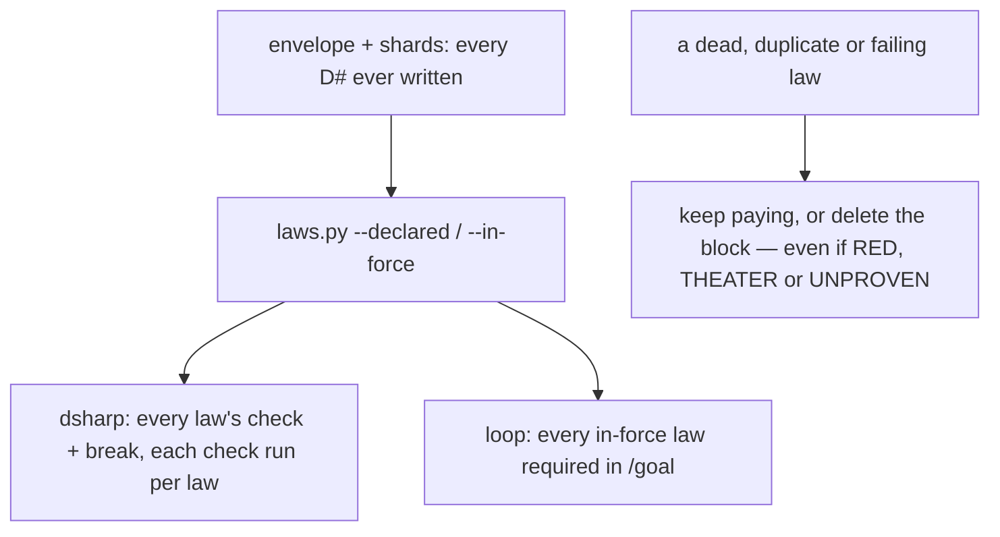

# Stage 05b — t68-law-retirement — SPEC

## User story IDs from the PRD

BDD's product is the cascade itself; the stories this slice serves:

- **S-LR1** — As a human, I can retire a law I signed — superseded by another, or its behaviour removed — with a
  signed `retired:` line. It stops being scored and stops being required in `/goal`, stays readable in its file and
  in git history, and its id is never reused.
- **S-LR2** — As the operator, a law can never leave force to make a gate pass: inside an open hop, a law may be
  retired **or deleted** only if it is GREEN right now (check passes, twin fails). A RED, THEATER or UNPROVEN law
  can be fixed, or taken out of force by a human with no hop running (I18). The merge gate re-proves this from git,
  so `--no-verify` does not get around it.
- **S-LR3** — As a law author, several laws can share one `check:` (one test class, distinct `break:` mutant
  switches), and on the two-command path that check runs once per scoring run for the family.
- **S-LR4** — As a human reviewing years of laws, `bash tests/laws_report.sh` lists candidates for me to look at and
  changes nothing.

## The problem, stated as cost

Laws only accumulate. Nothing records that a law was superseded or that the behaviour it guards was removed, so a
repo carries dead laws whose checks still cost builds every merge (`tests/dsharp_strength.sh` runs every declared
law's two commands; `tests/loop.sh` requires every in-force law in `/goal`, I13), near-duplicates, and laws nobody
can explain. Today the only exit is deleting the D# block. That is signed, but it erases the reason, frees the id —
and it can be done to a law that is RED, THEATER or UNPROVEN right now, which turns a red merge gate (any non-GREEN
law fails it, `tests/dsharp_strength.sh:259`) or a refused loop (`tests/loop.sh:72-90`) green by removing the
evidence. There is no other path today: no locked decision or signed law in this repo conflicts with the brief
(both `<EDIT>` blocks hold placeholders, `DSHARP 0/0`).

| Repo after years | Today | After t68 |
|---|---|---|
| A law whose code was deleted | fails forever, or a human deletes it | `retired: 2027-03-01 — removed — the wallet API was dropped`, signed with no hop running (it is RED) |
| D7 replaced by stronger D19 | both run every merge | `retired: … — superseded by D19`; D7 no longer runs |
| A non-GREEN law retired or deleted inside a hop | possible with a signature | refused by pre-commit, and re-proved by the merge gate |
| 6 laws on one shared `check:` (two-command path) | the check runs 6 times | once, plus each law's own `break:` |
| Which laws to review | nobody knows | `laws_report.sh` lists them |

## Before vs after

Before:



After:

```mermaid
flowchart TD
  E[envelope + shards] --> L[laws.py]
  L --> V{a retired: line?}
  V -->|valid| R[RETIRED with its reason; out of --declared/--in-force/--count;<br/>id stays taken]
  V -->|malformed, or superseded by a missing law or one with a retired: line| W[stays in force; dsharp WARNING]
  V -->|none| D[scored as today]
  D --> G[two-command path: a check shared by 2+ laws runs once, before any break;<br/>each law's own break still runs]
  R --> P[loop / affected / audit / merge gate do not require or score it]
  S[a commit that takes a law out of force:<br/>a new retired: line, or the D# block deleted] --> C{a hop open at HEAD or in the staged hop-state?}
  C -->|no| H[signed like any D# change]
  C -->|yes| K{the law GREEN on HEAD's tree?}
  K -->|yes| H
  K -->|no| B[BLOCKED — the human key does not lift it (I18)]
  M[merge gate] --> MR[tests/retirements.sh: every law that left force since main,<br/>inside a hop, must have been GREEN at its parent — else REFUSED]
  Q[tests/laws_report.sh] --> QK[candidates for a human — never edits]
```

## Benefits and trade-offs

| | Today | After t68 |
|---|---|---|
| Dead law | runs forever or is deleted | retired with a reason, not scored, readable, id kept |
| A non-GREEN law leaving force in a hop | possible | refused at commit (staged hop-state read, human key included) and at the merge gate |
| A non-GREEN law leaving force with no hop running | possible | possible, signed — a deliberate decision between hops, in git |
| A family on one check (two-command path) | the check runs per law | once per run |
| A family on the Gradle harness (t64) | one copy per law | unchanged: one copy per law (the harness proves each law from its own copy) |
| Finding candidates | by hand | `laws_report.sh` |
| Duplicate protected lines | an identical second `retired:` / `check:` line added no diff (set comparison) | counted: a line added twice is a change |
| Not chosen: guard RED only (the brief's wording) | — | THEATER and UNPROVEN fail the gate too (C1); the guard is "not GREEN" |
| Not chosen: a pre-commit-only guard | — | `--no-verify` would bypass it (C4); the merge gate re-proves it from git |
| Not chosen: let the human key lift the guard | — | the key is for ownership checks; turning a red gate green by removing evidence is I18, whoever does it |
| Not chosen: auto-retire from the report | — | a law changes only by a human signature (I13) |

## What the slice adds — and the line it must not cross

### 1. The `retired:` line

A `### D#` block may carry `retired: <YYYY-MM-DD> — superseded by D<N>` or `retired: <YYYY-MM-DD> — removed — <reason>`
(` - ` accepted for ` — `). The legacy one-liner cannot carry it; convert the law to the `###` form first.

- **Valid** when the date parses and either `superseded by D<N>` names a declared law other than itself **that has no
  `retired:` line at all** (one pass, no recursion: D2→D3 with D3→D2 makes both invalid, C9), or `removed —` is
  followed by a non-empty reason.
- **Invalid** → the law stays in force and dsharp prints `WARNING   D7  retired: … — <why>; the law stays in force`.
- `retired` joins laws.py's `FIELD` and `PROTECTED` patterns: a human-owned D# line for pre-commit, hop_guard, sign.sh
  and the t67 shard guard.
- **Protected lines are compared as a multiset** (`tests/lib/protected_lines.py`): a protected line added a second
  time — several laws `superseded by D19` on one date — is a change and needs a signature (C3). This also closes the
  same gap for a duplicated `check:` line.

### 2. laws.py

- `load()` reads every law (ids stay unique across retired and in-force, t67's FATAL unchanged); a validly retired law
  is marked `retired`.
- `--declared`, `--in-force`, `--unproven` and `--count` leave validly retired laws out, so dsharp, loop (I13 and
  UNPROVEN), affected, the verdict cache, the law harness, gradle_runner's merge exclusion, the seam and preserve stop
  scoring and requiring them.
- New `--retired`: `id|law|date|reason` per valid retirement, `id|law|INVALID|why` per invalid one.
- `load(..., retired=False)` by default for direct Python callers (affected.py).

### 3. dsharp_strength.sh and audit.sh

- dsharp prints `RETIRED   D7  <law>  — <reason> (<date>)` and the WARNING lines before `DSHARP k/n`; retired laws
  are in neither `k` nor `n`. audit reads RETIRED lines: a stage-10 row for a retired id prints `RETIRED … (not
  scored)` and counts in neither; a retired id needs no row.
- **Shared checks, two-command path only (S-LR3, C7, C8):** before any law's `break:` runs, each `check:` string
  shared by two or more laws not proven by the harness runs **once**, in the main process, sequentially, in declared
  order (so `DSHARP_JOBS` and `DSHARP_SERIAL` never apply to it). Every law in the family takes that result; each law's
  own `break:` then runs as today. A `check:` used by one law runs as today. The harness path (t64) is unchanged:
  one copy per law.

### 4. Leaving force inside a hop (S-LR2)

`.githooks/pre-commit`, placed **before** the `CASCADE_HUMAN=1` early exit (C6a):

- **Which laws leave force:** laws.py `--declared` on HEAD's envelope and shards vs on the **staged** envelope and
  shards, each materialised into a temp tree (`git show HEAD:<path>` / `git show :<path>` for the envelope and every
  `docs/cascade/laws/*.md` in the respective tree) and read with an explicit `--shards` (C10). A law declared at HEAD
  and not declared in the staged files — newly retired, or its block deleted (C5) — is leaving force.
- **Is a hop open:** `CURRENT_HOP` is GENERATE or EXECUTE in HEAD's hop-state **or** in the staged hop-state, read with
  `git show` — not the working tree (C6b). Staging `CURRENT_HOP: NONE` in the same commit does not count as closed.
- **Is it GREEN:** for each leaving law, run its `check:` and its `break:` (as dsharp does) on a `git worktree` of
  HEAD in a temp directory, with `GIT_DIR`/`GIT_WORK_TREE`/`GIT_INDEX_FILE`/`GIT_OBJECT_DIRECTORY`/`GIT_COMMON_DIR`
  unset (C10). GREEN = check exits 0 and break exits non-zero.
- **Verdict:** a hop open and any leaving law not GREEN → BLOCKED, whatever the signature, with: `D7 is <RED|THEATER|
  UNPROVEN> at HEAD; taking it out of force inside an open hop would drop a failing law to pass a gate (I18). Fix it,
  or close the hop and retire it with no hop running.`
- **Retiring a supersession target:** a commit that gives D19 a `retired:` line while another law says `superseded by
  D19` is BLOCKED with `re-point D7 first` (C9: no law silently comes back into force).

### 5. The merge-gate backstop (C4)

`tests/retirements.sh [--base REV]` (default: `git merge-base HEAD main`) walks every commit from the base to HEAD
that changes the laws' files. For each law that leaves force in a commit whose own or parent hop-state has
`CURRENT_HOP` GENERATE or EXECUTE, it checks out the parent in a temp worktree and runs the law's check and break; not
GREEN → `RETIREMENT REFUSED  D7  left force in <sha> during an open hop while <verdict>`. `tests/barbar.sh merge_gate`
runs it and refuses on any refusal line — a stricter condition, never a looser one (I18). CI's control-line job runs
the gate as today, so the check is Layer 0 too.

### 6. tests/laws_report.sh

`bash tests/laws_report.sh [--years N]` (default 3) prints one line per candidate and changes nothing:
`MISSING-PATH D7` (its `path:` file no longer exists), `DUPLICATE D7 D9` (identical `check:` **and** `break:`),
`UNEXPLAINED D7` (no `reason:`), `STALE D7` (no commit touched its `path:` file in N years; no `path:` → not judged),
and `FAMILY D7 D8 D9` (a shared `check:` with distinct breaks — information, not a candidate; Ask 5). It ends
`LAWS REPORT: k candidate(s) — nothing retired; retiring is a human-signed D# change` and exits 0.

## What the slice must not touch

- What an in-force law means; t65's cache key; t66's selection rules; t67's shard rules.
- The merge gate's existing conditions (§5 adds one refusal, removes none).
- The t64 harness's per-law copies.
- Any automatic edit of a law.

## Acceptance criteria

`tests/ac/t68_law_retirement.sh` builds scratch repos (shell laws; one shard; hooks wired), with a counter per law
command:

- **AC1 — retired is not scored.** D2 `superseded by D3`, D4 `removed — dropped`: RETIRED lines, `DSHARP k/n`
  without them, their commands never run; `laws.py --count/--in-force` omit them; `loop.sh --list` does not require
  them; `affected.sh` does not list them; audit prints a D2 row as `RETIRED (not scored)`.
- **AC2 — invalid stays in force.** A bad date; `superseded by D99` (missing); `superseded by D4` (D4 has a
  `retired:` line); D5→D6 with D6→D5: each such law is scored, required, and named in a WARNING.
- **AC3 — the id stays taken.** A new law reusing a retired id is t67's FATAL.
- **AC4 — leaving force in a hop.** With `CURRENT_HOP: EXECUTE`, each signed commit is BLOCKED: retiring a RED law, a
  THEATER law, an UNPROVEN law; deleting a RED law's block; the same with `CASCADE_HUMAN=1`; the same while staging
  `CURRENT_HOP: NONE` in the commit; the same with the hop flipped to NONE in the working tree only. A GREEN law's
  signed retirement and deletion land in an open hop. With `CURRENT_HOP: NONE` at HEAD and staged, a RED law's signed
  retirement lands. Retiring D19 while D7 says `superseded by D19` is BLOCKED. A retirement whose supersession target
  lives in a shard is judged the same as one in the envelope. **Red twin:** a hook copy that runs only `check:` lets a
  THEATER retirement land in an open hop.
- **AC5 — the merge gate.** A branch where a RED law was retired in an open hop with `--no-verify` makes
  `tests/retirements.sh` print `RETIREMENT REFUSED` and `tests/barbar.sh gate` REFUSE; the same retirement made with no
  hop running passes. **Red twin:** a `retirements.sh` copy that skips the parent's verdict lets it pass.
- **AC6 — guards.** An agent edit adding `retired:` is denied by hop_guard (permissions bypassed) and BLOCKED unsigned
  by pre-commit, in the envelope and in a shard; a second, identical `retired:` line (another law, same target and
  date) is BLOCKED unsigned too.
- **AC7 — a family runs its check once.** D6, D7, D8 share a `check:` with distinct `break:`: the check's counter is 1,
  each break ran once, the check ran before any break, and verdicts equal the pre-t68 script's (`git archive
  537c0c0`), with `DSHARP_JOBS=1` and `4`. **Red twin:** a dsharp copy whose memo reports pass for every check scores a
  RED family member GREEN.
- **AC8 — the report.** A fixture seeded with one law per candidate kind: each is named, FAMILY is printed for the
  family, exit 0, `git status` clean after.
- **AC9 — parity.** With no `retired:` line and no shared check, dsharp output equals `537c0c0` byte for byte.

Gate: `bash tests/ac/t68_law_retirement.sh`, `bash tests/enforcement.sh` (T68), the t56–t67 and t74 tests, lint.

## Laws

`bash tests/dsharp_strength.sh` prints `DSHARP 0/0`: NO LAW IN FORCE in this repo. The slice lets a human take a law
out of force with a signed, reasoned line; it never lets a failing law leave force inside a hop.

# Stage 05b — PLAN

## Goal

EXECUTE adds the signed `retired:` line (laws.py FIELD, PROTECTED, `--retired`, retired laws out of every scoring
mode), multiset protected-line comparison, RETIRED/WARNING in dsharp and audit, the shared-check pre-pass, the
open-hop leaving-force guard in pre-commit, `tests/retirements.sh` in the merge gate, and `tests/laws_report.sh`.

## In scope this execute

- [ ] `tests/lib/laws.py` — `retired` field, non-recursive validation, `--retired`, exclusion, `load(retired=False)`.
- [ ] `tests/lib/protected_lines.py` — multiset diff.
- [ ] `tests/dsharp_strength.sh` — RETIRED/WARNING; the shared-check pre-pass (two-command path).
- [ ] `tests/audit.sh` — RETIRED rows not scored.
- [ ] `.githooks/pre-commit` — §4, before the `CASCADE_HUMAN` exit; staged/HEAD materialisation; GIT_* unset.
- [ ] `tests/retirements.sh`; `tests/barbar.sh merge_gate` refuses on it.
- [ ] `tests/laws_report.sh`.
- [ ] `tests/ac/t68_law_retirement.sh` (AC1–AC9, three red twins); `tests/enforcement.sh` T68.
- [ ] `USAGE.md`, the envelope's law format (`retired:`), `docs/cascade/laws/README.md`, `CHANGELOG.md`,
      `CONTROL-LINE.md` T68.
- [ ] `docs/cascade/goal.md` for the EXECUTE hop.

## Out of scope this execute

- Auto-retirement; retiring legacy one-liners in place; deleting retired blocks.
- Sharing one check copy across a family in the t64 harness.
- Gradle tuning and the version bump (t69).

## Definition of done

- `bash tests/ac/t68_law_retirement.sh` exits 0 and the three red twins are shown to go red.
- `bash tests/enforcement.sh` exits 0 with T68; the t56–t67 ACs and T74 stay green.
- AC9 parity with `537c0c0` is byte-identical.

## Risks / UNKNOWNs that still block

- **U1 — the pre-pass assumes a check is deterministic within one run.** It runs every shared check before any break,
  so no break's tree change sits between two reuses (C7); a flaky check is a defect its author owns.
- **U2 — cost at commit and merge.** Only commits that take a law out of force run its commands (on a HEAD worktree);
  `retirements.sh` re-runs only laws that left force inside a hop on the branch.
- **U3 — `main` is the base.** A repo whose default branch is not `main` passes `--base` (barbar.sh uses the same base
  it already merges into).

## Ask of you

1. **Inside an open hop, a law may leave force (retired or deleted) only if GREEN**; not RED, THEATER or UNPROVEN —
   wider than the brief's "RED" (C1). With no hop running, a signed retirement of any law lands. *Default taken.*
2. **The guard runs before the human key** (`CASCADE_HUMAN=1` does not lift it), and the merge gate re-proves it.
   *Default taken.*
3. **Shared checks run once per run, on the two-command path only.** *Default taken.*
4. **An invalid `retired:` keeps the law in force**; supersession is one-pass (a target with any `retired:` line is
   invalid). *Default taken.*
5. **The report flags exact duplicates (same check and break) and lists families as information** — the brief's
   "identical `check:` commands" would flag every legitimate family (C2). *Default taken.*

## Invariants this hop

- PRESERVE run: no
- /goal set to: n/a — GENERATE; EXECUTE's goal is AC1–AC9 + T68 + the t56–t74 tests + lint
- /model /effort: as set by the session
- /plan: skipped — this document is the plan
- INVARIANTS I1–I18: held; Asks 1–2 widen the brief's guard to every non-GREEN law and back it at Layer 0
- Skills: none invoked; brainstorming skipped (brief signed; gaps are Asks 1–5)
- critique: C1–C10 answered in `05b-t68-law-retirement-critique.md` (spec v2)
- reads: AGENTS.md, hop-state.md, envelope.md, 05b-briefs.md (t68), laws.py, protected_lines.py, dsharp_strength.sh,
  audit.sh, loop.sh, cascade.sh, affected.py, law_harness.py, barbar.sh, .githooks/pre-commit, hop_guard.py
