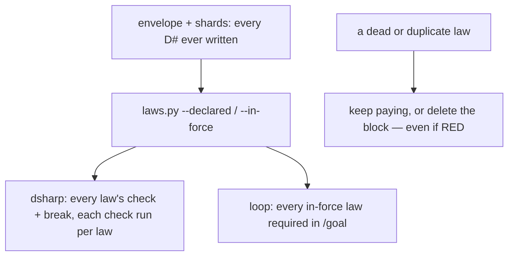

# Stage 05b — t68-law-retirement — SPEC

## User story IDs from the PRD

BDD's product is the cascade itself; the stories this slice serves:

- **S-LR1** — As a human, I can retire a law I signed — superseded by another, or its behaviour removed — with a
  signed `retired:` line. It stops being scored and stops being required in `/goal`, stays readable in its file and
  in git history, and its id is never reused.
- **S-LR2** — As the operator, retirement can never be used to make a gate pass: a law that is RED now cannot be
  retired while a hop is open (I18). It can be fixed, or retired later by a human with no hop running.
- **S-LR3** — As a law author, several laws can share one test (one `check:`, distinct `break:` mutant switches),
  and that test runs once per scoring run for the whole family.
- **S-LR4** — As a human reviewing years of laws, `bash tests/laws_report.sh` lists candidates for me to look at —
  a guarded file that no longer exists, an exact duplicate, a law nobody has explained, a law whose files have not
  changed in years — and changes nothing.

## The problem, stated as cost

Laws only accumulate. Nothing records that a law was superseded or that the behaviour it guards was removed, so a
repo carries dead laws whose checks still cost builds every merge (`tests/dsharp_strength.sh` runs every declared
law's two commands; `tests/loop.sh` requires every in-force law in `/goal`, I13), near-duplicates that prove the same
thing twice, and laws nobody can explain. Today the only exit is deleting the D# block: that is a signed D# change too,
but it erases the reason from the file, frees the id for reuse, and — the dangerous part — can be done to a law that
is RED right now, which turns a red merge gate green by removing the evidence.

| Repo after years | Today | After t68 |
|---|---|---|
| A law whose code was deleted | its check fails or is THEATER forever, or a human deletes it | `retired: 2027-03-01 — removed — the wallet API was dropped`; RETIRED in dsharp, not scored |
| D7 replaced by stronger D19 | both run every merge | `retired: … — superseded by D19`; D7 no longer runs |
| A RED law, deleted to pass the gate | possible with a signature | refused while a hop is open |
| 6 laws on one shared test class | the class runs 6 times + 6 twins | the class runs once + 6 twins |
| Which laws to review | nobody knows | `laws_report.sh` lists them |

## Before vs after

Before:



After:

```mermaid
flowchart TD
  E[envelope + shards] --> L[laws.py]
  L --> V{a retired: line?}
  V -->|valid| R[--retired: listed as RETIRED with its reason;<br/>not in --declared / --in-force / --count; id stays taken]
  V -->|malformed, or superseded by a missing/retired id| W[stays in force; dsharp WARNING names why]
  V -->|none| D[scored as today]
  D --> G[identical check: commands run once per run;<br/>each law's own break: still runs]
  R --> P[loop / affected / audit / merge gate do not require or score it]
  S[a commit adding retired: to a law] --> C{the law's check fails now<br/>and a hop is open?}
  C -->|yes| B[BLOCKED — fix it, or retire it with no hop running (I18)]
  C -->|no| H[signed like any D# change]
  Q[tests/laws_report.sh] --> K[candidates for a human: missing path, duplicate,<br/>no reason, stale files — never edits]
```

## Benefits and trade-offs

| | Today | After t68 |
|---|---|---|
| Dead law | runs forever or is deleted | retired with a reason, not scored, readable, id kept |
| Retiring a RED law to pass | possible | refused while a hop is open |
| A family on one test | the shared check runs per law | the shared check runs once per run |
| Finding candidates | by hand | `laws_report.sh` |
| Verdict of an in-force law | — | unchanged; the check-memo only removes repeat runs of a byte-identical command in one run |
| Not chosen: a retired law still runs its twin | — | a retired law is not a law; scoring it would keep paying for it |
| Not chosen: auto-retire from the report | — | the brief and I13: a law changes only by a human signature |
| Not chosen: retire a RED law with only a signature | — | I18: the gate must not be made green by removing evidence; a deliberate retirement waits for a hop boundary |

## What the slice adds — and the line it must not cross

### 1. The `retired:` line

A `### D#` block may carry `retired: <YYYY-MM-DD> — superseded by D<N>` or `retired: <YYYY-MM-DD> — removed — <reason>`
(an ASCII ` - ` is accepted for ` — `). The legacy one-liner cannot carry it; convert the law to the `###` form first.

- **Valid** when the date parses and either `superseded by D<N>` names a declared, **not retired** law other than
  itself, or `removed —` is followed by a non-empty reason.
- **Invalid** (malformed, or superseded by a missing or retired id) → the law is **not** retired: it stays in force,
  and dsharp prints `WARNING   D7  retired: … — <why>; the law stays in force`. Fail closed (I18).
- `retired` joins laws.py's `FIELD` and `PROTECTED` patterns, so the line is a human-owned D# line for pre-commit,
  hop_guard, sign.sh and the t67 shard guard, exactly like `check:`.

### 2. laws.py

- `load()` keeps reading every law (ids stay unique across retired and in-force, t67's FATAL unchanged); a validly
  retired law is marked `retired`.
- `--declared`, `--in-force`, `--unproven` and `--count` leave validly retired laws out, so every reader that already
  goes through them — dsharp, loop (I13 and UNPROVEN), affected, the verdict cache, the law harness, gradle_runner's
  merge exclusion, the seam, preserve — stops scoring and requiring them with no change of its own.
- New `--retired`: `id|law|date|reason` per valid retirement and `id|law|INVALID|why` per invalid one.
- Python callers that use `load()` directly (affected.py) get `load(..., retired=False)` by default.

### 3. dsharp_strength.sh

- Prints `RETIRED   D7  <law>  — <reason> (<date>)` for each valid retirement and the WARNING line for each invalid
  one, before `DSHARP k/n`. Retired laws are in neither `k` nor `n`. `audit.sh` reads RETIRED lines: a stage-10 row for
  a retired id prints `RETIRED      D7 … (not scored)` and counts in neither `k` nor `n`; a retired id needs no row.
- **Shared checks (S-LR3):** before scoring, laws are grouped by their exact `check:` string; each distinct check runs
  once and every law in the group takes that result; each law's own `break:` runs as today. The harness (t64) and the
  cache (t65) see the same per-law rows as before.

### 4. Retiring a RED law (S-LR2)

`.githooks/pre-commit`: when the staged envelope or a staged shard makes a law newly retired (laws.py `--retired` on
HEAD vs the staged files), the hook runs that law's `check:` on the tree. If it fails **and** `CURRENT_HOP` is
`GENERATE` or `EXECUTE`, the commit is BLOCKED — a signature does not lift it — with: `D7 is RED now; retiring it
inside an open hop would drop a red law to pass a gate (I18). Fix the product, or retire it with no hop running.`
With `CURRENT_HOP: NONE` the signed retirement lands (a deliberate decision, outside any hop, in git).
`CASCADE_HUMAN=1` keeps its documented meaning (the human's key lifts the hook's ownership checks).

### 5. tests/laws_report.sh

`bash tests/laws_report.sh [--years N]` (default 3) prints one line per candidate and changes nothing:

- `MISSING-PATH  D7  path: src/x.py does not exist`
- `DUPLICATE     D7 D9  identical check: and break:`
- `UNEXPLAINED   D7  no reason: line`
- `STALE         D7  no commit touched src/x.py since 2023-01-04 (N years)` — `git log -1` on the law's `path:` file
  (`:symbol` stripped); a law with no `path:` is not judged stale
- `FAMILY        D7 D8 D9  share one check: (fine — runs once)` — information, not a candidate

and ends `LAWS REPORT: k candidate(s) — nothing retired; retiring is a human-signed D# change (USAGE.md)`. Exit 0.

## What the slice must not touch

- What an in-force law means; t65's cache key; t66's selection rules; t67's shard rules (retired laws live in shards
  like any other).
- The merge gate's conditions (retired laws are simply not declared to it).
- Any automatic edit of a law.

## Acceptance criteria

`tests/ac/t68_law_retirement.sh` builds scratch repos (shell laws; one shard), with counters per law command:

- **AC1 — retired is not scored.** D2 `retired: … — superseded by D3`, D4 `retired: … — removed — dropped`: dsharp
  prints RETIRED for both, `DSHARP k/n` without them, and their commands never run; `laws.py --count/--in-force` omit
  them; `loop.sh --list` does not require them; `affected.sh` does not list them; audit scores a row for D2 as
  `RETIRED (not scored)`.
- **AC2 — invalid retirement stays in force.** A malformed date, `superseded by D99` (missing), and `superseded by D4`
  (retired): each law is scored, required, and named in a WARNING.
- **AC3 — the id stays taken.** A new law reusing a retired id is t67's FATAL.
- **AC4 — RED cannot be retired in an open hop.** With D5 RED and `CURRENT_HOP: EXECUTE`, a signed commit adding
  `retired:` to D5 is BLOCKED with the I18 message; with `CURRENT_HOP: NONE` the same signed commit lands; a GREEN
  law's signed retirement lands in an open hop; an unsigned retirement is BLOCKED as a D# change. **Red twin:** a
  hook copy without the RED check lets the open-hop RED retirement land.
- **AC5 — a family runs its check once.** D6, D7, D8 share one `check:` with distinct `break:`: the check's counter
  is 1, each break ran once, and the verdicts equal the pre-t68 script's (`git archive 537c0c0`). **Red twin:** a
  dsharp copy whose memo returns pass for every check scores a RED family member GREEN; the AC goes red.
- **AC6 — the report.** A fixture seeded with one law per candidate kind: the report names each, prints FAMILY for the
  family, exits 0, and `git status` is clean afterwards.
- **AC7 — guards.** An agent edit adding `retired:` is denied by hop_guard (permissions bypassed) and BLOCKED unsigned
  by pre-commit, in the envelope and in a shard.
- **AC8 — parity.** With no `retired:` line and no shared check, dsharp output equals `537c0c0` byte for byte.

Gate: `bash tests/ac/t68_law_retirement.sh`, `bash tests/enforcement.sh` (T68), t56/t64/t65/t66/t67 ACs, lint.

## Laws

`bash tests/dsharp_strength.sh` prints `DSHARP 0/0`: NO LAW IN FORCE in this repo. The slice lets a human take a law
out of force with a signed, reasoned line; it never lets a red law be removed to pass a gate.

# Stage 05b — PLAN

## Goal

EXECUTE adds the signed `retired:` line (laws.py: FIELD, PROTECTED, `--retired`, retired left out of every scoring
mode), RETIRED and WARNING lines in dsharp and audit, the open-hop RED-retirement refusal in pre-commit, the
shared-check memo in dsharp, and `tests/laws_report.sh`.

## In scope this execute

- [ ] `tests/lib/laws.py` — `retired` field, validation, `--retired`, exclusion from `--declared/--in-force/--unproven/--count`, `load(retired=False)`.
- [ ] `tests/dsharp_strength.sh` — RETIRED/WARNING lines; the shared-check memo.
- [ ] `tests/audit.sh` — RETIRED rows not scored.
- [ ] `.githooks/pre-commit` — the RED-retirement refusal.
- [ ] `tests/laws_report.sh`.
- [ ] `tests/ac/t68_law_retirement.sh` (AC1–AC8, two red twins); `tests/enforcement.sh` T68.
- [ ] `USAGE.md` (retiring a law, families, the report); envelope template's law format gains `retired:`;
      `docs/cascade/laws/README.md`; `CHANGELOG.md`; `CONTROL-LINE.md` T68.
- [ ] `docs/cascade/goal.md` for the EXECUTE hop.

## Out of scope this execute

- Auto-retirement; retiring legacy one-liners in place; deleting retired blocks.
- Gradle tuning and the version bump (t69).

## Definition of done

- `bash tests/ac/t68_law_retirement.sh` exits 0 and both red twins are shown to go red.
- `bash tests/enforcement.sh` exits 0 with T68; the t56–t67 ACs stay green.
- AC8 parity with `537c0c0` is byte-identical.

## Risks / UNKNOWNs that still block

- **U1 — the memo assumes a check is deterministic within one run.** A flaky check gives one result to the family
  instead of one per law; a flake is already a defect the law author owns. The memo keys on the exact command string
  and runs in the scoring process, so no environment or tree change sits between two reuses.
- **U2 — the RED check at commit time costs one law run.** Only on a commit that newly retires a law.
- **U3 — "same hop" is approximated as "any open hop".** Retiring a RED law needs `CURRENT_HOP: NONE`; a human can
  still do it deliberately, between hops, in a signed commit.

## Ask of you

1. **"Cannot be retired in the same hop" = refused while any hop is open**; allowed, signed, with no hop running.
   *Default taken.*
2. **Shared checks run once per scoring run** (by exact command string). *Default taken.*
3. **An invalid `retired:` keeps the law in force** with a WARNING. *Default taken.*
4. **Retired ids stay taken** (t67's duplicate FATAL counts them). *Default taken.*

## Invariants this hop

- PRESERVE run: no
- /goal set to: n/a — GENERATE; EXECUTE's goal is AC1–AC8 + T68 + t56–t67 ACs + lint
- /model /effort: as set by the session
- /plan: skipped — this document is the plan
- INVARIANTS I1–I18: held; S-LR2 keeps retirement from dropping a red law to pass a gate
- Skills: none invoked; brainstorming skipped (brief signed; gaps are Asks 1–4)
- reads: AGENTS.md, hop-state.md, envelope.md, 05b-briefs.md (t68), laws.py, dsharp_strength.sh, audit.sh, loop.sh,
  cascade.sh, affected.py, .githooks/pre-commit, hop_guard.py, the t64/t65/t67 specs
