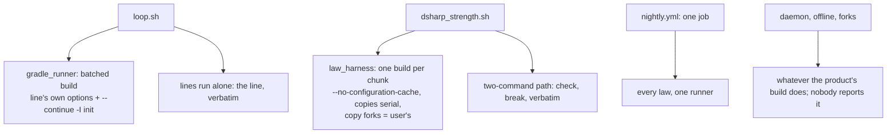
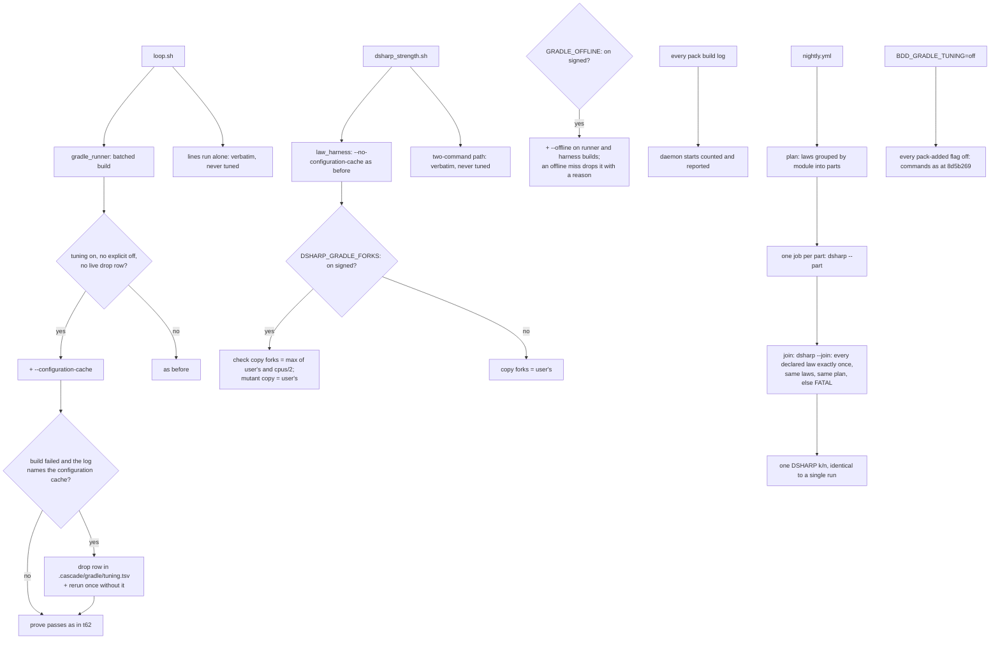

# Stage 05b — t69-gradle-tuning — SPEC

## User story IDs from the PRD

BDD's product is the cascade itself; the stories this slice serves:

- **S-GT1** — As a Gradle product owner, the loop's batched builds (t62) reuse Gradle's configuration cache without
  my having to turn it on. If I turned it off, the pack respects that. If my build rejects it, the pack drops it for
  my build and says why, and never forces it.
- **S-GT2** — As the operator, one run of the loop or the farm reuses one warm Gradle daemon per Gradle entry. When
  it does not, the logs say so and why.
- **S-GT3** — As a human, I can sign the two settings that make a run faster at a small verdict risk (`--offline`,
  and more test forks for a law's check). Each is off until I sign it, and each is dropped with a reason when my
  build rejects it.
- **S-GT4** — As the operator, the nightly full proof runs across several CI runners split by module. A final job
  joins their results into one `DSHARP k/n` that is identical to a single-machine run, or refuses to print a score.
- **S-GT5** — As a pack user, t63–t69 ship as one release, the next minor version above main, with a CHANGELOG that
  carries measured before/after numbers.

## The problem, stated as cost

After t62 (batching), t64 (one law build) and t65 (a verdict cache), fewer Gradle builds run. Each one that still
runs pays for configuration, a daemon, dependency checks and serial test JVMs. Read against the code, the brief's
five levers are not equal:

| Lever (brief) | What the code and the t62/t64 measurements say | This slice |
|---|---|---|
| Configuration cache, loop runner | A batched build (`tests/lib/gradle_runner.py:249-258`) passes only the line's own options, so a product without `org.gradle.configuration-cache=true` re-configures on every pass. t62 measured the same fixture repeating at 17.1s without the cache and 4.4s with it (`docs/cascade/05b-t62-loop-runners.md:33-40`). The runner's init script is already compatible with the cache (t62 AC7e). | **On by default** for the runner's batched builds: respects an explicit off, falls back per build, remembers a rejection |
| Configuration cache, law harness | The harness forces `--no-configuration-cache` (`tests/lib/law_harness.py:231`). Its init script writes `eligible.tsv` from `taskGraph.whenReady` (`law_harness.init.gradle:180`), which does not run when a cache entry is reused. Its fidelity check reads the whole environment (`:200`), so every environment variable would become a cache input. With t65, the plan is "the laws whose key missed", which changes from hop to hop, so the cache key changes too. | **Unchanged.** The cost and the risk are stated; the reasons are recorded under Out of scope |
| Warm daemon | Nothing the pack adds (`-I`, `--continue`, `--build-cache`, `BDD_*` env) makes a daemon incompatible, so pack builds in one run already share one. Nothing checks or reports it. | **Assert and report:** count daemon starts per run, name the reason in the log, never override an explicit `--no-daemon` or `org.gradle.daemon=false` |
| `--offline` | Gradle does not touch the network for a cached static version. The gain is on dynamic and changing versions (`1.+`, `-SNAPSHOT`), which is exactly where `--offline` can test a stale artifact that an online build would have refreshed. That is a verdict change. | **Signed opt-in** `GRADLE_OFFLINE: on`; dropped with a reason on an offline miss |
| `maxParallelForks` for law tasks | Forks spread test *classes* across JVMs within one task. A law whose check selects one class (the common shape, `--tests com.x.BalanceTest`) gains nothing. A different fork layout changes test isolation, and a mutant copy failing because of a race between forks would prove a THEATER law GREEN (`law_harness.py:164-185` accepts any failing case that passed in the check). | **Signed opt-in** `DSHARP_GRADLE_FORKS: on`, applied to the **check copy only**; the mutant keeps the user's value |
| Nightly split by module | One runner proves every law serially (`.github/workflows/nightly.yml:10-27`); wall-clock time grows with the number of laws. | **Plan → parts → join**, with the join failing closed |

No locked decision or signed law in this repo conflicts with the brief (both `<EDIT>` blocks hold placeholders,
`DSHARP 0/0`). One shipped promise does: USAGE.md:151 says of the configuration cache "the pack never turns it on for
you" (t62). This slice reverses that for the runner's batched builds only (Ask 1).

## Before vs after

Before:

After:

## Benefits and trade-offs

| | Today | After t69 |
|---|---|---|
| Loop repeat pass on a product without the configuration cache | re-configures per batched build | reuses the cache (t62: 17.1s → 4.4s on its fixture); E1 re-measures |
| A product that turned the cache off, or whose build rejects it | n/a | respected; a rejection costs one extra build, then is remembered until build logic or the Gradle version changes |
| Lines run alone; a law's own `check:`/`break:` | verbatim | verbatim. The pack never rewrites a user's command |
| Law harness | `--no-configuration-cache` | unchanged (see Out of scope) |
| Daemon | shared, unobserved | shared, counted, reported |
| `--offline`, more forks | never | only when signed; each states its verdict risk in USAGE |
| Nightly wall-clock | one runner, every law | parts in parallel; join is identical to one run or FATAL |
| Escape | `BDD_LOOP_RUNNER=shell`, `DSHARP_HARNESS=off` | plus `BDD_GRADLE_TUNING=off`, which only ever turns tuning off |
| Not chosen: the configuration cache in the law harness | — | eligibility is written in `whenReady`, the whole environment is read, and the t65 plan changes per hop |
| Not chosen: `--offline` and forks on by default (the brief's wording) | — | each can change a test result (stale changing modules; test isolation and fork races) |
| Not chosen: forks on the mutant copy | — | a race failure in the mutant would prove a THEATER law GREEN |
| Not chosen: cross-law concurrent copies | — | shared working dir, ports and files (t64 C5): a follow-up brief, not a tuning flag |
| Cost | — | a Gradle-aware tuning layer, one drop file, two signed switches, a nightly that is three jobs instead of one |

## What the slice adds — and the line it must not cross

The line: **only builds the pack constructs get tuned** (the t62 runner's batched builds and the t64 harness's law
builds). A line run alone, a law's `check:` and `break:`, `affected.py`'s module-map build and the user's own builds
are never changed. Every pack-added flag can make a build fail or be slower. It must never make a PASS or a GREEN
that the untuned build would not give. Where that cannot be guaranteed, the flag needs a signature (I18).

### 1. `tests/lib/gradle_tuning.py` — one place that decides the flags

`flags(root, entry, globals_, kind) -> (args, env, notes)`, where `kind` is `runner` or `harness`:

- **`BDD_GRADLE_TUNING=off`** → `([], {}, ["tuning off (BDD_GRADLE_TUNING=off)"])`. No other value turns anything
  on. An unset or unreadable value is the default below.
- **Configuration cache** (`kind == runner` only). Added when: the line's globals hold neither
  `--configuration-cache` nor `--no-configuration-cache`; neither the root `gradle.properties` nor
  `$GRADLE_USER_HOME/gradle.properties` (default `~/.gradle`) sets `org.gradle.configuration-cache` or the legacy
  `org.gradle.unsafe.configuration-cache` to anything; and no live drop row exists for (`configuration-cache`, entry).
  If the user's properties already say `true`, the flag adds nothing and is not passed. An explicit `false` is the
  user's decision and is respected (note: `configuration cache: off in gradle.properties`).
- **`--offline`** (both kinds). Added only when `- GRADLE_OFFLINE: on` is the last such line inside an `<EDIT>` block
  of `docs/cascade/envelope.md`, both at HEAD and in the working tree (`gradle_runner.merge_signed`'s rule), the
  globals hold neither `--offline` nor `--refresh-dependencies`, and there is no live drop row.
- **Forks** (`kind == harness` only). When `- DSHARP_GRADLE_FORKS: on` is signed the same way: env
  `BDD_LAW_FORKS=<max(1, os.cpu_count() // 2)>`.
- **Never added:** `--no-daemon`, `--daemon`, `-Dorg.gradle.jvmargs`, `-Dorg.gradle.java.home`, `--parallel`,
  `--max-workers`. Each of these can make a daemon incompatible or reorder tasks.

**Drop rows** — `.cascade/gradle/tuning.tsv`, `<flag>\t<entry>\t<fingerprint>\t<UTC date>\t<reason>`. The
fingerprint is the sha256 of the Gradle version (the wrapper's, or `gradle --version` on PATH) and the contents of
every file `affected.is_build_logic` names (root and module `build.gradle*`, `settings.gradle*`,
`gradle.properties`, `gradle/`, `buildSrc/`, `build-logic/`), tracked or not. A row is live while its fingerprint
matches. A row can only *remove* a flag, so a forged, stale or corrupt file makes a run slower, never more lenient.
An unreadable file means no rows: the flag is tried again.

**Rejection** — `rejected(log, flag) -> reason | None`, matched in the build log's `* What went wrong:` section
only. The exact strings per verified Gradle version are measured in E0 and pinned in the code with the version they
came from. For example, `Configuration cache problems found in this build` and
`Configuration cache state could not be cached` for the configuration cache, and `No cached version` with
`offline mode` for `--offline`.

### 2. The runner (`gradle_runner.py`)

`command()` takes the tuning args, and the drop logic wraps each wave's build:

1. Build with the tuning args. The graph key (`graph-<sha>.tsv`) is computed on the full command, so a tuned
   command and an untuned one never share a graph file.
2. If the build failed and `rejected()` names a pack-added flag: write a drop row, append
   `tuning: <flag> dropped — <reason>` to `.cascade/loop/tuning.log`, rerun the same wave once without that flag,
   and prove from the rerun only. The failed build proves nothing.
3. Otherwise prove passes exactly as t62 does. A failure count that is not a task's still proves nothing.

The `loop:` summary line gains `; tuning: <flags or none>` and, when a build started a daemon, `; daemon: <n>
started (<reason>)`. `PASS`/`FAIL` lines, `LOOP k/n` and the receipt are unchanged.

### 3. The law harness (`law_harness.py`, `law_harness.init.gradle`)

- It keeps `--no-configuration-cache` and the strictly serial copy chain.
- `--offline` from §1 when signed, with the same drop-and-rerun rule.
- With `BDD_LAW_FORKS=n`, the init script sets `bddLawCheck_<id>.maxParallelForks = max(original, n)`. The mutant
  copy keeps the original's value. The fidelity check compares every other property as today; for the check copy
  it skips only `maxParallelForks`, and only when `BDD_LAW_FORKS` is set. `law-harness.tsv` records `forks <n>` per
  build.
- The merge gate already sets `DSHARP_HARNESS=off` (`tests/barbar.sh:24`), so neither signed setting can reach a
  merge decision.

### 4. Daemon reporting

`gradle_tuning.daemon(log) -> (started: int, reason: str)` reads Gradle's own lines (`Starting a Gradle Daemon`,
plus the `N busy and M incompatible` / `stopped` suffix; strings pinned in E0). The runner and the harness sum them
per run into their logs and the `loop:` summary. Nothing is changed to "keep" a daemon. The pack already adds
nothing that breaks compatibility, and §1's "never added" list keeps it that way. An explicit `--no-daemon` on a
line, or `org.gradle.daemon=false`, is reported as the reason and respected.

### 5. The nightly split

- **`tests/lib/nightly_plan.py <root> <envelope> --parts N`** reads every in-force law (`laws.py --in-force
  --shards`), groups them by `affected.module_of(check)` (static: `:module:task`; any other line is group `-`),
  and packs whole groups into at most N parts. Largest group first, ties by name, each into the part with the fewest
  laws; a part never holds more than one module's group unless there are more groups than parts. It writes
  `plan.tsv` (`<declared index>\t<id>\t<part>`) and prints `{"part":[0,…]}`. There is always at least one part, so
  zero laws give one empty part (GitHub refuses an empty matrix).
- **`dsharp_strength.sh --part <plan.tsv> <K> --out <dir>`** scores only the laws the plan gives to part K, with the
  cache forced off. It writes `<dir>/res.<i>` (status only) and `<dir>/manifest` (sha256 of `laws.py --declared
  --shards` output, sha256 of `plan.tsv`, K). It prints its own law lines and `DSHARP PART K: k/m — not a verdict;
  join the parts`, never a `DSHARP k/n` line. It exits 0 if every law it owns is GREEN.
- **`dsharp_strength.sh --join <plan.tsv> <dir>...`** refuses with `FATAL     join: <why>` and exit 1 when: a
  manifest's laws sha is not its own; plan shas differ, or differ from the given plan; a part listed in the plan
  has no directory; an in-force declared index has no result or has two; a result sits in a part the plan does not
  give it to; or a status is not one of GREEN / RED / THEATER / UNPROVEN. Otherwise it rebuilds every line from its
  own parse with the one `line_for <status> <i>` function that `score_one` also uses (factored out, not copied),
  then runs the unchanged collection, RETIRED, metadata and exit-code path. So the joined output equals a
  single run by construction, not by comparison.
- **`.github/workflows/nightly.yml`**: job `plan` (outputs the matrix and uploads `plan.tsv`); job `laws`
  (`strategy.matrix.part`, `fail-fast: false`, Java + setup-gradle as today, `DSHARP_CACHE=off`, runs `--part`,
  uploads `part-<K>/`, and its own exit does not cancel the join); job `join` (`needs: [plan, laws]`,
  `if: always()`, downloads everything, runs `--join`; its exit is the nightly's law verdict). The enforcement suite
  and the stress step move to their own job `pack`, unchanged. `workflow_dispatch` takes `parts` (default 4).
- The merge gate, `barbar.sh` and the loop never use `--part` or `--join`.

### 6. The release

- `VERSION`, `.claude-plugin/plugin.json`, `.claude-plugin/marketplace.json` → **2.7.0** (origin/main is 2.6.0;
  re-checked at landing, and if main has moved, the next minor above it).
- `CHANGELOG.md`: `## Unreleased` becomes `## 2.7.0 — <landing date>`, with a one-paragraph summary of t63–t69 (and
  t74, which is already under Unreleased) above the existing entries, the t69 entry, and E1's table.
- `USAGE.md`: §B9 (loop runner) says the runner turns on the configuration cache for its own batched builds and how
  to opt out. That replaces "the pack never turns it on". The two signed switches, with their risk in one line each.
  `BDD_GRADLE_TUNING=off`. The nightly split. `CONTROL-LINE.md`: T69.

## What the slice must not touch

- Any user command: lines run alone, a law's `check:`/`break:`, `goal.md`, the envelope's laws.
- t62's proof rules (what counts as a proven PASS), t64's eligibility and GREEN rules (except the one fork
  exception in §3), t65's cache key and storage, t66's selection, t67's shard reading, t68's retirement.
- The merge gate's conditions; `DSHARP_HARNESS=off` and `DSHARP_CACHE=off` there stay.
- `affected.py`'s module-map build (`--no-configuration-cache`, unchanged).

## Acceptance criteria

`tests/ac/t69_gradle_tuning.sh` (stub Gradle: a `gradlew` script that logs argv and plays scripted outcomes, as T62
does) and `tests/stress/gradle_tuning.sh` (real Gradle):

- **AC1 — which flags.** Stub: a batched build gets `--configuration-cache` by default. It does not with
  `--no-configuration-cache` on the lines, with `org.gradle.configuration-cache=false` in the project's or the user
  home's `gradle.properties`, with `=true` there (nothing to add), or with `BDD_GRADLE_TUNING=off`. Lines run alone,
  and every law `check:`/`break:` on the two-command path, receive argv equal to their text. No pack build ever
  receives any flag on §1's "never added" list.
- **AC2 — rejection and memory.** The stub fails with a configuration-cache problem when given the flag. The wave is
  rerun once without it, a drop row and a `tuning.log` line are written, and the verdicts equal
  `BDD_LOOP_RUNNER=shell`. The next run makes one build per wave without the flag. Editing `build.gradle` makes the
  flag come back and be tried again. A forged row with another fingerprint is ignored. **Red twin:** a runner copy
  that ignores live drop rows makes two builds per wave on the second run.
- **AC3 — offline, signed.** Unsigned: never `--offline`. Signed and committed: runner and harness builds get it. The
  stub's offline miss drops it with a reason and reruns. Signed but uncommitted: never.
- **AC4 — forks, signed.** Stress fixture with a law whose check selects three classes: unsigned, both copies keep
  the user's `maxParallelForks`. Signed, the check copy runs `max(user, cpus/2)` and the mutant runs the user's value.
  Every other fidelity difference still makes the law ineligible. **Red twin:** an init-script copy that also forks
  the mutant proves GREEN a THEATER law whose mutant fails only because two of its classes race on one file. The real
  harness scores it THEATER through the two-command path.
- **AC5 — daemon.** Stress: a loop run with three waves plus a harness run starts at most one daemon per entry, and
  zero on an immediate second run. The summary names a start and its reason. With `org.gradle.daemon=false`, the
  pack adds no daemon flag and reports the reason.
- **AC6 — the nightly split.** Fixture with GREEN, RED, THEATER, UNPROVEN and RETIRED laws over three stub modules
  and a shell law. `nightly_plan.py --parts 2|3|8`, every part, then `--join`: stdout and exit code are
  byte-identical to a single `DSHARP_CACHE=off bash tests/dsharp_strength.sh`, for each N. Zero laws give one empty
  part and `DSHARP 0/0`. Each of these is FATAL: a missing part dir, a duplicated result, a result in the wrong part,
  a manifest from other laws, a plan mismatch. **Red twin:** a join copy without the completeness check prints a
  `DSHARP k/n` with a law missing.
- **AC7 — real Gradle (stress).** On the t62 fixture (two modules, `CONF_MS`), on 8.5 and 9.1.0: the verdict matrix
  with tuning on equals tuning off equals every line run alone. A module whose build logic is incompatible with the
  configuration cache (a `doLast` that reads `project` at execution time) scores the same with a logged drop.
- **AC8 — release.** T31 sees 2.7.0 in all three files; CHANGELOG has `## 2.7.0 — ` and no `## Unreleased` entries
  left behind; the t63–t69 and t74 headings are under it; E1's table is present.
- **AC9 — parity.** With `BDD_GRADLE_TUNING=off`, `loop.sh` and `dsharp_strength.sh` stdout and every stub argv equal
  `git archive 8d5b269` byte for byte. With no Gradle line, the default is byte-identical too.
- **E1 — measured.** On the t62 fixture plus 20 harness-shaped laws, warm daemon, on a verified Gradle: loop pass 1
  and an unchanged pass 2 (tuning off / on); a full farm run (`DSHARP_CACHE=off`, harness signed), forks unsigned and
  signed; nightly single job vs 3 parts (wall-clock of the slowest part plus the join). The table goes in the EXECUTE
  report and the CHANGELOG, including any row that did not get faster.

Gate: `bash tests/ac/t69_gradle_tuning.sh`, `bash tests/enforcement.sh` (T69), the t56–t68 and t74 tests, lint;
the stress script on CI in `pack-self-check.yml`.

## Laws

`bash tests/dsharp_strength.sh` prints `DSHARP 0/0`: NO LAW IN FORCE in this repo. The slice changes how fast pack
builds run, never what a law or a line means. A setting that could flip a verdict needs a signature, and none of
them reaches the merge gate.

# Stage 05b — PLAN

## Goal

EXECUTE adds `tests/lib/gradle_tuning.py` (flags, drop rows, rejection, daemon reading); wires it into the t62
runner (configuration cache by default, drop-and-rerun) and the t64 harness (signed offline, signed check-copy forks);
adds `nightly_plan.py`, `dsharp_strength.sh --part/--join`, and a three-job nightly; and releases 2.7.0 with E1's
numbers.

## In scope this execute

- [ ] E0: on Gradle 8.5 and 9.1.0, pin the rejection and daemon strings (§1, §4); confirm that the default
      problems mode fails the build on an incompatible module.
- [ ] `tests/lib/gradle_tuning.py` (new).
- [ ] `tests/lib/gradle_runner.py` — tuning args in `command()`, drop-and-rerun per wave, summary fields.
- [ ] `tests/loop.sh` — print the runner's tuning/daemon summary.
- [ ] `tests/lib/law_harness.py`, `tests/lib/law_harness.init.gradle` — offline, `BDD_LAW_FORKS` on the check copy,
      fidelity exception.
- [ ] `tests/lib/nightly_plan.py` (new); `tests/dsharp_strength.sh` — `line_for`, `--part`, `--join`.
- [ ] `.github/workflows/nightly.yml` — plan / laws / join / pack.
- [ ] `tests/ac/t69_gradle_tuning.sh` (AC1–AC6, AC8, AC9, three red twins); `tests/stress/gradle_tuning.sh` (AC4,
      AC5, AC7, E1); `tests/enforcement.sh` T69; `pack-self-check.yml` runs the stress script.
- [ ] `VERSION`, `plugin.json`, `marketplace.json` → 2.7.0; `CHANGELOG.md`; `USAGE.md`; `CONTROL-LINE.md`.
- [ ] `docs/cascade/goal.md` for the EXECUTE hop.

## Out of scope this execute

- The configuration cache in the law harness. That needs eligibility kept outside `whenReady`, a fidelity check that
  does not read the whole environment, and a plan that is stable across hops. Brief it separately if E1 shows the
  harness's configuration time dominates.
- Concurrent law copies (cross-law parallelism): a race-isolation design, not a flag.
- Rewriting any user command; shipping `nightly.yml` through `install.sh` (it stays the pack's, as in t66).
- `--parallel`, `--max-workers`, daemon JVM arguments.

## Definition of done

- `bash tests/ac/t69_gradle_tuning.sh` exits 0 and the three red twins are shown to go red.
- `bash tests/stress/gradle_tuning.sh` passes on 8.5 and 9.1.0, and E1's table is in the report and the CHANGELOG.
- `bash tests/enforcement.sh` exits 0 with T69; the t56–t68 ACs and T74 stay green; AC9 parity is byte-identical.

## Risks / UNKNOWNs that still block

- **A2 — configuration-cache equivalence.** A batched PASS under the cache rests on Gradle's own contract: a reused
  entry is the configuration that the same inputs would produce. Build logic that reads untracked state at
  configuration time (a network call, the clock) could configure a test differently on reuse. That risk only
  affects PASS: every FAIL is confirmed alone, untuned. The same premise as t62's A1.
- **U1 — rejection strings drift across Gradle versions.** They are pinned per verified version in E0. An unmatched
  rejection is an ordinary failed build: nothing is proven, the lines run alone, and the verdict is unchanged. The
  only cost is time.
- **U2 — the farm may not get faster by default.** The default-on gains are in the loop and the nightly wall-clock.
  The farm gets faster only with the signed forks (and only for multi-class laws) or the signed offline setting.
  E1 reports the farm rows as measured (Ask 6).
- **U3 — `os.cpu_count()` on CI runners** may report host cores. The fork count is logged per build.

## Ask of you

1. **The loop runner turns on the configuration cache for its own batched builds by default.** It respects an
   explicit off, drops the flag per build on a rejection, and remembers the drop until build logic changes. This
   reverses USAGE.md:151 ("the pack never turns it on"). *Default taken.*
2. **The law harness keeps `--no-configuration-cache`** (reasons above). *Default taken.*
3. **`--offline` only when you sign `GRADLE_OFFLINE: on`.** The brief made it a default, but a stale changing module
   can flip a test. *Default taken.*
4. **More forks only when you sign `DSHARP_GRADLE_FORKS: on`, and only on the check copy.** On the mutant, a race
   could prove a THEATER law GREEN. *Default taken.*
5. **The daemon: assert and report; never override your `--no-daemon` or `org.gradle.daemon=false`.** *Default taken.*
6. **"Measurably faster"** means the E1 rows that move under the defaults (loop repeat pass, nightly wall-clock).
   The farm rows are reported as measured, signed and unsigned, even if flat. *Default taken.*
7. **2.7.0, with t74 in the release notes** (it is already under Unreleased). *Default taken.*

## Invariants this hop

- PRESERVE run: no
- /goal set to: n/a — GENERATE; EXECUTE's goal is AC1–AC9 + T69 + the t56–t74 tests + lint
- /model /effort: as set by the session
- /plan: skipped — this document is the plan
- INVARIANTS I1–I18: held. Asks 3–4 narrow the brief (signed instead of default) so that no unsigned setting can
  flip a verdict
- Skills: none invoked; brainstorming skipped (brief signed; gaps are Asks 1–7)
- critique: see `05b-t69-gradle-tuning-critique.md`
- reads: AGENTS.md, hop-state.md, envelope.md, 05b-briefs.md (t62–t72), gradle_runner.py, gradle_runner.init.gradle,
  law_harness.py, law_harness.init.gradle, dsharp_strength.sh, loop.sh, affected.py, affected.sh, barbar.sh,
  nightly.yml, pack-self-check.yml, tests/stress/gradle_runner.sh, the t62/t64/t65/t66 specs, USAGE.md, CHANGELOG.md
