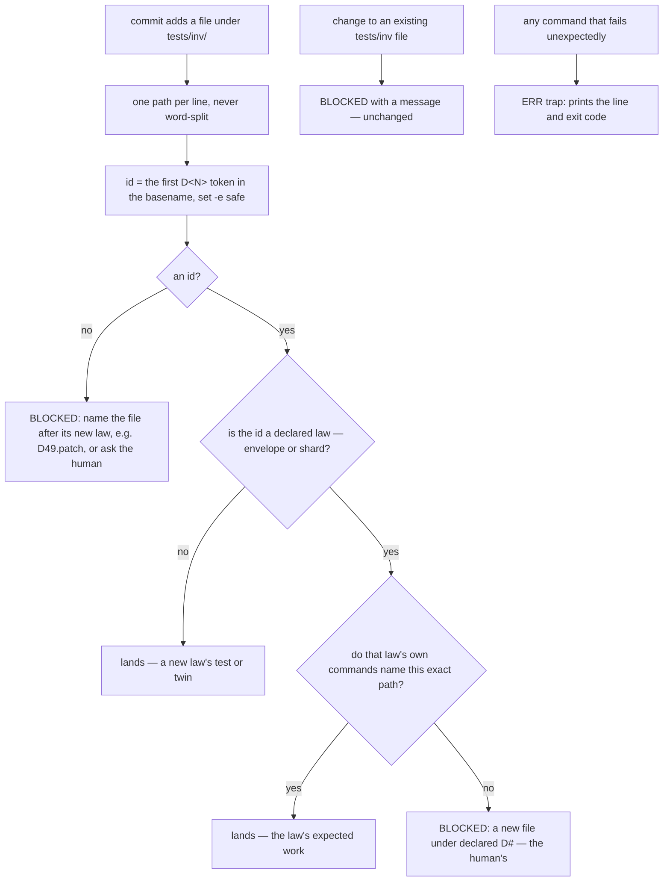

# Stage 05b — t74-inv-new-file-skip — SPEC

## User story IDs from the PRD

BDD's product is the cascade itself; the stories this slice serves:

- **S-IN1** — As an agent adding the red twin for a **new** D# (a mutant patch, a fixture, a table of its own), I can
  commit a new file under `tests/inv/` named after that id, as AGENTS.md rule 5 promises ("you may add a test for a
  **new** D# id").
- **S-IN2** — As a human or an agent, when the pre-commit hook refuses a commit it says why. A command that fails
  where the hook did not expect it prints the line it stopped at; the hook never exits 1 in silence.
- **S-IN3** — As the operator, nothing that is blocked today lands after t74. Changing an existing `tests/inv/` file
  stays a human-signed law edit, and no new file can sit beside an existing law's test unless that law names it.

## The problem, stated as cost

`.githooks/pre-commit` runs under `set -euo pipefail` (`.githooks/pre-commit:6`). Its tests/inv reuse check
extracts a law id from every **added** `tests/inv/` file, and only recognises names that start `test_D<N>`:

```
for f in $(git diff --cached --name-only --diff-filter=A -- 'tests/inv/*' 2>/dev/null); do     # :75
  id="$(basename "$f" | grep -oE '^test_D[0-9]+' | sed 's/^test_//')"                          # :76
  [[ -n "$id" ]] || continue
```

For any other name grep matches nothing, the pipeline fails, and `set -e` ends the hook with exit 1 before the
`continue` — no message (reported from a downstream repo on 2026-10-21, reproduced on `6703437`). The critic showed
(C1, C3, C4) that the silent exit is today the **only** thing stopping several commits the intent of rule 5 forbids,
so "add `|| true`" alone would open them:

| New file under `tests/inv/` | Today | With only `\|\| true` | After t74 |
|---|---|---|---|
| `mutants/D99.patch` (D99 undeclared) | silent exit 1 | lands | **lands** |
| `test_D99.sh` (undeclared) | lands | lands | lands |
| `D1_vip.sh` (D1 declared, not named by D1) | silent exit 1 | **lands** | BLOCKED, with a message |
| `conftest.py` (no id: can change every pytest law's verdict) | silent exit 1 | **lands** | BLOCKED, with a message |
| `test_D1 vip.sh` (a space; word-split) | silent exit 1 | **lands** | BLOCKED, with a message |
| `sub/test_D1.sh` (D1 names `tests/inv/test_D1.sh`) | lands (basename match) | lands | BLOCKED, with a message |
| `test_D1.sh` exactly as D1's `check:` names it (UNPROVEN's expected work) | lands | lands | lands |
| an existing `tests/inv/` file changed (a shared `twins.tsv` row included) | BLOCKED | BLOCKED | BLOCKED, unchanged |

## Before vs after

Before:

```mermaid
flowchart TD
  A[commit adds a file under tests/inv/] --> W[for f in $git diff: word-split on spaces]
  W --> B[id = basename \| grep ^test_D \| sed]
  B --> C{grep matched?}
  C -->|no| D[set -e: hook exits 1, prints nothing]
  C -->|yes| E{is the id a declared law?}
  E -->|no| L1[lands — a new law's test]
  E -->|yes| F{law text contains the basename?}
  F -->|yes| L2[lands]
  F -->|no| X[BLOCKED with a message]
```

After:



## Benefits and trade-offs

| | Today | After t74 |
|---|---|---|
| A new law's twin under any name carrying its id | silent exit unless named `test_D…` | lands |
| A new file with no id (`conftest.py`, a helper) | silent exit | BLOCKED with the reason; a human signs it, or the agent names it after the new law |
| A new file under a declared law, not named by it | blocked if `test_D…`, silent exit otherwise | BLOCKED with the reason, whatever its name |
| Match against the law's text | basename (a copy in a subfolder slipped through) | the exact path the law's commands contain |
| A path with a space | word-split | read whole |
| Unexpected failure anywhere in the hook | silent | `cascade: pre-commit stopped at line N (exit E)` on stderr |
| Changes to existing files | BLOCKED | unchanged |
| Not chosen: let agents append rows for undeclared ids to an existing table (`twins.tsv`) | — | relaxes a Layer 1 guard for a format the pack does not define (I18); a new file per twin needs no exception |
| Not chosen: allow id-less new files | — | `conftest.py` changes an existing law's verdict without touching its file (C3) |

## What the slice adds — and the line it must not cross

1. **`.githooks/pre-commit`, the added-file loop:**
   - read the added paths one per line (`while IFS= read -r f; do … done < <(git diff --cached --name-only
     --diff-filter=A -z … | tr '\0' '\n')`), never through `$( … )` word-splitting;
   - `id` = the first `D<digits>` token in the basename (`D49.patch`, `twin_D49.tsv`, `test_D49.py` all give `D49`),
     with `|| true`;
   - no id → the file is listed as `<path> (no D# id in its name — a new law's twin is named after it, e.g.
     D49.patch; anything else under tests/inv/ is the human's)`;
   - a declared id (laws.py, envelope and shards, unchanged from t67) whose law text does not contain the **exact
     path** `f` → listed as `<path> (adds under declared D#; that law names a different test)`;
   - an undeclared id, or a declared law naming this exact path → allowed.
   Listed files are BLOCKED by the existing message unless `human_ok` signs them, as today.
2. **`.githooks/pre-commit`, a catch-all:** `trap 'echo "cascade: pre-commit stopped at line $LINENO (exit $?) — a
   hook error, not a verdict; run bash -x .githooks/pre-commit to see it" >&2' ERR` right after `set -euo
   pipefail`, so any unexpected failure names itself (S-IN2). It does not change any decision: it prints, and
   `set -e` exits as before.
3. **`.claude/hooks/hop_guard.py`**, the same rule for a `Write` that creates a file under `tests/inv/`: no id →
   `sign_or_deny`; a declared id whose law does not name the exact path → `sign_or_deny`; else allowed.
4. **AGENTS.md rule 5**, one sentence: a new law's red twin goes in a **new** file under `tests/inv/` whose name
   carries the new id (`tests/inv/mutants/D49.patch`); a file without an id, a new file under an existing law, and
   any change to an existing file there are the human's to sign. The hook's BLOCKED text says the same, so an
   installed repo whose AGENTS.md is not refreshed by `install.sh` (C2) still gets the rule at the moment it matters.
5. **`tests/enforcement.sh`** T74; its header and final PASS ranges updated, and `tests/lint.sh` checks them with the
   other T-ranges (C10).

Must not touch: what counts as an existing file (the `MDR` filter), `tests/sign.sh`, any law's meaning, t67's reader.

## Acceptance criteria

T74 in `tests/enforcement.sh` builds a scratch repo with the hook wired and one declared law `D1` whose `check:` is
`bash tests/inv/test_D1.sh`:

- **AC1 — a new law's twin lands.** Adding `tests/inv/mutants/D99.patch`, `tests/inv/twin_D99.tsv` and
  `tests/inv/test_D99.sh` each commits.
- **AC2 — nothing blocked today lands (S-IN3).** Each is BLOCKED with its reason on stderr: `tests/inv/D1_vip.sh`,
  `tests/inv/conftest.py`, `tests/inv/test_D1 vip.sh`, `tests/inv/sub/test_D1.sh`, a change to the existing
  `tests/inv/test_D1.sh`, a row appended to an existing `tests/inv/twins.tsv`. `tests/inv/test_D1.sh` added in a repo
  where it does not exist yet (UNPROVEN's expected work) commits.
- **AC3 — signed, it lands.** `tests/inv/conftest.py` after `bash tests/sign.sh` commits.
- **AC4 — never silent.** Every BLOCKED in AC2 has non-empty stderr. A copy of the hook with a command that fails
  injected after the ERR trap prints `cascade: pre-commit stopped at line`.
- **AC5 — red twins.** (a) A copy of the hook with line 76's original extraction restored (exactly
  `grep -oE '^test_D[0-9]+' | sed 's/^test_//')"` without `|| true`) exits 1 on AC1's `D99.patch` — AC1 goes red.
  (b) A copy that skips id-less files instead of listing them lets `conftest.py` commit — AC2 goes red.
- **AC6 — hop_guard.** `Write` of `tests/inv/conftest.py` and of `tests/inv/D1_vip.sh` is denied (permissions
  bypassed) or asked; `Write` of `tests/inv/mutants/D99.patch` passes.
- **AC7 — prose.** AGENTS.md rule 5 carries the new-file sentence; the hook's BLOCKED text names the rule.

Gate: `bash tests/enforcement.sh` (T74), `bash tests/lint.sh`.

## Laws

`bash tests/dsharp_strength.sh` prints `DSHARP 0/0`: NO LAW IN FORCE in this repo. The slice changes which new files
under `tests/inv/` an agent may add — never looser than today (S-IN3), and loud where today is silent.

# Stage 05b — PLAN

## Goal

EXECUTE replaces the added-file loop in `.githooks/pre-commit` with a whole-path, id-carrying, exact-path rule, adds
an ERR trap so no hook failure is silent, gives `hop_guard.py` the same rule, says it in AGENTS.md rule 5 and in the
BLOCKED text, and adds T74.

## In scope this execute

- [ ] `.githooks/pre-commit` — the loop (§1) and the ERR trap (§2).
- [ ] `.claude/hooks/hop_guard.py` — the same rule for a new file (§3).
- [ ] `AGENTS.md` rule 5 (§4).
- [ ] `tests/enforcement.sh` T74 (AC1–AC7); header and final ranges; `tests/lint.sh` checks them.
- [ ] `CONTROL-LINE.md` T74 row and ranges; `CHANGELOG.md` (installed repos get the hook from `install.sh`; the
      AGENTS.md sentence must be merged by hand — `install.sh` keeps an existing AGENTS.md; the hook's message
      carries the rule meanwhile).
- [ ] `docs/cascade/goal.md` for the EXECUTE hop.

## Out of scope this execute

- Appends to an existing shared file; id-less new files without a signature.
- t71 (EDIT-tag pairing), t73 (portable sed), the autopilot `CASCADE_ENVELOPE` leak.
- Refreshing an existing AGENTS.md from `install.sh`.

## Definition of done

- `bash tests/enforcement.sh` exits 0 with T74, and both red twins are shown to go red.
- `bash tests/lint.sh` is clean, including the enforcement ranges.

## Risks / UNKNOWNs that still block

- **U1 — downstream copies.** Installed repos get the hook by re-running `install.sh` (or a plugin refresh when idle
  and clean); their AGENTS.md keeps the old rule 5 until merged by hand. The BLOCKED text carries the rule.
- **U2 — a stricter rule.** `tests/inv/sub/test_D1.sh` lands today and is blocked after t74 (exact path, not
  basename). That is a deliberate tightening; CHANGELOG names it.
- **U3 — the ERR trap and `set -e`.** ERR does not fire inside `if`, `&&`, `||` or `!` contexts, so existing
  intentional checks stay silent; AC4 shows it fires on an unexpected failure.

## Ask of you

1. **Option (b) of the report, made explicit:** an existing `tests/inv/` file stays human-owned (a shared twins table
   included); a new file must carry a D# id; undeclared ids land, a declared id lands only on the exact path its law
   names, id-less files need a signature. *Default taken.*

## Invariants this hop

- PRESERVE run: no
- /goal set to: n/a — GENERATE; EXECUTE's goal is T74 + lint
- /model /effort: as set by the session
- /plan: skipped — this document is the plan
- INVARIANTS I1–I18: held; S-IN3 keeps Layer 1 at least as strict as today (C1, C3, C4)
- Skills: none invoked; brainstorming skipped (brief signed; the one choice is Ask 1)
- critique: C1–C10 answered in `05b-t74-inv-new-file-skip-critique.md` (spec v2)
- reads: AGENTS.md, hop-state.md, envelope.md, 05b-briefs.md (t74), .githooks/pre-commit, hop_guard.py, install.sh,
  tests/enforcement.sh (T25), tests/lint.sh, the downstream bug report
