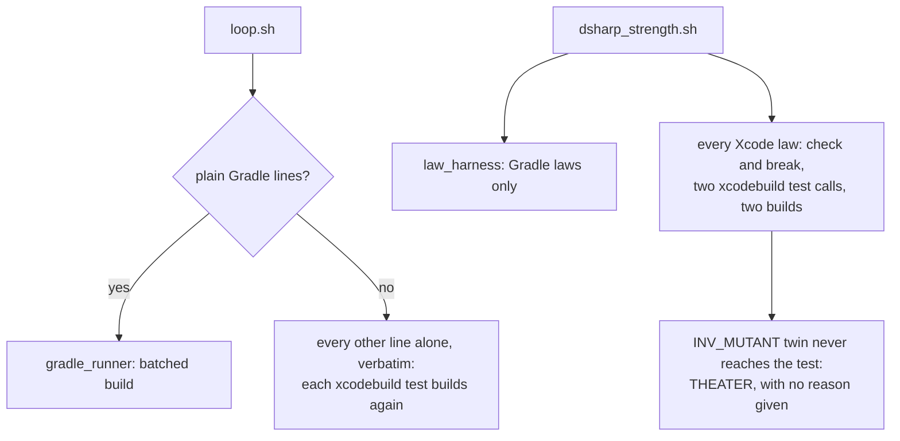
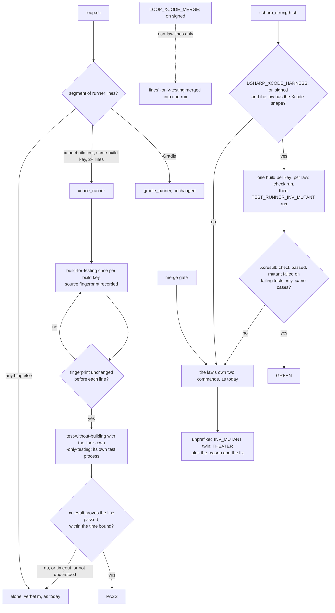

# Stage 05b — t75-xcode-runner — SPEC

## User story IDs from the PRD

BDD's product is the cascade itself; the stories this slice serves:

- **S-XR1** — As an iOS/macOS product owner, consecutive `xcodebuild test` lines in `/goal` share one build instead of
  building on every call. Each line still runs in its own test process, so a line's verdict is what it would be alone.
- **S-XR2** — As a law author on Xcode, I can sign `DSHARP_XCODE_HARNESS: on` and my laws are proven from one build
  per scheme and destination, not two builds per law. A RED or THEATER verdict is still the law's own two commands'.
- **S-XR3** — As a law author, a red twin written `INV_MUTANT=<id> xcodebuild …` tells me why it can never fail:
  Xcode passes only `TEST_RUNNER_`-prefixed variables to tests.
- **S-XR4** — As the operator, a hung `xcodebuild` costs a bounded amount of time in the fast path and never becomes a
  verdict.

## The problem, stated as cost

Every Xcode line in `/goal`, and both commands of every Xcode law, is a separate `xcodebuild test` call. Each call
pays tool start, build planning, package resolution and an incremental build check before one test runs. Measured
this hop (E0) on Xcode 27.0, an iOS 26.5 simulator, and a Swift-package fixture whose build has a 5s phase standing in
for a real app's script phases and planning:

| Call | Cost |
|---|---|
| `xcodebuild test -only-testing:WalletTests/BalanceTests/testDebit`, nothing changed | **8s, every call** |
| `build-for-testing` once | 8s |
| then `test-without-building -only-testing:…` | **2–3s per call** |
| the same `test` call on a trivial package with no slow phase | 2–3s |

So the build check is the cost: a goal of N Xcode lines and M laws pays it N + 2M times today. Real apps commonly spend
far longer than 5s there; that number is a stand-in, as t62's `CONF_MS` was for Gradle.

E0 also measured four hazards that decide the design:

| Hazard (E0) | What happened | Consequence |
|---|---|---|
| Shared process | `-only-testing:A -only-testing:B` in one call ran both classes in **one process** (one pid); a class that passes alone **failed** after another class set static state | Merging lines into one test run changes verdicts: signed opt-in only, never for a law |
| Stale binary | After a source edit, `test-without-building` ran the **old** binary: a false pass one way, and, after the edit was reverted, a false failure the other | The shared build must be keyed to the sources and rebuilt when they change |
| Mutant reach | `INV_MUTANT=D1 xcodebuild …` did **not** reach the test (rc 0); `TEST_RUNNER_INV_MUTANT=D1` did (rc 65) | An unprefixed twin always passes: the law is THEATER, and should say why |
| Hang | After its tests failed, `xcodebuild test` **did not exit for 9+ minutes** and had to be killed | The fast path needs a wall-clock bound, and a timeout proves nothing |

The `.xcresult` bundle holds what a verdict needs: `xcrun xcresulttool get test-results tests` lists each test case
with its `nodeIdentifier` (`BalanceTests/testDebit()`), `result` (`Passed`, `Failed`, …) and failure messages (E0).

No locked decision or signed law conflicts with the brief (both `<EDIT>` blocks hold placeholders; `DSHARP 0/0`).

## Before vs after

Before:

After:

## Benefits and trade-offs

| | Today | After t75 |
|---|---|---|
| N Xcode lines, nothing changed | N builds (8s each in E0) | 1 build + N test runs (8s + 2–3s each in E0) |
| A line's verdict | its own call | identical: own process, same build key, fresh binary, PASS only from `.xcresult` |
| Every FAIL | its own call | still its own call: the runner never reports a FAIL |
| M Xcode laws | 2M builds | signed: one build per key + 2M test runs; unsigned: as today |
| Unprefixed `INV_MUTANT` twin | THEATER, unexplained | THEATER with the reason and `TEST_RUNNER_INV_MUTANT` |
| A hung `xcodebuild` in the fast path | n/a | killed after `BDD_XCODE_TIMEOUT` (default 600s), proves nothing, the line runs alone |
| A hung `xcodebuild` run alone | hangs the loop | unchanged (out of scope; see Risks U3) |
| Escape hatch | — | `BDD_LOOP_RUNNER=shell` (all runners), `DSHARP_HARNESS=off` (all harnesses) |
| Not chosen: merging lines by default | — | E0: classes share one process and a passing class failed. Signed opt-in, never for a law |
| Not chosen: parallel testing (`-parallel-testing-enabled`) | — | cloned simulators, ordering and shared-resource races; out of scope |
| Not chosen: trusting `test-without-building`'s exit code | — | a hang, a crash and a stale binary all produce misleading exit codes; only `.xcresult` proves |
| Cost | — | a second runner, macOS CI time, and the build key + fingerprint bookkeeping |

## What the slice adds — and the line it must not cross

The line: **the runner and the harness may only report what they prove from a `.xcresult` produced by a build of the
current sources.** Everything else runs the user's own command, verbatim. The merge gate never uses either.

### 1. Which lines (`tests/lib/xcode_runner.py: parse`)

A line is taken when it is a plain `xcodebuild` call with:

- exactly one action, `test`;
- exactly one `-scheme`, at most one of `-workspace`/`-project`, exactly one `-destination` whose value names one
  device (`id=…`, or `platform=…,name=…`; `generic/…` and repeated `-destination` are refused);
- only these options otherwise: `-configuration`, `-testPlan`, `-sdk`, `-derivedDataPath` (refused: the runner owns
  its own), `-only-testing:X` and `-skip-testing:X` (repeatable), `-quiet`, and `KEY=VALUE` build settings;
- no shell syntax (the t62 rule) and no `-resultBundlePath` (the runner writes its own).

Anything else runs alone. The **build key** is the line minus its action and its `-only-/-skip-testing` selectors.
A runner segment, as in t62, is the longest run of consecutive taken lines; lines with the same build key share one
build, and a key with one line saves nothing, so that line runs alone.

### 2. How a line is proven (`xcode_runner.py`)

For each build key in the segment:

1. `xcodebuild <build key> build-for-testing -derivedDataPath .cascade/xcode/<key hash>`, recording the source
   fingerprint (`cascade_worktree_sha`, t59) before it starts. A failed build proves nothing: its lines run alone.
2. Per line, in goal order: if the fingerprint changed since the build (a shell line earlier in the segment, or the
   loop itself, edited a file), rebuild first. Then `xcodebuild <build key> test-without-building <line's selectors>
   -resultBundlePath .cascade/xcode/<key hash>/<line>.xcresult`, bounded by `BDD_XCODE_TIMEOUT` (default 600s; on
   timeout the process group is killed).
3. A line is **PASS** only when all of these hold: the call exited 0 within the bound; the `.xcresult` exists and
   `xcresulttool get test-results tests` parses; at least one `Test Case` node ran; no node has `result` `Failed`; and
   every test case that ran is one the line's own selectors select (no foreign class, so no shared process with
   another line's tests). Anything else — including a result the runner does not recognise — proves nothing, and the
   line runs alone through today's code path.

The runner speaks t62's protocol to `loop.sh` (`<i>\tPASS\t
`, `S`, `E`, and t69's `T`/`M` lines). It never
prints FAIL.

**Merged (signed).** Only when `- LOOP_XCODE_MERGE: on` is the last such line inside `<EDIT>` in the envelope, at HEAD
and in the working tree (t62's `merge_signed` rule): non-law lines with one build key run as one
`test-without-building` with their selectors combined, and each is proven from the shared `.xcresult` by its own test
cases. A line equal to an in-force law's `check:` is never merged. The cost is E0's shared-process hazard, stated in
USAGE.

### 3. `loop.sh`

Generalise the runner hook from Gradle only to a table: a line matching `^(\./gradlew|gradle) ` starts a Gradle
segment (unchanged), a line matching `^xcodebuild ` starts an Xcode segment. One segment is one runner; a segment never
mixes tools. With no Xcode line, `loop.sh` output is byte-identical to `d89438e` (AC9).

### 4. The law harness (`tests/lib/xcode_harness.py`, signed)

On only when `- DSHARP_XCODE_HARNESS: on` is signed and committed (t64's rule) and `DSHARP_HARNESS` is not `off` (the
merge gate always sets it). A law is eligible when its `check:` is a line §1 takes with at least one `-only-testing`
selector, and its `break:` is exactly `TEST_RUNNER_INV_MUTANT=<id> <check>`. Per build key: one `build-for-testing`.
Per law, sequentially: the check run, then the mutant run with `TEST_RUNNER_INV_MUTANT=<id>` in the environment, each
its own `test-without-building` with its own `.xcresult`. **GREEN** only when (t64's §4 conditions): the check run
passed with at least one test case; the mutant run failed, its `.xcresult` shows only test-case failures (no build,
launch or crash failure); both ran the same test cases; every case that failed in the mutant passed in the check; and
the fingerprint did not change across the two. It prints only GREEN; every other law is scored by its own two
commands, exactly as today. Laws are never run concurrently.

### 5. The THEATER reason (`dsharp_strength.sh`)

When a THEATER law's `break:` contains `INV_MUTANT=` before `xcodebuild` without the `TEST_RUNNER_` prefix, its line
gains `  (Xcode passes only TEST_RUNNER_* variables to tests: write TEST_RUNNER_INV_MUTANT=<id> — USAGE.md §B16)`.
The verdict stays THEATER (I18).

### 6. Docs and CI

USAGE.md §B16 (Xcode products: what is batched, the law shape, the timeout, the signed merge and its cost);
CONTROL-LINE.md T75; CHANGELOG under `## Unreleased`; `.github/workflows/pack-self-check.yml` gains an `xcode-runner`
job on `macos-latest` running `tests/stress/xcode_runner.sh`.

## What the slice must not touch

- t62's Gradle runner and its contract; t64–t69's rules; the merge gate's conditions (it already sets
  `DSHARP_HARNESS=off` and never runs the loop).
- Any user command: lines run alone and every law's own `check:`/`break:` stay verbatim.
- The alone path's lack of a timeout (U3).

## Acceptance criteria

`tests/ac/t75_xcode_runner.sh` uses an `xcodebuild` stub that plays recorded behaviour (selection, process sharing,
`.xcresult` JSON, exit codes, a hang), as `gradlew-stub.py` does for Gradle; `tests/stress/xcode_runner.sh` makes the
same claims on real Xcode.

- **AC1 — which lines.** Taken: the §1 shape. Alone: two actions, `build`, `clean`, a second `-destination`,
  `generic/platform=iOS`, `-derivedDataPath`, `-resultBundlePath`, shell syntax. A single line, or a segment whose lines
  all have different build keys, makes no batched build. A segment stops at the first line the runner does not take.
- **AC2 — the verdict matrix.** Every line's verdict equals the line run alone, for: all pass; a failing test; a
  compile error; a selector that matches nothing; a test that crashes the host; a class that fails only after another
  class ran in its process (E0's case); a shell line between two Xcode lines that edits a source (the rebuild); a hang.
- **AC3 — the fingerprint.** A source edit between build and test triggers a rebuild before the next line; the stub
  counts builds. **Red twin:** a runner copy that skips the fingerprint check reports PASS for a line whose source now
  fails (E0's stale-binary case).
- **AC4 — proof only from `.xcresult`.** **Red twin:** a runner copy that reads only the exit code reports PASS for a
  call whose `.xcresult` has a `Failed` test (or is missing).
- **AC5 — merged, signed.** Unsigned, signed-but-uncommitted, and an env var: no merge. Signed and committed: non-law
  lines merge; a law's `check:` line never does; E0's shared-process case is documented as the signed cost.
- **AC6 — the harness.** Unsigned: every Xcode law runs its own two commands. Signed: eligible laws are GREEN from one
  build per key; RED, THEATER, a launch failure in the mutant, and a mutant that ran other cases are each left to the
  two commands with that verdict. `DSHARP_HARNESS=off` (the merge gate) uses neither. **Red twin:** a harness that
  trusts the mutant's exit code alone proves a RED law GREEN.
- **AC7 — THEATER reason.** An `INV_MUTANT=D1 xcodebuild …` twin prints THEATER with the reason; the same law with
  `TEST_RUNNER_INV_MUTANT` is GREEN.
- **AC8 — the bound.** A stubbed hang is killed after `BDD_XCODE_TIMEOUT`, proves nothing, and the line runs alone.
- **AC9 — parity.** With no `xcodebuild` line and no Xcode law, `loop.sh` and `dsharp_strength.sh` output equals
  `d89438e` byte for byte; with `BDD_LOOP_RUNNER=shell` too.
- **E1 — measured (stress).** On the E0 fixture with a 5s build phase: 4 lines and 6 laws, before/after, first and
  unchanged pass, with identical verdicts; in the EXECUTE report and the CHANGELOG.

Gate: `bash tests/ac/t75_xcode_runner.sh`, `bash tests/enforcement.sh` (T75), the t56–t69 tests, lint; the stress
script on macOS CI.

## Laws

`bash tests/dsharp_strength.sh` prints `DSHARP 0/0`: NO LAW IN FORCE in this repo. The slice changes how Xcode lines
and laws are run, never what they mean; nothing it adds reaches the merge gate.

# Stage 05b — PLAN

## Goal

EXECUTE adds `tests/lib/xcode_runner.py` (parse, build key, fingerprint, `.xcresult` proof, bound), a runner table in
`loop.sh`, the signed `xcode_harness.py`, the THEATER reason, an `xcodebuild` stub, the AC and stress scripts, T75,
docs and a macOS CI job.

## In scope this execute

- [ ] E0b on real Xcode, before code: a selector that matches nothing (exit code and `.xcresult`); a test that
      crashes the host; whether `build-for-testing` fails on a compile error in a test target the line does not
      select while `test -only-testing` alone passes (if so, those lines run alone: safe, slower); the `.xcresult`
      shape for a launch failure; `-quiet`'s effect on output.
- [ ] `tests/lib/xcode_runner.py`, `tests/lib/xcode_harness.py` (new).
- [ ] `tests/loop.sh` — the runner table.
- [ ] `tests/dsharp_strength.sh` — the Xcode harness call (as t64's) and the THEATER reason.
- [ ] `tests/ac/fixtures/xcodebuild-stub.py`; `tests/ac/t75_xcode_runner.sh` (AC1–AC9, three red twins);
      `tests/stress/xcode_runner.sh` (AC2 and E1 on real Xcode); `tests/enforcement.sh` T75.
- [ ] `USAGE.md` §B16, `CONTROL-LINE.md` T75, `CHANGELOG.md` (Unreleased), `pack-self-check.yml` macOS job.
- [ ] `docs/cascade/goal.md` for the EXECUTE hop.

## Out of scope this execute

- `-parallel-testing-enabled`; UI tests' extra device state; a timeout on the alone path; t65 cache keys for Xcode
  (path-based keys already apply); a nightly split for non-Gradle laws (a separate brief).
- A version bump (t69 shipped 2.7.0; t75 lands under `## Unreleased`).

## Definition of done

- `bash tests/ac/t75_xcode_runner.sh` exits 0 and the three red twins are shown to go red.
- `bash tests/stress/xcode_runner.sh` passes on this machine's Xcode and in the macOS CI job, with E1's table.
- `bash tests/enforcement.sh` exits 0 with T75; t56–t69 stay green; AC9 parity is byte-identical.

## Risks / UNKNOWNs that still block

- **A1 — the binary is the sources.** A PASS rests on: same build key, same source fingerprint, and the test
  process launched from that build. A build that reads untracked state outside the repo (a remote package that moved
  on, a system tool upgraded mid-run) could differ; FAIL is always re-run alone.
- **U1 — stub fidelity.** The AC stub replays E0's recorded behaviour; the stress script on real Xcode is the check
  that the stub is honest, as t62's was.
- **U2 — macOS CI cost.** macOS runners cost more minutes than Linux and need a simulator runtime; the job runs on
  PRs that touch `tests/lib/xcode_*` or `tests/stress/xcode_runner.sh`, and nightly (Ask 4).
- **U3 — the alone path can still hang.** E0's 9-minute hang would also stall a line run alone. Bounding the alone
  path changes today's behaviour for every tool; it is left out and named here.
- **U4 — Xcode versions.** Verified on what E0b and CI measure (27.0 here); other versions run every line alone, as
  t62 does for unverified Gradle.

## Ask of you

1. **The loop runner is on by default** for Xcode lines (one build per key, each line in its own process), as t62's
   exact mode is for Gradle. *Default taken.*
2. **The law harness needs your signature** (`DSHARP_XCODE_HARNESS: on`), as t64's does. *Default taken.*
3. **Merging lines into one test run needs your signature** (`LOOP_XCODE_MERGE: on`), never for a law. *Default
   taken.*
4. **A macOS CI job** on PRs that touch the Xcode files, and nightly. *Default taken.*
5. **Verified Xcode range starts at what E0b and CI measure** (27.0 here); other versions run alone. *Default taken.*

## Invariants this hop

- PRESERVE run: no
- /goal set to: n/a — GENERATE; EXECUTE's goal is AC1–AC9 + T75 + the t56–t69 tests + lint
- /model /effort: as set by the session
- /plan: skipped — this document is the plan
- INVARIANTS I1–I18: held; no unsigned setting can change a verdict
- Skills: none invoked; brainstorming skipped (brief signed into 05b-briefs.md; gaps are Asks 1–5)
- E0: measured this hop in a scratch Swift package (Xcode 27.0, iOS 26.5 simulator); no product code written
- critique: see `05b-t75-xcode-runner-critique.md`
- reads: AGENTS.md, hop-state.md, envelope.md, 05b-briefs.md (t75), loop.sh, dsharp_strength.sh, gradle_runner.py,
  law_harness.py, gradle_tuning.py, cascade.sh, the t62 and t64 specs
