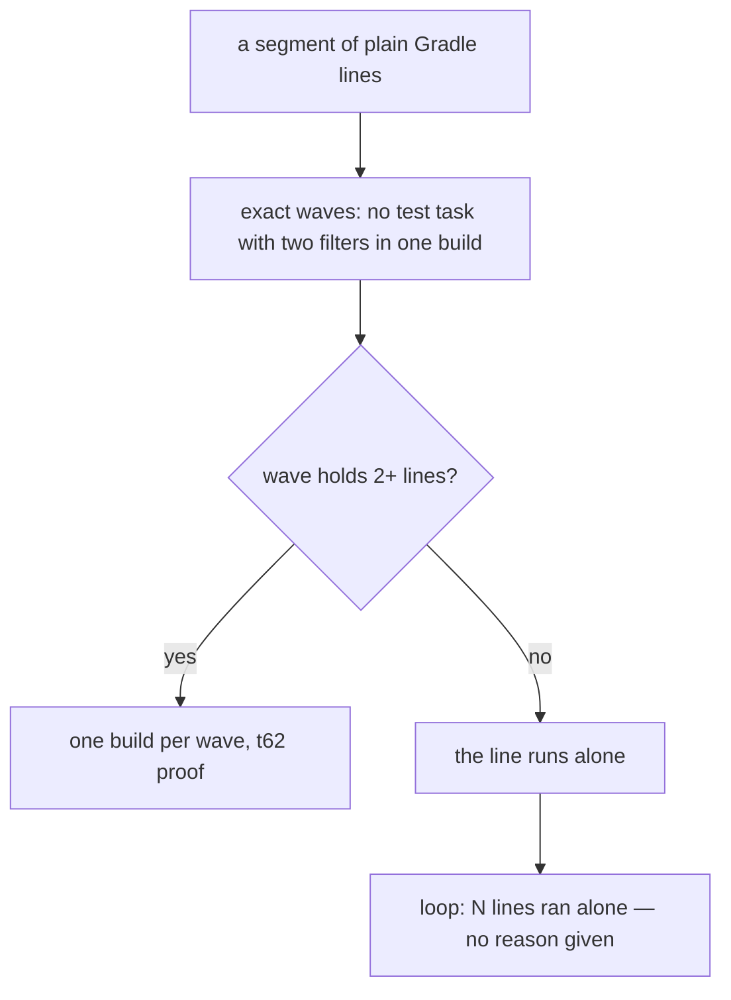
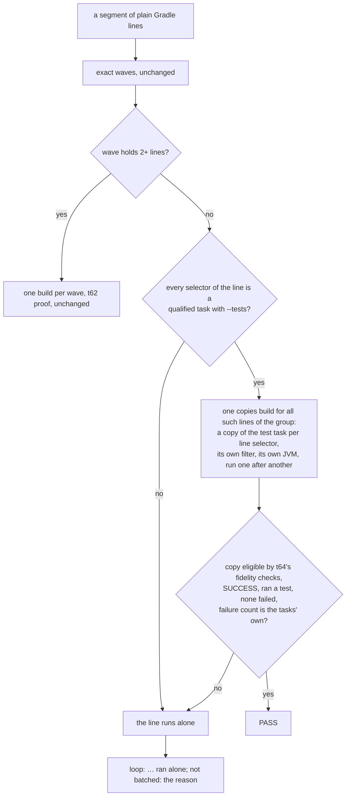

# Stage 05b — t76-gradle-task-copies — SPEC

## User story IDs from the PRD

BDD's product is the cascade itself; the stories this slice serves:

- **S-TC1** — As a Gradle product owner whose goal lines run one test task with different `--tests` filters (the
  common shape), the loop configures my build once for them instead of once per line, and each line still runs in
  its own test JVM, so its verdict is what it would be alone.
- **S-TC2** — As the operator, when the loop could not batch a Gradle segment, the `loop:` line says why, in one
  phrase, instead of a silent long run.

## The problem, stated as cost

t62's exact mode (`tests/lib/gradle_runner.py: waves`) puts two lines in one build only when no test task would run
with two different filters. Lines that share a test task and differ in `--tests` — which is how goals are written —
clash, so each gets a wave of its own; a wave of one is not built (`plan = [b for b in plan if len(b["lines"]) > 1]`),
and every such line runs alone. Measured downstream on 2026-10-23 (dream-camera, worktree recording-audio-integrity,
pack 2.7.0, Gradle 8.14.3): 49 of 59 validators run `:composeApp:testDebugUnitTest` with different filters; no batched
build ran; the Gradle lines cost about 26 of the loop's ~27 minutes, 40–200s each, a full KMP configuration every
time (that repo sets `org.gradle.configuration-cache=false`, which t69 respects). Nothing in the loop's output said why.

Measured this hop (E0, Gradle 8.14.3, a one-module fixture with a 5s configuration phase, four lines on `:core:test`
with four different `--tests` filters):

| Run | Configurations | Time | Test JVMs |
|---|---|---|---|
| Each line alone (today) | 4 | 24s | 4 |
| One build with a copy of `:core:test` per line (t64's law-harness init script, check copies only) | **1** | **9s** | 4 — one per copy (distinct pids) |

Each copy ran exactly its own class (`out/L<n>/check/TEST-p.<X>Test.xml`), and t64's fidelity checks marked all four
eligible. This is the mechanism t64 already uses to prove laws, and t69 hardened (the mutant copy is compared too).

No locked decision or signed law conflicts with the brief (both `<EDIT>` blocks hold placeholders; `DSHARP 0/0`).

## Before vs after

Before:

After:

## Benefits and trade-offs

| | Today | After t76 |
|---|---|---|
| N lines, one test task, N filters | N builds, N configurations | 1 copies build: 1 configuration + N test JVMs (E0: 24s → 9s for 4 lines) |
| Lines t62's waves already batch | one build per wave | unchanged |
| A line's test JVM | its own | its own (one copy per line selector, E0: distinct pids) — not the shared JVM of signed merge |
| A FAIL | alone | still alone: copies only ever prove a PASS |
| A copy that cannot faithfully reproduce the original task | n/a | ineligible (t64's checks, fail closed): the line runs alone |
| The configuration cache in the copies build | n/a | off: the init script's eligibility is written when the graph is ready, which a reused entry skips (as on t64) |
| Why a segment did not batch | silent | one phrase on the `loop:` line |
| Escape hatch | `BDD_LOOP_RUNNER=shell` | the same; plus `BDD_GRADLE_COPIES=off` for copies alone |
| Not chosen: merging the filters into one task run | — | that is signed merge (shared JVM); copies give one configuration without it |
| Not chosen: copies for every line, replacing waves | — | waves already batch with the user's own tasks and up-to-date state; copies are for what waves cannot batch |
| Not chosen: running copies in parallel | — | copies share a working directory, ports and files (t64 C5); one after another |
| Cost | — | the copies build always runs its copies (never UP-TO-DATE, as on t64), where a line alone might be UP-TO-DATE; a FAIL from that re-runs alone, so the verdict is still the alone one |

## What the slice adds — and the line it must not cross

The line: **a copy may only prove a PASS that the line, run alone, would also give** — the same task configuration
(t64's fidelity checks), the line's own filter, its own JVM. Everything else runs the user's command verbatim.

### 1. Which lines (`gradle_runner.py`)

After the exact waves are planned for a group (entry + globals), a line is a **copy candidate** when its wave holds
only itself and every one of its selectors is a qualified task path (`:proj:task`) with at least one `--tests`
pattern. Candidates of one group, two or more, go into one copies build; a group with one candidate saves nothing.
Lines t62 already batches are untouched. `BDD_GRADLE_COPIES=off` turns copies off; `BDD_LOOP_RUNNER=shell` turns all
runners off, as before.

### 2. The copies build

`<entry> <group globals without configuration-cache flags> --no-configuration-cache --continue
-I tests/lib/law_harness.init.gradle <every copy task>`, with `BDD_LAW_PLAN` holding one row per line selector —
`L<i>_<n>`, the selector, the line's patterns — and `BDD_LAW_OUT` a fresh directory under `.cascade/gradle/copies/`.
Only the check copies are requested (E0: `:core:bddLawCheck_L1 …`); t64's init script chains them with `mustRunAfter`,
so they run one after another in goal order. The group's own globals (`-q`, `-D…`, `-P…`, `-x …`) are passed as the
line would pass them; t69's `--offline`, when signed, applies as on any pack build. The copies build's log is
`.cascade/loop/gradle-copies-<start>-<g>.log`.

### 3. How a line is proven

A line is **PASS** only when, for every one of its selectors, the copy `L<i>_<n>`: is `yes` in `eligible.tsv`;
finished `SUCCESS` in `outcomes.tsv` (copies are never `UP-TO-DATE` or `FROM-CACHE`); has JUnit XML under
`out/L<i>_<n>/check/` with at least one test case and no failure or error; and the build's own failure count equals
its count of `FAILED` tasks (no failure that is no task's, t62's rule). Another line's failing copy does not stop a
line's proof — each copy is its own task — but a failed dependency (a compile error) leaves the copies unrun, and
nothing is proven. Every line not proven runs alone.

### 4. Why it did not batch

The runner prints `R\t<reason>` for a segment that made no batched build at all, and `loop.sh` appends
`; not batched: <reason>` to the `loop:` line. Reasons, first that applies: `Gradle <v> is not verified`;
`one line`; `<n> lines on <task> with different --tests filters, and copies are off`; `copies ineligible: <first
reason from eligible.tsv>`; `no line is a plain Gradle task line`. With a goal that batches, or no Gradle lines, the
`loop:` line is unchanged.

## What the slice must not touch

- t62's waves, merge rules and proof; t64's laws (`dsharp_strength.sh`, `law_harness.py`); t65–t69's rules; the merge
  gate (it never runs the loop).
- `law_harness.init.gradle` itself: reused as is (its copy and fidelity logic is the trusted part).
- Any user command: lines run alone stay verbatim.

## Acceptance criteria

`tests/ac/t76_gradle_task_copies.sh` on the Gradle stub (extended to answer `law_harness.init.gradle` for check copies
requested by name, as it already does for `bddLaws`), and `tests/stress/gradle_task_copies.sh` on real Gradle:

- **AC1 — one build for clashing lines.** Four lines on `:core:test` with four filters: one copies build (the stub
  counts invocations), `LOOP 4/4`, and every verdict equals `BDD_LOOP_RUNNER=shell`.
- **AC2 — the verdict matrix.** Each equals the line alone: a failing test; a filter that matches nothing; a compile
  error; a test task whose original has a `doFirst` (ineligible: alone); two selectors in one line, one failing; a law's
  `check:` line among them.
- **AC3 — waves untouched.** t62's G4 goal (two waves) makes exactly the builds it made at `d11d415`, and no copies
  build.
- **AC4 — red twin.** A runner copy that skips `eligible.tsv` proves PASS for the `doFirst` line, where the line alone
  fails.
- **AC5 — red twin.** A runner copy that accepts a copy with zero test cases proves PASS for a no-match filter where the
  line alone fails.
- **AC6 — why.** A goal of one line per task with copies off prints `not batched: <n> lines on :core:test with different
  --tests filters, and copies are off`; an unverified Gradle prints its reason; a batching goal prints no reason.
- **AC7 — parity.** With `BDD_GRADLE_COPIES=off` and with no Gradle lines, `loop.sh` output equals `d11d415`.
- **E1 — measured (stress).** A dream-camera-shaped fixture: 20 lines on one test task with different filters, a 20s
  configuration phase, configuration cache off: alone vs copies, first and unchanged pass, identical verdicts.

Gate: `bash tests/ac/t76_gradle_task_copies.sh`, `bash tests/enforcement.sh` (T76), the t62/t64/t69 tests, lint.

## Laws

`bash tests/dsharp_strength.sh` prints `DSHARP 0/0`: NO LAW IN FORCE in this repo. The slice changes how goal lines are
batched, never what a line or a law means.

# Stage 05b — PLAN

## Goal

EXECUTE adds copy candidates and the copies build to `gradle_runner.py`, the `R` reason line and its suffix in
`loop.sh`, stub support for named check copies, the AC and stress scripts, T76, and docs.

## In scope this execute

- [ ] E0b on real Gradle: a copy of a task with `-D` and `-P` in the group's globals; a line with two selectors; an
      `-x` exclusion; Gradle 8.5 and 9.1.0 (redownloaded: the local 8.5/9.x distributions were cleaned up).
- [ ] `tests/lib/gradle_runner.py` — candidates, the copies build, the copy proof, `R` reasons, `BDD_GRADLE_COPIES`.
- [ ] `tests/loop.sh` — `; not batched: <reason>`.
- [ ] `tests/ac/fixtures/gradlew-stub.py` — check copies requested by name.
- [ ] `tests/ac/t76_gradle_task_copies.sh` (AC1–AC7, two red twins); `tests/stress/gradle_task_copies.sh` (AC1, AC2 and
      E1 on real Gradle); `tests/enforcement.sh` T76; `pack-self-check.yml` runs the stress script.
- [ ] `USAGE.md` §B9, `CONTROL-LINE.md` T76, `CHANGELOG.md` (Unreleased).
- [ ] `docs/cascade/goal.md` for the EXECUTE hop.

## Out of scope this execute

- Copies for lines t62 already batches; parallel copies; the configuration cache in the copies build.
- Trimming goals that carry earlier slices' validators (the other half of the downstream cost; a separate brief).
- t75 (paused, WIP at `703caef`).

## Definition of done

- `bash tests/ac/t76_gradle_task_copies.sh` exits 0 and the two red twins are shown to go red.
- `bash tests/stress/gradle_task_copies.sh` passes on 8.5 and 9.1.0 with E1's table.
- `bash tests/enforcement.sh` exits 0 with T76; t62/t64/t69 stay green; AC7 parity is byte-identical.

## Risks / UNKNOWNs that still block

- **A1 (t62's, restated for copies):** a copy's outcome depends on its configuration (fidelity-checked), its inputs and
  its dependencies — not on which other copies share the build. Copies run one after another, so two lines' tests never
  overlap; a test that reads files an earlier line's tests wrote is the non-hermetic case t62 already names.
- **U1 — fidelity coverage.** t64's checks were written for law tests; goal lines may use test tasks with settings the
  checks have not met. Fail closed: anything unread makes the copy ineligible and the line runs alone.
- **U2 — memory.** One build holding many copies needs daemon heap (t64 measured 558 MB for 100 tasks); large goals are
  split into chunks of 100 copies, as t64 does.

## Ask of you

1. **Copies on by default** for lines t62's waves cannot batch (each line its own JVM, fidelity fail-closed).
   *Default taken.*
2. **Reuse `law_harness.init.gradle` unchanged** for goal-line copies rather than a second copy script. *Default taken.*
3. **The `not batched:` reason is always printed** when a Gradle segment made no batched build. *Default taken.*

## Invariants this hop

- PRESERVE run: no
- /goal set to: n/a — GENERATE; EXECUTE's goal is AC1–AC7 + T76 + the t62/t64/t69 tests + lint
- /model /effort: as set by the session
- /plan: skipped — this document is the plan
- INVARIANTS I1–I18: held; copies only prove a PASS; every other line runs verbatim
- Skills: none invoked; brainstorming skipped (brief signed into 05b-briefs.md; gaps are Asks 1–3)
- E0: measured this hop in a scratch fixture (Gradle 8.14.3); no product code written
- critique: see `05b-t76-gradle-task-copies-critique.md`
- reads: AGENTS.md, hop-state.md, envelope.md, 05b-briefs.md (t76), gradle_runner.py, law_harness.init.gradle,
  law_harness.py, gradle_tuning.py, loop.sh, the t62 and t64 specs, the dream-camera loop logs (read only)
