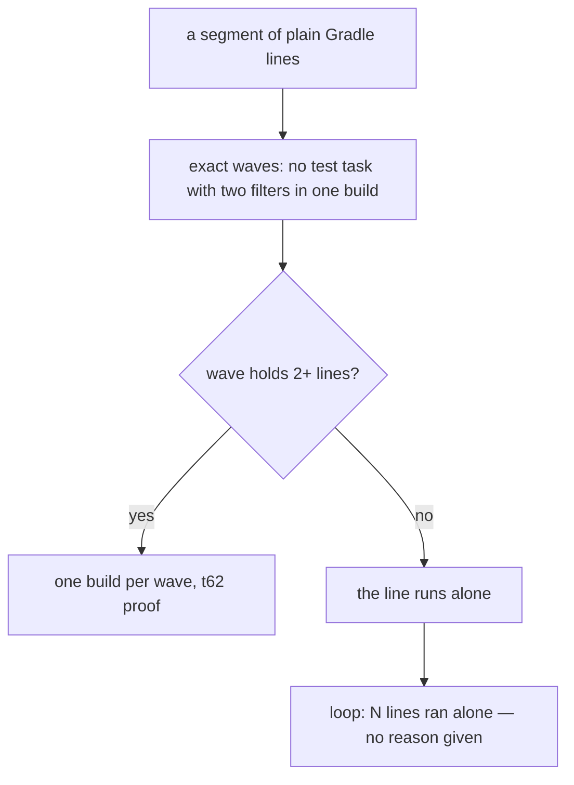
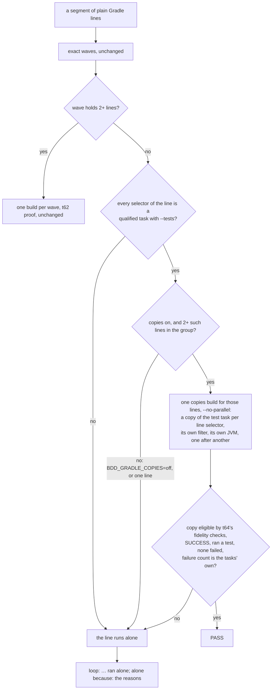

# Stage 05b — t76-gradle-task-copies — SPEC

## User story IDs from the PRD

BDD's product is the cascade itself; the stories this slice serves:

- **S-TC1** — As a Gradle product owner whose goal lines run one test task with different `--tests` filters (the
  common shape), the loop configures my build once for them instead of once per line, and each line still runs in
  its own test JVM, so its verdict is what it would be alone.
- **S-TC2** — As the operator, when the loop could not batch a Gradle segment, the `loop:` line says why, in one
  phrase, instead of a silent long run.

## The problem, stated as cost

t62's exact mode (`tests/lib/gradle_runner.py: waves`) puts two lines in one build only when no test task would run
with two different filters. Lines that share a test task and differ in `--tests` — which is how goals are written —
clash, so each gets a wave of its own; a wave of one is not built (`plan = [b for b in plan if len(b["lines"]) > 1]`),
and every such line runs alone. Measured downstream on 2026-10-23 (dream-camera, worktree recording-audio-integrity,
pack 2.7.0, Gradle 8.14.3): 49 of 59 validators run `:composeApp:testDebugUnitTest` with different filters; no batched
build ran; the Gradle lines cost about 26 of the loop's ~27 minutes, 40–200s each, a full KMP configuration every
time (that repo sets `org.gradle.configuration-cache=false`, which t69 respects). Nothing in the loop's output said why.

Measured this hop (E0, Gradle 8.14.3, a one-module fixture with a 5s configuration phase, four lines on `:core:test`
with four different `--tests` filters):

| Run | Configurations | Time | Test JVMs |
|---|---|---|---|
| Each line alone (today) | 4 | 24s | 4 |
| One build with a copy of `:core:test` per line (t64's law-harness init script, check copies only) | **1** | **9s** | 4 — one per copy (distinct pids) |

Each copy ran exactly its own class (`out/L<n>/check/TEST-p.<X>Test.xml`), and t64's fidelity checks marked all four
eligible. This is the mechanism t64 already uses to prove laws, and t69 hardened (the mutant copy is compared too).

**What E0 did not show (C1):** the task that motivated the brief is an Android/KMP unit-test task
(`:composeApp:testDebugUnitTest`, AGP's `Test` subclass), and the init script registers copies as plain `Test`. If the
subclass carries inputs or actions a plain copy cannot reproduce, every such line is ineligible and the downstream cost
stays. So E0b, the first EXECUTE task, is a **gate** on a real AGP module: copies of `testDebugUnitTest` must be
eligible and faithful (same tests, same results as the line alone). If they are not with a plain `Test`, the copy is
registered as the original's own task class (with its `_Decorated` suffix removed); if that fails too, the slice stops
at E0b with a report — it would not reach the case it exists for.

No locked decision or signed law conflicts with the brief (both `<EDIT>` blocks hold placeholders; `DSHARP 0/0`).

## Before vs after

Before:

After:

## Benefits and trade-offs

| | Today | After t76 |
|---|---|---|
| N lines, one test task, N filters | N builds, N configurations | 1 copies build: 1 configuration + N test JVMs (E0: 24s → 9s for 4 lines) |
| Lines t62's waves already batch | one build per wave | unchanged |
| A line's test JVM | its own | its own (one copy per line selector, E0: distinct pids) — not the shared JVM of signed merge |
| A FAIL | alone | still alone: copies only ever prove a PASS |
| A copy that cannot faithfully reproduce the original task | n/a | ineligible (t64's checks, fail closed): the line runs alone |
| The configuration cache in the copies build | n/a | off: the init script's eligibility is written when the graph is ready, which a reused entry skips (as on t64) |
| Why a segment did not batch | silent | one phrase on the `loop:` line |
| Escape hatch | `BDD_LOOP_RUNNER=shell` | the same; plus `BDD_GRADLE_COPIES=off` for copies alone |
| Not chosen: merging the filters into one task run | — | that is signed merge (shared JVM); copies give one configuration without it |
| Not chosen: copies for every line, replacing waves | — | waves already batch with the user's own tasks and up-to-date state; copies are for what waves cannot batch |
| Not chosen: running copies in parallel | — | copies share a working directory, ports and files (t64 C5); the copies build passes `--no-parallel`, because with only check copies requested the init script's chain does not order them (C3) |
| Not chosen: behind a signed switch, as t64's harness and t62's merge are | — | C2, the human's call (Ask 1): merge is signed because it shares a JVM, the harness because it changed how laws are proven; copies keep each line's own JVM and t64's fidelity checks, like t62's default exact mode |
| Cost | — | the copies build always runs its copies (never UP-TO-DATE, as on t64), where a line alone might be UP-TO-DATE; a FAIL from that re-runs alone, so the verdict is still the alone one |

## What the slice adds — and the line it must not cross

The line: **a copy may only prove a PASS that the line, run alone, would also give** — the same task configuration
(t64's fidelity checks), the line's own filter, its own JVM. Everything else runs the user's command verbatim.

### 1. Which lines (`gradle_runner.py`)

After the exact waves are planned for a group (entry + globals), a line is a **copy candidate** when its wave holds
only itself and every one of its selectors is a qualified task path (`:proj:task`) with at least one `--tests`
pattern. Candidates of one group, two or more, go into one copies build; a group with one candidate saves nothing.
Lines t62 already batches are untouched. `BDD_GRADLE_COPIES=off` turns copies off; `BDD_LOOP_RUNNER=shell` turns all
runners off, as before.

**`-D`/`-P` (C7).** t64 refuses them for laws. Here they are part of the group key: every line in the copies build has
the same globals, which are exactly what each line passes alone, so the build the copies run in is each line's own.
E0b checks a `-D` that a test reads.

### 2. The copies build

`<entry> <group globals without configuration-cache flags> --no-configuration-cache --no-parallel --continue
-I tests/lib/law_harness.init.gradle <every copy task, in goal order>`, with `BDD_LAW_PLAN` holding one row per line
selector — `L<i>_<n>`, the selector, the line's patterns — and `BDD_LAW_OUT` a fresh directory under
`.cascade/gradle/copies/`. Only the check copies are requested (E0: `:core:bddLawCheck_L1 …`). The init script's chain
orders each check after the previous *mutant*, so with mutants not requested the checks are unordered (C3):
`--no-parallel` keeps tasks of different projects from running at once, and tasks of one project do not run in
parallel without the configuration cache, which the copies build has off — so copies run one after another.

**The environment (C5)**, as `law_harness.py` sets it: `INV_MUTANT`, `BDD_LAW_FORKS` and `BDD_BUILD_CACHE_URL` are
removed (forks or a remote cache from an inherited variable would make a copy run differently from its line), and
`BDD_GRADLE_RANGE` is set. A new `BDD_LAW_LOOP=1` tells the init script these are goal-line copies (C7): it skips the one
check that only guards a law's mutant (the original takes `INV_MUTANT` from the build environment), and changes nothing
else. t64's AC stays green. The group's own globals (`-q`, `-D…`, `-P…`, `-x …`) are passed as the
line would pass them; t69's `--offline`, when signed, applies as on any pack build. The copies build's log is
`.cascade/loop/gradle-copies-<start>-<g>.log`.

### 3. How a line is proven

A line is **PASS** only when, for every one of its selectors, the copy `L<i>_<n>`: is `yes` in `eligible.tsv`;
finished `SUCCESS` in `outcomes.tsv` (copies are never `UP-TO-DATE` or `FROM-CACHE`); has JUnit XML under
`out/L<i>_<n>/check/` with at least one test case and no failure or error; and the build's own failure count equals
its count of `FAILED` tasks (no failure that is no task's, t62's rule); and no task other than a copy `FAILED`
(t64's `others_failed`, C7). Another line's failing copy does not stop a line's proof — each copy is its own task. A
failed dependency (a compile error) leaves the copies that depend on it unrun (C10), and those lines are not proven.
Every line not proven runs alone.

### 4. Why lines ran alone (C6)

Whenever at least one Gradle line ran alone, the `loop:` line ends with `; alone because: <reasons>` — the distinct
reasons, in the order first met, across every segment of the run. Each runner invocation prints `R\t<reason>` for the
lines of its segment it did not prove, from this list: `Gradle <v> is not verified`; `a line is not a plain Gradle task
line`; `one line in its group`; `<n> lines on <task> with different --tests filters, and copies are off`; `copy
ineligible: <first reason from eligible.tsv>`; `failed or not proven in the batched build` (a FAIL always runs alone).
A goal whose Gradle lines were all proven, or with no Gradle line, or with the runner off (`BDD_LOOP_RUNNER=shell`),
prints no reason, so its `loop:` line is unchanged. The configuration cache is not a reason a line ran alone: when the
project turned it off, t69 already says so in `.cascade/loop/tuning.log`.

## What the slice must not touch

- t62's waves, merge rules and proof; t64's laws (`dsharp_strength.sh`, `law_harness.py`); t65–t69's rules; the merge
  gate (it never runs the loop).
- `law_harness.init.gradle` itself: reused as is (its copy and fidelity logic is the trusted part).
- Any user command: lines run alone stay verbatim.

## Acceptance criteria

`tests/ac/t76_gradle_task_copies.sh` on the Gradle stub (extended to answer `law_harness.init.gradle` for check copies
requested by name, as it already does for `bddLaws`), and `tests/stress/gradle_task_copies.sh` on real Gradle:

- **AC1 — one build for clashing lines.** Four lines on `:core:test` with four filters: one copies build (the stub
  counts invocations), `LOOP 4/4`, and every verdict equals `BDD_LOOP_RUNNER=shell`.
- **AC2 — the verdict matrix.** Each equals the line alone: a failing test; a filter that matches nothing; a compile
  error; a test task whose original has a `doFirst` (ineligible: alone); two selectors in one line, one failing; a law's
  `check:` line among them; a build failure that is no task's; an inherited `BDD_LAW_FORKS=8` (the copies run with the
  original's forks; the stub logs the environment).
- **AC3 — waves untouched.** t62's G4 goal (two waves) makes exactly the builds it makes on `main` (`d89438e`), and no
  copies build.
- **AC4 — red twin, real Gradle (C4).** An init-script copy with t64's fidelity checks removed proves PASS for a line
  whose original task has a `doFirst` that makes its test fail, where the line alone fails; the real script makes it
  ineligible and the line runs alone (stress, as t64's AC4-twins).
- **AC5 — red twin, stub (C4).** A runner copy that skips the failure-count rule proves PASS for lines whose build has a
  failure that is no task's (the stub's `buildFailureIf`), where each line alone fails.
- **AC6 — why (C6).** Copies off: `alone because: 4 lines on :core:test with different --tests filters, and copies are
  off`; an unverified Gradle: its reason; a FAIL: `failed or not proven in the batched build`; two segments with
  different reasons: both, once each, in order; a goal whose lines were all proven: no suffix.
- **AC7 — parity (C8).** With `BDD_LOOP_RUNNER=shell`, with no Gradle lines, and with t62's G4 goal, `loop.sh` output
  equals `main` at `d89438e` byte for byte.
- **AC8 — order (C3).** Real Gradle, two projects, `org.gradle.parallel=true`: the copies' test JVMs never overlap
  (each test records its start and end).
- **E1 — measured (stress, `--timing`, local only — C9).** E0b's AGP module plus a 20s configuration phase, 20 lines on
  `testDebugUnitTest` with different filters, configuration cache off: alone vs copies, first and unchanged pass,
  identical verdicts. CI runs the stress script without `--timing` (AC1, AC2, AC4, AC8 only), on 9.1.0.

Gate: `bash tests/ac/t76_gradle_task_copies.sh`, `bash tests/enforcement.sh` (T76), the t62/t64/t69 tests, lint.

## Laws

`bash tests/dsharp_strength.sh` prints `DSHARP 0/0`: NO LAW IN FORCE in this repo. The slice changes how goal lines are
batched, never what a line or a law means.

## E0b — the gate, measured at the start of EXECUTE (2026-10-23): FAILED

An Android library module (AGP 8.7.3, Gradle 8.14.3, compileSdk 35, plain JUnit 4 unit tests), two lines on
`:lib:testDebugUnitTest` with different `--tests` filters, copies made by t64's init script:

| Copy registered as | t64's fidelity checks | Runs? |
|---|---|---|
| plain `Test` (the init script as it is) | ineligible: `input jacocoExtensionEnabled is on only one side` | — |
| AGP's own class, `AndroidUnitTest` | ineligible: `jacocoExtensionEnabled differs`, then `the input files differ` (the original declares `src/test/jniLibs`, `src/testDebug/jniLibs`) | — |
| `AndroidUnitTest`, carrying `jacocoExtensionEnabled`, `variantName`, `testJniLibs`, and the **private** field `testConfigInputs` by reflection | **eligible** | **no**: `Cannot query the value of task ':lib:bddLawCheck_L1' property 'analyticsService' because it has no value available` |

AGP's `AndroidUnitTest` overrides `executeTests()` and reads state its own creation code sets — a private field with no
setter, and `@Internal` build services — that t64's fidelity checks cannot see, because they compare declared inputs.
Making copies of it run means copying AGP internals one by one, per AGP version, and the checks that are meant to prove
a copy faithful are blind to exactly that state. Per this spec's gate (C1), the slice stops here, with no product
code: it would not reliably reach the case it exists for (`:composeApp:testDebugUnitTest`).

What still works for that case, without a new slice: the signed `LOOP_GRADLE_MERGE: on` (one build, a shared test JVM,
never for a law's `check:`); the configuration cache, if the build is compatible; and a `goal.md` that carries only the
current slice's validators. Copies for plain `Test` tasks (JVM modules) remain possible — E0 showed 4 configurations →
1 — but that is not the downstream case, and is a narrower slice if wanted.

**Sent back by the human (2026-10-24, "go")** after E0b: the slice closes here with no product code; the brief, spec and
evidence stay. Goal hygiene (t77) addresses the larger share of the downstream cost.

# Stage 05b — PLAN

## Goal

EXECUTE adds copy candidates and the copies build to `gradle_runner.py`, the `R` reason line and its suffix in
`loop.sh`, stub support for named check copies, the AC and stress scripts, T76, and docs.

## In scope this execute

- [ ] **E0b, a gate (C1):** a real AGP module (Android Gradle plugin, a `testDebugUnitTest` task, Robolectric-free
      JUnit tests): copies eligible and faithful as plain `Test`, else as the original's own class, else stop with a
      report. Also: a `-D` a test reads; a line with two selectors; an `-x` exclusion; Gradle 8.5 and 9.1.0
      (redownloaded: the local 8.5/9.x distributions were cleaned up).
- [ ] **Branch (C8):** EXECUTE runs on `t76-gradle-task-copies`, branched from `main` (`d89438e`) with only this slice's
      cascade documents carried over — never on t75's unfinished `loop.sh` changes; t75 rebases onto it when it resumes.
- [ ] `tests/lib/gradle_runner.py` — candidates, the copies build, the copy proof, `R` reasons, `BDD_GRADLE_COPIES`.
- [ ] `tests/loop.sh` — `; not batched: <reason>`.
- [ ] `tests/ac/fixtures/gradlew-stub.py` — check copies requested by name; the environment logged; only copies whose
      own dependencies failed are skipped (C10).
- [ ] `tests/lib/law_harness.init.gradle` — `BDD_LAW_LOOP=1` skips the mutant-only check (C7); nothing else.
- [ ] `tests/ac/t76_gradle_task_copies.sh` (AC1–AC7, two red twins); `tests/stress/gradle_task_copies.sh` (AC1, AC2 and
      E1 on real Gradle); `tests/enforcement.sh` T76; `pack-self-check.yml` runs the stress script.
- [ ] `USAGE.md` §B9, `CONTROL-LINE.md` T76, `CHANGELOG.md` (Unreleased).
- [ ] `docs/cascade/goal.md` for the EXECUTE hop.

## Out of scope this execute

- Copies for lines t62 already batches; parallel copies; the configuration cache in the copies build.
- Trimming goals that carry earlier slices' validators (the other half of the downstream cost; a separate brief).
- t75 (paused, WIP at `703caef` on its own branch; it rebases onto t76 when it resumes).

## Definition of done

- `bash tests/ac/t76_gradle_task_copies.sh` exits 0 and the two red twins are shown to go red.
- `bash tests/stress/gradle_task_copies.sh` passes on 8.5 and 9.1.0 with E1's table.
- `bash tests/enforcement.sh` exits 0 with T76; t62/t64/t69 stay green; AC7 parity is byte-identical.

## Risks / UNKNOWNs that still block

- **A1 (t62's, restated for copies):** a copy's outcome depends on its configuration (fidelity-checked), its inputs and
  its dependencies — not on which other copies share the build. Copies run one after another, so two lines' tests never
  overlap; a test that reads files an earlier line's tests wrote is the non-hermetic case t62 already names.
- **U1 — fidelity coverage.** t64's checks were written for law tests; goal lines may use test tasks with settings the
  checks have not met. Fail closed: anything unread makes the copy ineligible and the line runs alone.
- **U2 — memory.** One build holding many copies needs daemon heap (t64 measured 558 MB for 100 tasks); large goals are
  split into chunks of 100 copies, as t64 does.

## Ask of you

1. **Copies on by default** for lines t62's waves cannot batch (each line its own JVM, fidelity fail-closed) — or
   behind a signed `LOOP_GRADLE_COPIES: on`, as the critic argues from precedent (C2). **Your call**; the recorded
   default is on, with `BDD_GRADLE_COPIES=off` to turn it off.
2. **Reuse `law_harness.init.gradle`** for goal-line copies, with one loop-mode switch (`BDD_LAW_LOOP=1`), rather than
   a second copy script. *Default taken.*
3. **The `not batched:` reason is always printed** when a Gradle segment made no batched build. *Default taken.*

## Invariants this hop

- PRESERVE run: no
- /goal set to: n/a — GENERATE; EXECUTE's goal is AC1–AC7 + T76 + the t62/t64/t69 tests + lint
- /model /effort: as set by the session
- /plan: skipped — this document is the plan
- INVARIANTS I1–I18: held; copies only prove a PASS; every other line runs verbatim
- Skills: none invoked; brainstorming skipped (brief signed into 05b-briefs.md; gaps are Asks 1–3)
- E0: measured this hop in a scratch fixture (Gradle 8.14.3); no product code written
- critique: C1, C3–C10 fixed and C2 to the human, in `05b-t76-gradle-task-copies-critique.md` (spec v2)
- reads: AGENTS.md, hop-state.md, envelope.md, 05b-briefs.md (t76), gradle_runner.py, law_harness.init.gradle,
  law_harness.py, gradle_tuning.py, loop.sh, the t62 and t64 specs, the dream-camera loop logs (read only)
