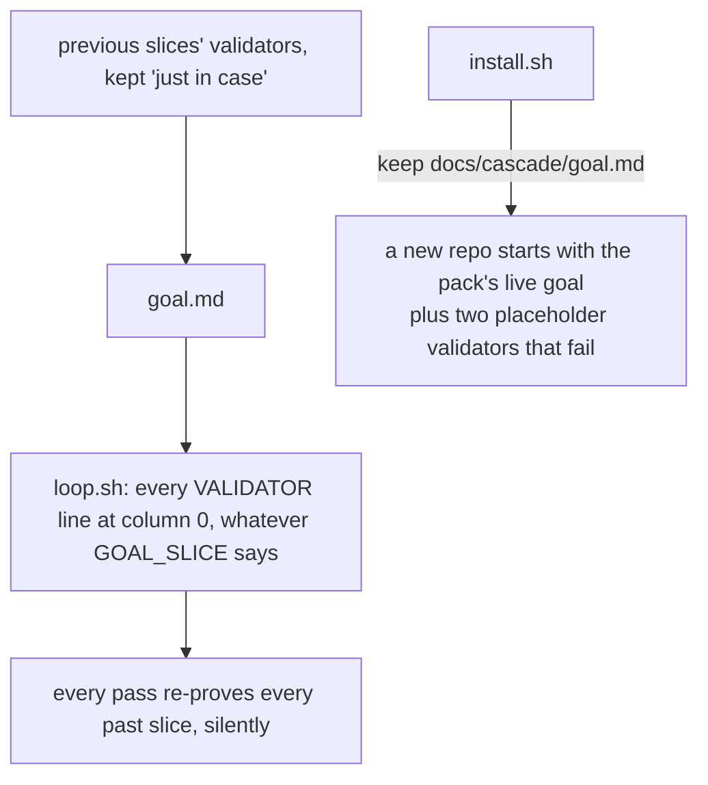

# Stage 05b — t77-goal-hygiene — SPEC (v3, Ask 1 answered: the cap)

## User story IDs from the PRD

BDD's product is the cascade itself; the stories this slice serves:

- **S-GH1** — As a product owner, my loop's goal stops growing silently: every pass says how many validators were already
  in earlier slices' goals, apart from the standing gates I mark as such, so I can move the rest to CI or laws.
- **S-GH2** — As an agent opening an EXECUTE hop, one command (`bash tests/goal.sh reset`) gives me a clean goal for this
  hop; and a goal written for another slice is refused with that command named.
- **S-GH3** — As a new adopter, `install.sh` gives me a goal *template* that runs nothing, not the pack's own live goal.
- **S-GH4** — As a pack user, this ships as 2.8.0.

## The problem, stated as cost

`goal.md` is one hop's definition of done. Its header says "Write this file at the start of every EXECUTE hop"; I9 says
"/goal is this hop's DoD only … /goal clear before STOP or on send-back"; the conductor's step 5 says "/goal clear any
leftover, then /goal this hop's DoD". Nothing enforces any of it: `tests/loop.sh:61-62` reads every `VALIDATOR:` line in
the file, and nothing looks at `GOAL_SLICE` or at what earlier hops' goals held.

Measured downstream on 2026-10-23 (dream-camera, worktree recording-audio-integrity, pack 2.7.0): `goal.md` carries a
"Previous slice" section for every earlier slice — 59 validators (49 Gradle, 7 Xcode, 3 shell) — and each loop pass
re-proves them all: ~27 minutes. Its agent kept `GOAL_SLICE` current on every hop while the validators grew from 46 to 59
(critique C1). So the failure is **accumulation under a correct slice name**, and the lever for it is to make the
accumulation visible on every pass and give its owner a clear place to move the lines (the project's CI; laws for what
must hold forever). A goal that names *another* slice is a second, smaller failure — a stale or foreign goal — and it is
refused.

**Ask 1 answered (human, 2026-10-24: "take the cap")**: above a cap of carried-over validators the loop is refused
until lines move to CI or a law, or the human signs a higher cap. Default 10; `GOAL_CARRY_MAX: <n>` inside an envelope
`<EDIT>` block, committed, changes it (§2b). dream-camera's goal (63 lines on 2026-10-24) is refused on its first loop
after upgrading, by design: that is the 27 minutes being cut, by its owner, at the point it was added.

Found while writing this spec, corrected by the critic (C5): from v2.0.0 on, every release has shipped
`docs/cascade/goal.md` with template text **and** the pack's own live goal below it (`git show v2.5.0:docs/cascade/goal.md`:
last `GOAL_SLICE: t59-scale-hardening`; v2.7.0: `release-2.7.0`), and `install.sh` seeds a new repo's goal from it
(`keep docs/cascade/goal.md`). The template block also has `VALIDATOR: <command that must pass>` twice at column 0, which
`loop.sh` would run (C4). So every adopter since 2.0.0 started with the pack's validators plus two that always fail.

No locked decision or signed law conflicts with the brief (both `<EDIT>` blocks hold placeholders; `DSHARP 0/0`).

## Before vs after

Before:



After:

```mermaid
flowchart TD
  O[an EXECUTE hop opens] --> GR[bash tests/goal.sh reset:<br/>the template, this hop's GOAL_STAGE/SLICE, no validators]
  GR --> W[the agent writes this hop's validators;<br/>standing gates end with '# standing']
  W --> G[goal.md]
  G --> S{GOAL_SLICE set and not CURRENT_SLICE?}
  S -->|yes| R[LOOP REFUSED: a goal for another slice<br/>WHAT TO DO: bash tests/goal.sh reset]
  S -->|no| L[loop.sh: the validators, as today]
  L --> C[goal: n of m validators were in earlier slices' goals (A, B, …),<br/>s standing — move the n to the project's CI or a law]
  C --> K{n above the cap?<br/>default 10, or the signed GOAL_CARRY_MAX}
  K -->|yes| KR[LOOP REFUSED: n carried, cap c<br/>WHAT TO DO: move them to CI or a law, or sign a higher cap]
  K -->|no| V[the validators run, as today]
  I[install.sh] -->|seed from goal.template.md| N[a new repo starts with the template: zero validators]
```

## Benefits and trade-offs

| | Today | After t77 |
|---|---|---|
| Carried-over validators | invisible; the loop just gets slower | counted and named on every pass, with the slices they came from |
| Standing gates (lint, the repo's whole suite) | indistinguishable from carried lines | marked `# standing` (a shell comment, so the line runs unchanged); counted separately, never as carried |
| A law's `check:` in the goal | required (I13) | still required; never counted |
| A goal written for another slice | runs, proving the wrong slice | refused, naming `bash tests/goal.sh reset` |
| Starting a hop's goal | by hand, often by copying the last one | `bash tests/goal.sh reset` at the start of every EXECUTE hop |
| A new install's goal | the pack's live goal + two failing placeholders (since 2.0.0) | the template, which runs nothing |
| Version | 2.7.0 | 2.8.0 |
| Carried-over validators above the cap | run, every pass | refused before any validator runs; cap 10 unless the human signs `GOAL_CARRY_MAX` |
| Not chosen: refusing every carried line (cap 0 by default) | — | a refusal pushes agents to reword or hide lines; a cap leaves room for a slice that touches its neighbours, and the human can sign 0 |
| Not chosen: no cap unless signed | — | the repo that needs it most (dream-camera) is exactly the one whose agent would never sign it |
| Not chosen: resetting at the accept edge | — | the receipt that unlocks accept describes the goal, and autopilot's edge re-runs `loop.sh` on it (C3); the reset belongs at the start of the next EXECUTE hop |
| Not chosen: a hook that rewrites `goal.md` | — | rewriting a tracked file at commit time surprises humans; the helper and the refusal make a stale goal visible |
| Cost | — | two new refusals; one `git log -p` of `goal.md` (≤ 200 versions) per loop run, measured in EXECUTE |

## What the slice adds — and the line it must not cross

The line: **nothing rewrites a goal except the helper when run, the only new refusals are a goal for another slice and
carried lines above the cap, and the notice never changes a verdict.**

### 1. The slice check (`tests/loop.sh`)

Before the validators run: the last `GOAL_SLICE:` line of the goal at column 0. If it is present, is not a `<…>`
placeholder, and differs from `CURRENT_SLICE`: `LOOP REFUSED: docs/cascade/goal.md is for slice <x>, this hop is <y>`,
`BOTTLENECK: a goal is one hop's definition of done`, `WHAT TO DO: bash tests/goal.sh reset, then write this hop's
validators`, exit 3. Absent, placeholder or equal: as today. A repo that kept a seeded pack goal (C5) is refused on its
first loop after the upgrade, by design: that goal was never its own.

### 2. The notice (`tests/lib/goal_history.py`)

One `git log -p --format=… -200 -- docs/cascade/goal.md` (C8): each earlier version's last column-0 `GOAL_SLICE` and its
column-0 `VALIDATOR:` lines. Lines are compared after collapsing runs of whitespace; a line that was reworded or folded
into another (a filter merged into an existing line) is not matched — named as a limit, not hidden. A current validator
is **carried** when it appears in an earlier version whose `GOAL_SLICE` names another slice; its origin is the oldest
such version in log order. It is **standing** when it ends with the comment `# standing`; standing lines and every
in-force law's `check:` (as `loop.sh` reads them) are never carried. `loop.sh` prints, before `LOOP k/n`:
`goal: <n> of <m> validators were in earlier slices' goals (<up to 3 slices>, …), <s> standing — move the <n> to the
project's CI or a law (USAGE.md §B16)`. Nothing is printed when `n` is 0, when history cannot be read, or when no
earlier version names another slice. Never a refusal, never part of `LOOP k/n` or the receipt.

### 2b. The cap (`tests/loop.sh`, `tests/lib/goal_history.py`)

The cap is the last `GOAL_CARRY_MAX: <n>` line (a non-negative integer) inside an `<EDIT>` block of the envelope, read
like `LOOP_GRADLE_MERGE` (t69): it holds only when the committed envelope (`HEAD`) and the working copy both say it; a
`{{…}}` line is no decision. Absent, unsigned or disagreeing: **10**. When the notice's `n` is above the cap, before
any validator runs: `LOOP REFUSED: <n> validators were in earlier slices' goals (<up to 3 slices>, …), the cap is <c>`,
`BOTTLENECK: a goal is one hop's definition of done; past slices' tests belong to the project's CI or a law`,
`WHAT TO DO: move <n - c> or more to CI or a law (USAGE.md §B16), or the human signs a higher GOAL_CARRY_MAX in
envelope.md`, exit 3. Same counting as §2 — standing lines and law checks never count — with one guard against a
marker added to get under the cap: **a line marked `# standing` that an earlier slice's goal held unmarked, in a version
that marked other lines `# standing`, is carried.** (A version with no marker anywhere predates the convention, so an
upgrading repo can mark its lint line once.) History that cannot be read (a shallow clone, no git): no cap and no
notice, and `loop.sh` prints `goal: history unreadable, carry cap not checked`. The slice check (§1) runs first.

### 3. The helper (`tests/goal.sh`)

`bash tests/goal.sh reset` writes `docs/cascade/goal.md` from `docs/cascade/goal.template.md` with `GOAL_STAGE` and
`GOAL_SLICE` set to the current hop's, and no validators, and prints how many validators it removed. It is for the
**start** of an EXECUTE hop (C3): the conductor's step 5 and AGENTS.md say so; it is never run at an accept edge, whose
receipt and autopilot check describe the goal as it was. `loop.sh` on a reset goal with no validators keeps today's
behaviour (no validator, no pass); add one and it runs (C6). `bash tests/goal.sh show` prints the slice check and the
counts without running anything.

### 4. The template (`docs/cascade/goal.template.md`, `install.sh`)

A new pack-owned file: the field help, a note that a goal is one hop's definition of done and where past slices' tests
go, and examples **indented by four spaces**, so no example is a column-0 `VALIDATOR:` line (C4). `loop.sh --list` on it
lists zero validators. `install.sh` ships it (`copy`) and seeds a missing `goal.md` from it; an existing `goal.md` is
kept, as today. The pack's own `goal.md` stays its live goal.

### 5. Docs and release

- AGENTS.md: at the start of every EXECUTE hop, `bash tests/goal.sh reset`, then this hop's validators; standing gates
  end with `# standing`; past slices' tests go to CI or laws. The conductor's step 5 names the helper. USAGE.md §B16
  (the next free section on this branch, C10): what a goal holds, the marker, the refusal, the notice.
- **2.8.0** in `VERSION`, `.claude-plugin/plugin.json`, `.claude-plugin/marketplace.json` (main is 2.7.0, re-checked at
  landing); `CHANGELOG.md` `## 2.8.0 — <date>`: this slice, the template fix since 2.0.0. t75's work in progress and
  t76's sent-back spec are not in it.

## What the slice must not touch

- The validators' semantics (a `# standing` line runs exactly as without the comment), `LOOP k/n`, the receipt,
  t62–t69's runners, autopilot's edges, the merge gate.
- Any existing `goal.md` content.

## Acceptance criteria

`tests/ac/t77_goal_hygiene.sh` in scratch git repos:

- **AC1 — another slice's goal.** `GOAL_SLICE: old`, `CURRENT_SLICE: new`: `LOOP REFUSED` naming both and the helper,
  exit 3, no validator ran (a counter). Equal, absent, and `<slice slug>`: the loop runs as today.
- **AC2 — the notice.** History: slice A's goal with v1, v2, `bash tests/lint.sh # standing` and an in-force law's
  check; then slice B's with v1, v2, v3, the standing line and the law's check: `goal: 2 of 5 validators were in earlier
  slices' goals (A), 1 standing`. No earlier slice in history: no notice. **Red twin:** a notice that counts law checks
  reports 3.
- **AC3 — the helper.** `goal.sh reset` writes the template with the current stage and slice, prints the count it
  removed, and `loop.sh` is not refused for the slice; with one validator added, the loop runs it to `LOOP 1/1`.
- **AC4 — install.** A fresh repo from this tree gets `goal.md` equal to the template and `goal.template.md`, and
  `loop.sh --list` lists no validator from it; an existing `goal.md` is untouched. **Red twin:** an `install.sh` that
  seeds from `goal.md` gives the pack's live validators.
- **AC5 — parity.** A goal whose `GOAL_SLICE` equals the current slice and whose validators were never in another
  slice's goal: `loop.sh` output equals `d89438e`'s (its own `tests/` copied, seconds normalised), byte for byte.
- **AC6 — release.** `VERSION`, `plugin.json` and `marketplace.json` all read exactly `2.8.0` (the value, not only
  agreement — C10); `CHANGELOG.md` has `## 2.8.0 — ` with the t77 entry.
- **AC7 — the cap.** History: slice A's goal with v1–v11; slice B's with v1–v11 and v12: refused, `11 … the cap is
  10`, exit 3, no validator ran. Same with `GOAL_CARRY_MAX: 11` signed in a committed `<EDIT>` block: runs. Signed in the
  working copy only, or in a `{{…}}` line: refused at 10. A's v1–v11 plus a `# standing` lint line in A, then B marks
  v11 `# standing` too: refused (10 + the late marker = 11). A version with no marker anywhere, then B marks its lint
  line: not carried. **Red twin:** a loop that counts the late-marked line as standing runs with 11 carried.
- **E1 — cost.** `goal_history.py` on this repo's own history (≥ 100 goal versions): wall time, reported.

Gate: `bash tests/ac/t77_goal_hygiene.sh` (AC1–AC7), `bash tests/enforcement.sh` (T77), lint.

## Laws

`bash tests/dsharp_strength.sh` prints `DSHARP 0/0`: NO LAW IN FORCE in this repo. The slice changes which goal a loop
accepts and what it reports, never what a validator or a law means.

# Stage 05b — PLAN

## Goal

EXECUTE adds the slice check and the notice to `loop.sh`, `tests/lib/goal_history.py`, `tests/goal.sh`, the shipped
`goal.template.md` and the install seed, docs, T77, and the 2.8.0 release.

## In scope this execute

- [ ] `tests/loop.sh` — §1, the notice line, and the §2b cap refusal.
- [ ] `tests/lib/goal_history.py`, `tests/goal.sh` (new).
- [ ] `docs/cascade/goal.template.md` (new); `install.sh` — ship and seed.
- [ ] `tests/ac/t77_goal_hygiene.sh` (AC1–AC7, three red twins); `tests/enforcement.sh` T77; `CONTROL-LINE.md` T77.
- [ ] `AGENTS.md`, `docs/cascade/product-e2e-gre-pipeline.md`, `USAGE.md` §B16.
- [ ] `VERSION`, `.claude-plugin/plugin.json`, `.claude-plugin/marketplace.json` → 2.8.0; `CHANGELOG.md`.
- [ ] `docs/cascade/goal.md` for the EXECUTE hop, written with `tests/goal.sh reset` once it exists, then this hop's
      validators (lint and enforcement marked `# standing`).

## Out of scope this execute

- Moving any repo's old validators (the owner's decision); dream-camera itself; signing a `GOAL_CARRY_MAX` in any
  envelope (the human's).
- t75 (paused WIP) and t76 (sent back).

## Definition of done

- `bash tests/ac/t77_goal_hygiene.sh` exits 0 and the three red twins are shown to go red.
- `bash tests/enforcement.sh` exits 0 with T77; lint green; AC5 parity byte-identical.

## Risks / UNKNOWNs that still block

- **U1 — the new refusal on upgrade (C5).** A repo whose goal still names the pack's slice from the seeded file, or the
  previous slice, is refused until it resets; the refusal names the one command.
- **U2 — reworded lines (C8).** Matching is exact after whitespace; a carried line edited slightly is not counted. The
  notice under-counts rather than guesses.
- **U4 — the cap on upgrade.** A repo carrying more than 10 lines (dream-camera: 63 on 2026-10-24) is refused on its
  first loop after 2.8.0 until its owner moves lines or signs a cap; the refusal names both. Reworded lines (U2) slip
  under the cap the same way they slip past the notice.
- **U3 — AGENTS.md in installed repos.** `install.sh` keeps an existing AGENTS.md (as for t74); the refusal and the
  notice carry the rule meanwhile.

## Ask of you

1. **C1 — what to do about accumulation itself.** *Answered 2026-10-24: "take the cap".* §2b: default 10, a signed
   `GOAL_CARRY_MAX` changes it; the late-`# standing` guard and the unreadable-history fallback are the agent's choices,
   recorded in AC7 and §2b.
2. **The reset belongs at the start of each EXECUTE hop**, not at the accept edge (C3). *Default taken.*
3. **`# standing`** marks gates every hop reruns (lint, the full suite); counted, never carried (C2). *Default taken.*
4. **Ship a template and seed new installs from it** (every release since 2.0.0 seeded the pack's live goal). *Default
   taken.*
5. **2.8.0 carries only t77.** *Default taken.*

## Invariants this hop

- PRESERVE run: no
- /goal set to: n/a — GENERATE; EXECUTE's goal is AC1–AC7 + T77 + lint
- /model /effort: as set by the session
- /plan: skipped — this document is the plan
- INVARIANTS I1–I18: held; two new refusals, stricter only
- Skills: none invoked; brainstorming skipped (brief signed into 05b-briefs.md; gaps are Asks 1–5)
- critique: C2–C10 fixed; C1 answered by the human (the cap), in `05b-t77-goal-hygiene-critique.md` (spec v3)
- reads: AGENTS.md, hop-state.md, envelope.md, 05b-briefs.md (t77), loop.sh, cascade.sh, install.sh, goal.md (main, v2.0.0,
  v2.5.0, v2.7.0), autopilot.py, stop_guard.py, product-e2e-gre-pipeline.md, the dream-camera goal (read only)
