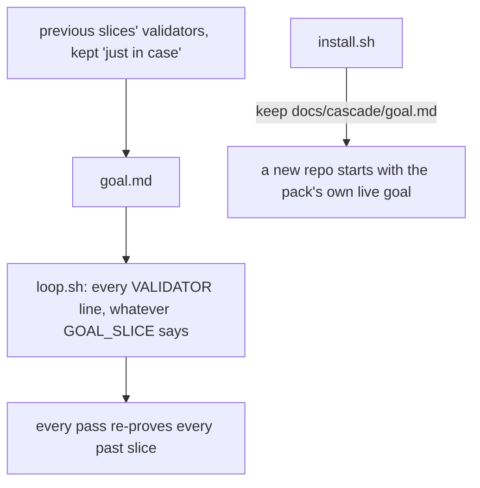
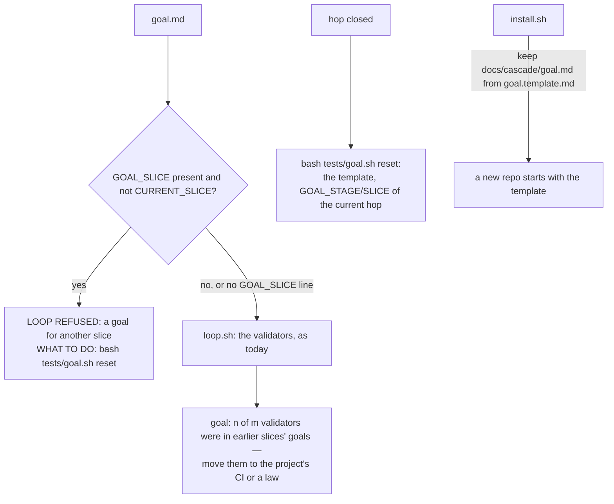

# Stage 05b — t77-goal-hygiene — SPEC

## User story IDs from the PRD

BDD's product is the cascade itself; the stories this slice serves:

- **S-GH1** — As a product owner, every hop's loop proves that hop's definition of done, not every slice ever built: a
  goal written for another slice is refused with the command that fixes it, and lines carried over from earlier slices
  are counted on every pass, so growth is visible.
- **S-GH2** — As an agent closing a hop, one command (`bash tests/goal.sh reset`) leaves a clean goal for the next hop.
- **S-GH3** — As a new adopter, `install.sh` gives me a goal *template*, not the pack's own live goal.
- **S-GH4** — As a pack user, this ships as 2.8.0.

## The problem, stated as cost

`goal.md` is one hop's definition of done. Its header says "Write this file at the start of every EXECUTE hop"; I9 says
"/goal is this hop's DoD only … /goal clear before STOP or on send-back"; the conductor's step 5 says "/goal clear any
leftover, then /goal this hop's DoD". Nothing enforces any of it: `tests/loop.sh:62-64` reads every `VALIDATOR:` line and
never looks at `GOAL_SLICE`.

Measured downstream on 2026-10-23 (dream-camera, worktree recording-audio-integrity, pack 2.7.0): `goal.md` carries a
"Previous slice" section for every earlier slice — 59 validators (49 Gradle, 7 Xcode, 3 shell) where the slice itself
needed a handful — and each loop pass re-proves them all: ~27 minutes, ~26 of them Gradle builds of past slices' tests.
Those tests already belong somewhere that runs them: the project's CI suite, and — for what must hold forever — laws,
which t66 already requires on every hop they can be broken.

Found while writing this spec: since the pack started running its own hops, `main`'s `docs/cascade/goal.md` is the
pack's **live** goal (`git show d89438e:docs/cascade/goal.md`: `GOAL_SLICE: release-2.7.0`, `VALIDATOR: CONF_MS=1000 bash
tests/stress/gradle_runner.sh`), and `install.sh` seeds a new repo's goal with it (`keep docs/cascade/goal.md`). At
v2.5.0 that file was a template (`GOAL_SLICE: <slice slug>`). So 2.7.0 gives every new adopter the pack's own
validators, one of which names a script products are not shipped.

No locked decision or signed law conflicts with the brief (both `<EDIT>` blocks hold placeholders; `DSHARP 0/0`).

## Before vs after

Before:

After:

## Benefits and trade-offs

| | Today | After t77 |
|---|---|---|
| A goal written for another slice | runs, silently proving the wrong thing | refused, with `bash tests/goal.sh reset` named |
| Carried-over validators | invisible; the loop just gets slower | counted and named on every pass (`goal: 52 of 59 …`); never refused |
| An in-force law's `check:` in the goal | required (I13) | still required; never counted as carried over |
| Resetting the goal | by hand, usually not done | `bash tests/goal.sh reset`; AGENTS.md says to run it at the accept edge |
| A goal with no `GOAL_SLICE` line (old installs) | runs | runs exactly as today (no refusal, the notice still counts) |
| A new install's goal | the pack's live goal (2.6.0+) | the template |
| Version | 2.7.0 | 2.8.0 |
| Not chosen: refusing carried-over lines | — | a refusal would push agents to rename or hide lines; a visible count is honest and a human decides |
| Not chosen: resetting the goal automatically in a hook | — | a hook that rewrites a tracked file at commit time surprises humans; the helper plus the slice check make a stale goal impossible to run silently |
| Not chosen: moving old validators to CI automatically | — | which past tests matter is the repo owner's decision |
| Cost | — | one new refusal; one `git log` of `goal.md` per loop run (one file's history) |

## What the slice adds — and the line it must not cross

The line: **nothing rewrites a goal the user or agent wrote, and the only new refusal is a goal for another slice.**

### 1. The slice check (`tests/loop.sh`)

After the existing refusals and before the validators run: read `GOAL_SLICE:` from the goal (the last such line; `#`
comments ignored). If it is present, is not a `<…>` template placeholder, and differs from `CURRENT_SLICE`
(`cascade_slice`): `LOOP REFUSED: docs/cascade/goal.md is for slice <x>, this hop is <y>` with `BOTTLENECK`, `WHAT TO
DO: bash tests/goal.sh reset, then write this hop's validators` and exit 3. No `GOAL_SLICE` line, or a placeholder,
or an equal slice: as today. `GOAL_STAGE` is not checked (a slice name is what identifies a hop's goal).

### 2. The carried-over notice (`tests/lib/goal_history.py`)

`goal_history.py <root> <goal file> <current slice>` reads `git log --format=%H -- docs/cascade/goal.md` (bounded to the
last 200 commits that touched it) and, for each earlier version whose `GOAL_SLICE` names another slice, collects its
`VALIDATOR:` lines. It prints the current goal's validators that appear in any of them, with the slice they first came
from, minus every in-force law's `check:` (read the way `loop.sh` reads them, `cascade_dsharp_in_force`). `loop.sh`
prints, before `LOOP k/n`: `goal: <n> of <m> validators were in earlier slices' goals (<up to 3 slices>, …) — they
belong in the project's CI or a law; see USAGE.md §B17`. Nothing printed when `n` is 0, when git history is unreadable,
or when the goal has no `GOAL_SLICE`-tagged history. Never a refusal, never part of `LOOP k/n`.

### 3. The reset helper (`tests/goal.sh`)

`bash tests/goal.sh reset` writes `docs/cascade/goal.md` from `docs/cascade/goal.template.md` with `GOAL_STAGE` and
`GOAL_SLICE` set to the current hop's, and no validators; it never touches a goal while a loop receipt for the current
hop and tree exists (the hop's evidence), and it prints what it replaced (`n validators removed`). `bash tests/goal.sh
show` prints the current slice check and the carried-over count without running anything.

### 4. The template (`docs/cascade/goal.template.md`, `install.sh`)

A new pack-owned file holding v2.5.0's template text (placeholders, the field help, a one-line note that a goal is one
hop's DoD and where past slices' tests go). `install.sh` ships it (`copy`) and seeds a missing `goal.md` from it instead
of from the pack's own `goal.md`; an existing `goal.md` is kept, as today.

### 5. Docs and release

- AGENTS.md "Ending a hop": at an accept or send-back edge, run `bash tests/goal.sh reset` in the closing commit. The
  conductor (`product-e2e-gre-pipeline.md`) step 5 names the helper. USAGE.md §B17: what a goal holds, where past
  slices' tests go (CI; laws for invariants), the refusal and the notice.
- **2.8.0** in `VERSION`, `.claude-plugin/plugin.json`, `.claude-plugin/marketplace.json` (main is 2.7.0, re-checked at
  landing); `CHANGELOG.md` `## 2.8.0 — <date>` with this slice and the template fix. t75's work in progress and t76's
  sent-back spec are not part of this release.

## What the slice must not touch

- The validators' semantics, `LOOP k/n`, the receipt, t62–t69's runners, the merge gate.
- Any existing `goal.md` content (the helper rewrites only when run).

## Acceptance criteria

`tests/ac/t77_goal_hygiene.sh` in scratch git repos:

- **AC1 — another slice's goal.** `GOAL_SLICE: old` with `CURRENT_SLICE: new`: `LOOP REFUSED` naming both and
  `tests/goal.sh reset`, exit 3, no validator ran (a counter). Equal slices, no `GOAL_SLICE` line, and the template's
  placeholder: the loop runs as today.
- **AC2 — the notice.** History: a goal for slice A with validators v1,v2; then slice B's goal with v1,v2,v3 and an
  in-force law's check: `goal: 2 of 4 validators were in earlier slices' goals (A)`; the law's check is not counted.
  With no earlier goal in history: no notice. **Red twin:** a notice that counts law checks reports 3.
- **AC3 — the helper.** `goal.sh reset` writes the template with the current stage and slice, reports the validators
  removed, and the next `loop.sh` is not refused for the slice; with a live receipt for this hop and tree it refuses to
  reset.
- **AC4 — install.** A fresh repo installed from this tree gets `goal.md` equal to the template with placeholders, and
  `goal.template.md`; an existing `goal.md` is untouched. **Red twin:** an `install.sh` that seeds from `goal.md`
  gives the pack's live validators.
- **AC5 — parity.** A repo whose goal has no `GOAL_SLICE` line: `loop.sh` output equals `d89438e` byte for byte.
- **AC6 — release.** T31 sees 2.8.0 in the three files; `CHANGELOG.md` has `## 2.8.0 — ` with the t77 entry.

Gate: `bash tests/ac/t77_goal_hygiene.sh`, `bash tests/enforcement.sh` (T77), lint.

## Laws

`bash tests/dsharp_strength.sh` prints `DSHARP 0/0`: NO LAW IN FORCE in this repo. The slice changes which goal a loop
accepts and what it reports, never what a validator or a law means.

# Stage 05b — PLAN

## Goal

EXECUTE adds the slice check to `loop.sh`, `tests/lib/goal_history.py` and the notice, `tests/goal.sh`, the shipped
`goal.template.md` and the install seed, docs, T77, and the 2.8.0 release.

## In scope this execute

- [ ] `tests/loop.sh` — the slice check (§1) and the notice (§2).
- [ ] `tests/lib/goal_history.py`, `tests/goal.sh` (new).
- [ ] `docs/cascade/goal.template.md` (new); `install.sh` — ship it, seed from it.
- [ ] `tests/ac/t77_goal_hygiene.sh` (AC1–AC6, two red twins); `tests/enforcement.sh` T77; `CONTROL-LINE.md` T77.
- [ ] `AGENTS.md`, `docs/cascade/product-e2e-gre-pipeline.md`, `USAGE.md` §B17.
- [ ] `VERSION`, `.claude-plugin/plugin.json`, `.claude-plugin/marketplace.json` → 2.8.0; `CHANGELOG.md`.
- [ ] `docs/cascade/goal.md` for the EXECUTE hop — written with `tests/goal.sh reset`, then this hop's validators.

## Out of scope this execute

- Moving any repo's old validators anywhere (the owner's decision); dream-camera itself.
- t75 (paused WIP) and t76 (sent back).

## Definition of done

- `bash tests/ac/t77_goal_hygiene.sh` exits 0 and the two red twins are shown to go red.
- `bash tests/enforcement.sh` exits 0 with T77; lint green; AC5 parity byte-identical.

## Risks / UNKNOWNs that still block

- **U1 — the new refusal on upgrade.** A repo upgraded to 2.8.0 mid-hop whose goal names the previous slice is refused
  until it resets: intended, and the refusal names the one command. A repo whose goal has no `GOAL_SLICE` line is
  unaffected.
- **U2 — history cost.** One `git log` of one file, bounded to 200 versions; measured in EXECUTE on this repo's history.
- **U3 — AGENTS.md in installed repos.** `install.sh` keeps an existing AGENTS.md (t74 had the same limit): the refusal's
  own message carries the rule meanwhile.

## Ask of you

1. **Refuse a goal for another slice** (the one new refusal), but **only count** carried-over lines. *Default taken.*
2. **No hook rewrites `goal.md`**; the helper plus the rule in AGENTS.md. *Default taken.*
3. **Ship a template and seed new installs from it** (fixes 2.6.0+/2.7.0 seeding the pack's live goal). *Default taken.*
4. **2.8.0 carries only t77** (t75 WIP and t76 stay out). *Default taken.*

## Invariants this hop

- PRESERVE run: no
- /goal set to: n/a — GENERATE; EXECUTE's goal is AC1–AC6 + T77 + lint
- /model /effort: as set by the session
- /plan: skipped — this document is the plan
- INVARIANTS I1–I18: held; one new refusal, stricter only
- Skills: none invoked; brainstorming skipped (brief signed into 05b-briefs.md; gaps are Asks 1–4)
- critique: see `05b-t77-goal-hygiene-critique.md`
- reads: AGENTS.md, hop-state.md, envelope.md, 05b-briefs.md (t77), loop.sh, cascade.sh, install.sh, goal.md (main and
  v2.5.0), product-e2e-gre-pipeline.md, the dream-camera goal (read only)
