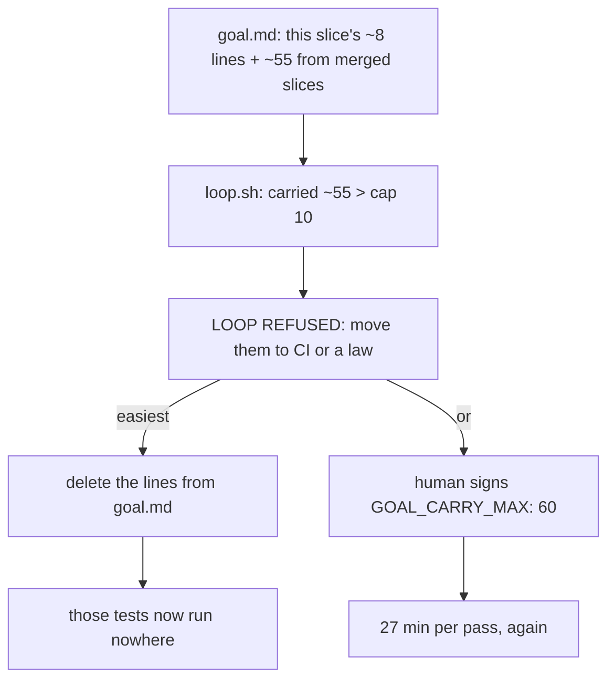
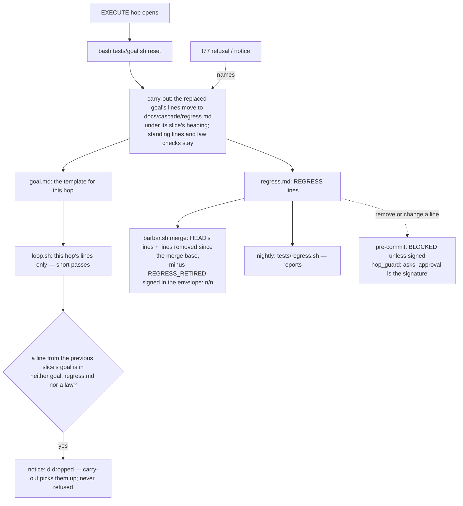

# Stage 05b — t78-carry-out — SPEC (v2, after the critic)

## User story IDs from the PRD

BDD's product is the cascade itself; the stories this slice serves:

- **S-CO1** — As a product owner, when a slice is accepted its tests keep running before every merge, without
  re-running in every later hop's loop.
- **S-CO2** — As an agent opening an EXECUTE hop, `bash tests/goal.sh reset` moves the last slice's tests to the
  regression suite for me, so the short goal I get never costs coverage.
- **S-CO3** — As a product owner, no agent can make the merge gate pass by removing a regression *line*: removing or
  changing one is mine to sign, a line removed on the branch still runs at the gate until I retire it, and a test that
  vanishes from a goal without being carried is named. (The test code a line runs is the product's own, reviewed in
  the diff like any code; see U5.)
- **S-CO4** — As a pack user, t77 and t78 ship together as 3.0.0.

## The problem, stated as cost

t77 (accepted 2026-10-24, `a94b26a`) counts validators carried from earlier slices' goals and refuses the loop above
10. Its refusal says "move them to the project's CI or a law", but the pack offers neither a place nor a command for
that. The cheapest way under the cap is to delete lines from `goal.md`. Then an accepted slice's tests stop running at
hop edges, and nothing in the pack runs them anywhere else: the merge gate (`tests/barbar.sh:21-55`) runs the audit,
retirements and the laws; the shipped CI (`.github/workflows/control-line.yml:17-29`) runs the pack's own scripts.

Measured downstream on 2026-10-24 (dream-camera, worktree cinematic-natural-blur, running pack 2.7.0): `goal.md` holds
63 validators under 3 merged-slice sections; a loop pass took ~27 min awake. By t77's rule its first loop on 2.8.0 is
refused (projected from the rule, not run there, C3). With t77 alone, the owner's choices are a signed cap (the 27
min stay) or deleting at least 45 lines (63, minus this slice's ~8, minus the cap of 10).

## Before vs after

Before (2.8.0, t77 alone):

After (3.0.0, t77 + t78):

## Benefits and trade-offs

| | Today (2.8.0) | After t78 |
|---|---|---|
| An accepted slice's tests | stay in `goal.md` (slow loops) or are deleted (lost) | move to `regress.md`; run at the merge gate and nightly |
| Hop loop length | grows with every slice unless lines are deleted | this hop's lines, plus standing gates and laws |
| Merge gate | audit + retirements + laws | the same, plus `REGRESS k/n` when there are lines; a line removed on the branch still runs |
| Removing a regression line | not applicable | asks at Write/Edit (Layer 2), BLOCKED at commit unless signed (Layer 1), still run at the gate until retired in the envelope |
| A test removed from a goal without carry-out | invisible | named in the loop's notice ("dropped") |
| `goal.sh reset` | writes the template, says how many lines it removed | carries the carried lines out first, then writes the template |
| Merge-time cost | — | grows with `regress.md` (dream-camera: ~55 lines, run once per merge instead of once per pass) |
| Version | 2.8.0 (untagged) | **3.0.0** with t77: two refusals and a stricter merge gate are breaking |
| Not chosen: CI runs `regress.sh` on every PR | — | products have platform-bound lines (dream-camera: 7 `xcodebuild`) the default Linux runner cannot run; Ask 3 |
| Nightly | — | runs the suite and reports; the product sets `runs-on` for platform-bound lines; it never decides a merge (C2) |
| Not chosen: Gradle batching for regression lines | — | `regress.sh` runs each line alone this slice; batching reuses t62's runner later (Ask 4) |
| Not chosen: a `--drop` flag on reset | — | an easy delete path is what this slice closes; the human removes a regression line by signing |

## What the slice adds — and the line it must not cross

The line: **no command ever removes a regression line; a removal the human did not retire still runs at the gate; the
merge gate only gets stricter; the hop loop's verdicts do not change; the dropped notice never refuses.**

### 1. `docs/cascade/regress.md` (the suite)

A product-owned file: a header, then `### <slice>` headings with column-0 `REGRESS: <command>` lines below them.
Lines run unchanged (no marker is appended). Order and headings carry no meaning to the checks: the protected set is
the multiset of `REGRESS:` lines, compared after collapsing whitespace. `install.sh` seeds it from
`docs/cascade/regress.template.md` (pack-owned, shipped with `copy`, zero `REGRESS:` lines at column 0) and keeps an
existing one.

### 2. Carry-out (`tests/goal.sh carry-out`, and the first step of `reset`)

`tests/lib/goal_history.py` gains one output row per line to carry: `L\t<origin slice>\t<line as written>`. Lines to
carry are (a) the current goal's carried lines by t77's rule (a late-marked `# standing` line counts as carried, as it
does for the cap, and is carried with its marker — a shell comment), and (b) the previous slice's **dropped** lines
(§6), read from history. Carry-out removes the (a) lines from `goal.md`, appends (a) and (b) to `regress.md` under
`### <origin slice>` (the heading created at the end of the file if absent), skips a line already in `regress.md`
(whitespace collapsed), and prints `goal: carried <n> validators to docs/cascade/regress.md (<slices>), <k> already
there`. Standing lines, law checks and lines not carried stay. Unreadable history: (a) and (b) are empty and it says so.

`reset` does not depend on history for the goal it replaces (C10). It refuses, leaving everything untouched, when
`goal.md` has uncommitted changes (`commit the goal first so its lines can be carried`). Otherwise: if the replaced
goal's `GOAL_SLICE` equals `CURRENT_SLICE` (a send-back re-run), it runs carry-out as above; if it names another slice
or none, it carries **every** validator of the replaced goal that is not standing and not a law check, under `### <its
GOAL_SLICE>` or `### unattributed`, plus (b). Then it writes the template as in t77 and prints both counts; `removed
<n> validators` is kept in its message.

### 3. `tests/regress.sh` (the runner)

Reads column-0 `REGRESS:` lines from `docs/cascade/regress.md` (`--root DIR` for the gate), runs each alone from the
root (`eval`, as `loop.sh`'s alone path), writes `.cascade/regress/<i>.log`, prints `PASS`/`FAIL` per line (a FAIL with
the same 25-line detail as `loop.sh`) and `REGRESS k/n`; exit 0 iff k = n. No file, or no lines: `REGRESS 0/0`, exit 0.
It never reads the goal, the hop or the laws, and it is legal on any hop.

### 4. The merge gate (`tests/barbar.sh merge_gate`)

Runs `tests/regress.sh --root "$GATE_ROOT" --gate`. In gate mode the suite is not the working copy (C4): it is the
`REGRESS:` lines of `HEAD`'s `regress.md`, **plus** every line in the merge base's version (t68's base: origin/HEAD,
else main/master/trunk) that `HEAD` no longer has, **minus** lines the human retired: `- REGRESS_RETIRED: <line> —
<reason>` inside an envelope EDIT block at `HEAD` (the same trust the gate already gives READY). A working copy of
`regress.md` that differs from `HEAD`, or a base it cannot reach (shallow clone), is a REFUSED, never "clean". ALLOWED
additionally needs `REGRESS n/n`. When the suite has lines, the ALLOWED and REFUSED lines name `REGRESS k/n` and
failing lines are listed as `  RG FAIL <line>`; with 0 lines both lines are byte-identical to 2.8.0's. A missing
`tests/regress.sh` is a REFUSED (fail closed), as for `retirements.sh`. So a removal made with `--no-verify` or an
uncommitted `sed` gains nothing at the gate.

### 5. Protection (`.githooks/pre-commit`, `.claude/hooks/hop_guard.py`)

Pre-commit: when `docs/cascade/regress.md` is staged changed or type-changed, every `REGRESS:` line in `HEAD`'s version
must still be in the staged version (multiset, whitespace collapsed). A line missing is `BLOCKED: docs/cascade/regress.md
— a regression line removed or changed: <line>` with the signing hint, unless the staged blob carries a human token
(`human_ok`). Deleting or renaming the file away is BLOCKED except with `CASCADE_HUMAN=1` (no blob to sign). Adding
lines, headings and prose is free. Any hop, `NONE` included.

Signing (C5, C6): `tests/sign.sh`'s `human_owned()` lists `docs/cascade/regress.md` when tracked, so `bash tests/sign.sh`
signs a human's edit as it does a law shard's; hop_guard sends a Write/Edit whose result drops a line through
`sign_or_deny` (interactive: `ask`, and approving is the signature via `sign_ok.py`; headless: deny), and lets one that
only adds through. `sign_ok.py` needs no change (it hashes whatever hop_guard recorded).

### 6. The dropped notice (`goal_history.py`, `loop.sh`)

The **previous slice's goal** is the newest committed version of `goal.md` whose `GOAL_SLICE` is set and differs from
`CURRENT_SLICE`. Its validators that are not standing and not an in-force law check, and that are in neither the
current goal nor `regress.md` (same comparison), are **dropped**. `goal_history.py` prints `D\t<d>\t<previous slice>`
when d > 0. A line that is in **any committed version** of `regress.md` is never dropped: it was carried, and its
removal was the separate, guarded act of §5 (C8). `loop.sh` prints, beside t77's notice and before `LOOP k/n`: `goal:
<d> validators of <slice>'s goal are in neither this goal, regress.md nor a law — bash tests/goal.sh carry-out moves
them to regress.md (USAGE.md §B17)`; carry-out does exactly that ((b) in §2). Never a refusal, never part of `LOOP
k/n`. Unreadable history prints t77's line only.

**t77's words change** (C9): its notice ends `— bash tests/goal.sh carry-out moves the <n> to regress.md (USAGE.md
§B17)` and its cap refusal's WHAT TO DO names `bash tests/goal.sh carry-out` first, then the signed cap. Counts, exit
codes and when they fire do not change.

### 7. Docs and release

- AGENTS.md: the goal row says reset carries out; a regression line is the human's to remove. USAGE.md §B17: the suite,
  carry-out, the gate, the protection, the notice. `docs/cascade/product-e2e-gre-pipeline.md` is not edited (step 5
  sits inside an EDIT span, t77).
- **3.0.0** in `VERSION` and both manifests; `CHANGELOG.md`: the `## 2.8.0 — 2026-10-24` heading becomes
  `## 3.0.0 — <date>` holding t77 and t78 (2.8.0 was never tagged). t77's AC6 pins `2.8.0`; it becomes "the three files
  agree and the CHANGELOG section for that version names t77" (t55's AC4 shape), so the next release does not break it.
- The pack's nightly gets a `regress` job running `bash tests/regress.sh` (the pack's suite starts empty). The product
  nightly that `install.sh --with-nightly` writes carries the same job with `runs-on` marked as the product's to set
  for platform-bound lines; an existing product nightly is kept, and USAGE §B17 and the CHANGELOG show the job to paste
  (C2). The nightly reports; the merge gate decides.

## What the slice must not touch

- The hop loop's validators, `LOOP k/n`, the receipt, t62–t69's runners, autopilot's edges; t77's counts and refusals
  (only their words change, §6).
- Any existing `REGRESS:` line, goal line not carried, or law.
- `control-line.yml` (Ask 3).

## Acceptance criteria

`tests/ac/t78_carry_out.sh` in scratch git repos (a counter file proves what ran):

- **AC1 — carry-out.** History: A's goal (v1, v2, `lint # standing`, a law check), then the current goal for B with v1,
  v2, v3, the standing line and the law check: `goal.sh carry-out` moves v1 and v2 under `### A` in `regress.md`, prints
  `carried 2 … (A), 0 already there`; v3, the standing line and the law check stay; the loop now prints no t77 notice.
  Run twice: the second carries 0. A line already in `regress.md` is removed from the goal and not duplicated. A
  late-marked `# standing` line (t77 AC7's shape) is carried.
- **AC2 — reset carries out.** A's goal (v1–v3, committed), `CURRENT_SLICE: B`: `goal.sh reset` puts v1–v3 under
  `### A`, writes the template, and says `removed 3 validators (3 carried …)`. The same in a shallow clone (no history)
  and with no `GOAL_SLICE` (`### unattributed`). An uncommitted goal: reset refuses, both files untouched. A send-back
  reset (`GOAL_SLICE` = `CURRENT_SLICE`) carries only lines from earlier slices. **Red twin:** a reset without
  carry-out leaves `regress.md` empty.
- **AC3 — the runner.** Three lines, one failing: `REGRESS 2/3`, exit 1, the failing line's detail; all passing:
  `REGRESS 3/3`, exit 0; no file and an empty file: `REGRESS 0/0`, exit 0; each line ran once (counter).
- **AC4 — the gate.** A gate-ready fixture (the farm's own `merge-allowed-when-ready` shape): ALLOWED with `REGRESS 1/1`;
  one failing line: REFUSED naming `REGRESS 0/1` and the line; that failing line removed with `git commit --no-verify`
  on the branch: still REFUSED; retired by a signed `REGRESS_RETIRED:` envelope line: ALLOWED; removed in the working
  copy only: REFUSED (dirty); a shallow clone: REFUSED; empty `regress.md`: the ALLOWED line equals 2.8.0's byte for
  byte; `tests/regress.sh` missing: REFUSED. **Red twin:** a gate that reads only `HEAD`'s lines lets the `--no-verify`
  removal through.
- **AC5 — protection.** Committing a removed or edited `REGRESS:` line: BLOCKED naming the line; after
  `bash tests/sign.sh`: lands; deleting the file: BLOCKED, lands with `CASCADE_HUMAN=1`; adding a line and moving one
  under another heading: lands unsigned; hop_guard answers `ask` to a Write that drops a line (interactive), `deny`
  headless, and nothing to one that adds. **Red twin:** a guard that compares only line counts lets an edited line
  through.
- **AC6 — dropped.** History: B's goal (v1, v2, `lint # standing`); then `CURRENT_SLICE: C`, a goal for C with v1 only and
  no `regress.md`: `goal: 1 validators of B's goal are in neither …`; `goal.sh carry-out` then puts v2 under `### B`
  and the notice is gone; a line once committed to `regress.md` and removed with a signature is not dropped; the
  standing line is never dropped. t77's notice and refusal name `goal.sh carry-out`.
- **AC7 — install.** A fresh install seeds `regress.md` from the template (`REGRESS 0/0`), ships `regress.sh` and the
  template; an existing `regress.md` is kept; `--with-nightly` ships a nightly with a `regress` job.
- **AC8 — parity.** Empty `regress.md`, nothing carried or dropped: `loop.sh` output equals `a94b26a`'s (its own
  `tests/`), seconds normalised; the merge gate's ALLOWED and REFUSED lines equal `a94b26a`'s.
- **AC9 — release.** `VERSION`, `plugin.json`, `marketplace.json` agree on 3.0.0; `CHANGELOG.md` has `## 3.0.0 — ` naming
  t77 and t78 and no `## 2.8.0` heading; t77's AC6 passes on the agreement rule.
- **E1 — cost.** A dream-camera-shaped fixture (60 lines of `sleep 0.2` across 4 slices): loop lines and wall time per
  pass before and after `goal.sh reset`; the merge gate's added time.

Gate: `bash tests/ac/t78_carry_out.sh`, `bash tests/enforcement.sh` (T78), lint.

## Laws

`bash tests/dsharp_strength.sh` prints `DSHARP 0/0`: NO LAW IN FORCE in this repo. Regression lines are not laws (no
red twin, no D#); the slice changes which tests the merge gate runs and who may remove them, never what a law means.

# Stage 05b — PLAN

## Goal

EXECUTE adds the regression suite, carry-out (alone and inside reset), its runner, the gate check, the two guards, the
dropped notice, install seeding, docs, T78, and the 3.0.0 release with t77.

## In scope this execute

- [ ] `docs/cascade/regress.template.md` (new); `install.sh` — copy it, seed `regress.md`.
- [ ] `tests/lib/goal_history.py` — `L` rows (carried lines with origin), `D` row (dropped), `regress.md` read.
- [ ] `tests/goal.sh` — `carry-out`; `reset` carries out first.
- [ ] `tests/regress.sh` (new).
- [ ] `tests/barbar.sh` — `merge_gate` runs it.
- [ ] `.githooks/pre-commit`, `.claude/hooks/hop_guard.py`, `tests/sign.sh` — regression lines are the human's to
      remove, and signable.
- [ ] `tests/loop.sh` — the dropped line; t77's notice and refusal name carry-out.
- [ ] `.github/workflows/nightly.yml` — a `regress` job (the product copy inherits it via `--with-nightly`).
- [ ] `tests/ac/t78_carry_out.sh` (AC1–AC9, two red twins); `tests/enforcement.sh` T78; `CONTROL-LINE.md` T78.
- [ ] `tests/ac/t77_goal_hygiene.sh` AC6 → the agreement rule; AC2/AC7 expect the new words; AC3's reset message holds.
- [ ] `tests/ac/t69_gradle_tuning.sh` AC9 — admit `tests/regress.sh`, `regress.template.md`, the seeded `regress.md` (C7).
- [ ] `AGENTS.md`, `USAGE.md` §B17.
- [ ] `VERSION`, `.claude-plugin/plugin.json`, `.claude-plugin/marketplace.json` → 3.0.0; `CHANGELOG.md`.
- [ ] `docs/cascade/goal.md` for the hop: `bash tests/goal.sh reset`, then AC + `# standing` enforcement and lint.

## Out of scope this execute

- `control-line.yml` running the suite on every PR (Ask 3); Gradle batching in `regress.sh` (Ask 4).
- Moving dream-camera's lines (its owner runs `goal.sh reset` after upgrading).
- The Stop hook pushing a used-up autopilot list (its own slice).

## Definition of done

- `bash tests/ac/t78_carry_out.sh` exits 0 and both red twins are shown to go red.
- `bash tests/enforcement.sh` exits 0 with T78; lint green; AC8 parity byte-identical.

## Risks / UNKNOWNs that still block

- **U1 — merge time grows with the suite.** Every accepted slice adds lines; the suite is pruned only by the human.
  Measured in E1; visible as `REGRESS k/n` at every merge.
- **U2 — an intended behaviour change breaks an old slice's test.** The merge gate refuses until the human signs the
  edited line. That is the point (a past slice's promise changes only by decision), and it is friction.
- **U3 — the gate runs product commands.** `regress.sh` evals lines at `GATE_ROOT`, as `dsharp_strength.sh` already
  does for laws.
- **U4 — commands that need a platform** (Xcode) fail on a machine without it, at the gate or the nightly. The owner's
  nightly picks its runner; the gate runs where the human merges.
- **U5 — the test body is not guarded (C1).** A line can stay byte-identical while the test it runs is gutted. That is
  product code, reviewed in the diff; a test that must never weaken belongs in a law (`tests/inv/`, human-owned).
- **U6 — the gate's trust in `REGRESS_RETIRED`** equals its trust in READY: text inside an envelope EDIT block. A
  `--no-verify` commit could forge either; branch protection and the human merge are the backstop, as today.

## Ask of you

1. **3.0.0 with t77**, 2.8.0 never tagged. *Default taken (from the brief).*
2. **Reset always carries out**; there is no flag that drops lines. *Default taken.*
3. **CI does not run `regress.sh` on every PR**; it binds at the merge gate and the nightly. Alternative: add it to
   `control-line.yml` (products with platform-bound lines would need to edit their CI). *Default taken — your call.*
4. **No Gradle batching in `regress.sh` this slice** (dream-camera: ~55 lines alone ≈ 25 min per merge). *Default taken.*

## Invariants this hop

- PRESERVE run: no
- /goal set to: n/a — GENERATE; EXECUTE's goal is AC1–AC9 + T78 + lint
- /model /effort: as set by the session
- /plan: skipped — this document is the plan
- INVARIANTS I1–I18: held; the merge gate gets stricter, the hop loop's verdicts do not change
- Skills: none invoked; brainstorming skipped (brief signed into 05b-briefs.md as `91d85c0`; gaps are Asks 1–4)
- critique: C1–C10 answered in `05b-t78-carry-out-critique.md` (spec v2); no human rows
- reads: AGENTS.md, hop-state.md, envelope.md, 05b-briefs.md (t78), loop.sh, goal.sh, goal_history.py, barbar.sh,
  pre-commit, hop_guard.py, sign.sh, retirements.sh, install.sh, control-line.yml, nightly.yml,
  product-e2e-gre-pipeline.md, critique.py, t69_gradle_tuning.sh
