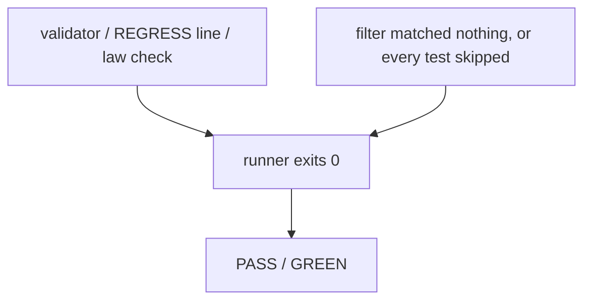
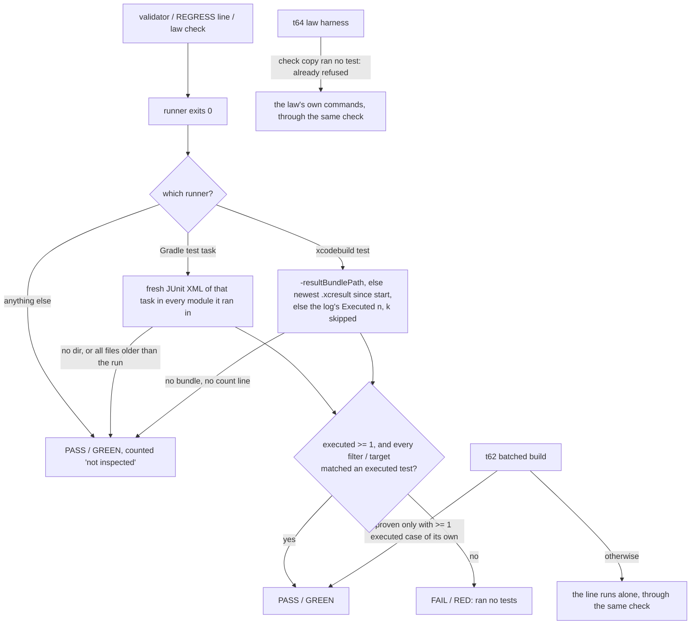

# Stage 05b — t79-zero-test-guard — SPEC (v2, after the critic)

## User story IDs from the PRD

BDD's product is the cascade itself; the stories this slice serves:

- **S-ZT1** — As a product owner, a PASS from a test runner means at least one test executed: a filter that matches
  nothing, or a run where every test was skipped, is a FAIL with the reason `ran no tests`. On a line with several
  filters, each filter must have matched an executed test (C1).
- **S-ZT2** — As a product owner, the same rule holds wherever the pack turns a test command into a verdict: the hop
  loop (alone and batched), the regression suite (t78), and a law's check.
- **S-ZT3** — As a product owner, a line the pack cannot read a test count from is named `not inspected`, never
  counted as a pass that ran tests.

## The problem, stated as cost

Every verdict in the pack is an exit code. `tests/loop.sh` runs a line alone and prints PASS on exit 0
(`tests/loop.sh` alone path, `if ( cd "$ROOT" && eval "$v" ) …; then … echo "PASS  $v"`); `tests/regress.sh` (t78) does
the same; a law's check is GREEN on exit 0 (`tests/dsharp_strength.sh:3`). A runner that executes zero tests and exits
0 therefore reads as proof:

- **Xcode:** `xcodebuild test -only-testing:<Target>/<Class>` names a class; whether a misspelled one exits 0 with
  `Executed 0 tests` is to be measured (E0), not assumed. dream-camera's goal holds 11 `xcodebuild test` lines.
- **Gradle:** `--tests <filter>` fails with "No tests found for given includes" by default, so a misspelled filter is
  caught — unless the build sets `filter.failOnNoMatchingTests = false`, or every matched test is skipped (`@Ignore`,
  an assumption failure), which exits 0 with nothing executed.
- **The batched runner (t62)** proves a line from a shared build when the task's outcome is OK and the filter it ran
  equals the line's own (`tests/lib/gradle_runner.py:403-436`); nothing there requires an executed case either.

The agent does not have to lie: the script prints PASS. Found reviewing t77/t78 for blind spots (2026-10-25, #1 of 7,
the one the pack can close outright).

Measured on 2026-10-25, read-only: dream-camera's Xcode logs carry XCTest's `Executed N tests, with M failures` lines
even under `-quiet` (`grep -h 'Executed [0-9]* test' .cascade/loop/*.log` in the worktree), an `.xcresult` bundle is
written under `DerivedData/<project>/Logs/Test/`, and `xcrun xcresulttool` (Xcode 27, version 25115) is installed.
dream-camera's `composeApp/build.gradle.kts` does not set `failOnNoMatchingTests`.

## Before vs after

Before:

After:

## Benefits and trade-offs

| | Today | After t79 |
|---|---|---|
| A filter that matches nothing, exit 0 | PASS | FAIL `ran no tests` |
| One misspelled filter beside a valid one | PASS | FAIL `filter matched no executed test: <filter>` (C1) |
| Every selected test skipped | PASS | FAIL `ran no tests` (skipped is not executed) |
| A batched Gradle line whose own filter executed nothing | proven PASS | not proven; runs alone and fails there |
| A law check that runs no test | GREEN (THEATER only if its twin also passes) | RED `ran no tests` |
| Plain shell lines (`bash tests/…`) | PASS on exit 0 | unchanged; counted `not inspected` only when the goal also has a Gradle/Xcode test line (C4) |
| Xcode output the pack cannot read | PASS | PASS, counted `not inspected` (never a guessed zero) |
| A Gradle task that did not execute this run (up-to-date, cached, skipped) | PASS | PASS, counted `not inspected` — its old XML is not evidence either way (C2) |
| Cost | — | one XML/xcresult read per test line after it passes; no extra build |
| Not chosen: adding `-resultBundlePath` or Gradle flags to the user's command | — | the pack never rewrites a validator (t69's line); it reads what the run already left |
| Not chosen: FAIL when a count is unreadable | — | an Xcode or Gradle output change would turn honest passes red across every product; `not inspected` is visible instead |

## What the slice adds — and the line it must not cross

The line: **a verdict changes only from PASS/GREEN to FAIL/RED, only when a recognised test runner executed zero
tests; no command is rewritten; an unreadable count is never a FAIL.**

### 1. `tests/lib/test_count.py` (one reader)

`test_count.py ROOT START LOG -- <command>` prints one line: `ran <n>`, `none <why>` or `uninspected <why>`.

- **Gradle**: the command's first word is `./gradlew` or `gradle` and it names a test task (`test`, `*Test`,
  `*UnitTest`, `check`). The results directories: `<module>/build/test-results/<task>/` for `:module:task`; for a bare
  task name, that task in **every** project that has the directory (Gradle runs a bare name in every project, C3).
  Only XML files modified at or after START count (the brief's rule, C2): a directory whose files all predate the run
  belongs to a task that was `UP-TO-DATE`, `FROM-CACHE`, `SKIPPED` or `NO-SOURCE` this time, and the line is
  `uninspected (results predate the run)` — never a FAIL and never a stale PASS. No directory at all: `uninspected`.
  From the fresh XML: **executed** = `testcase` elements without `skipped`. No filter: `ran <executed>`. With
  `--tests` filters (C1): each filter must be matched by at least one executed case under t62's **wide** matcher
  (`could`, which may over-match but never under-matches — the opposite of `surely`, which stays inside `proven()`
  only, C3); a filter none could match is `none filter matched no executed test: <filter>`. A JUnit 5 `@Nested` case
  (`com.x.FooTest$Inner`) and a `@DisplayName` method are matched by their class prefix, so a run that executed tests
  is never read as zero.
- **Xcode**: the first word is `xcodebuild` and the action list includes `test` (or `test-without-building`). The
  bundle (C2): the command's `-resultBundlePath` if it names one; else the newest `*.xcresult` modified at or after
  START under `<-derivedDataPath>/Logs/Test/` when the command names one, else under
  `~/Library/Developer/Xcode/DerivedData/*/Logs/Test/` — the default scan is not used when laws run concurrently
  (`DSHARP_JOBS` > 1, C6). Read with `xcrun xcresulttool get test-results summary --path <bundle>`: executed =
  `totalTestCount - skippedTests`; per `-only-testing:` target (C1), `xcresulttool get test-results tests` must show at
  least one executed test under it. Without a bundle, the log: XCTest's last `Executed <n> tests, with <k> tests
  skipped …` gives n − k (`with <k> tests skipped` absent means k = 0, C7), plus Swift Testing's `Test run with <n>
  tests`; per-target checks need the bundle and are skipped without one. Neither bundle nor count line:
  `uninspected`.
- **Anything else**: `uninspected not a recognised test runner`.

### 2. Where it applies

- **`tests/loop.sh`** (alone path): START is taken before the line runs and its log is the line's own; after exit
  0, `ran 0`/`none` turns PASS into `FAIL  <line>` with `ran no tests (<why>)` as its detail; `uninspected` stays PASS.
  The summary line gains `; <u> not inspected` only when the goal has at least one Gradle or Xcode test line and u > 0,
  so a goal of shell lines prints exactly what it printed before — t77's AC5 and t78's AC8 parity hold unchanged (C4).
- **`tests/lib/gradle_runner.py`** (t62 batched proof): `proven()` additionally requires, for each test task the line
  owns, at least one non-skipped case its own patterns select (`surely`). Otherwise the line is not proven and runs
  alone — through the check above.
- **`tests/regress.sh`** (t78): as `loop.sh`'s alone path; the summary gains `(u not inspected)` under the same rule.
- **Laws** (`tests/dsharp_strength.sh`, and so the merge gate; C6): the check's output goes to
  `.cascade/dsharp/<id>.check.log` instead of `/dev/null`, START is taken just before it, and the count is read
  **right after the check and before the red twin runs** (the twin writes to the same results directory). A check
  that exits 0 with `none` is `RED  D# … ran no tests`; `uninspected` leaves GREEN as today. The t68 family pre-pass
  records the count with the shared check's memoised result, so every family member reads the same answer. A red
  twin's verdict is unchanged. The law harness (t64) already refuses a check copy that ran no non-skipped test
  (`law_harness.py:204-205`, C9) and the law then runs its own commands, where this rule applies: no harness change.
- **The verdict cache** (t65, C8): `test_count.py` joins `SCORERS` in `tests/lib/verdict_cache.py`, so a change to the
  reader invalidates GREENs cached under the old one.

### 3. The t78 defect carried here

`tests/regress.sh` writes `.cascade/regress/<i>.log`, but `.cascade/regress/` is in neither the pack's `.gitignore`
nor `install.sh`'s gitignore list (`install.sh:187`), so `830610d` committed `.cascade/regress/0.log`. This slice adds
the pattern to both and removes the tracked log (found at t78's accept edge, 2026-10-25). Seven older tracked
`.cascade/*.out` files (`edge68.out`, `loop-t68*.out`, …) predate t78; they are named in the report for the human and
left alone (C5).

### 4. Docs and release

AGENTS.md: a PASS needs an executed test where the pack can read it. USAGE.md §B18: the rule, the readers, `not
inspected`. CONTROL-LINE.md + `tests/enforcement.sh` T79. CHANGELOG: under the unreleased 3.0.0 section (t79 ships with
t77/t78 unless the human tags 3.0.0 first, in which case 3.1.0).

## What the slice must not touch

- Any validator, law or REGRESS command (read, never rewritten); t69's tuning; the receipt; autopilot's edges.
- Plain shell lines' verdicts.
- A red twin's verdict.

## Acceptance criteria

`tests/ac/t79_zero_test_guard.sh` with stub runners (a `gradlew` / `xcodebuild` / `xcrun` on `PATH` in the fixture that
writes the XML, xcresult summary or log a real run would, and exits 0) — real Gradle and Xcode are E0:

- **AC1 — Gradle, lenient filter.** A stub task whose fresh XML holds `com.x.FooTest` only; the line filters
  `com.x.FoTest`: loop `FAIL … ran no tests`, `LOOP 0/1`. The correct filter: PASS. Two filters, one misspelled:
  FAIL naming it. Every case `skipped`: FAIL. No filter, one executed case: PASS. A `@Nested` case
  (`com.x.FooTest$Inner`) under filter `com.x.FooTest`: PASS. A bare `test` whose results are in a subproject only:
  PASS. XML older than the run (an up-to-date task): PASS, `not inspected`.
- **AC2 — Xcode.** A stub writing an `.xcresult` (at `-resultBundlePath` when the line names one, else under a stub
  DerivedData) whose summary says 0 executed: FAIL; 3 total, 3 skipped: FAIL; 2 executed: PASS; two `-only-testing:`
  targets, one with no executed test: FAIL naming it. No bundle, a log with `Executed 0 tests`: FAIL; `Executed 3
  tests, with 3 tests skipped`: FAIL (C7); `Executed 4 tests, with 0 failures`: PASS; Swift Testing `Test run with 0
  tests`: FAIL. No bundle, no count line: PASS and `1 not inspected`.
- **AC3 — plain shell.** A goal of shell lines only: the loop's output equals `c8886b0`'s byte for byte (no `not
  inspected` text, C4); t77's AC5 and t78's AC8 pass unchanged. A goal with one Gradle line and one shell line:
  `; 1 not inspected`.
- **AC4 — batched.** Two Gradle lines through t62's runner (its stub fixture), one whose own filter executed nothing in
  the shared build: that line is not proven, runs alone and FAILs; the other is proven. **Red twin:** a `proven()`
  without the executed-case requirement proves both.
- **AC5 — regression suite.** The same zero-test line as a `REGRESS:` line: `REGRESS 0/1`, `ran no tests`.
- **AC6 — laws.** A law whose check runs a zero-test stub: `RED … ran no tests` in `dsharp_strength.sh` and the merge
  gate refuses; one executed test: GREEN. A red twin that writes its own (passing) XML after the check: the count is
  the check's, not the twin's. A family of two laws on one zero-test check: both RED. `DSHARP_JOBS=4`: the Xcode
  reader does not scan the default DerivedData. **Red twin:** a `test_count.py` that reports every Gradle run as
  `ran 1` leaves AC1's misspelled filter PASS.
- **AC7 — the t78 defect.** `.cascade/regress/` is in `.gitignore` and in `install.sh`'s list; a fresh install's
  `.gitignore` has it; no file under `.cascade/regress/` is tracked in the pack (C5). `test_count.py` is in the
  verdict cache's `SCORERS` (C8).
- **E0 — real runners (in EXECUTE, before building).** On this machine: (a) `xcodebuild test -only-testing:` naming a
  missing class in a throwaway project — exit code, `Executed` line, xcresult summary; (b) Gradle with
  `failOnNoMatchingTests = false` and a missing filter — exit code and XML; (c) whether a re-executed Gradle test task
  leaves a deleted class's XML behind. The spec's readers change if E0 contradicts them; the report states each result.
- **E1 — cost.** Wall time added per test line on dream-camera's goal (read-only run of `test_count.py` on its logs).

Gate: `bash tests/ac/t79_zero_test_guard.sh`, `bash tests/enforcement.sh` (T79), lint.

## Laws

`bash tests/dsharp_strength.sh` prints `DSHARP 0/0`: NO LAW IN FORCE in this repo. The slice changes how a law's check
is scored in products (a zero-test check is RED, §2); it adds no law, edits no law line, and adds no test under an
existing D#.

# Stage 05b — PLAN

## Goal

EXECUTE runs E0, then adds `test_count.py`, wires it into the loop's alone path, the t62 runner's proof, the regression
suite and the law scoring, fixes t78's ignored-log defect, and documents and tests it (T79).

## In scope this execute

- [ ] E0 (real Xcode, real Gradle) before any code; record results in the report.
- [ ] `tests/lib/test_count.py` (new).
- [ ] `tests/loop.sh` — alone path and summary.
- [ ] `tests/lib/gradle_runner.py` — `proven()` requires an executed own case.
- [ ] `tests/regress.sh` — the same check.
- [ ] `tests/dsharp_strength.sh` — the check's log and START, the count before the twin, the family memo, no default
      DerivedData scan when `DSHARP_JOBS` > 1. `tests/lib/law_harness.py`: no change (it already refuses a no-test copy).
- [ ] `tests/lib/verdict_cache.py` — `test_count.py` in `SCORERS`.
- [ ] `.gitignore`, `install.sh` — `.cascade/regress/`; untrack `.cascade/regress/0.log`.
- [ ] `tests/ac/t79_zero_test_guard.sh` (AC1–AC7, two red twins) with stub runners; `tests/enforcement.sh` T79;
      `CONTROL-LINE.md` T79.
- [ ] `AGENTS.md`, `USAGE.md` §B18, `CHANGELOG.md`.
- [ ] `docs/cascade/goal.md`: `bash tests/goal.sh reset` (t78's AC moves to the suite), then this hop's validators.
- [ ] Older ACs kept compatible: t69 AC9's path list (`test_count.py`). t77 AC5 and t78 AC8 need no change: the
      summary only grows when a goal has a recognised test line (C4).

## Out of scope this execute

- Runners other than Gradle and Xcode (pytest, jest, go test): `not inspected` for now; each is a reader to add later.
- Rewriting validators to add result-bundle or report flags.
- t80's matching.

## Definition of done

- `bash tests/ac/t79_zero_test_guard.sh` exits 0 and both red twins are shown to go red; E0's three results reported.
- `bash tests/enforcement.sh` exits 0 with T79; lint green; AC3 parity holds.

## Risks / UNKNOWNs that still block

- **U1 — E0 may contradict the readers** (e.g. Gradle keeps stale XML, or Xcode exits non-zero on a missing class, which
  would make the Xcode hole smaller than assumed). The report says so and the reader follows the measurement.
- **U2 — a shared DerivedData** (two Xcode projects, or a parallel run) could hand the reader another run's bundle. The
  loop lock serialises loops in one repo; across repos the newest-since-start rule can misread. Falls back to the log.
- **U3 — products whose laws today rely on a zero-test check** go RED on upgrade. That is the slice's point, and it is
  a verdict change in products: the CHANGELOG says so plainly.
- **U4 — `not inspected` is a count, not a guard.** Plain shell lines (`bash tests/ac/…`) stay exit-code verdicts.

## Ask of you

1. **An unreadable count is `not inspected`, never a FAIL** — including a Gradle task that did not execute this run.
   *Default taken.*
2. **Skipped tests do not count as executed.** *Default taken.*
3. **Laws are in scope** (a zero-test check is RED in products). *Default taken (from the brief).*
4. **t79 joins the unreleased 3.0.0** with t77/t78. *Default taken.*
5. **Each filter must match an executed test** (C1), not only the line as a whole — it closes the likelier form of
   the hole (28 of dream-camera's 47 lines carry several `--tests`). Matching is deliberately wide, so it can only
   miss a misspelling that looks like a real class prefix. *Default taken.*

## Invariants this hop

- PRESERVE run: no
- /goal set to: n/a — GENERATE; EXECUTE's goal is AC1–AC7 + T79 + lint
- /model /effort: as set by the session
- /plan: skipped — this document is the plan
- INVARIANTS I1–I18: held; verdicts move only PASS→FAIL / GREEN→RED, for zero executed tests
- Skills: none invoked; brainstorming skipped (brief committed in 05b-briefs.md, `c4035c9`; gaps are Asks 1–4)
- critique: C1–C10 answered in `05b-t79-zero-test-guard-critique.md` (spec v2); no human rows
- reads: AGENTS.md, hop-state.md, envelope.md, 05b-briefs.md (t79), loop.sh, regress.sh, gradle_runner.py,
  law_harness.py, dsharp_strength.sh, verdict_cache.py, install.sh, .gitignore; dream-camera's loop logs, DerivedData
  and build file (read only)
