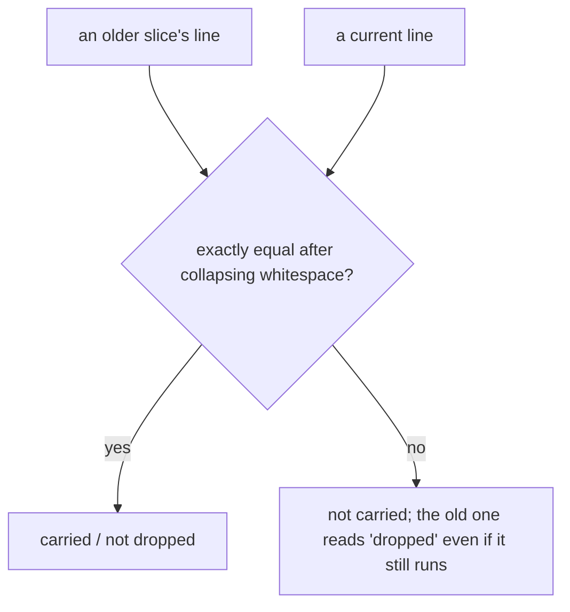
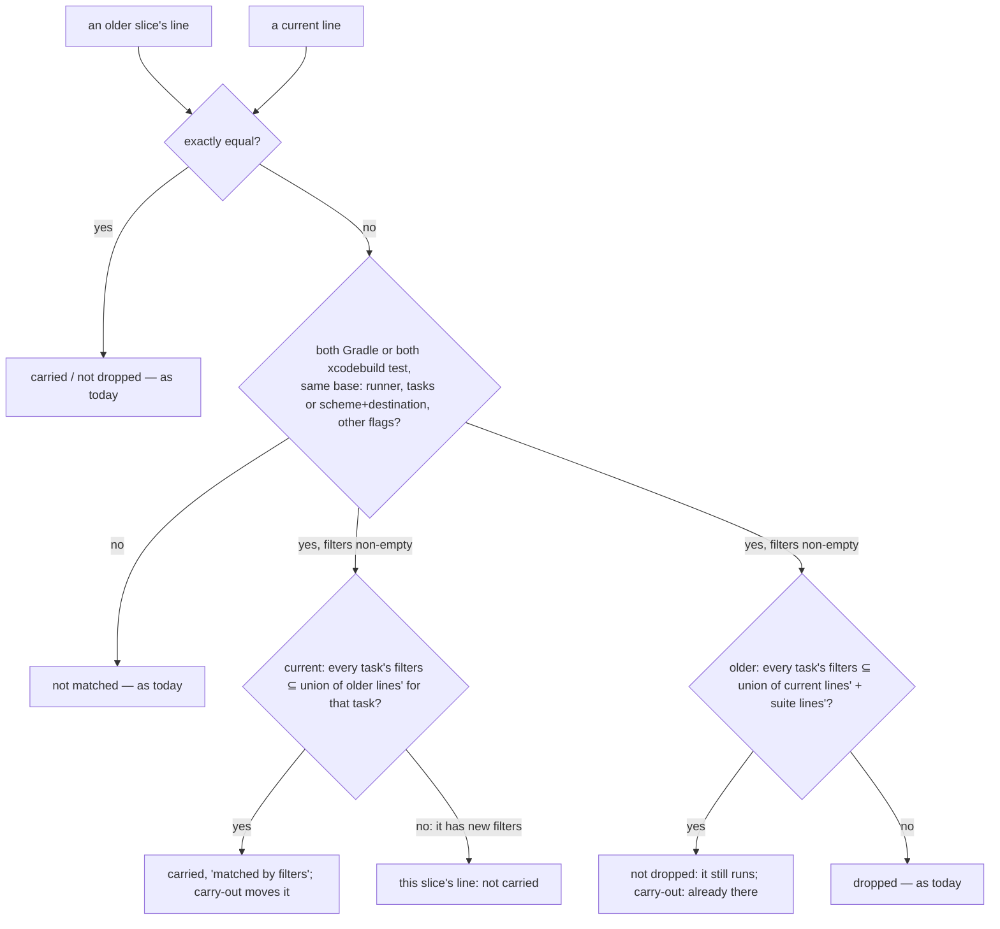

# Stage 05b — t80-carry-matching — SPEC (v2, after the critic — two plans; the human picks, Ask 0)

## Ask 0 first — is the matcher worth building? (C1, C2)

The critic measured what v1 never did: across dream-camera's **100 earlier goal versions (75 slices)**, exact matching
already pairs **62 of its 63** current lines as carried, and filter matching would add **0** carried and remove **0**
"dropped" (`python3 -B …/scratchpad/e1.py`, re-run by the author: `exact carried 62 matched by filters 0 total 63`;
`dropped exact 0 dropped with covers 0`). v1's "12 of 51 lines are subsets" compared lines inside **one** goal, not
across slices. So the brief's cost is unobserved in the product that motivated it. And the brief's own "fold" is the
mixed case (old + new filters in one line), whose Done ("carried out") would move this slice's new tests out of its
own loop (C2).

- **Plan A — recommended: README only.** Build the README's "Reading the codes" (the human's request, now in the brief,
  C3); record the measurement in USAGE §B16 ("matching by filters was considered for t80 and not built: 0 of 63 lines
  in the product that prompted it"); no matcher. Smallest diff, no verdict risk.
- **Plan B — the matcher, with every critic fix** (§1–§3 below, as revised): worth it only as prevention for products
  that rewrite lines more than dream-camera does.

Plan A unless you say B. Either way the slice stays t80 on the signed list.

## User story IDs from the PRD

BDD's product is the cascade itself; the stories this slice serves:

- **S-CM1** *(Plan B)* — As a product owner, a validator carried from an earlier slice's goal is counted as carried
  even when it was reworded harmlessly: `--tests` filters reordered, `-q` added, or several old lines folded into one.
- **S-CM2** *(Plan B)* — As a product owner, an old test that still runs inside current lines is never reported
  "dropped", and carry-out never adds a line the suite already covers.
- **S-CM3** *(Plan B)* — As a product owner, when matching was not exact the notice says so.
- **S-CM4** — As anyone reading the pack, the README explains the codes every screen shows: `05b`, `t80`, `GENERATE`
  / `EXECUTE`, `D#`, `LOOP k/n`, `REGRESS k/n`, `STITCH NEEDED`, `AUTOPILOT HALT` (asked for by the human,
  2026-10-25: "elaborate in readme regarding the stage code"; recorded in the brief, C3). Both plans.

## The problem, stated as cost

t77's carried count, t78's carry-out and its dropped notice all compare validator lines **exactly**, after collapsing
whitespace (`tests/lib/goal_history.py`, `norm` / `entry`; `tests/lib/carry_out.py`, `gh.norm`). A line that runs the
same tests but is written differently is a new line to them:

- `--tests com.x.A --tests com.x.B` vs `--tests com.x.B --tests com.x.A`; `… -q` vs `…` — not carried, so the cap
  undercounts, and the original is reported "dropped" although it still runs.
- A fold: slice B's line runs A1's and A2's filters in one `./gradlew` — neither A1 nor A2 is matched, both read
  "dropped", and carry-out (b) copies them into the suite although B's line already runs them.

Measured read-only on 2026-10-25 (dream-camera, worktree cinematic-natural-blur): within the current goal, 12 of 51
Gradle lines have a `--tests` set that is a strict subset of another line's; **across** its 100 earlier goal versions,
filter matching changes **nothing** — exact matching already carries 62 of 63 lines (Ask 0, C1). The cost this slice
removes is therefore hypothetical for the product that prompted it.

## Before vs after

Before:

After:

## Benefits and trade-offs

| | Today | After t80 |
|---|---|---|
| Filters reordered, `-q` added | not carried; the original "dropped" | carried, `matched by filters`; not dropped |
| Old lines folded into one current line of old filters only | not carried; each old one "dropped" | carried; none dropped |
| A current line mixing old and new filters | not carried; the old one "dropped" | not carried (it is partly this slice's); the old one not dropped (it still runs) |
| Carry-out of a line the suite already covers by filters | added again | skipped, counted `already there` |
| A genuinely different filter set | not matched | not matched |
| Plain shell lines, law checks, the `# standing` guard | exact | exact (unchanged) |
| The README | no explanation of stage and slice codes | a "Reading the codes" section |
| Not chosen: carrying a mixed line out | — | it would move this slice's new tests out of its own loop |
| Not chosen: rewriting a mixed line to drop the old filters | — | the pack never rewrites a validator (t69, t79) |
| Not chosen: fuzzy text matching | — | a near-match on characters can pair two different tests; structure is what Gradle and Xcode run |
| The loop's verdict (Plan B, C4) | — | can change: a reworded carried line now counts toward t77's cap, so a goal near the cap can be refused where it ran before |

## What the slice adds — and the line it must not cross

The line: **matching only recognises that two lines run the same tests; it never rewrites a line; anything it cannot
parse keeps today's exact rule. Its one verdict effect is t77's cap counting a reworded carried line (C4).**

*§1–§3 apply to Plan B only.*

### 1. `tests/lib/line_match.py` (one definition)

No new parser (C5): **Gradle** lines are read by t62's `gradle_runner.parse` — each selector with its own filter set,
  `app:test` = `:app:test`, value-taking flags known, shell operators (`&&`, `|`, `;`) rejected (no shape) — and the
  base is (entry, the globals minus output-only flags `-q -i -w -d -s -S --console --warning-mode` and their
  long forms). **Xcode** lines by `test_count.py`'s tokeniser: base = (scheme, destination(s), project/workspace,
  `test` vs `test-without-building`, other flags minus `-quiet`), filters = the `-only-testing:` targets. A shape is a
  base plus a **per-task** map of filter sets (Gradle) or one target set (Xcode). Anything else: no shape, exact only.

### 2. Carried (`goal_history.py`; t77's cap and notice, t78's carry-out)

A current line is carried when it is exactly in an earlier slice's goal (today), **or** it has a shape, every task
has non-empty filters, and each task's filters are a subset of the **union** of that task's filters across earlier-
slice lines with the same base (reorders, `-q`, old lines folded into one). Origin: the oldest slice among them. A
line with any filter no earlier line had is this slice's (Ask 1). `goal_history.py` prints a new row `M\t<m>`
(lines matched by filters, not exactly) — the `N` row is unchanged (C9); `loop.sh` and `goal.sh show` append
`, <m> matched by filters` to the notice when m > 0. Standing lines, law checks (exact, as I13 requires) and the
late-`# standing` guard keep their rules.

### 3. Dropped and already-there (`goal_history.py`, `carry_out.py`)

The **same union rule, the other way round** (C8): a previous-slice line is not dropped when, for each of its tasks,
its filters are a subset of the union of that task's filters across the current goal's lines plus every `regress.md`
line (working copy or any committed version) with the same base — so a split (`{X,Y}` → `{X}` and `{Y}`) is neither
dropped nor carried out twice. Carry-out skips a line the suite already covers by that rule (`already there`).

### 4. README — "Reading the codes"

A short section near the top of `README.md`: the stage table (00–11, what `05b` is and why it has a "b"), what a slice
id is (`t80-carry-matching` = slice 80, proven by enforcement check T80 and `tests/ac/t80_*.sh`), `GENERATE` /
`EXECUTE`, `D#`, `LOOP k/n`, `REGRESS k/n`, `STITCH NEEDED`, `AUTOPILOT HALT`, with one worked line ("GENERATE 05b
t80-carry-matching means …"). Each term links to where it is defined.

### 5. Release

CHANGELOG: t80 under the unreleased 3.0.0. USAGE §B16/§B17 name the matching rule. CONTROL-LINE + enforcement T80.

## What the slice must not touch

- Any verdict: `LOOP k/n`, `REGRESS k/n`, the merge gate, laws. Only counts and the notice change.
- Any validator or REGRESS line (read, never rewritten).
- The exact rule for law checks and shell lines.

## Acceptance criteria

`tests/ac/t80_carry_matching.sh` in scratch git repos. Lines are real Gradle/Xcode shapes — `./gradlew …` and
`xcodebuild test …` — run by stubs in the fixture (a `./gradlew` and an `xcodebuild` on `PATH` that mark a counter,
write one executed test case so t79's guard passes, and exit 0); no `echo` prefix (C7). AC1–AC7 are Plan B's; AC8
holds in both plans:

- **AC1 — reorder and output flags.** A's goal `./gradlew :m:test --tests a.X --tests a.Y`; B's goal `./gradlew :m:test
  --tests a.Y --tests a.X -q`: `goal: 1 of 1 … (A), 0 standing, 1 matched by filters`; carry-out moves it; A's line is
  not dropped.
- **AC2 — a fold.** A1 `--tests a.X`, A2 `--tests a.Y` (same base); B's single line `--tests a.X --tests a.Y`: carried
  (1, matched by filters), neither A1 nor A2 dropped.
- **AC3 — mixed.** B's line `--tests a.X --tests b.NEW`: not carried (`0 of 1`); A's `a.X` line not dropped.
- **AC4 — different.** B's `--tests a.Z`: not carried, A's line dropped (as today). Different base (another task or
  `-Dfoo=1` vs `-Dfoo=2`): not matched.
- **AC5 — Xcode.** `-only-testing:T/A -only-testing:T/B` vs the same targets reordered with `-quiet`: carried.
- **AC6 — the suite covers.** `regress.md` holds the folded line; carry-out of A1 alone: `already there`; A1 not dropped.
- **AC6b — a split.** A's `{X,Y}` line; B's goal has `{X}` and `{Y}` lines: both carried; A's line not dropped;
  carry-out adds nothing for A twice (C8).
- **AC6c — the cap.** A's goal of 11 lines; B's goal has the same 11 with filters reordered: `LOOP REFUSED … 11 …
  the cap is 10` — a verdict t80 changes, asserted (C4).
- **AC7 — unchanged rules.** A shell line, a law check, a late-`# standing` line: exactly t77/t78's results; a goal with
  only exact matches prints byte-identical to `237240a` (parity).
- **AC8 — README.** `README.md` has "Reading the codes" naming `05b`, a slice id, `GENERATE`, `EXECUTE`, `D#`,
  `LOOP k/n`, `REGRESS k/n`, `STITCH NEEDED` and `AUTOPILOT HALT`.
- **Red twins (C6):** under-matching — an exact-only matcher leaves AC1/AC2 not carried and A1 dropped; over-matching
  — a matcher that ignores the base matches AC4's different base, one that drops the per-task map pairs
  `:a:test --tests X :b:test --tests Y` with its swapped form, and one with the union reversed carries AC3's mixed
  line. Each twin is shown to go red.
- **E1 — dream-camera, read only.** Already measured for Ask 0: 0 of 63 lines change. In EXECUTE (Plan B) the report
  repeats it with the built matcher and states each product's distance to the cap (C4).

Gate: `bash tests/ac/t80_carry_matching.sh`, `bash tests/enforcement.sh` (T80), lint.

## Laws

`bash tests/dsharp_strength.sh` prints `DSHARP 0/0`: NO LAW IN FORCE. The slice changes counts and a notice; law checks
keep the exact rule I13 needs.

# Stage 05b — PLAN

## Goal

**Plan A (recommended):** EXECUTE adds the README's "Reading the codes", the measurement note in USAGE §B16, a
CHANGELOG line, and AC8 with T80 checking the README. **Plan B:** the same plus the matcher (§1–§3) and AC1–AC7.

## In scope this execute

- [ ] *(B)* `tests/lib/line_match.py` (new, a thin layer over `gradle_runner.parse` and `test_count.py`'s tokeniser).
- [ ] *(B)* `tests/lib/goal_history.py` — union rule for carried and dropped; the `M` row.
- [ ] *(B)* `tests/lib/carry_out.py` — already-there by the union rule.
- [ ] *(B)* `tests/loop.sh`, `tests/goal.sh` — `, <m> matched by filters`.
- [ ] `README.md` — "Reading the codes".
- [ ] `tests/ac/t80_carry_matching.sh` — A: AC8; B: AC1–AC8 and the four red twins; `tests/enforcement.sh` T80;
      `CONTROL-LINE.md` T80.
- [ ] `USAGE.md` §B16/§B17, `CHANGELOG.md`; t69 AC9's path list (`line_match.py`).
- [ ] `docs/cascade/goal.md`: `bash tests/goal.sh reset`, then this hop's validators.

## Out of scope this execute

- The autopilot edge check leaking `CASCADE_ENVELOPE` into the enforcement suite (briefed as t81).
- t62's AC5b `sed -i` on macOS; the seven older tracked `.cascade/*.out` files (named for the human).
- Matching other runners (pytest, jest): exact, as today.

## Definition of done

- `bash tests/ac/t80_carry_matching.sh` exits 0 and the red twins go red; `bash tests/enforcement.sh` exits 0 with T80;
  lint green; AC7 parity holds.

## Risks / UNKNOWNs that still block

- **U1 — over-matching.** Two lines with the same base and filters but an environment prefix (`FOO=1 ./gradlew …`) are
  not Gradle-shaped (first word is not the runner) and stay exact; a `-D`/`-P` difference keeps bases apart. Matching
  can still pair lines whose filters overlap by name while the build differs in a way the flags do not show.
- **U2 — a mixed line keeps the old tests in the hop loop.** By design (Ask 1); the cap does not count it.

## Ask of you

0. **Plan A (README only) or Plan B (the matcher)?** Recommendation: **A** — the measured benefit is 0 of 63 lines
   (C1). **Your call.**
1. *(B)* **A line mixing old and new filters is this slice's** (not carried), and the old lines it absorbs are not
   dropped. This departs from the brief's "folds are carried out" (C2): carrying such a line out would move this
   slice's new tests out of its own loop. **Your call if you pick B.**
2. **Output-only flags are ignored when matching** (`-q`, `--info`, `--stacktrace`, `--console`, `-quiet`). *Default
   taken.*
3. **t80 joins the unreleased 3.0.0.** *Default taken.*

## Invariants this hop

- PRESERVE run: no
- /goal set to: n/a — GENERATE; EXECUTE's goal is AC1–AC8 + T80 + lint
- /model /effort: as set by the session
- /plan: skipped — this document is the plan
- INVARIANTS I1–I18: held; no verdict changes
- Skills: none invoked; brainstorming skipped (brief committed, `c4035c9`; the README item from the human, 2026-10-25)
- critique: C3–C10 fixed; C1 and C2 to the human (Ask 0, Ask 1), in `05b-t80-carry-matching-critique.md` (spec v2)
- reads: AGENTS.md, hop-state.md, envelope.md, 05b-briefs.md (t80), goal_history.py, carry_out.py, loop.sh, goal.sh,
  README.md, product-e2e-cascade.md; dream-camera's goal (read only)
