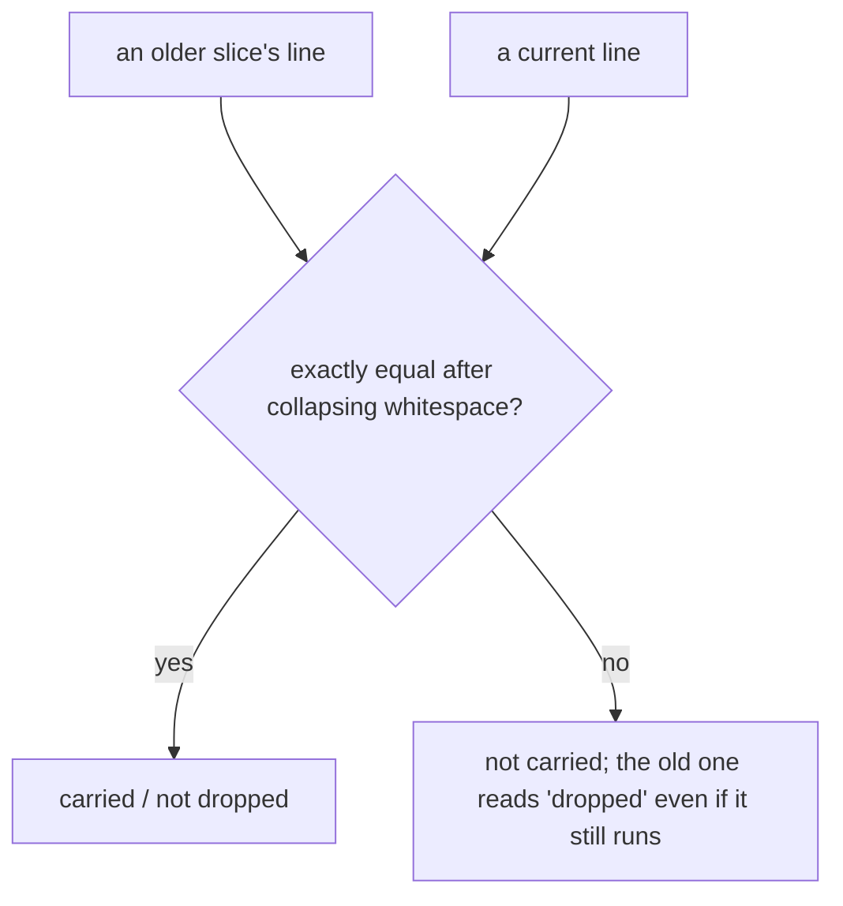
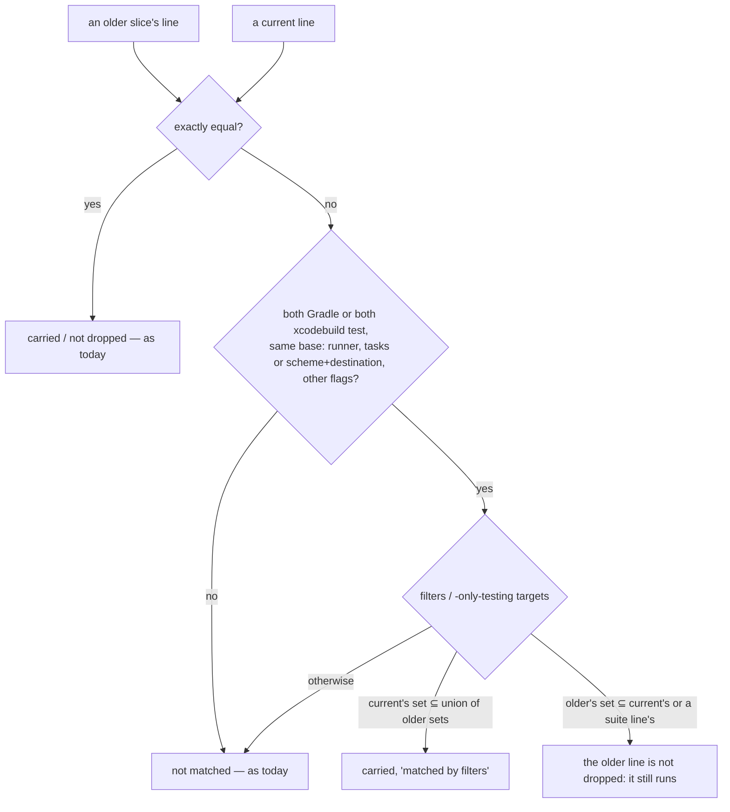

# Stage 05b — t80-carry-matching — SPEC (v1)

## User story IDs from the PRD

BDD's product is the cascade itself; the stories this slice serves:

- **S-CM1** — As a product owner, a validator carried from an earlier slice's goal is counted as carried even when it
  was reworded harmlessly: `--tests` filters reordered, `-q` added, or several old lines folded into one.
- **S-CM2** — As a product owner, an old test that still runs inside a bigger line is never reported "dropped", and
  carry-out never adds a line the suite already covers.
- **S-CM3** — As a product owner, when matching was not exact the notice says so, so I can see the rule at work.
- **S-CM4** — As anyone reading the pack, the README explains the codes every screen shows: `05b`, `t80`, `GENERATE`
  / `EXECUTE`, `D#`, `LOOP k/n`, `REGRESS k/n`, `STITCH NEEDED`, `AUTOPILOT HALT` (asked for by the human,
  2026-10-25: "elaborate in readme regarding the stage code").

## The problem, stated as cost

t77's carried count, t78's carry-out and its dropped notice all compare validator lines **exactly**, after collapsing
whitespace (`tests/lib/goal_history.py`, `norm` / `entry`; `tests/lib/carry_out.py`, `gh.norm`). A line that runs the
same tests but is written differently is a new line to them:

- `--tests com.x.A --tests com.x.B` vs `--tests com.x.B --tests com.x.A`; `… -q` vs `…` — not carried, so the cap
  undercounts, and the original is reported "dropped" although it still runs.
- A fold: slice B's line runs A1's and A2's filters in one `./gradlew` — neither A1 nor A2 is matched, both read
  "dropped", and carry-out (b) copies them into the suite although B's line already runs them.

Measured read-only on 2026-10-25 in dream-camera's goal (`docs/cascade/goal.md`, worktree cinematic-natural-blur, 63
lines): **12 of 51 Gradle lines have a `--tests` set that is a strict subset of another line's** — the fold shape — and
the flags beside the filters are `-q` (49 lines) and `-Dbloom.goldens.enforce=false` (49). No two lines differ only by
filter order today; nothing stops it tomorrow.

## Before vs after

Before:

After:

## Benefits and trade-offs

| | Today | After t80 |
|---|---|---|
| Filters reordered, `-q` added | not carried; the original "dropped" | carried, `matched by filters`; not dropped |
| Old lines folded into one current line of old filters only | not carried; each old one "dropped" | carried; none dropped |
| A current line mixing old and new filters | not carried; the old one "dropped" | not carried (it is partly this slice's); the old one not dropped (it still runs) |
| Carry-out of a line the suite already covers by filters | added again | skipped, counted `already there` |
| A genuinely different filter set | not matched | not matched |
| Plain shell lines, law checks, the `# standing` guard | exact | exact (unchanged) |
| The README | no explanation of stage and slice codes | a "Reading the codes" section |
| Not chosen: carrying a mixed line out | — | it would move this slice's new tests out of its own loop |
| Not chosen: rewriting a mixed line to drop the old filters | — | the pack never rewrites a validator (t69, t79) |
| Not chosen: fuzzy text matching | — | a near-match on characters can pair two different tests; structure is what Gradle and Xcode run |

## What the slice adds — and the line it must not cross

The line: **matching only ever recognises that two lines run the same tests; it never changes a verdict, never
rewrites a line, and anything it cannot parse keeps today's exact rule.**

### 1. `tests/lib/line_match.py` (one definition)

- **Gradle shape** — first word `./gradlew`, `gradlew` or `gradle`: **base** = (runner, the set of task selectors, the
  set of other flags with their values, minus output-only flags `-q --quiet -i --info -w --warn -d --debug -s
  --stacktrace -S --full-stacktrace --console=* --warning-mode=*`); **filters** = the set of `--tests` values.
- **Xcode shape** — first word `xcodebuild` with `test`/`test-without-building`: **base** = (scheme, destination(s),
  project/workspace, the other flags minus `-quiet`); **filters** = the set of `-only-testing:` targets.
- Anything else (or a line `shlex` cannot read): no shape — exact matching only.
- `same(a, b)`: same base and same filters. `covers(big, small)`: same base, `small`'s filters non-empty and a subset
  of `big`'s.

### 2. Carried (`goal_history.py`; t77's cap and notice, t78's carry-out)

A current line is carried when it is exactly in an earlier slice's goal (today), **or** it has a shape, non-empty
filters, and every one of its filters belongs to earlier-slice lines with the same base (reorders, `-q`, folds of old
lines). Its origin is the oldest slice among those lines. The notice gains `, <m> matched by filters` when m > 0.
Standing lines, law checks (exact, as I13 requires) and the late-`# standing` guard keep their rules.

### 3. Dropped and already-there (`goal_history.py`, `carry_out.py`)

A previous-slice line is **not dropped** when a current goal line, or a `regress.md` line (working copy or any
committed version), `covers` it or is `same` as it. Carry-out skips a line the suite `covers` or holds `same`, counted
as `already there`.

### 4. README — "Reading the codes"

A short section near the top of `README.md`: the stage table (00–11, what `05b` is and why it has a "b"), what a slice
id is (`t80-carry-matching` = slice 80, proven by enforcement check T80 and `tests/ac/t80_*.sh`), `GENERATE` /
`EXECUTE`, `D#`, `LOOP k/n`, `REGRESS k/n`, `STITCH NEEDED`, `AUTOPILOT HALT`, with one worked line ("GENERATE 05b
t80-carry-matching means …"). Each term links to where it is defined.

### 5. Release

CHANGELOG: t80 under the unreleased 3.0.0. USAGE §B16/§B17 name the matching rule. CONTROL-LINE + enforcement T80.

## What the slice must not touch

- Any verdict: `LOOP k/n`, `REGRESS k/n`, the merge gate, laws. Only counts and the notice change.
- Any validator or REGRESS line (read, never rewritten).
- The exact rule for law checks and shell lines.

## Acceptance criteria

`tests/ac/t80_carry_matching.sh` in scratch git repos (no runner executes; lines are `echo`-prefixed Gradle/Xcode shapes
behind a `gradlew` stub that marks a counter and exits 0):

- **AC1 — reorder and output flags.** A's goal `./gradlew :m:test --tests a.X --tests a.Y`; B's goal `./gradlew :m:test
  --tests a.Y --tests a.X -q`: `goal: 1 of 1 … (A), 0 standing, 1 matched by filters`; carry-out moves it; A's line is
  not dropped.
- **AC2 — a fold.** A1 `--tests a.X`, A2 `--tests a.Y` (same base); B's single line `--tests a.X --tests a.Y`: carried
  (1, matched by filters), neither A1 nor A2 dropped.
- **AC3 — mixed.** B's line `--tests a.X --tests b.NEW`: not carried (`0 of 1`); A's `a.X` line not dropped.
- **AC4 — different.** B's `--tests a.Z`: not carried, A's line dropped (as today). Different base (another task or
  `-Dfoo=1` vs `-Dfoo=2`): not matched.
- **AC5 — Xcode.** `-only-testing:T/A -only-testing:T/B` vs the same targets reordered with `-quiet`: carried.
- **AC6 — the suite covers.** `regress.md` holds the folded line; carry-out of A1 alone: `already there`; A1 not dropped.
- **AC7 — unchanged rules.** A shell line, a law check, a late-`# standing` line: exactly t77/t78's results; a goal with
  only exact matches prints byte-identical to `237240a` (parity).
- **AC8 — README.** `README.md` has "Reading the codes" naming `05b`, a slice id, `GENERATE`, `EXECUTE`, `D#`,
  `LOOP k/n`, `REGRESS k/n`, `STITCH NEEDED` and `AUTOPILOT HALT`.
- **Red twins:** an exact-only `same`/`covers` (each returns False) leaves AC1 and AC2 not carried and A1 dropped.
- **E1 — dream-camera, read only.** How many of its 63 lines `line_match.py` pairs by filters, against the exact rule.

Gate: `bash tests/ac/t80_carry_matching.sh`, `bash tests/enforcement.sh` (T80), lint.

## Laws

`bash tests/dsharp_strength.sh` prints `DSHARP 0/0`: NO LAW IN FORCE. The slice changes counts and a notice; law checks
keep the exact rule I13 needs.

# Stage 05b — PLAN

## Goal

EXECUTE adds `line_match.py`, uses it for carried / dropped / already-there, adds the README's "Reading the codes", and
tests it (T80).

## In scope this execute

- [ ] `tests/lib/line_match.py` (new).
- [ ] `tests/lib/goal_history.py` — carried by filters, `matched by filters` count, dropped uses `covers`.
- [ ] `tests/lib/carry_out.py` — already-there uses `same`/`covers`.
- [ ] `tests/loop.sh`, `tests/goal.sh` — print `, <m> matched by filters` in the notice and `show`.
- [ ] `README.md` — "Reading the codes".
- [ ] `tests/ac/t80_carry_matching.sh` (AC1–AC8, red twins); `tests/enforcement.sh` T80; `CONTROL-LINE.md` T80.
- [ ] `USAGE.md` §B16/§B17, `CHANGELOG.md`; t69 AC9's path list (`line_match.py`).
- [ ] `docs/cascade/goal.md`: `bash tests/goal.sh reset`, then this hop's validators.

## Out of scope this execute

- The autopilot edge check leaking `CASCADE_ENVELOPE` into the enforcement suite (briefed as t81).
- t62's AC5b `sed -i` on macOS; the seven older tracked `.cascade/*.out` files (named for the human).
- Matching other runners (pytest, jest): exact, as today.

## Definition of done

- `bash tests/ac/t80_carry_matching.sh` exits 0 and the red twins go red; `bash tests/enforcement.sh` exits 0 with T80;
  lint green; AC7 parity holds.

## Risks / UNKNOWNs that still block

- **U1 — over-matching.** Two lines with the same base and filters but an environment prefix (`FOO=1 ./gradlew …`) are
  not Gradle-shaped (first word is not the runner) and stay exact; a `-D`/`-P` difference keeps bases apart. Matching
  can still pair lines whose filters overlap by name while the build differs in a way the flags do not show.
- **U2 — a mixed line keeps the old tests in the hop loop.** By design (Ask 1); the cap does not count it.

## Ask of you

1. **A line mixing old and new filters is this slice's** (not carried), and the old lines it absorbs are not dropped.
   *Default taken.*
2. **Output-only flags are ignored when matching** (`-q`, `--info`, `--stacktrace`, `--console`, `-quiet`). *Default
   taken.*
3. **t80 joins the unreleased 3.0.0.** *Default taken.*

## Invariants this hop

- PRESERVE run: no
- /goal set to: n/a — GENERATE; EXECUTE's goal is AC1–AC8 + T80 + lint
- /model /effort: as set by the session
- /plan: skipped — this document is the plan
- INVARIANTS I1–I18: held; no verdict changes
- Skills: none invoked; brainstorming skipped (brief committed, `c4035c9`; the README item from the human, 2026-10-25)
- critique: pending
- reads: AGENTS.md, hop-state.md, envelope.md, 05b-briefs.md (t80), goal_history.py, carry_out.py, loop.sh, goal.sh,
  README.md, product-e2e-cascade.md; dream-camera's goal (read only)
