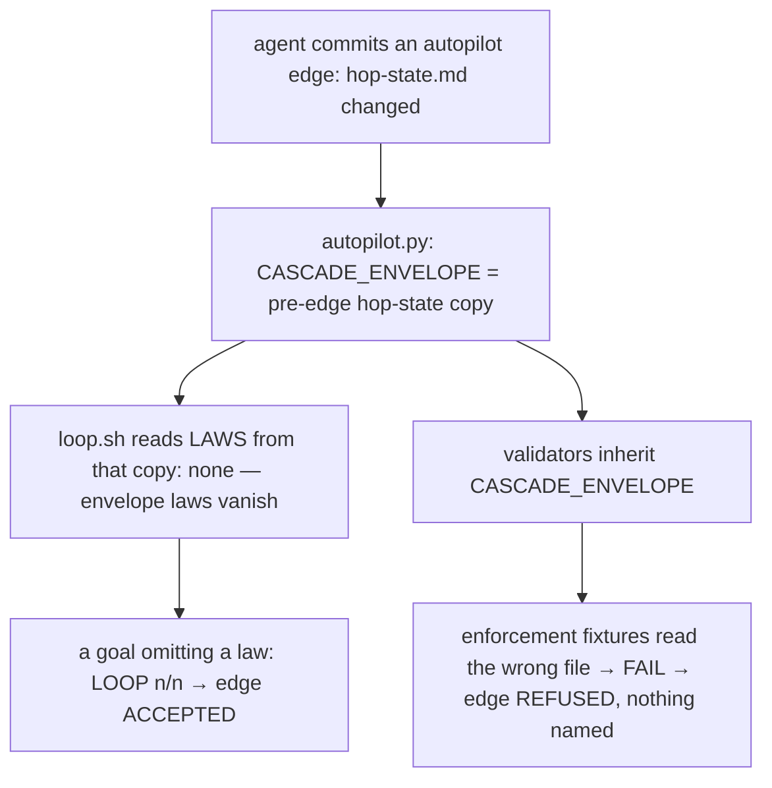

# Stage 05b — t81-autopilot-edge-envelope — SPEC (v2, after the critic)

## User story IDs from the PRD

BDD's product is the cascade itself; the stories this slice serves:

- **S-AE1** — As a product owner who signed an autopilot list, an EXECUTE→next edge is accepted only when the loop on
  this tree is n/n **with every in-force law required**, exactly as a loop I run myself would say.
- **S-AE2** — As a product owner, an edge the loop refuses names the validator (or the omitted law) that failed, not
  a bare "not n/n".
- **S-AE3** — As a maintainer on macOS, t62's acceptance script passes here as it does in CI.

## The problem, stated as cost

Autopilot evaluates an edge against the pre-edge state by running `tests/loop.sh` with `CASCADE_ENVELOPE` set to a
temporary copy of the file the edge changed (`tests/lib/autopilot.py:111-116`). Since hop state moved out of the
envelope into `docs/cascade/hop-state.md`, that file is the **hop state**, not the envelope — and
`CASCADE_ENVELOPE` means "the envelope" to every reader (`tests/lib/cascade.sh:8`, `:15`, `:52`;
`tests/dsharp_strength.sh:49`). Two failures follow, both measured on 2026-10-25:

1. **Fail-open (E0b).** The loop reads the laws from the hop-state copy, which holds none; only shard laws survive. A
   goal that omits every law in `envelope.md` passes. Fixture: one in-force law `D1` in the envelope, a goal without
   its check. `bash tests/loop.sh` → `FAIL in-force D# omitted from /goal: D1`, `LOOP 1/2`. The same with
   `CASCADE_ENVELOPE=<pre-edge hop-state.md>` → `LOOP 1/1`, so the edge is **accepted**. dream-camera keeps its 25 laws
   in `envelope.md` and its hop state in `hop-state.md`: its autopilot edges were checked without its laws.
2. **False refusal (E0a, measured during this hop: 23+ enforcement FAILs — T5, T8, T12, T13, T14, T18, T19, … —
   under the leaked variable, none without it).** Every validator inherits `CASCADE_ENVELOPE`. The enforcement
   suite — a `# standing` line in every goal since t77 — runs its fixtures' own `loop.sh` / `dsharp_strength.sh`, which
   then read the temporary file instead of the fixture's envelope. The edge EXECUTE t79 → GENERATE t80 was refused
   ("tests/loop.sh is not n/n") while the same tree was `LOOP 3/3` outside the hook (`ce7c4fe`).

Two smaller costs: the refusal names nothing (`autopilot.py:122`), and the check's 30-minute timeout (`autopilot.py:116`)
sits close to this repo's ~25-minute loop — the t78 → t79 edge timed out once. And t62's AC5b uses `sed -i 's/…/'`
without a backup suffix (`tests/ac/t62_loop_runners.sh:315`), which BSD sed rejects, so it fails on macOS.

A third failure appears once the laws are read again (C4): t66's selector (`tests/lib/affected.py:62-77`) finds the
commit that opened the hop by comparing hop fields with the **working-tree** `hop-state.md` — post-edge on an edge — so
it falls back to the full law set, and a product with narrowed laws would be refused where its own loop passes.

## Before vs after

Before:



After:

```mermaid
flowchart TD
  E[agent commits an autopilot edge] --> W{autopilot.py: does docs/cascade/hop-state.md exist?}
  W -->|yes: split repo| H[CASCADE_HOPSTATE = pre-edge copy; laws from the repo's envelope + shards]
  W -->|no: pre-split, hop state in the envelope| EN[CASCADE_ENVELOPE = pre-edge copy, as today]
  H --> G{which edge?}
  EN --> G
  G -->|GENERATE→EXECUTE| GG[critique.sh / diverge.sh read the pre-edge hop]
  G -->|EXECUTE→next| L[loop.sh: hop, slice and t66's selector read the pre-edge hop; every law required]
  L --> V[validators run with CASCADE_ENVELOPE and CASCADE_HOPSTATE unset: the tree's own files]
  V --> R{LOOP n/n within the limit (60 min, BDD_AUTOPILOT_LOOP_MINUTES)?}
  R -->|yes| OK[edge accepted]
  R -->|no| NO[edge refused, naming up to 5 FAIL / LOOP REFUSED lines]
  R -->|timeout| TO[edge refused, the whole process group killed]
```

## Benefits and trade-offs

| | Today | After t81 |
|---|---|---|
| A goal omitting an envelope law, on an autopilot edge (split repos) | accepted | refused, naming the law |
| Validators on an autopilot edge | inherit the temp file; the enforcement suite fails | run against the tree, as in any loop |
| A refused edge | "tests/loop.sh is not n/n" | the FAIL lines, at most 5, plus the log path |
| The check's time limit | 30 minutes, fixed | 60 minutes by default; `BDD_AUTOPILOT_LOOP_MINUTES` raises or lowers it; a timeout says so and names the limit |
| Pre-split repos (hop state inside the envelope) | `CASCADE_ENVELOPE`, works | unchanged |
| t66's selector on an autopilot edge | full set (it reads the post-edge hop) | the same narrow set as the human's loop (C4) |
| A timed-out check | `bash loop.sh` killed, its validators keep running | the whole process group killed (C7) |
| t62 AC5b on macOS | fails (BSD sed) | passes (portable edit) |
| Not chosen: accepting the loop's receipt instead of re-running | — | the receipt lives in `.cascade/`, which the agent can write; Layer 1 must not trust it (Ask 2) |
| Not chosen: making every validator unset the variables itself | — | one place (the loop's subshell) cannot be forgotten by the next test |

## What the slice adds — and the line it must not cross

The line: **an autopilot edge is accepted only on the verdict a human's own `bash tests/loop.sh` would print on this
tree just before the edge; no check gets looser; a pre-split repo behaves as today. Edges the fail-open accepted are
refused from now on — a stricter verdict, on purpose (C1).**

### 1. Autopilot passes hop state as hop state (`tests/lib/autopilot.py`, `.githooks/pre-commit`)

No new argument (C5): `autopilot.py` already imports `hopstate_path(root)`. When `docs/cascade/hop-state.md`
exists, its gates run with `CASCADE_HOPSTATE=<before>` and **without** `CASCADE_ENVELOPE`, so `cascade_hopstate` reads
the pre-edge hop and every law reader reads the repo's envelope and shards (`cascade.sh:13-16` already honours
`CASCADE_HOPSTATE`). Otherwise (a pre-split repo, hop state in the envelope): `CASCADE_ENVELOPE`, as today. This holds
for both edges: EXECUTE→next (`loop.sh`) and GENERATE→EXECUTE (`critique.sh`, `diverge.sh`, `autopilot.py:95`) — there,
without the variable, `critique.sh` would read the post-edge EXECUTE hop and print `CRITIQUE n/a`, passing vacuously
(C8; AC6 tests it).

**t66's selector reads the pre-edge hop too (C4):** `tests/lib/affected.py` takes the hop fields from
`CASCADE_HOPSTATE` when it is set, instead of the working-tree `hop-state.md`, so the edge sees the same affected set
as the human's loop.

### 2. Validators run on the tree (`tests/loop.sh`)

Every validator, whether it runs alone or through t62's runner, runs with `CASCADE_ENVELOPE` and `CASCADE_HOPSTATE`
unset. The loop's own reads (hop, stage, slice, laws, t66's selector, goal slice, cap) still use them.
(`tests/regress.sh` is not changed: nothing sets these variables around it, C9.)

### 3. A refusal names what failed (`autopilot.py`)

On a non-zero loop, the error is `tests/loop.sh is not n/n — ` followed by up to 5 lines from its stdout **and
stderr**: `FAIL …` (a validator or `in-force D# omitted`) and `LOOP REFUSED …` with its `BOTTLENECK` (an UNPROVEN law,
a duplicate id, the carry cap, a goal for another slice — C6), then the log directory. The hook already prints the last
line of `cascade-autopilot.err`; it prints the whole message.

### 4. The time limit (`autopilot.py`)

The limit is 60 minutes by default, set by `BDD_AUTOPILOT_LOOP_MINUTES` (a positive integer; anything else is the
default). The loop runs in its own process group (`start_new_session`); on timeout the **whole group** is killed, so no
validator outlives the check and holds the loop lock or `.cascade/loop` (C7). The refusal reads `tests/loop.sh did not
finish in <n> minutes (BDD_AUTOPILOT_LOOP_MINUTES)`.

### 5. t62's AC5b on macOS (`tests/ac/t62_loop_runners.sh`)

`sed -i 's/^version .*/version 99.0.0/'` becomes a portable rewrite (`sed -i.bak … && rm -f ….bak`, the idiom the rest of
the ACs use). The test's meaning is unchanged. CI runs Linux, where both spellings work, so this is checked on macOS by
hand (AC7), not guarded by CI (C10).

## What the slice must not touch

- Any loop verdict, the receipt, the Stop hook, laws, the merge gate.
- Pre-split repos' behaviour.
- Which edges autopilot allows (the list rules in `autopilot.py`'s header).

## Acceptance criteria

`tests/ac/t81_autopilot_edge_envelope.sh`, scratch git repos with hooks wired:

- **AC1 — fail-open closed.** Split repo, an in-force law `D1` in `envelope.md`, a signed list, EXECUTE of entry 1, a goal
  without D1's check: committing the edge to GENERATE entry 2 is BLOCKED, naming `D1`. With D1's check added: the
  edge lands. **Red twin:** an `autopilot.py` that sets `CASCADE_ENVELOPE` to the hop-state copy lets the first edge
  land.
- **AC2 — validators see the tree (C3).** The goal holds a validator that runs a nested fixture's own
  `tests/loop.sh` — **not** `--list` — whose hop state names a different slice (`CURRENT_SLICE: inner`, goal for
  `inner`) and whose envelope holds a law its goal includes: it passes only if the nested loop reads its own hop state
  and envelope. The edge lands. **Red twins:** a loop that does not unset `CASCADE_HOPSTATE` for validators refuses
  the edge (the nested loop reads the outer slice and refuses "goal for another slice"); one that does not unset
  `CASCADE_ENVELOPE` likewise (on a pre-split outer repo).
- **AC2b — the selector (C4).** A split repo whose law has `path: lib/a.txt`, a hop diff that touches only `lib/b.txt`,
  a goal without the law: the human's `bash tests/loop.sh` prints `not affected D1` and passes; the autopilot edge
  lands too. **Red twin:** an `affected.py` that ignores `CASCADE_HOPSTATE` refuses the edge (full set).
- **AC3 — refusals name the failure (C2, C6).** A goal with a failing validator `false`: BLOCKED, the message contains
  `FAIL  false`. A goal for another slice: BLOCKED, the message contains `LOOP REFUSED` and `goal.md is for slice`.
- **AC4 — the limit (C7).** `BDD_AUTOPILOT_LOOP_MINUTES=1` with a validator that runs `sleep 90` and writes a marker
  when it ends: refused with `did not finish in 1 minutes`; 5 s later no `sleep 90` from the fixture is alive and the
  marker never appears. A garbage value is treated as 60 (asserted on the computed limit, not by waiting).
- **AC5 — pre-split repos.** Hop state inside `envelope.md`: the same edge, laws read from it, behaves as today (lands
  when n/n, blocked when not).
- **AC6 — GENERATE→EXECUTE gates (C8).** A split repo on GENERATE of a signed entry with a spec doc but a **red**
  critique: the edge to EXECUTE is BLOCKED naming the critique. **Red twin:** an `autopilot.py` that passes no
  variable to the gates lets it land (`critique.sh` reads the post-edge EXECUTE hop: `CRITIQUE n/a`).
- **AC7 — macOS (local evidence, C10).** `bash tests/ac/t62_loop_runners.sh` passes on this machine; the EXECUTE
  report states it.
- **E0a — the enforcement suite under the old leak** (measured during GENERATE, reported).

Gate: `bash tests/ac/t81_autopilot_edge_envelope.sh`, `bash tests/enforcement.sh` (T81), lint.

## Laws

`bash tests/dsharp_strength.sh` prints `DSHARP 0/0`: NO LAW IN FORCE in this repo. The slice makes autopilot require
laws it silently dropped in products; it changes no law.

# Stage 05b — PLAN

## Goal

EXECUTE passes the pre-edge hop state as hop state, runs validators against the tree, names what failed, sets a usable
time limit, and fixes t62's AC5b on macOS (T81).

## In scope this execute

- [ ] `tests/lib/autopilot.py` — `CASCADE_HOPSTATE` for hop-state edges; the FAIL lines; the time limit.
- [ ] `.githooks/pre-commit` — pass which guarded file changed; print the whole autopilot message.
- [ ] `tests/loop.sh` — validators run with both variables unset.
- [ ] `tests/lib/affected.py` — hop fields from `CASCADE_HOPSTATE` when set.
- [ ] `tests/ac/t62_loop_runners.sh` — the portable `sed`.
- [ ] `tests/ac/t81_autopilot_edge_envelope.sh` (AC1–AC7 with AC2b, five red twins); `tests/enforcement.sh` T81;
      `CONTROL-LINE.md` T81.
- [ ] `docs/cascade/05b-briefs.md` — a correction under the t81 brief (the cause; the stricter verdict) (C1).
- [ ] `USAGE.md` (autopilot section), `CHANGELOG.md` (3.0.1: a fix release).
- [ ] `docs/cascade/goal.md`: `bash tests/goal.sh reset` (t80's AC moves to the suite), then this hop's validators.

## Out of scope this execute

- Trusting the loop receipt for autopilot edges (Ask 2).
- The seven tracked `.cascade/*.out` files (the human's call).

## Definition of done

- `bash tests/ac/t81_autopilot_edge_envelope.sh` exits 0 and the red twins go red — its fixtures take real autopilot
  edges through the real pre-commit hook, accepted when n/n and refused, naming the failure, when not (C2);
  `bash tests/enforcement.sh` exits 0 with T81; lint green.
- A live edge on this repo needs a list naming t81 and a next entry; the signed list (t78–t80) is complete, so that
  observation is the human's option (Ask 4), not part of done (C2).

## Risks / UNKNOWNs that still block

- **U1 — products that relied on the fail-open.** A product whose goals omitted envelope laws had autopilot edges
  accepted; after t81 they are refused until the laws are in the goal. That is the point, and the CHANGELOG says so.
- **U2 — the 60-minute default** still caps a very slow loop; the variable raises it, and the message names it.

## Ask of you

1. **Release as 3.0.1** (a fix release, after 3.0.0). *Default taken.*
2. **Keep re-running the loop on autopilot edges** rather than trusting `.cascade/loop-receipt` (agent-writable).
   *Default taken.*
3. **60-minute default limit**, `BDD_AUTOPILOT_LOOP_MINUTES` to change it. *Default taken.*
4. **Optional live check:** sign `AUTOPILOT: 05b t81-autopilot-edge-envelope, 05b <next slice>` if you want the next
   EXECUTE→GENERATE edge on this repo taken by autopilot as a live test. *Not required for done.*

## Invariants this hop

- PRESERVE run: no
- /goal set to: n/a — GENERATE; EXECUTE's goal is AC1–AC7 + T81 + lint
- /model /effort: as set by the session
- /plan: skipped — this document is the plan
- INVARIANTS I1–I18: held; the autopilot gate gets stricter (I13 restored on its edges), no verdict loosens
- Skills: none invoked; brainstorming skipped (brief committed, `e6f04e8`)
- critique: C1–C10 answered in `05b-t81-autopilot-edge-envelope-critique.md` (spec v2); no human rows
- reads: AGENTS.md, hop-state.md, envelope.md, 05b-briefs.md (t81), autopilot.py, cascade.sh, laws.py, loop.sh,
  dsharp_strength.sh, affected.py, critique.sh, pre-commit, t62_loop_runners.sh; E0a/E0b (scratchpad)
