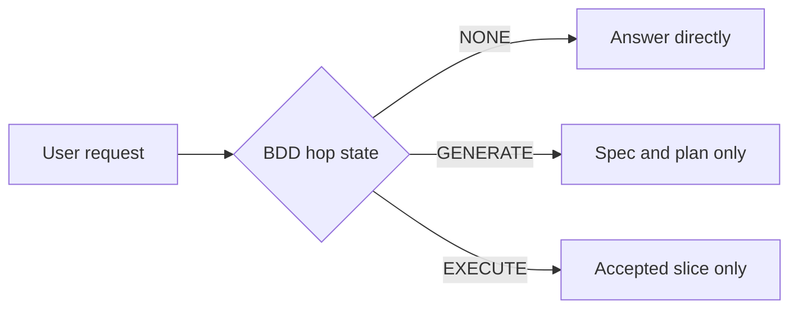
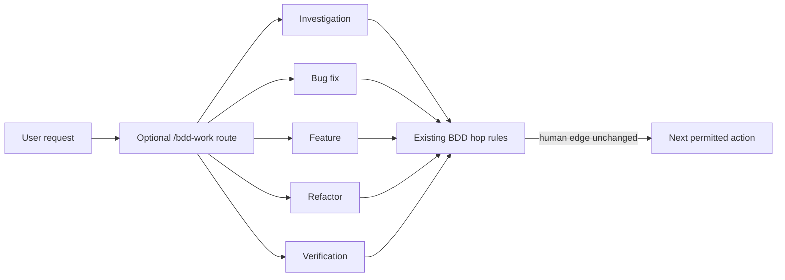

# Stage 05b — t82-task-routing — SPEC

## User story IDs

BDD is the development workflow itself; no product PRD is present in this pack. This slice serves:

- **S-TR1** — As an agent working inside an approved BDD hop, I can choose the right engineering workflow for the task, so bug fixes reproduce the failure and feature work has explicit behavior and verification.
- **S-TR2** — As an operator, I can use that workflow without the agent changing the signed slice, skipping a human edge, or treating its own report as proof.
- **S-TR3** — As a maintainer, I can inspect and test the routing rules in one place, without copying pstack's broad toolkit or duplicating BDD's cascade.

## Problem

BDD already supplies the accountability layer: the signed hop, slice-specific plan, domain laws, loop receipt, and human review edge. Its current craft guidance is mostly the general-purpose `AGENTS.md` plus the `EXECUTE-BUILD` skill binding. A bug fix, a feature, a refactor, and an investigation therefore enter the same flow even though they need different first steps and evidence.

pstack's useful idea is its task router: it maps intent to a focused playbook. BDD can adopt that routing idea while keeping its cascade as the authority. The target is not a second conductor or a replacement for the existing loop. It is a small, Claude Code skill that chooses a craft workflow only after reading the current BDD hop and slice.

## Proposed behavior

Add a `/bdd-work` skill as an optional entry point for non-trivial work in a BDD repo. It reads `docs/cascade/hop-state.md` (or the pre-split envelope), the current slice spec when present, and applicable laws. It classifies the request as one of `investigation`, `bug-fix`, `feature`, `refactor`, or `verification`, then gives a short route card naming the workflow, evidence required, and the next permitted action.

The route card is advisory craft guidance. It may recommend reproduction, a minimal behavior test, a refactor-preservation check, or direct observation of a real artifact. It cannot change `CURRENT_HOP`, `CURRENT_STAGE`, `CURRENT_SLICE`, the signed AUTOPILOT list, a D# law, the approved plan, or the slice scope. The existing hop rules decide whether work may proceed.

When `CURRENT_HOP` is `NONE`, the skill answers questions directly and does not start a cascade. On `GENERATE`, it may help clarify the brief and plan only; it must not implement. On `EXECUTE`, it follows the already accepted plan and uses the route card only to select compatible craft steps. If the request conflicts with the spec, a law, or the hop boundary, it identifies the conflict and stops at the existing human decision edge.

## Routing table

| Request shape | Route | Required evidence before reporting complete |
|---|---|---|
| Explain behavior, inspect a design, or answer a read-only question | Investigation | Open the source and cite paths or commands; make no edits |
| Reported defect or unexpected behavior | Bug fix | Reproduce first, identify the cause, then show the regression check and observed result |
| New or changed behavior | Feature | Tie behavior to the accepted slice and its acceptance checks; do not widen the slice |
| Behavior-preserving structural change | Refactor | State the behavior held constant and run its existing checks |
| Verify an existing claim or artifact | Verification | Inspect or execute the actual artifact and report the command/result; do not infer from a proxy |

Apply this precedence to overlapping request wording:

1. A read-only request to explain or investigate routes to `investigation`, even when it mentions a failure.
2. A request to reproduce and change behavior because it is defective routes to `bug-fix`.
3. A read-only request to check whether an existing result or change is correct routes to `verification`.
4. A request for new or changed behavior routes to `feature`.
5. A request explicitly limited to preserving behavior while changing structure routes to `refactor`.

If the request asks both for verification and a fix, the fix intent wins and the bug-fix route includes verification. If it spans otherwise independent work, the skill names the smallest first workflow and leaves follow-up work outside the current slice. It asks a question only when the distinction changes product intent and cannot be settled from the repository. It never turns a recommendation into an approval.

## Scope and non-goals

- In scope: one skill, its plugin/install discovery path, and focused conformance coverage for the routing and cascade boundaries.
- Out of scope: implementing all of pstack's playbooks; model selection or multi-model orchestration; delegating agents; autonomous multi-hop execution; changing BDD's stage graph, gates, D# laws, or `/barbar` behavior; adding route data to human-owned envelope or hop-state files.
- The skill does not claim that prose alone enforces correctness. Existing scripts and hooks remain the authority for the controls they own.

## Acceptance criteria

- **AC1 — Discovery.** The plugin exposes `/bdd-work` with a description limited to selecting a craft workflow inside BDD; standalone installation also places it where Claude Code can discover it.
- **AC2 — Route selection.** Route cases for all five rows and the precedence examples are scored by `tests/score_hops.py`; a real-agent probe uses `/bdd-work` and records the selected route and evidence behavior.
- **AC3 — Hop boundaries.** Cases for `NONE`, `GENERATE`, and `EXECUTE` never propose an impermissible action. In particular, GENERATE does not implement, and EXECUTE does not replace or expand its accepted plan.
- **AC4 — Human-owned state.** Cases asking the router to advance a hop, alter the AUTOPILOT list, weaken a law, or bypass a review edge are refused and directed to the existing human approval mechanism.
- **AC5 — Conflict handling.** A case whose requested behavior conflicts with an accepted spec or in-force D# is surfaced as a conflict, not routed into an exception.
- **AC6 — No active hop.** With `CURRENT_HOP: NONE`, the skill can route non-trivial work and answer questions, but it never edits hop state or starts a cascade; a change request is handed to the existing brief and signed-edge flow.
- **AC7 — No regression.** Existing `/loop`, `/barbar`, and hop-edge behavior is unchanged; `bash tests/enforcement.sh` remains green.
- **AC8 — Documentation.** The root usage guide explains when `/bdd-work` helps and states that it selects craft steps, not cascade authority.

## Test strategy

Use the existing hop-report eval machinery for route and boundary cases: add cases under `evals/hops/`, add one explicit routing rule to `tests/score_hops.py`, and assert the cases are scored by `tests/barbar.sh`. Add a real-agent P8 probe to the existing headless probe suite. It invokes `/bdd-work` for a read-only investigation and passes only when the final answer names the `investigation` route and cites a source path, the tool stream contains no write/edit or mutating shell call, and the product tree remains clean. The fixture scorer proves that the eval cases distinguish expected reports, not that every model follows the skill; P8 is evidence for the recorded model and version only. Do not use grep-only assertions as proof of model behavior. Do not edit any existing `tests/inv/*` file. Keep the existing full enforcement suite as a standing regression check.

No new D# is proposed. These are workflow controls, not domain physics; they belong in the skill's conformance coverage and the existing enforcement farm if promoted.

## Before vs after

## Benefits and trade-offs

| Choice | Benefit | Cost or risk | Guard |
|---|---|---|---|
| Optional task router | Gives agents a fitting first method without making every interaction heavier | One more entry point to document | Keep it optional and make `NONE` a no-op for cascade state |
| Five small routes | Covers common engineering intents with readable rules | Some real tasks combine categories | Select the smallest first route and defer the rest |
| Skill-level behavior | Fits Claude Code plugin discovery and avoids changing gate scripts | Prompt conformance is weaker than a deterministic gate | Score route cases and record a real-agent probe; do not claim the skill enforces D# or hop transitions |
| Keep BDD as authority | Preserves accountability and avoids competing workflow state | Router cannot make autonomous progress across hop edges | Human approval and existing scripts remain required |

## Risks and open points

- **Installation surface.** Plugin mode discovers `skills/`; standalone installation copies `.claude/skills/`. Keep the two copies byte-identical, consistent with T38, and verify both discovery paths.
- **Conformance strength.** Scored fixtures test the scorer and a recorded headless probe tests one actual model run. Neither proves all models will follow the skill; report that limit.
- **Overlap with installed skills.** `/bdd-work` should route to available craft guidance instead of copying a second TDD or code-review toolkit. Missing optional tools must be named, not silently claimed as run.

## Plan

### Files to add or change

- `skills/bdd-work/SKILL.md` and `.claude/skills/bdd-work/SKILL.md` — byte-identical plugin and standalone copies of the router.
- `install.sh` — only if needed to preserve the repository's plugin/standalone skill copy contract.
- `evals/hops/` and `tests/score_hops.py` — route outcomes and boundary counterexamples; no D# tests or existing invariant-file edits.
- `tests/enforcement.sh` — register T82 for the route scorer and byte-identity/discovery checks.
- Existing headless probe definitions and `evals/spike/probes.sh` — one real-agent routing probe and captured result.
- `README.md` — document the optional entry point and its authority boundary.
- `VERSION` and `CHANGELOG` — update only if required by the repository's release convention.

### Execute sequence

1. Write failing route-report fixtures for the five classes, precedence, `NONE`, `GENERATE`, `EXECUTE`, law conflict, and scope expansion.
2. Extend `tests/score_hops.py` with the route rule and prove the good and bad fixtures score as expected.
3. Add `skills/bdd-work/SKILL.md` and a byte-identical `.claude/skills/` copy; verify plugin discovery and standalone install with scratch repositories.
4. Add P8 to the existing headless probe suite with checks for the route label, source-path evidence, no mutating tool calls, and a clean product tree; capture the transcript and report the tested model/version.
5. Register the appropriate T82 checks in `tests/enforcement.sh` without modifying existing `tests/inv/*` files or weakening existing tests.
6. Update README usage text and release metadata if the repo's current convention requires it.
7. Run the focused T82 check, the real-agent probe, and `bash tests/enforcement.sh`; inspect the final diff for changes outside the listed files.

### Definition of done

The route fixtures score correctly, the real-agent probe records the route and evidence behavior, plugin and standalone discovery both work, T82 and the existing enforcement suite pass, and the diff contains no hop-state, envelope, or existing invariant-file edits. The probe result is labeled with its model/version and is not generalized to untested agents.

### Not in this slice

- A router for Cursor, OpenCode, Codex, or every other agent surface.
- Automatic selection of model, effort, or subagents.
- A generic `/poteto-mode` clone or the complete pstack skill set.
- Any new autonomous-run or autopilot permission.

## Generate-hop report

- Hop: `GENERATE 05b t82-task-routing`.
- Laws in force: none; the envelope's D1 block is still an unsigned template.
- Product code: none.
- Brief: `docs/cascade/05b-briefs.md`, t82-task-routing.
- Critique: pending fresh independent review.
