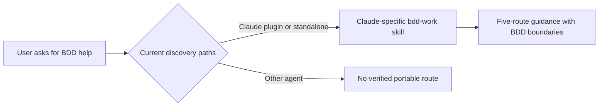
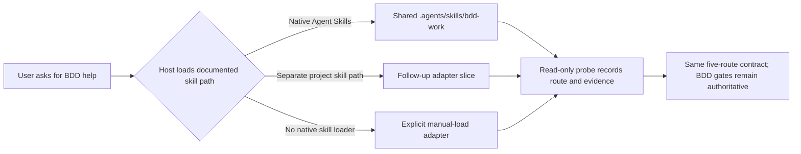

# Stage 05b — Work-routing portability — SPEC

Status: GENERATE proposal for `t83-work-routing-portability`; not an implementation or a cross-agent runtime test.

## Authority and scope

The accepted `05b-t82-task-routing` slice introduced the optional `/bdd-work` router for Claude Code and explicitly left Codex and other agents out of scope. The accepted `06-codex-compatibility` work packages the existing skills for Codex, but its route behavior was not probed in Codex. This proposal adds a separate portability slice; it does not revise either accepted artifact or claim every agent behaves alike.

The current hop is `GENERATE`, stage `05b`, slice `t83-work-routing-portability`. NO LAW IN FORCE: the envelope's D1 is an unsigned template. No new D# is proposed.

Goal: make the same five-route work guidance discoverable through the open Agent Skills layout on clients that document that format, then define separate adapters for clients that use another path or have no native skill loader. Preserve one canonical route contract, keep BDD's cascade as authority, and report tested clients and versions individually.

## Before vs after

## Benefits and trade-offs

| Change | Benefit | Trade-off |
|---|---|---|
| One shared Agent Skills copy for documented native-skill clients | The same BDD route guidance can be discovered across several agent hosts. | Discovery and invocation still need a real probe for each client and version. |
| Separate adapters for different skill paths or manual loading | Compatibility claims stay specific to each host's actual mechanism. | More slices and maintenance are needed as hosts change their formats. |
| Keep the skill advisory and preserve existing gates | Host portability cannot silently grant approval or change cascade authority. | Natural-language activation and adherence cannot be guaranteed by repository files. |

## Observed platform facts

- The skill currently exists as `skills/bdd-work/SKILL.md` and `.claude/skills/bdd-work/SKILL.md`; the repository acceptance check requires those copies to match.
- The current skill's title and README entry point use Claude-style `/bdd-work` wording. Native skill discovery and invocation differ by host.
- Official docs describe Agent Skills discovery from `.agents/skills/` in Codex/VScode's Codex integration, Cursor, Gemini CLI, OpenCode, and Zed. VS Code/Copilot documents `.github/skills/` as its project skill location. These are discovery facts, not proof that the BDD skill is loaded or followed in any installed client.
- Aider's documented approach is to load a conventions file using `/read` or `--read`; its docs do not establish native Agent Skills discovery. It therefore needs an explicit/manual adapter if included.
- This specification sets a compatibility target, not a general promise: initial native-skill targets are Codex CLI, Cursor, Gemini CLI, OpenCode, and Zed; VS Code/GitHub Copilot and Aider are proposed follow-up slices. Other products, including Windsurf and Continue, remain unsupported until an official discovery/invocation path and a real probe are documented.

Sources: [Codex repository skills](https://developers.openai.com/blog/skills-agents-sdk), [VS Code Agent Skills](https://code.visualstudio.com/docs/agent-customization/agent-skills), [Cursor Agent Skills](https://cursor.com/docs/skills), [Gemini CLI skill discovery](https://geminicli.com/docs/cli/tutorials/skills-getting-started/), [OpenCode skills](https://docs.opencode.ai/docs/skills/), [Zed skills](https://zed.dev/docs/ai/skills), and [Aider conventions](https://aider.chat/docs/usage/conventions.html).

## Proposed behavior

1. Keep one host-neutral routing contract: the five routes, precedence, evidence required, and `NONE`/`GENERATE`/`EXECUTE` limits remain the same for every host.
2. Publish a canonical Agent Skills copy at `.agents/skills/bdd-work/SKILL.md`. Keep the plugin and Claude standalone copies byte-identical to that canonical content, or generate all copies from one source with a checked parity rule. Do not rely on symlinks where a client loader may not follow them.
3. Describe the action as invoking or loading `bdd-work`; show `/bdd-work` only as a host-specific example where that client provides slash skill invocation. A skill may auto-activate based on its description or be explicitly loaded according to that client's UI/CLI.
4. The initial compatibility claim is limited to skill discovery and one synthetic, read-only route probe per tested native-skill client. Each probe records client and version, whether the skill was discoverable/activated, selected route, source evidence, mutation/tool activity, and final tree state.
5. For clients with another documented skill directory, add a separate adapter slice. For clients without native skill discovery, document an explicit manual-load route and label it manual; do not imply automatic routing.
6. The skill remains advisory. It cannot grant tool permission, sign state, override `AGENTS.md`, laws, the accepted spec, or git/CI gates. Skill compatibility must never be described as enforcement compatibility.

## Compatibility slices

These are proposed `stage 05b` slice IDs for the operator to consider adding to AUTOPILOT after their specs and execute edges are accepted. They are not signed by this document.

| Slice | Target and outcome | Compatibility proof | Boundary |
|---|---|---|---|
| `t83-work-routing-portability` | Make the core `bdd-work` skill host-neutral and expose the same copy under `.agents/skills/` while preserving Claude plugin/standalone discovery. Target documented Agent Skills clients: Codex CLI, Cursor, Gemini CLI, OpenCode, and Zed. | Per-client discovery plus synthetic read-only route probe, with exact client/version and clean-tree/tool-stream evidence. If a client is unavailable, record it as unverified and make no support claim for it. | This is the current slice. It does not add each host's enforcement hooks or change cascade rules. |
| `t84-copilot-work-routing` | Add and install the VS Code/GitHub Copilot project skill location at `.github/skills/`; preserve the core skill byte-for-byte. | VS Code Copilot discovery and read-only route probe for the recorded VS Code/Copilot version. | Copilot's documented directory is separate; do not assume `.agents/skills/` alone is enough for every Copilot harness. |
| `t85-aider-work-routing` | Provide a clearly manual Aider path to load the core route instructions using documented `/read` or `--read` behavior. | Aider CLI loads the specified file and returns the route/evidence card on a synthetic prompt; document that it is explicit-load, not automatic skill discovery. | Do not add or overwrite `.aider.conf.yml` by default; do not claim auto-activation. |

Potential later targets (Windsurf, Continue, and any additional agent) are not on this proposed list yet. First verify an official skill/rule discovery mechanism and decide whether it can load the same contract without weakening it; then generate a named slice. A product mention or shared `AGENTS.md` support alone is not proof of router activation.

## Cascade and safety boundaries

- `CURRENT_HOP: NONE`: answer directly; never open a hop or change cascade state.
- `GENERATE`: spec and plan only; no product edits or implementation instructions disguised as completed work.
- `EXECUTE`: follow the accepted plan and only the named slice. A route cannot widen it.
- Never change hop fields, AUTOPILOT, D# laws/validators, accepted specs, or `<EDIT>` content.
- Do not copy I1–I18 into every host adapter. Host instructions must point back to repository `AGENTS.md` as the controlling source.
- A tool stream or clean tree check is evidence only for the recorded probe. It does not prove a skill is a security control or that other models follow it.

## Data inventory and privacy

No new service, account, telemetry, or transcript storage is proposed. Runtime route inputs may include user requests, source paths, code, and local cascade state. The model host processes those inputs under its own retention controls, which vary and are not set by this repository. Tests use synthetic prompts and disposable repositories. Probe artifacts must exclude raw prompts, source code, credentials, usernames, and absolute home paths; retain only the minimal route result, tool-operation classification, tree status, client/version, and command metadata needed to support the claim. Existing decision logs remain governed by their current rules.

## Threat model — STRIDE-lite

| Boundary | Threat | Required control/evidence |
|---|---|---|
| Skill copies → client discovery | Tampering: a stale host copy omits a cascade boundary or diverges from canonical routing | Compare every shipped copy byte-for-byte or verify its deterministic generation; test every declared path. |
| Request → skill activation | Spoofing/elevation: user text, project instructions, or a misleading description makes route guidance appear to approve work | State explicitly that route output is not approval; negative fixtures cover attempts to advance a hop, bypass a signature, or expand an accepted slice. |
| Route card → tool action | Elevation: an investigation/verification route performs writes, or GENERATE/EXECUTE boundary is ignored | Use synthetic read-only probes and inspect complete structured tool activity where the host exposes it; unsupported activity evidence is UNKNOWN, not PASS. Existing git hooks and CI remain the enforcement backstop. |
| Host adapter → user expectations | Repudiation/confusion: a slash command is documented where none exists, or a manual path is described as automatic | Keep invocation syntax host-specific; label manual adapters and untested clients; cite official discovery docs and record exact versions. |
| Probe artifact → repository history | Information disclosure: transcripts include private paths, prompts, or code | Use synthetic fixtures, sanitize before committing, and retain no raw transcript unless a separately reviewed decision authorizes it. |

No new accepted risks are proposed. Residual risk: natural-language skill activation and adherence vary by model/version and cannot be guaranteed by file-format portability. A host without discovery or tool-stream evidence remains unverified, not compatible by inference.

## Acceptance criteria

- **AC1 — One route contract.** The five routes, precedence, evidence requirements, and cascade boundaries are behaviorally identical across the canonical skill and its installed copies.
- **AC2 — Native Agent Skills discovery.** `.agents/skills/bdd-work/SKILL.md` follows the documented format and is discovered in actual probes for each initial target claimed in the execute report; any unavailable client is explicitly unverified.
- **AC3 — Portable invocation wording.** The skill no longer requires a Claude-only slash command. Host-specific invocation examples are accurate, and the user can activate the workflow by the documented mechanism for that host.
- **AC4 — Boundary conformance.** Synthetic route reports cover all five routes, precedence, `NONE`, `GENERATE`, `EXECUTE`, law/spec conflict, human-owned state, and scope expansion; bad reports fail the scorer.
- **AC5 — Read-only probe.** Each claimed client/version completes a synthetic investigation prompt with a source path and no mutating tool operation; unsupported or incomplete tool evidence is not a pass.
- **AC6 — Copilot adapter separation.** The core slice does not claim Copilot project discovery from the wrong path; the follow-up adapter has a distinct ID and acceptance probe.
- **AC7 — Aider honesty.** The follow-up is explicitly-load/manual and does not claim skill auto-discovery or automatic route activation.
- **AC8 — Authority preservation.** No route changes enforcement layers, hop fields, laws, signed plans, or approvals. Existing T82 and enforcement checks remain intact.
- **AC9 — Privacy.** New probe evidence contains no raw prompt/transcript, private code, credential, or absolute user path.
- **AC10 — Existing destination safety.** If the shared skill destination is absent, installation creates it. If it already matches the canonical skill, installation is a no-op. If it exists with different contents, installation fails with a clear message and preserves the existing file.

## Test and review strategy

1. Extend focused route fixtures to assert the shared behavior contract and negative boundary cases; run the actual scorer on positive and negative reports.
2. Add path and parity checks for canonical, Claude, plugin, and future host copies; validate the Agent Skills metadata against its format requirements. Include installer fixtures for an absent destination, an identical destination, and a conflicting existing destination.
3. For each initial client, run the relevant skill-list/discovery command or UI in a disposable repository, then one synthetic investigation prompt. Capture only sanitized metadata.
4. The acceptance script can verify paths and fixtures; it cannot substitute for actual client discovery or route behavior. Report fixture status and live probe status separately.
5. Run the existing `tests/ac/t82_task_routing.sh` and standing enforcement validator; do not edit existing `tests/inv/*` files.

## Out of scope

- Hook parity, permission dialogs, or policy enforcement for every listed agent.
- Claiming every future version of a client or every model is compatible.
- Automatically installing skills into personal home directories or modifying user-level client configuration.
- Automatic model/subagent choice, autonomous multi-hop execution, or changes to AUTOPILOT authority.
- Windsurf, Continue, and clients whose official discovery behavior is not yet established.

## Generate-hop report

- Hop: `GENERATE 05b t83-work-routing-portability`.
- Laws in force: none; the envelope D1 block is an unsigned template.
- Product code: none.
- External research: official product docs support the shared Agent Skills approach for the initial native-skill target set; Aider uses explicit conventions-file loading. Runtime discovery and behavior remain untested for this slice.
- Critique disposition: C1 is a human question because `docs/cascade/05b-briefs.md` has no t83 entry; add/sign a matching brief or direct how the user request should serve as the recorded brief.
- Decision requested: approve, cut, or revise the target list and proposed order before executing t83.

## Critique dispositions

| C# | DISPOSITION |
|---|---|
| C1 | human Should the t83 request be added to `docs/cascade/05b-briefs.md` as a recorded brief before this slice proceeds? |
| C2 | fixed in the plan and acceptance criteria: installation is a no-op for an identical existing destination and fails without overwriting a conflicting file. |
