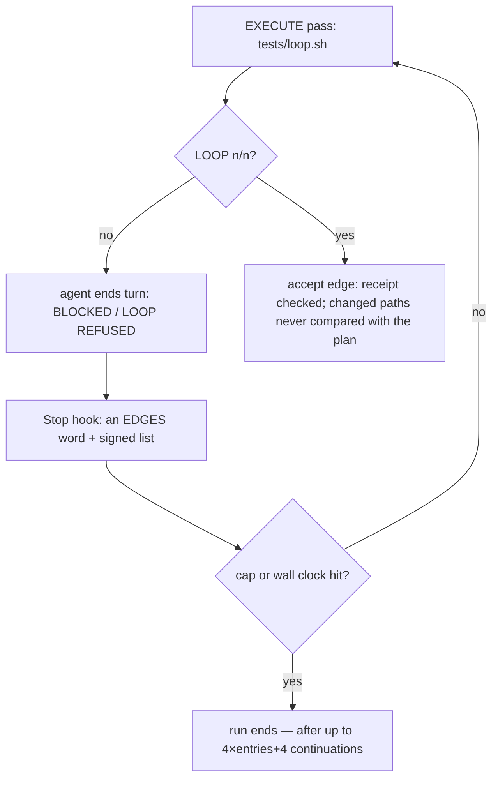
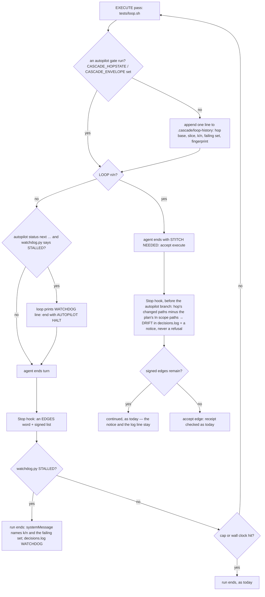

# Stage 05b — t84-progress-watchdog — SPEC (v2, after the critic)

## User story IDs from the PRD

BDD's product is the cascade itself; the stories this slice serves:

- **S-WD1** — As a product owner who signed an autopilot list, a slice that stops making progress ends the run for
  me after a few passes, naming the evidence (the stuck `LOOP k/n`, the failing validators), instead of burning the
  night until the hop cap or the wall-clock budget.
- **S-WD2** — As a product owner, a slice that *is* moving — `k` rising, or different validators failing after real
  edits — is never stopped by the watchdog.
- **S-WD3** — As a reviewer at the accept edge — or reading `decisions.log` the morning after an autopilot run that
  took that edge without me — I am told which changed paths the plan never named, without the hop being refused for
  it (C1).

## The problem, stated as cost

An autopilot run ends today on four things, none of which looks at progress:

| Stop | Where | What it measures |
|---|---|---|
| hop cap `4 × entries + 4` | `.claude/hooks/stop_guard.py:164` | how many stops were continued |
| `BDD_AUTOPILOT_MINUTES` | `stop_guard.py:172-192` | wall clock (unset = no ceiling) |
| `BDD_AUTOPILOT_LOOP_MINUTES` (t81) | `tests/lib/autopilot.py:28` | one edge loop |
| stage-10 `PUNCH_CAP` | `stop_guard.py:318-327` | audit rounds — stage 10 only |

`continue_autopilot` continues any stop whose reply carries one of `EDGES` (`stop_guard.py:30`) — `LOOP REFUSED` and
`BLOCKED` included. An EXECUTE hop whose agent cannot make the last validator pass ends each turn with `BLOCKED …`,
is continued, re-runs `tests/loop.sh` at the same `LOOP k/n` with the same `FAIL` line, and repeats until the cap: a
3-slice list allows 16 continuations. Nothing records the passes — `.cascade/loop/` is reset every pass
(`tests/loop.sh:212-213`) and the receipt is written only on n/n (`:323-335`) — so neither the hook nor the human can
tell "stuck" from "slow" the next morning. The stage-10 punch cap already encodes the same idea ("past that, rounds
stop being progress", `stop_guard.py:324`) for one stage only.

Scope: plans list their files under `## In scope this execute`, and nothing compares that list with what the hop
actually changed. `tests/lib/affected.py` already computes the hop's changed paths (`hop_base`, `changed`,
`affected.py:72-122`) for t66.

## Before vs after

Before:



After:



## Benefits and trade-offs

| | Today | After t84 |
|---|---|---|
| A slice stuck at the same `LOOP k/n` and `FAIL` set | continued until the hop cap or wall clock | stopped after N passes (default 3), naming `k/n` and the failing validators |
| Re-running the loop with no edit between passes | continued | stopped after N passes: "no edit between passes" |
| A slice that is moving (k rises, or the failing set changes after edits) | continued | continued |
| A human-driven hop (no signed list) | — | unchanged: no WATCHDOG line, no stop; passes are still recorded |
| The morning after | no record of passes | `.cascade/loop-history`, one line per pass |
| Files the plan never named | invisible | named in a notice at the accept edge, and in `decisions.log` |
| Cost per pass | — | one fingerprint (`cascade_worktree_sha`, already paid on n/n: 0.08 s on this repo's 543 files, measured) and one appended line |
| Not chosen: a model judging progress or drift | — | a verdict a script cannot reproduce is chat, not evidence |
| Not chosen: denying further `tests/loop.sh` runs once stalled | — | would block the run that verifies a real fix; the Stop hook ending the *run* is enough |
| Not chosen: drift as a refusal | — | plans name files loosely; a refusal would punish an honest plan. Notice and log first; a law can harden it later |
| Autopilot edge loops (`autopilot.py`'s gate runs) | — | not recorded: they re-run an unchanged tree and would fake "no edit" (C3) |
| Known limit | — | the history is local and agent-writable: deleting it can only *avoid* a stop, never cause an accept. Within one long turn the WATCHDOG line instructs the halt; the wall clock still bounds an agent that ignores it |

## What the slice adds — and the line it must not cross

The line: **no loop verdict, exit code, receipt, edge check or law changes; the watchdog can only end an autopilot run
early for a human, and the drift check can only add a notice.** A hop with no signed list behaves as today.

### 1. One history line per pass (`tests/loop.sh`, `install.sh`)

After `LOOP k/n` is printed (and not under `--list`, not on an early `LOOP REFUSED`, and **not when
`CASCADE_HOPSTATE` or `CASCADE_ENVELOPE` is set** — the marks of an autopilot gate run from `autopilot.py` via the
PreToolUse hook or pre-commit, which re-run an unchanged tree and would fake "no edit", C3), the loop appends to
`.cascade/loop-history` one tab-separated line:

```
<epoch>  <hop-base sha or ->  <stage>  <slice>  <k>/<n>  <fingerprint or ->  <failing-set hash>  <first FAIL line, ≤120 chars>
```

The failing set is the sorted `FAIL …` lines of this pass (validators and omitted laws); its hash is the first 12 hex
of its SHA-1 (empty set → `-`). Every field has tabs, CR and LF replaced by a space before it is written (a
validator command may contain any of them, C10); `watchdog.py` skips a line that does not split into exactly 8 fields. The hop base comes from `affected.py`'s `hop_base` (new `--hop-base` flag printing the
sha or nothing). The fingerprint is `cascade_worktree_sha`, now computed on every pass, not only on n/n, and never skipped: the
"no edit" rule depends on it (C9). Writing is
best-effort (`|| true`): a failed write never changes the verdict. The file is capped at 2000 lines (the oldest are
dropped). `install.sh` adds `.cascade/loop-history` to the repo's `.gitignore`, as it does for the receipt.

### 2. The stall rule (`tests/lib/watchdog.py`, new)

`watchdog.py <root> --check` prints `OK`, `OFF`, or `STALLED <reason>` and always exits 0. It reads the last
`N` = `BDD_WATCHDOG_PASSES` lines (default 3; `0` = `OFF`; `1` is raised to 2; anything else is the default) whose
hop base **and** slice match the current hop (`hop_base` now; the slice from the hop state). **No hop base now**
(`hop_base` returns None: an uncommitted hop-state edit, or a hop-open commit off HEAD) → `OK`, and lines whose base
is `-` never match: a watchdog that cannot tell which hop a pass belongs to does not stop anyone, and passes from
different hops never pool (C5). Fewer than N matching lines → `OK`. Otherwise `STALLED` when every one of the N has `k < n` **and** either:

- **no rise:** `k` of the newest is ≤ `k` of the oldest, and all N have the same failing-set hash; or
- **no edit:** all N have the same fingerprint (not `-`).

The reason names the rule, `k/n` of the newest, and its first FAIL line, e.g.
`STALLED no progress over 3 passes of t84-progress-watchdog: LOOP 1/2, FAIL  false`.

### 3. The loop says it (`tests/loop.sh`)

On a pass that is not n/n, when `autopilot.py --status` starts with `next` — the exact condition under which the Stop
hook would continue the run (`stop_guard.py:153`, `:429`), so the loop never asks for a halt the hook would not
enforce (C6) — and `watchdog.py --check` prints `STALLED`, the loop prints, after `not n/n — do not ask for accept.`:

```
WATCHDOG: <reason>. End the hop: AUTOPILOT HALT with BOTTLENECK naming the failing validator (USAGE.md §B3).
```

Exit code unchanged. With no signed list, `done`, or `error: …`, nothing is printed.

### 4. The Stop hook ends the run (`.claude/hooks/stop_guard.py`)

In `continue_autopilot`, before the budget and cap checks: if `watchdog.py --check` prints `STALLED`, log
`WATCHDOG <reason>` to `decisions.log` and return `(False, "autopilot: watchdog — <reason>. Stopping so a human can
look. Committed work is safe; resume with /barbar auto.")`. The watchdog runs only where `continue_autopilot` already
runs (a signed list, a reply with an edge word, no HALT), with a 30-second timeout; a timeout or crash is `OK` (the
cap still bounds the run — a watchdog that cannot run must not stop work, and must not keep the session either way).

### 5. Scope drift at the accept edge (`stop_guard.py`, `tests/lib/watchdog.py --drift`) — under autopilot too (C1, C2)

`watchdog.py <root> --drift <spec doc>` prints the hop's changed paths (`affected.py`'s `changed` since `hop_base`,
working tree and untracked included) that no entry of the doc's `## In scope this execute` list covers. Entries are
the backticked tokens in that list **that look like a path** — no whitespace, not starting with `-`, and either
containing `/` or matching `name.ext` — so `--check`, `continue_autopilot`, `BDD_WATCHDOG_PASSES` or
`bash tests/goal.sh reset` are ignored (C8). A token ending in `/` covers a prefix, a token with `*` is an `fnmatch`
glob, anything else is an exact path. Always exempt: `docs/cascade/goal.md`, `docs/cascade/regress.md`, `.cascade/`. No
such section, or no hop base → prints nothing.

On an EXECUTE hop (stage ≠ 10) whose reply issues `STITCH NEEDED: accept execute`, the hook computes drift **before**
the autopilot branch (`stop_guard.py:427`), so it runs whether the edge is then continued by a signed list or left to
a human (C1, C2). Non-empty drift appends to the human's notice
`scope: <n> changed path(s) the plan does not list: a, b, c (+k more)` (at most 5 named) and logs `DRIFT` with the
same text to `decisions.log`. It changes no return value: never a nudge, never a refusal, never a stop. 30-second
timeout; a failure is silence.

## What the slice must not touch

- Any loop verdict, exit code, `LOOP k/n` line, the receipt, `autopilot.py`'s edge rules, laws, the merge gate.
- Human-driven hops: no WATCHDOG line, no stop, no change to the Stop hook's verdicts.
- The hop cap, `BDD_AUTOPILOT_MINUTES`, `BDD_AUTOPILOT_LOOP_MINUTES`, `PUNCH_CAP` — all stay as they are.

## Acceptance criteria

`tests/ac/t84_progress_watchdog.sh`, scratch git repos with hooks wired (the t81 `mkap` shape: EXECUTE of entry `a`
on a signed list `a, b`):

- **AC1 — stuck run stopped.** Goal `true` + `false`; three passes with a file edited between each. History holds 3
  lines for slice `a`; the third pass prints `WATCHDOG: … no progress over 3 passes … LOOP 1/2, FAIL  false`; a Stop
  event whose last message is `BLOCKED: false still fails` gets **no** continuation and a `systemMessage` containing
  `watchdog`. **Red twin:** a `loop.sh` that writes no history → the same Stop event is continued.
- **AC2 — moving run continues.** Validators that pass one more per pass (`1/3 → 2/3 → 3/3`, driven by files the
  fixture edits): no WATCHDOG line; the Stop event after pass 2 is continued.
- **AC3 — changing failures continue.** `k` stays `1/2` but a different validator fails each pass, with edits:
  `OK`, continued. **Red twin:** a watchdog that ignores the failing-set hash stops it.
- **AC4 — no edit stopped.** Three passes, no edit between them, **two validators that take turns failing** (each
  reads a counter under `.cascade/`, outside the fingerprint), so the failing set differs every pass (C4):
  `STALLED … no edit …`. **Red twin:** a watchdog without the fingerprint rule lets it continue.
- **AC4b — gate runs not recorded (C3).** One failing pass, then two `tests/loop.sh` runs with `CASCADE_HOPSTATE`
  set (as `autopilot.py` runs it): the history still holds one line, and `--check` is `OK`.
- **AC4c — no hop base (C5).** Hop state edited but not committed: the pass records base `-`; `--check` is `OK` even
  over three stuck `-` lines.
- **AC5 — a new hop starts fresh.** Three stuck passes, then a send-back commit to `hop-state.md` (new hop base):
  the first pass of the new hop is `OK`.
- **AC6 — human hops unchanged.** No `AUTOPILOT:` line, and separately a list whose status is `done` (C6): three stuck
  passes print no `WATCHDOG` line; loop stdout is
  identical, apart from the history file, to the same fixture with `BDD_WATCHDOG_PASSES=0`; the Stop hook output for
  the same event is identical.
- **AC7 — the knob.** `BDD_WATCHDOG_PASSES=0` → `OFF`; `=1` → behaves as 2; `=abc` → 3 (asserted on `--check`
  output over a crafted history, not by waiting).
- **AC8 — drift (C1, C2, C8).** In-scope list `` `lib/a.txt` ``, `` `tests/ac/` `` and the non-paths
  `` `--check` `` and `` `bash tests/goal.sh reset` ``; the hop changes `lib/a.txt`, `lib/b.txt` (uncommitted) and
  `tests/ac/x.sh`; loop n/n. Two fixtures: **no list** — a Stop event `STITCH NEEDED: accept execute for stage 05b,
  or send back.` passes with a notice naming `lib/b.txt` only; **signed list `a, b`** — the same event is continued
  *and* its `systemMessage` names `lib/b.txt`, and `decisions.log` has a `DRIFT` line. Without `lib/b.txt`: no notice.
  No In-scope section: no notice. **Red twins:** a drift check that matches only exact paths names `tests/ac/x.sh`; a
  drift check placed after the autopilot branch gives the signed-list fixture no notice.
- **AC9 — verdicts preserved (I18).** Across AC1–AC8 fixtures (AC4b, AC4c included), `tests/loop.sh` exit codes and `LOOP k/n` lines equal
  those of the pre-t84 `loop.sh` on the same trees.

Gate: `bash tests/ac/t84_progress_watchdog.sh`, `bash tests/enforcement.sh` (T84), lint.

## Laws

`bash tests/dsharp_strength.sh` prints `DSHARP 0/0`: NO LAW IN FORCE in this repo. The slice adds no D# and changes
none; it ends autopilot runs earlier, never accepts more.

# Stage 05b — PLAN

## Goal

EXECUTE records every loop pass, stops a stalled autopilot run for a human with the evidence, and names out-of-plan
paths at the accept edge — with no verdict changed (T84).

## In scope this execute

- [ ] `tests/loop.sh` — the history line; the fingerprint on every pass; the WATCHDOG line under a signed list.
- [ ] `tests/lib/watchdog.py` (new) — `--check`, `--drift`.
- [ ] `tests/lib/affected.py` — a `--hop-base` flag (prints the sha or nothing).
- [ ] `.claude/hooks/stop_guard.py` — the watchdog in `continue_autopilot`; the drift notice after `hop_evidence_ok`.
- [ ] `install.sh` — `.cascade/loop-history` in the managed `.gitignore` patterns; this repo's `.gitignore`.
- [ ] `tests/ac/t84_progress_watchdog.sh` (AC1–AC9 with AC4b/AC4c, five red twins); `tests/enforcement.sh` T84;
      `CONTROL-LINE.md` (T84 row) (C7).
- [ ] `USAGE.md` (autopilot section: the watchdog, `BDD_WATCHDOG_PASSES`, the drift notice), `commands/barbar.md`
      and its shipped copy `.claude/commands/barbar.md` ("Bound an unattended run"), `CHANGELOG.md` (C7).
- [ ] `docs/cascade/goal.md`: `bash tests/goal.sh reset`, then this hop's validators.

## Out of scope this execute

- t85 (recall index) and t86 (halt notify) — their own slices; t85 will read this history.
- Hardening drift into a refusal or a law.
- A model-judged progress check.

## Definition of done

- `bash tests/ac/t84_progress_watchdog.sh` exits 0 and its red twins go red; `bash tests/enforcement.sh` exits 0 with
  T84; lint green; `bash tests/loop.sh` n/n on this hop's goal.

## Risks / UNKNOWNs that still block

- **U1 — fingerprint cost on every pass.** `cascade_worktree_sha` stages the tree into a temporary index: 0.08 s on
  this repo (543 tracked files), measured at GENERATE. It scales with the tree; on a large product it is paid once
  per pass, beside builds that take minutes. It is never skipped, because the "no edit" rule needs it (C9).
- **U2 — false stops on a slow-but-honest slice.** A slice that needs 3 failed attempts on the same validator with
  edits each time is stopped at N=3. That is the intended trade (the human looks, then resumes); `BDD_WATCHDOG_PASSES`
  raises it.

## Ask of you

1. **N = 3 passes by default**, `BDD_WATCHDOG_PASSES` to change it, `0` to turn it off. *Default taken.*
2. **Drift is a notice, not a refusal.** *Default taken.*
3. **Release as a minor version** (new behaviour under autopilot). *Default taken.*

## Invariants this hop

- PRESERVE run: no
- /goal set to: n/a — GENERATE; EXECUTE's goal is AC1–AC9 + T84 + lint
- /model /effort: as set by the session
- /plan: skipped — this document is the plan
- INVARIANTS I1–I18: held; no verdict loosens, no gate weakens (I18)
- Skills: none invoked; brainstorming skipped (brief committed, `5710b55`)
- critique: C1–C10 answered in `05b-t84-progress-watchdog-critique.md` (spec v2); no human rows
- reads: AGENTS.md, hop-state.md, envelope.md, 05b-briefs.md (t84), autopilot.py, stop_guard.py, loop.sh,
  affected.py, cascade.sh, preserve.py, decisions.py, install.sh, t81 spec/critique/AC
