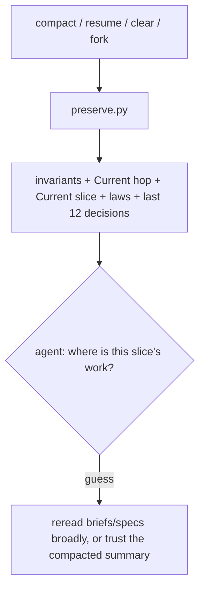
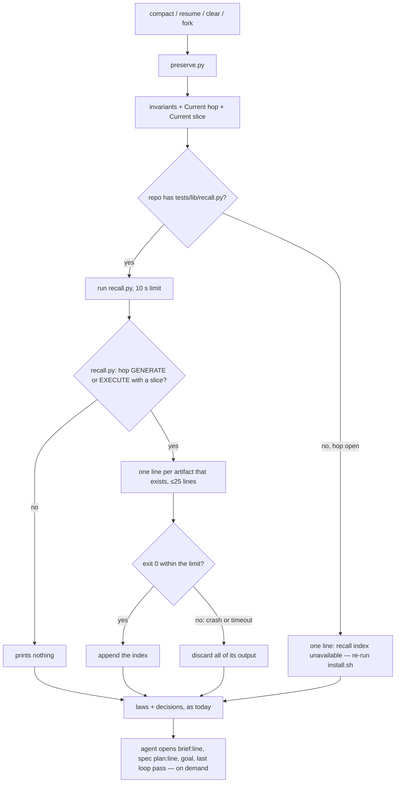

# Stage 05b — t85-recall-index — SPEC (v2, after the critic)

## User story IDs from the PRD

BDD's product is the cascade itself; the stories this slice serves:

- **S-RI1** — As an agent whose context was just compacted, resumed or cleared mid-hop, I am told *where* this
  slice's work lives — the brief line, the spec and its plan and AC anchors, the critique, the goal, the last loop
  pass, the last halt — as paths and line numbers I can open, so I do not reconstruct the slice from chat residue.
- **S-RI2** — As an operator, the re-injected context stays short: pointers, not file contents, capped, and never a
  path to a file that is not there.
- **S-RI3** — As an operator with no hop running, nothing changes.

## The problem, stated as cost

After `compact`, `resume`, `clear` or `fork`, `.claude/hooks/preserve.py` injects the invariants, the hop
(`Current hop:` / `Current slice:`, `preserve.py:264-266`), the laws and the last 12 decisions (`preserve.py:291`).
It does not say where the slice's own artifacts are. The control line then forbids the obvious fallback
("Do not reconstruct locks from compacted conversation", `preserve.py:34-35`), so the agent either rereads broadly —
the briefs file is 400+ lines, a spec+plan 200+ — or works from the compacted summary.

What the agent needs is already on disk, in fixed places:

| Artifact | Where | Known since |
|---|---|---|
| the slice's brief | `docs/cascade/05b-briefs.md`, a `- <slug>:` line | t57 |
| spec + plan | `docs/cascade/<stage>-<slice>.md` (`# Stage … — PLAN`, `## Acceptance criteria`, `## In scope this execute`) | t59 |
| critique | `docs/cascade/05b-<slice>-critique.md` | t57 |
| candidates | `docs/cascade/05b-<slice>-candidates.md` (`tests/lib/diverge.py:82`) | t58 |
| goal | `docs/cascade/goal.md` (`GOAL_SLICE:`) | t77 |
| last loop pass | `.cascade/loop-history` (`tests/lib/watchdog.py`) | t84 |
| last halt / budget / cap / watchdog | `.cascade/decisions.log` — older than the 12-line tail after a long run | t59 |
| the hop's commits | `git log <hop base>..HEAD` (`tests/lib/affected.py:hop_base`) | t66 |

Inline the pointer, spill the content: the index says where each thing is and one line of status, and the agent
opens what this hop needs.

## Before vs after

Before:



After:



## Benefits and trade-offs

| | Today | After t85 |
|---|---|---|
| After a context break mid-hop | hop and slice names only | plus a recall index: `path:line` for the brief, spec, plan, AC, scope list; critique, candidates, goal; last loop pass; last halt; commits since the hop opened |
| A halt older than the last 12 decisions | not shown | the newest HALT / BUDGET / CAP / WATCHDOG / NUDGECAP line, with its time |
| Context cost | — | ≤25 lines, ≤240 chars each; no file contents beyond the brief's first 200 characters |
| A file that does not exist | — | never listed |
| No hop running, or plain startup | — | unchanged (byte-identical output) |
| A broken or slow `recall.py` | — | all of its output is discarded (partial lines included); the rest of the injection is unchanged |
| A repo whose pack predates `recall.py` (plugin mode) | — | one line says the index is unavailable and to re-run `install.sh` |
| Not chosen: inlining the spec or plan | — | thousands of tokens on every compact; the pointer costs one line |
| Not chosen: a model-written summary of the hop | — | chat residue by another name; the index is computed from files |

## What the slice adds — and the line it must not cross

The line: **the index only adds pointers and one-line statuses computed from files; it changes no gate, verdict,
hop field or law, and injects nothing at NONE or on plain startup.**

### 1. `tests/lib/recall.py <root>` (new)

Prints nothing unless `CURRENT_HOP` is `GENERATE` or `EXECUTE` and `CURRENT_SLICE` is set. Otherwise prints, in this
order, only the lines whose source exists:

```
brief      docs/cascade/05b-briefs.md:<line>  <the line's text after "- <slug>:", whitespace collapsed, ≤200 chars>
spec       docs/cascade/<stage>-<slice>.md  (plan :<line>, AC :<line>, scope :<line>)
critique   docs/cascade/05b-<slice>-critique.md  (<k> findings, <m> answered)
candidates docs/cascade/05b-<slice>-candidates.md
goal       docs/cascade/goal.md  (for <slice> | for ANOTHER slice: <x> — reset it; <n> validators)
loop       .cascade/loop-history (logs in .cascade/loop/): last pass <age> ago, LOOP <k>/<n>[, <first FAIL line>]
halt       .cascade/decisions.log record: <timestamp> <actor> <verdict> <detail>
commits    <n> since the hop opened at <sha7>; newest: <subject>
```

- `brief`: 05b only; the first column-0 line `- <slug>:` (a `[diverge]` tag after the colon allowed), **joined with its
  indented continuation lines** up to the next column-0 line or blank line, whitespace collapsed, then cut at 200
  characters — real briefs wrap at ~115 columns (C1). The line number is the anchor's, 1-based, so `sed -n <line>p`
  prints `- <slug>:`.
- `spec`: anchors present in the doc only; a doc with none prints the path alone.
- `critique`: `k` = rows under `## Brief` and `## Spec`, `m` = rows under `## Dispositions` (shape only, as in
  `tests/lib/critique.py`); never a verdict.
- `goal`: EXECUTE only.
- `loop`: the newest `.cascade/loop-history` line whose slice and hop base match (t84's format); none → omitted. t84
  stores the first failing line and a hash of the set, not every failing validator, so the index names the first one
  and points at `.cascade/loop/` for the rest (C2; the brief's plural cannot be met from t84's format and is narrowed
  here, said so in a dated note under the brief).
- `halt`: the newest `decisions.log` line whose verdict is `HALT`, `BUDGET`, `CAP`, `WATCHDOG` or `NUDGECAP`, read from
  the last 2000 lines; none → omitted; **omitted too when that line is among the last 12, which `preserve.py` already
  prints** (C8). It is prefixed `record:` — a local, agent-writable log line, quoted as a record, not an instruction.
- `commits`: needs a hop base (`affected.hop_base`); none → omitted.
- Every line is cut at 240 characters; at most 25 lines. **Exit 0 on success; an error is not caught** — it
  propagates as a non-zero exit so `preserve.py` can discard the output (C4).
- Added at GENERATE beyond the brief (C3): the `goal` line (one file read), the `commits` line (`hop_base` plus one
  `git log`, as `affected.py` already does on every loop), and `WATCHDOG` / `NUDGECAP` among the halts. Each is one
  line and each is listed in the Done-when below.

### 2. `preserve.py` prints it

On `compact` / `resume` / `clear` / `fork`, right after `Current slice:`, `preserve.py` runs **the repo's**
`tests/lib/recall.py` — as it reads the repo's `tests/lib/laws.py`, in plugin mode too (C5) — with a timeout of
`BDD_RECALL_TIMEOUT` seconds (default 10; tests set 1). Only on exit 0 within the limit, and non-empty output, it
appends:

```
Recall index — pointers, not content; open what this hop needs (durable truth is these files):
  <each line>
```

Empty output, a non-zero exit or a timeout appends nothing — partial output included (C4). When the repo has no
`tests/lib/recall.py` and a hop is open, it appends one line instead: `Recall index unavailable: tests/lib/recall.py is
not in this repo (pack older than 3.1.0) — re-run install.sh.` (C5). `startup` stays the version line alone (T15).

## What the slice must not touch

- Any gate, verdict, receipt, hop field, law or decision line.
- `preserve.py`'s output at NONE, on `startup`, and every line it prints today (the index is inserted, nothing moves
  or is removed).

## Acceptance criteria

`tests/ac/t85_recall_index.sh`, scratch git repos; `preserve.py` fed a SessionStart event:

- **AC1 — GENERATE.** A fixture on GENERATE 05b `a` with a brief wrapped over three lines (C1), a spec with all three
  anchors, a critique with 3 findings and 2 dispositions, and a candidates file: the compact output holds the brief's `path:line` (and `sed -n` of it starts
  `- a:`), the spec anchors (each `sed -n` gives the heading), `(3 findings, 2 answered)`, the candidates path, and brief text that includes words from its third line; no `goal`
  or `loop` line.
- **AC2 — EXECUTE.** The same slice on EXECUTE with a goal for `a`, one real `tests/loop.sh` pass (`LOOP 1/2`), and a
  `HALT` line followed by 20 other decisions: `goal … for a; 2 validators`, `loop … LOOP 1/2, FAIL  false`, the
  `HALT` line prefixed `record:`, and `commits 1 since the hop opened`. With the `HALT` line among the last 12, no
  `halt` index line (C8).
- **AC3 — no dead path (C6).** One at a time on EXECUTE: no critique, no candidates, no spec doc, no `goal.md`, a
  `loop-history` holding only another slice's lines, no `decisions.log`, no hop base (hop state differs from its last
  commit) — the matching line is absent and the others stay. In every case, every path the index prints exists
  (`test -e`). **Red twin:** a `recall.py` that lists the critique without checking it exists shows it.
- **AC4 — the cap.** A 3000-line `decisions.log`, a brief wrapped over 8 lines (~900 characters) and a spec: at most 25 index lines, none over
  240 characters. **Red twin:** a `recall.py` without the cut prints a line over 240.
- **AC5 — a goal for another slice** prints `for ANOTHER slice: b — reset it`.
- **AC6 — unchanged when idle.** At NONE, and on `startup`, `preserve.py`'s output is byte-identical with and without
  `tests/lib/recall.py` present.
- **AC7 — a broken index is harmless (C4).** A `recall.py` that raises before printing, one that prints two lines and
  then raises, and one that sleeps past `BDD_RECALL_TIMEOUT=1`: each output is valid JSON, holds `Current hop:`, and
  holds no index line. **Red twins:** a `preserve.py` that ignores the exit code keeps the partial lines; one with no
  timeout does not return within 5 s.
- **AC8 — plugin mode, older pack (C5).** The pack's `preserve.py` run against a repo whose `tests/lib` has no
  `recall.py`, on an open hop: the output holds `Recall index unavailable`; at NONE it does not.

Done when also covers the GENERATE additions (C3): the `goal`, `commits` and `WATCHDOG` / `NUDGECAP` halt lines are
asserted in AC2 and AC3.

Gate: `bash tests/ac/t85_recall_index.sh`, `bash tests/enforcement.sh` (T85), lint.

## Laws

`bash tests/dsharp_strength.sh` prints `DSHARP 0/0`: NO LAW IN FORCE in this repo. The slice adds no D# and changes
none.

# Stage 05b — PLAN

## Goal

EXECUTE adds a computed recall index to the context `preserve.py` re-injects after a break mid-hop, with no gate or
verdict changed (T85).

## In scope this execute

- [ ] `tests/lib/recall.py` (new).
- [ ] `.claude/hooks/preserve.py` — run it after `Current slice:`.
- [ ] `tests/ac/t85_recall_index.sh` (AC1–AC8, four red twins); `tests/enforcement.sh` T85; `CONTROL-LINE.md` T85 row.
- [ ] `tests/ac/t69_gradle_tuning.sh` — `recall` in the shipped-paths parity list (as t84 did for `watchdog`).
- [ ] `USAGE.md` — a new paragraph **"After a context break"** right after the `What a hop reads` bullet's section
      (`USAGE.md:301-303`, which mentions what preserve re-injects) (C10); `CHANGELOG.md` (version per Ask 1).
- [ ] `docs/cascade/05b-briefs.md` — a dated note under the t85 brief: the loop line names the first failing
      validator, not all (C2).
- [ ] `docs/cascade/goal.md`: `bash tests/goal.sh reset`, then this hop's validators.

## Out of scope this execute

- t86 (halt notify).
- Changing what `seam.py` injects on every prompt.
- Long-term memory across slices.

## Definition of done

- `bash tests/ac/t85_recall_index.sh` exits 0 and its red twins go red; `bash tests/enforcement.sh` exits 0 with T85;
  lint green; `bash tests/loop.sh` n/n on this hop's goal.

## Risks / UNKNOWNs that still block

- **U2 — the `halt` line is agent-written (C8).** It is quoted from `decisions.log`, prefixed `record:`, capped, and
  already visible today in the 12-line tail; t85 adds at most one older such line.
- **U1 — the brief text is chat-shaped.** Its first 200 characters are human prose re-injected as context. It is the
  human's own committed brief, capped, and labelled as a pointer; a prompt-injection in a brief already reaches the
  agent on every GENERATE hop that reads it.

## Ask of you

1. **Version (C9, a human row).** 3.1.0 is unreleased (no tag) and installed copies are 3.0.2. Default: **t84 and t85
   ship together as 3.1.0**, so every plugin user crosses 3.0.2 → 3.1.0 and gets both. If you release t84 alone
   first, say so and t85 becomes 3.1.1. *Your call at this edge.*
2. **25-line cap.** *Default taken.*

## Invariants this hop

- PRESERVE run: no
- /goal set to: n/a — GENERATE; EXECUTE's goal is AC1–AC7 + T85 + lint
- /model /effort: as set by the session
- /plan: skipped — this document is the plan
- INVARIANTS I1–I18: held; nothing loosens (I18)
- Skills: none invoked; brainstorming skipped (brief committed, `5710b55`)
- critique: C1–C10 answered in `05b-t85-recall-index-critique.md` (spec v2); C9 is a human row (Ask 1)
- reads: AGENTS.md, hop-state.md, envelope.md, 05b-briefs.md (t85), preserve.py, _common.py, decisions.py,
  watchdog.py, affected.py, critique.py, diverge.py, enforcement.sh (T15)
