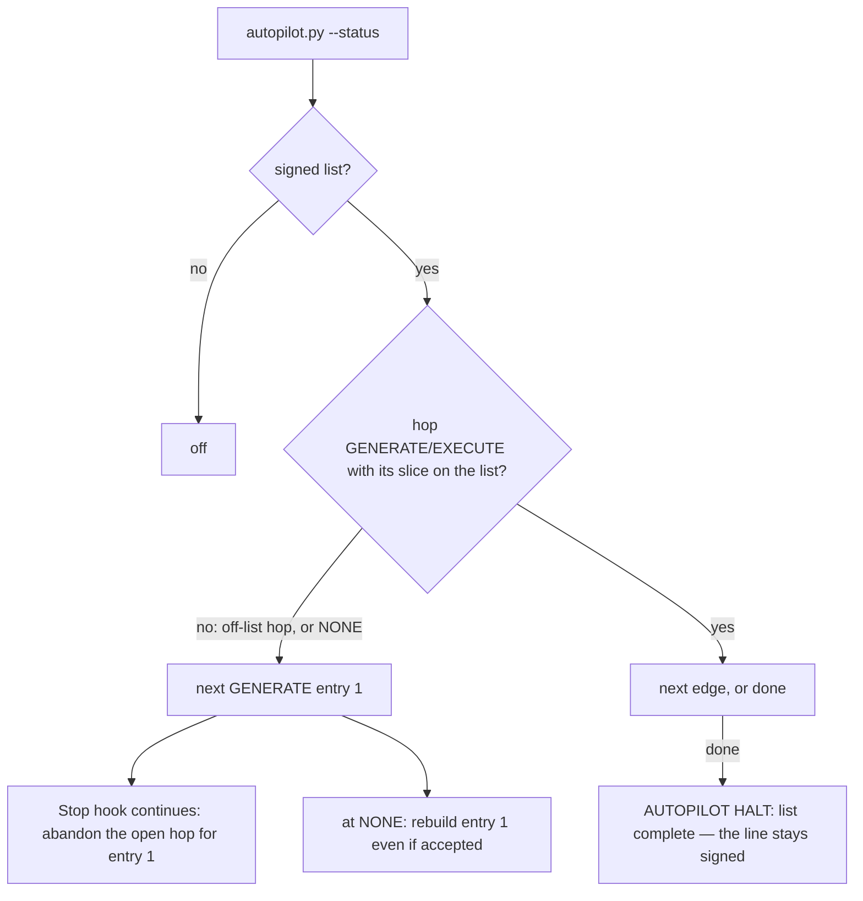
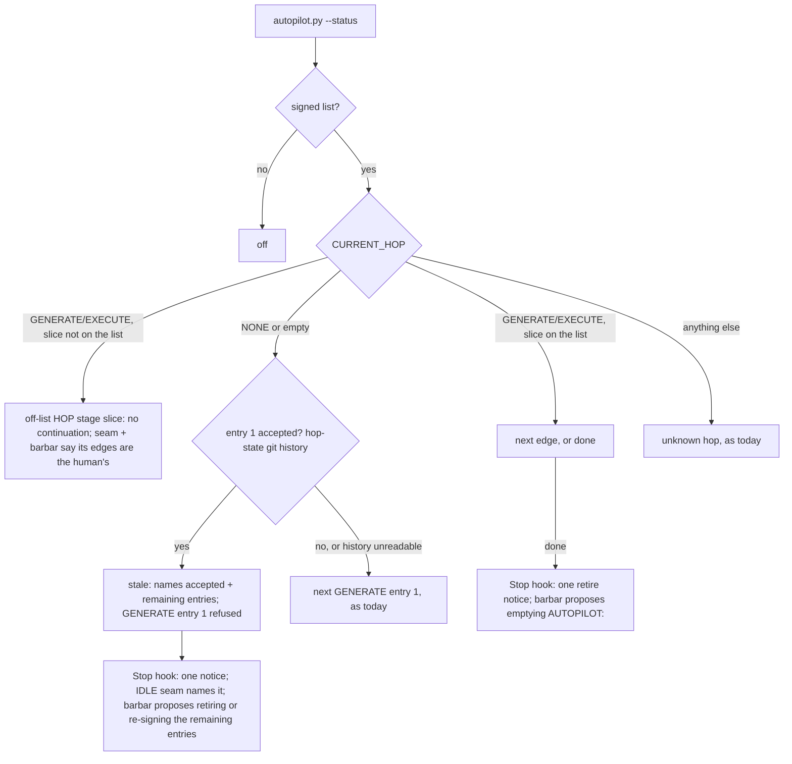

# Stage 05b — t87-autopilot-list-retire — SPEC (v2, after the critic)

## User story IDs from the PRD

BDD's product is the cascade itself; the stories this slice serves:

- **S-AR1** — As an operator running a hop by hand while an old list is still signed, the agent is not pushed toward
  that list's first entry after every stop, and is told plainly that this hop's edges are mine.
- **S-AR2** — As an operator, a list whose first entry was already accepted cannot quietly start over: `/barbar auto`
  at NONE refuses it and says which entries are done and which remain.
- **S-AR3** — As an operator, when a list's last slice is done — or a stale list is found — I am asked once to retire
  or re-sign the line, instead of discovering weeks later that it is still signed.

## The problem, stated as cost

`tests/lib/autopilot.py` folds two different states into one rule (`decide()` `:118`, `status()` `:193`):

```python
if idx < 0 or hop in ("", "NONE"):          # the current slice is not on the list, OR no hop is running
    return f"next GENERATE {plan[0][0]} {plan[0][1]}"
```

Measured in this repo on 2026-11-02, with `AUTOPILOT: 05b t78-carry-out, 05b t79-zero-test-guard, 05b
t80-carry-matching` still signed from an October run:

| While | `autopilot.py --status` | Effect |
|---|---|---|
| EXECUTE t84 … GENERATE t87, all by hand | `next GENERATE 05b t78-carry-out` | 17 `CONTINUE … t78-carry-out` lines in `decisions.log`: after every stop the Stop hook told the agent to abandon the open hop for t78 |
| NONE | `next GENERATE 05b t78-carry-out` | `/barbar auto` would rebuild t78, accepted in October: the hop state went `EXECUTE t78` (`1e771ac`) → `GENERATE t79` (`79ae35c`) |

`.claude/hooks/seam.py:143` prints "AUTOPILOT is ON … You may advance CURRENT_HOP yourself" from the raw line on every
prompt of those hand-run hops. `commands/barbar.md:30` ends a finished list with `AUTOPILOT HALT: list complete` and
leaves the line signed. `hop_guard.autopilot_ok` (`.claude/hooks/hop_guard.py:127-129`) discards autopilot's reason,
so an in-session refusal shows only the generic "human-owned" text.

**When is an entry accepted?** Not when `regress.md` gets its `### slug` heading — `goal.sh reset` writes that at the
*next* EXECUTE (critic C4). The hop state's own git history says it the moment the edge lands: an entry is accepted
when some committed version of the hop-state file reads `EXECUTE <stage> <slug>` and the next committed version reads
anything other than `EXECUTE` or `GENERATE` of that same slice. In this repo: `EXECUTE t78 → GENERATE t79`, `EXECUTE
t79 → GENERATE t80`, `EXECUTE t80 → NONE` (`0932a8b`). A send-back (EXECUTE → GENERATE of the same slice, or a rewind
that removes the commit) is not an accept.

## Before vs after

Before:



After:



## Benefits and trade-offs

| | Today | After t87 |
|---|---|---|
| A hand-run hop while an old list is signed | pushed to entry 1 after every stop | `off-list`: no continuation; the seam and `/barbar auto` say the hop's edges are yours |
| `/barbar auto` at NONE, entry 1 accepted | rebuilds entry 1 | `stale`: refused; names accepted and remaining entries; the agent proposes retiring or re-signing |
| A partly finished list closed to NONE (C8) | restarts at entry 1 | `stale … remaining: <entries>`: the agent proposes re-signing exactly the remaining entries |
| A list's last slice done | halt, line stays | the same halt plus one retire notice and the agent's proposal to empty the line |
| A fresh list at NONE | starts entry 1 | unchanged |
| A list signed while another hop is open, meant to take over | jumped to entry 1, abandoning the open hop | `off-list` until the open hop is closed to NONE — on purpose, said in the CHANGELOG |
| A shallow clone or unreadable hop-state history | — | `stale` cannot be computed → today's `next GENERATE entry 1` (fails open to current behaviour, never refuses a fresh list) |
| An in-session refused edge | generic "human-owned" text | the dialog also names autopilot's reason (C9) |
| Cost | — | one `git log -p` over the hop-state file, at most 400 versions, only at NONE with a list signed |
| Not chosen: `### slug` in `regress.md` as "accepted" | — | written one hop late (C4); headings carry no meaning to checks (`regress.md:15`) |
| Not chosen: a hook that clears the line | — | the line is human-owned (AGENTS.md rule 7); the agent proposes, the approval signs |
| Not chosen: resuming a partial list at its first open entry automatically | — | that would allow an edge autopilot refuses today; re-signing keeps the human on it |

## What the slice adds — and the line it must not cross

The line: **autopilot only gets stricter — an edge it allowed only through the off-list fold, or to an accepted
entry 1, is refused; every other verdict is unchanged. The `AUTOPILOT:` line stays human-owned; nothing writes it.**

### 1. `tests/lib/autopilot.py`

- `accepted(root, entries) -> set | None`: walks `git log -p --format=%H -400 -- <hop-state file>` (the envelope in a
  pre-split repo, via `hopstate_path`) oldest-first; an entry is accepted when a version reads `EXECUTE <stage>
  <slug>` and the next version reads neither `EXECUTE` nor `GENERATE` of that slice. `None` when git or the history
  cannot be read.
- `status()`, in order: no list → `off`; hop `GENERATE`/`EXECUTE` and `(stage, slice)` not on the list →
  **`off-list <HOP> <stage> <slice>`**; hop on the list → as today (`next …`, `done`); hop `NONE`/empty and entry 1 in
  `accepted()` → **`stale accepted: <entries>; remaining: <entries or none>`**; hop `NONE`/empty otherwise → `next
  GENERATE <entry 1>` (as today); any other hop → as today.
- `decide()` mirrors it: from an open off-list hop → `the open hop (<HOP> <stage> <slice>) is not on the signed list —
  a human takes its edges; close it to NONE to start the list`; from NONE when `stale` → `the signed list is stale
  (<status>) — retire or re-sign the AUTOPILOT: line`. Every other branch is untouched.

### 2. The Stop hook (`.claude/hooks/stop_guard.py`)

`continue_autopilot`'s `startswith("next")` gate is unchanged: `off-list` and `stale` never continue. New, at the
end of `judge()` for any stop that passes or ends a hop: when the status is `done` or starts with `stale`, add one
`systemMessage` notice — `autopilot: the signed list is finished (<status>) — approve the agent's edit that empties
or re-signs the AUTOPILOT: line.` — at most once per status per session: the hook keeps the last notified status in
`<git dir>/cascade-retire-<session>` and notifies again only when the status differs (C6).

### 3. The seam (`.claude/hooks/seam.py`)

Running hop — the sentence comes from `autopilot.py --status`: `next …` → today's text; `done` → today's text (it
still contains `AUTOPILOT is ON`, so T27 holds, C2) plus `This is the list's last entry: after its accept, propose
emptying the AUTOPILOT: line.`; `off-list …` → `AUTOPILOT is signed (<list>) but this hop is not on it: every edge of
this hop is the human's.`; `off` → today's text. If `autopilot.py` cannot run, today's raw-line text.
IDLE (NONE) branch — after today's CASCADE IDLE text, when the status starts with `stale`: `A signed AUTOPILOT list is
stale (<status>): propose emptying it, or re-signing only the remaining entries, before starting anything.` (C3).

### 4. `/barbar auto` (`commands/barbar.md` and `.claude/commands/barbar.md`), USAGE.md

- **`off-list …`** (new, C5): say the open hop is not on the list; do not advance; the human takes its edges or closes
  it to NONE.
- **`done`**: after the halt line, propose the edit that empties `AUTOPILOT:` inside `<EDIT>` (the dialog signs).
- **`stale …`** (new): name the accepted and remaining entries; propose emptying the line, or replacing it with the
  remaining entries; do not start a hop.
- USAGE.md's autopilot protocol line lists `off`, `off-list`, `stale`, `done`, `next`.

### 5. In-session refusals name the reason (`.claude/hooks/hop_guard.py`)

`autopilot_ok` returns autopilot's stderr reason with its verdict; when an edge is refused, the `sign_or_deny` message
appends `autopilot: <reason>` (C9). Allowed edges are unchanged.

## What the slice must not touch

- The edges a valid on-list run takes, the loop gate, the critique/diverge gates, stage 10/11 rules, laws, the
  continuation cap.
- The `AUTOPILOT:` line's ownership.

## Acceptance criteria

`tests/ac/t87_autopilot_list_retire.sh`, scratch repos with hooks wired (the t81 `mkap` shape); acceptance is made by
real hop-state commits, never by writing headings (C4):

- **AC1 — off-list open hop.** List `05b a, 05b b`; hop `EXECUTE 05b x`: status `off-list EXECUTE 05b x`; a Stop
  event ending `BLOCKED: …` is not continued. **Red twin:** today's `idx < 0` rule → `next GENERATE 05b a`, continued.
- **AC2 — its edges are refused, with the reason.** From that hop, a commit flipping to `GENERATE 05b a` is BLOCKED
  with `not on the signed list`; the same edit through `hop_guard.py` yields a decision whose message contains
  `autopilot:` and `not on the signed list` (C9).
- **AC3 — a fresh list at NONE still starts.** NONE, list `05b a, 05b b`, no accept in history: `next GENERATE 05b a`;
  the edge lands.
- **AC4 — accepted by history (C4, C8).** Commits `GENERATE a → EXECUTE a → NONE` (a one-entry accept, the case C4
  says a heading misses), list `05b a, 05b b`: status `stale accepted: 05b a; remaining: 05b b`; the edge to `GENERATE
  05b a` is BLOCKED naming `stale`. All entries accepted → `remaining: none`. A send-back (`EXECUTE a → GENERATE a`)
  is not an accept. **Red twin:** an `accepted()` that returns an empty set lets the edge land.
- **AC5 — history unreadable.** A repo whose hop-state file has no commits: `next GENERATE 05b a` (fails open).
- **AC6 — on-list runs unchanged.** `EXECUTE 05b a` on `a, b` → `next GENERATE 05b b`; the last entry → `done`; T27 in
  `tests/enforcement.sh` stays green.
- **AC7 — one notice per status (C6).** Two hop-ending stops at `done` → one retire notice; the status changes to
  `stale …` → one more.
- **AC8 — the seam (C2, C3).** Running `next` and `done` print `AUTOPILOT is ON` (`done` also `last entry`);
  `off-list` prints `not on it`; NONE + `stale` prints `is stale`; no list prints `AUTOPILOT is off`.
- **AC9 — barbar.md says it (C7, presence by design).** Both copies contain the `off-list`, `stale` and `done`-retire
  paragraphs; USAGE.md's protocol line names all five statuses. A presence check, labelled as one: it guards against
  the instruction being deleted, not against an agent ignoring it.

Gate: `bash tests/ac/t87_autopilot_list_retire.sh`, `bash tests/enforcement.sh` (T87), lint.

## Laws

`bash tests/dsharp_strength.sh` prints `DSHARP 0/0`: NO LAW IN FORCE in this repo. No D# added or changed.

# Stage 05b — PLAN

## Goal

EXECUTE separates "off-list open hop" and "stale list" from "start the list", using the hop state's own git history
for "accepted", and gets every surface (Stop hook, seam, `/barbar auto`, in-session refusals) to say so (T87).

## In scope this execute

- [ ] `tests/lib/autopilot.py` — `accepted()`, `off-list` and `stale` in `status()` and `decide()`.
- [ ] `.claude/hooks/stop_guard.py` — the once-per-status retire notice.
- [ ] `.claude/hooks/seam.py` — the AUTOPILOT sentence from `--status`; the IDLE `stale` sentence.
- [ ] `.claude/hooks/hop_guard.py` — autopilot's reason in refusals.
- [ ] `commands/barbar.md` and `.claude/commands/barbar.md` — `off-list`, `stale`, the `done` retire proposal.
- [ ] `tests/ac/t87_autopilot_list_retire.sh` (AC1–AC9, two red twins); `tests/enforcement.sh` T87; `CONTROL-LINE.md`.
- [ ] `USAGE.md` (autopilot protocol line and section), `CHANGELOG.md` (3.1.0).
- [ ] `docs/cascade/05b-briefs.md` — a dated note under the t87 brief (C1).
- [ ] `docs/cascade/goal.md`: `bash tests/goal.sh reset`, then this hop's validators.

## Out of scope this execute

- The continuation counter per list (not chosen on 2026-11-02).
- t88 (briefs archive), t86 (halt notify).
- `install-global.sh`: `bdd status` prints the status verbatim, and `bdd auto` runs `/barbar auto`, which this slice
  updates.
- Emptying this repo's own stale line: the human's edit, which the agent proposes after this slice.

## Definition of done

- `bash tests/ac/t87_autopilot_list_retire.sh` exits 0 and its red twins go red; `bash tests/enforcement.sh` exits 0
  with T87 and T27 unchanged; lint green; `bash tests/loop.sh` n/n.

## Risks / UNKNOWNs that still block

- **U1 — take-over mid-hop.** A list signed while a hop is open no longer takes over; close the hop first. CHANGELOG.
- **U2 — shallow clones.** `accepted()` returns `None` and autopilot behaves as today.
- **U3 — a slice re-run on purpose.** Someone who wants to rebuild an accepted entry 1 now gets `stale`; they take
  that GENERATE edge by hand, as for any edge autopilot refuses.

## Ask of you

1. **Off-list open hop = `off-list`, not "start the list".** *Default taken.*
2. **Accepted = the hop state left `EXECUTE <slug>` for anything but that slice, in git.** *Default taken.*
3. **A stale list is refused at NONE**, not only flagged — a change to the brief's done-when, noted under it (C1).
   *Default taken; say so if you want flag-only.*

## Invariants this hop

- PRESERVE run: no
- /goal set to: n/a — GENERATE; EXECUTE's goal is AC1–AC9 + T87 + lint
- /model /effort: as set by the session
- /plan: skipped — this document is the plan
- INVARIANTS I1–I18: held; autopilot only gets stricter (I18)
- Skills: none invoked; brainstorming skipped (brief committed, `aab766e`)
- critique: C1–C10 answered in `05b-t87-autopilot-list-retire-critique.md` (spec v2); C1 raised as Ask 3
- reads: AGENTS.md, hop-state.md (and its git history), envelope.md, 05b-briefs.md (t87), autopilot.py, stop_guard.py,
  seam.py, hop_guard.py, pre-commit, barbar.md, regress.md, carry_out.py, goal.sh, enforcement.sh (T27), USAGE.md
