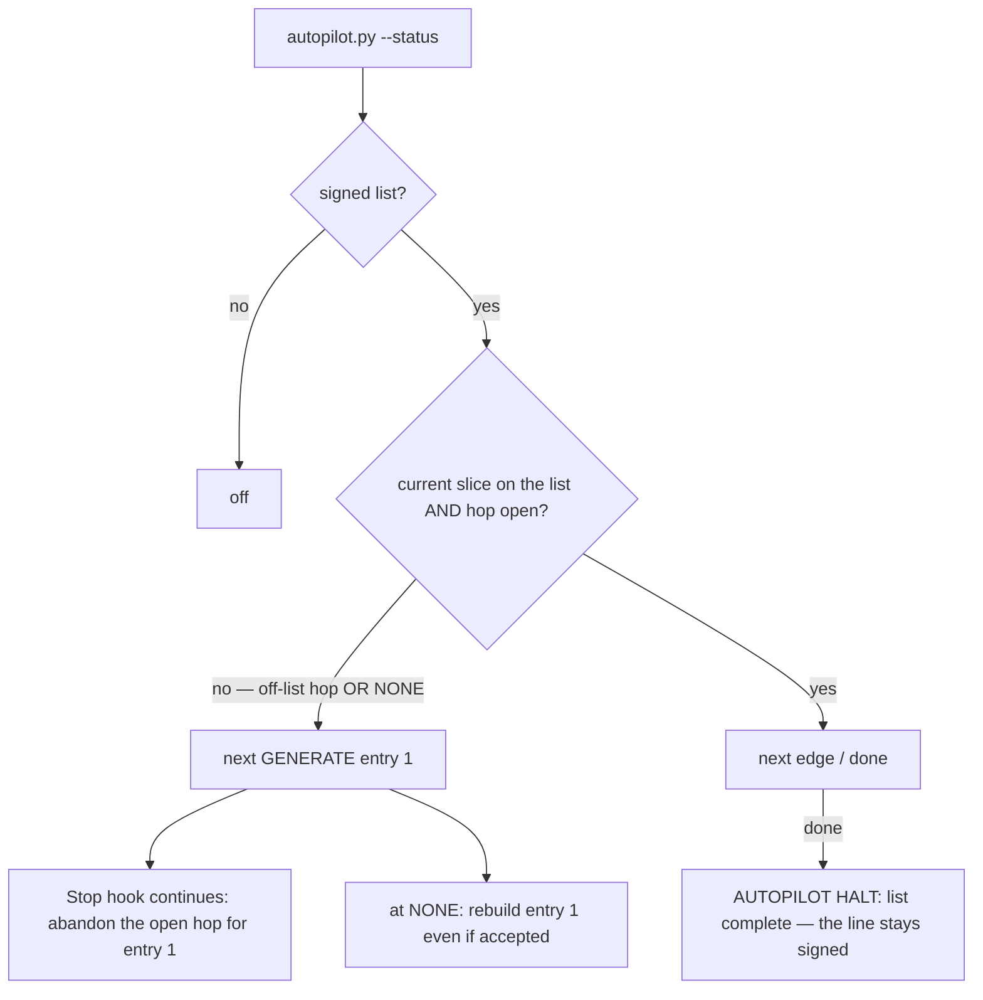
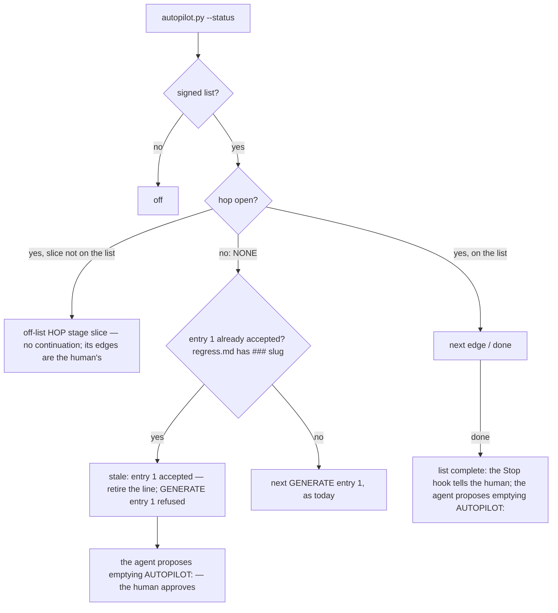

# Stage 05b — t87-autopilot-list-retire — SPEC

## User story IDs from the PRD

BDD's product is the cascade itself; the stories this slice serves:

- **S-AR1** — As an operator running a hop by hand while an old list is still signed, the agent is not pushed toward
  that list's first entry after every stop.
- **S-AR2** — As an operator, a finished list cannot quietly start over: `/barbar auto` at NONE does not rebuild a slice
  that was already accepted.
- **S-AR3** — As an operator, when a list's last slice is done, I am asked to retire the line — one approval — instead
  of discovering weeks later that it is still signed.

## The problem, stated as cost

`tests/lib/autopilot.py` folds two different states into one rule (`decide()` `:118`, `status()` `:193`):

```python
if idx < 0 or hop in ("", "NONE"):          # the current slice is not on the list, OR no hop is running
    return f"next GENERATE {plan[0][0]} {plan[0][1]}"
```

"Not on the list" while a hop is **open** is treated like "no hop". Measured in this repo on 2026-11-02, with
`AUTOPILOT: 05b t78-carry-out, 05b t79-zero-test-guard, 05b t80-carry-matching` still signed from an October run:

| While | `autopilot.py --status` | Effect |
|---|---|---|
| EXECUTE t84 / GENERATE t85 / EXECUTE t85 (by hand) | `next GENERATE 05b t78-carry-out` | 12 `CONTINUE … t78-carry-out` lines in `decisions.log`: the Stop hook told the agent to abandon the open hop for t78 after every stop |
| NONE (now) | `next GENERATE 05b t78-carry-out` | `/barbar auto` would rebuild t78, which `docs/cascade/regress.md:21` (`### t78-carry-out`) shows was accepted |

`.claude/hooks/seam.py:143` reads the raw line and prints "AUTOPILOT is ON … You may advance CURRENT_HOP yourself"
on every prompt of those hand-run hops — telling the agent it may take edges that `decide()` would then send to t78.
And nothing ever retires a finished list: `commands/barbar.md:30` prints `AUTOPILOT HALT: list complete` and stops.

## Before vs after

Before:



After:



## Benefits and trade-offs

| | Today | After t87 |
|---|---|---|
| A hand-run hop while an old list is signed | the Stop hook pushes the agent to the list's entry 1 after every stop | `off-list`: no continuation, no push; the seam says this hop's edges are the human's |
| `/barbar auto` at NONE on a finished list | rebuilds entry 1 | `stale`: refused, naming `regress.md`; the agent proposes retiring the line |
| A list's last slice done | `AUTOPILOT HALT: list complete`, line stays | the same halt, plus a proposal to empty the line (one approval) |
| A fresh list at NONE | starts entry 1 | unchanged |
| A list signed **while** another hop is open, meant to take over | autopilot jumped to entry 1, abandoning the open hop | refused until the open hop is closed (accept or send back to NONE) — a behaviour change, on purpose |
| A slice whose goal held only `# standing` lines | — | it gets no `### slug` section, so `stale` cannot see it: falls back to today's `next GENERATE` (fails open to current behaviour, never refuses a fresh list) |
| Not chosen: a hook that clears the line itself | — | the line is human-owned (AGENTS.md rule 7); the agent proposes, the human's approval is the signature |
| Not chosen: a list "consumed" flag in `.cascade/` | — | agent-writable local state cannot retire a signed line; git is the record |

## What the slice adds — and the line it must not cross

The line: **autopilot only ever gets stricter: an edge it allowed only because of the off-list fold, or to an
already-accepted entry, is refused; every other verdict is unchanged. The `AUTOPILOT:` line stays human-owned.**

### 1. Two new statuses (`tests/lib/autopilot.py`)

`status()`, in order:

- no list → `off` (as today);
- hop `GENERATE` / `EXECUTE` and `(stage, slice)` not on the list → **`off-list <HOP> <stage> <slice>`**;
- hop `NONE` / empty and entry 1's slice has a `### <slug>` heading in `docs/cascade/regress.md` →
  **`stale <stage> <slug> is already accepted (docs/cascade/regress.md) — retire the AUTOPILOT: line`**;
- otherwise as today (`next …`, `done`).

`decide()` mirrors it: from an open off-list hop, any edge → `the open hop (<HOP> <stage> <slice>) is not on the
signed list — a human takes its edges; close it to NONE to start the list`; from NONE to GENERATE of an accepted entry
1 → the `stale` reason. Every other branch is untouched.

### 2. The Stop hook (`.claude/hooks/stop_guard.py`)

No change to `continue_autopilot`'s `startswith("next")` gate: `off-list` and `stale` do not continue, by
construction. New: when the status is `done` or `stale` and the reply ends a hop, add one human notice (once per
status per session, as t63's notices): `autopilot: the signed list is finished (<status>) — the agent will propose
emptying the AUTOPILOT: line; approve it to retire the list.`

### 3. The seam (`.claude/hooks/seam.py`)

The AUTOPILOT sentence comes from `autopilot.py --status` (one source of truth) instead of the raw line:
`next …` → today's "AUTOPILOT is ON" text; `off-list …` → `AUTOPILOT is signed (<list>) but this hop is not on it:
every edge of this hop is the human's.`; `done` / `stale …` → `AUTOPILOT list finished (<status>): propose emptying
the AUTOPILOT: line; every edge is the human's until then.`; `off` → today's "AUTOPILOT is off". A failure to run
`autopilot.py` falls back to today's raw-line text.

### 4. The retire proposal (`commands/barbar.md` and its `.claude` copy)

The `done` paragraph gains: after the halt line, propose the edit that empties `AUTOPILOT:` inside `<EDIT>` (the
permission dialog is the signature, as for the `off` picker). A new `stale` paragraph: say which entry is already
accepted, propose the same edit, do not start the hop.

## What the slice must not touch

- The edges a valid on-list run takes, the loop gate, the critique/diverge gates, stage 10/11 rules, laws.
- The `AUTOPILOT:` line's ownership: no hook or script writes it.

## Acceptance criteria

`tests/ac/t87_autopilot_list_retire.sh`, scratch repos with hooks wired (the t81 `mkap` shape):

- **AC1 — off-list open hop.** List `05b a, 05b b`; hop `EXECUTE 05b x`: status `off-list EXECUTE 05b x`; a Stop
  event ending `BLOCKED: …` is not continued. **Red twin:** today's `idx < 0` rule gives `next GENERATE 05b a` and
  the stop is continued.
- **AC2 — its edges are refused.** From that hop, an agent commit flipping to `GENERATE 05b a` is BLOCKED with `not on
  the signed list`.
- **AC3 — a fresh list at NONE still starts.** NONE, list `05b a, 05b b`, no `### a` in `regress.md`: status `next
  GENERATE 05b a`, the edge lands.
- **AC4 — a stale list at NONE.** The same with `### a` in `regress.md`: status `stale 05b a is already accepted …`;
  the edge to `GENERATE 05b a` is BLOCKED naming `regress.md`. **Red twin:** without the regress check the edge
  lands.
- **AC5 — on-list runs unchanged.** `EXECUTE 05b a` on `a, b` → `next GENERATE 05b b`; EXECUTE of the last entry →
  `done`; T27 in `tests/enforcement.sh` stays green.
- **AC6 — the notices.** `done` and `stale` each add the retire notice to `systemMessage`, once per session.
- **AC7 — the seam.** `next` prints `AUTOPILOT is ON`; `off-list` prints `not on it`; `stale` prints `list finished`;
  no list prints `AUTOPILOT is off`.

Gate: `bash tests/ac/t87_autopilot_list_retire.sh`, `bash tests/enforcement.sh` (T87), lint.

## Laws

`bash tests/dsharp_strength.sh` prints `DSHARP 0/0`: NO LAW IN FORCE in this repo. No D# added or changed.

# Stage 05b — PLAN

## Goal

EXECUTE separates "off-list open hop" and "finished list" from "start the list", so a stale signed list neither
pushes a hand-run hop nor rebuilds accepted work, and proposes its own retirement (T87).

## In scope this execute

- [ ] `tests/lib/autopilot.py` — `off-list` and `stale` in `status()` and `decide()`.
- [ ] `.claude/hooks/stop_guard.py` — the retire notice for `done` / `stale`.
- [ ] `.claude/hooks/seam.py` — the AUTOPILOT sentence from `--status`.
- [ ] `commands/barbar.md` and `.claude/commands/barbar.md` — the `done` retire proposal; the `stale` paragraph.
- [ ] `tests/ac/t87_autopilot_list_retire.sh` (AC1–AC7, two red twins); `tests/enforcement.sh` T87; `CONTROL-LINE.md`.
- [ ] `USAGE.md` (autopilot section), `CHANGELOG.md` (3.1.0).
- [ ] `docs/cascade/goal.md`: `bash tests/goal.sh reset`, then this hop's validators.

## Out of scope this execute

- Resetting the continuation counter per list (item 2 of the 2026-11-02 review; not chosen).
- t88 (briefs archive) and t86 (halt notify).
- Emptying this repo's own stale line: that is the human's edit (the agent will propose it after this slice).

## Definition of done

- `bash tests/ac/t87_autopilot_list_retire.sh` exits 0 and its red twins go red; `bash tests/enforcement.sh` exits 0
  with T87 and T27 unchanged; lint green; `bash tests/loop.sh` n/n.

## Risks / UNKNOWNs that still block

- **U1 — take-over mid-hop.** Someone who signs a list while a hop is open and expects autopilot to jump to it now
  gets `off-list`. The seam and the refusal say how: close the hop to NONE. Stated in the CHANGELOG.
- **U2 — slices with no `### slug`.** `stale` cannot see them and falls back to today's behaviour (never a false
  refusal).

## Ask of you

1. **Off-list open hop = `off-list`, not "start the list".** *Default taken.*
2. **Accepted = a `### slug` heading in `regress.md`.** *Default taken.*

## Invariants this hop

- PRESERVE run: no
- /goal set to: n/a — GENERATE; EXECUTE's goal is AC1–AC7 + T87 + lint
- /model /effort: as set by the session
- /plan: skipped — this document is the plan
- INVARIANTS I1–I18: held; autopilot only gets stricter (I18)
- Skills: none invoked; brainstorming skipped (brief committed, `aab766e`)
- critique: pending
- reads: AGENTS.md, hop-state.md, envelope.md, 05b-briefs.md (t87), autopilot.py, stop_guard.py, seam.py, hop_guard.py,
  barbar.md, regress.md, carry_out.py, enforcement.sh (T27), decisions.log
