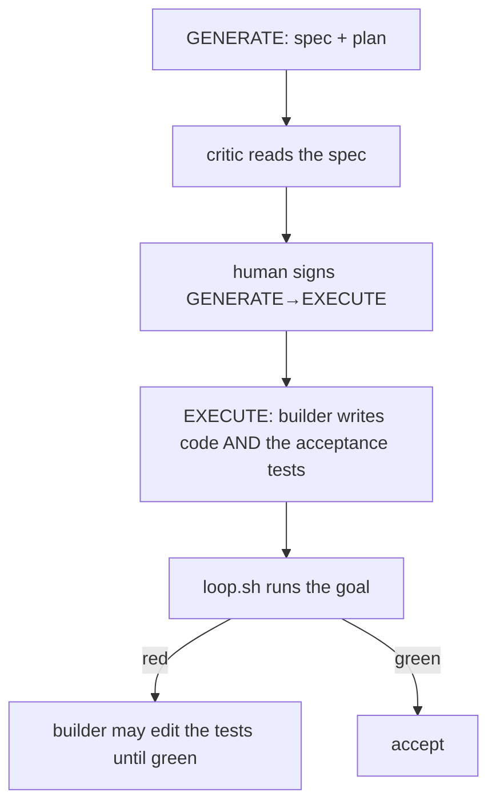
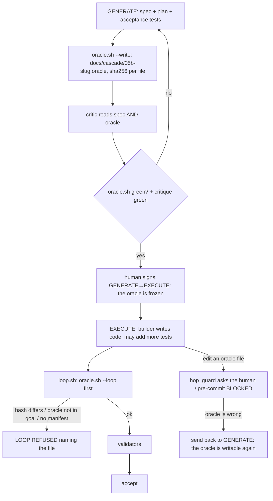

# Stage 05b — t89-frozen-oracle — SPEC

## User story IDs from the PRD

BDD's product is the cascade itself; the stories this slice serves:

- **S-FO1** — As an operator who switches models mid-work, every builder of a slice is judged by the same acceptance
  tests, written and reviewed before the build, which no builder can edit.
- **S-FO2** — As a reviewer at the spec edge, I sign the tests together with the spec: the critic has read both.
- **S-FO3** — As an operator, changing the oracle is a deliberate send-back to GENERATE, never a quiet edit during the
  build.

## The problem, stated as cost

The agent that builds a slice also writes the tests that decide whether it is done. In this repo, t84, t85 and t87's
acceptance files (`tests/ac/t84_progress_watchdog.sh`, `t85_recall_index.sh`, `t87_autopilot_list_retire.sh`) were
each written during EXECUTE by the builder, red twins included (`git log --diff-filter=A --format=%h -- tests/ac/t87*`
→ the EXECUTE commit `90d198d`). The spec critic reads the spec, never the tests. Models are switched mid-work for
usage limits, so the grader changes with the builder: a weaker model can satisfy tests it wrote to its own level.
Nothing stops a builder from editing a failing acceptance test until it passes — `tests/` is writable on every hop
(`.claude/hooks/hop_guard.py:30`), and only `tests/inv/*` (laws) is human-owned (`hop_guard.py:337`,
`.githooks/pre-commit:82-92`).

## Before vs after

Before:

After:

## Benefits and trade-offs

| | Today | After t89 |
|---|---|---|
| Who writes the acceptance tests | the builder, during EXECUTE | the spec writer, during GENERATE; reviewed by the critic |
| A builder editing a failing acceptance test | allowed | asked of the human in session; BLOCKED at commit; `LOOP REFUSED` on a changed hash |
| A model switch mid-EXECUTE | the new model may rewrite the tests | the new model meets the same frozen tests |
| Extra tests the builder adds | allowed | still allowed; they never replace the oracle |
| A wrong oracle | quietly edited | send back to GENERATE (the human's edge), fix, re-sign |
| Cost | — | GENERATE writes tests against interfaces the spec must name exactly; tests for code that does not exist yet must be designed, not discovered |
| Opt-out | — | `- ORACLE: off` signed inside `<EDIT>` in the envelope (the human's), as `DSHARP_GRADLE_HARNESS` |
| Stages 06–09 and 10 | — | unchanged (05b only) |
| Not chosen: freezing by content in hop-state | — | hashes in a per-slice manifest are reviewable in a diff and readable by every gate |
| Not chosen: a second agent writing the tests | — | a fresh-agent author is better still but heavier; freezing first gives most of the value, and t90's switch audit adds the second reader |

## What the slice adds — and the line it must not cross

The line: **an oracle can only make acceptance stricter: it adds a refusal, never a pass. Stages other than 05b,
laws, the receipt and every existing verdict are unchanged. A signed `ORACLE: off` restores today's behaviour.**

### 1. The manifest

`docs/cascade/05b-<slug>.oracle`, committed on the GENERATE hop. One line per oracle file, `sha256sum` format:
`<64 hex>  <repo-relative path>`; `#` comments and blank lines allowed. The files must be under a path writable on
GENERATE (`tests/` by default; `docs/cascade/generate-writable.txt` otherwise).

### 2. `tests/oracle.sh` (new) and `tests/lib/oracle.py` (new)

- `bash tests/oracle.sh` — the gate. On GENERATE 05b with a slice: checks the manifest exists, lists at least one
  file, every file exists and its sha256 matches. Prints one `PASS`/`FAIL` line per check (`FAIL  no oracle manifest:
  docs/cascade/05b-<slug>.oracle`, `FAIL  missing: <path>`, `FAIL  hash differs: <path>`) and `ORACLE k/n`; exit 0 iff
  k == n. On any other hop or stage: `ORACLE n/a` and exit 0. With `- ORACLE: off` signed: `ORACLE off (signed)`,
  exit 0.
- `bash tests/oracle.sh --write <path>…` — writes the manifest for the current slice with the files' hashes. GENERATE
  05b only; on any other hop it prints `oracle: --write is for GENERATE (the oracle is frozen on EXECUTE)` and exits 2.
- `bash tests/oracle.sh --loop` — for `tests/loop.sh` on EXECUTE 05b: the hash checks above, plus every oracle path
  must appear in a column-0 `VALIDATOR:` line of `docs/cascade/goal.md` (`FAIL  not a goal validator: <path>`). No
  manifest is a FAIL. Exit 0 when green, 3 otherwise. On any other hop/stage, or with `ORACLE: off`: exit 0 silently.

### 3. The gates

- **Spec edge.** `stop_guard.spec_gate_red` and `autopilot.py`'s GENERATE→EXECUTE gates run `tests/oracle.sh` beside
  `critique.sh` and `diverge.sh` (the same loop, the same "red names the failing lines" rule).
- **Loop.** `tests/loop.sh` runs `bash tests/oracle.sh --loop` after its hop checks and before any validator; non-zero
  → `LOOP REFUSED: the frozen oracle does not hold (t89):` with its FAIL lines, `BOTTLENECK` and `WHAT TO DO: restore
  the oracle file, or send the slice back to GENERATE to change it`, exit 3.
- **Session.** `hop_guard.py`: on EXECUTE 05b, a Write/Edit to a path listed in the manifest, or to the manifest
  itself, goes to `sign_or_deny` (`'<path>' is part of the frozen oracle for <slug> (t89) …`). The check is one
  function, `oracle_frozen(root, rel) -> bool`. Other paths under `tests/` are unaffected.
- **Commit.** `.githooks/pre-commit`: on EXECUTE 05b (staged hop state), a staged change, deletion or type change to a
  manifest path or the manifest is `BLOCKED: frozen oracle (t89)` naming the file, unless `CASCADE_HUMAN=1` (the human's
  key) — as for `tests/inv/*`.
- **Send-back.** On GENERATE the guards do not apply, so a sent-back slice can change its oracle and re-run `--write`.

### 4. Docs and the critic

The critic brief in `docs/cascade/product-e2e-gre-pipeline.md` adds the oracle files and the manifest to what it reads
("do these tests check the spec's acceptance criteria, can each one fail for the right reason?"). `commands/barbar.md`
(both copies) and USAGE.md: GENERATE writes the oracle and runs `oracle.sh --write`; EXECUTE builds against it.

## What the slice must not touch

- Laws (`tests/inv/*`) and their guards; the receipt; stages 06–10; `tests/regress.sh`; any verdict when the oracle
  holds.
- Slices already past GENERATE when the pack is updated: the plugin refreshes a repo only at NONE (t62), so a hop open
  during an upgrade keeps the old scripts until it closes.

## Acceptance criteria — the oracle, written at GENERATE

`tests/ac/t89_frozen_oracle.sh`, written **in this GENERATE hop** and listed in `docs/cascade/05b-t89-frozen-oracle.oracle`
(this slice uses its own rule on itself; the tool does not exist yet, so the manifest is written with `shasum -a 256`).
Scratch repos with the real hooks wired:

- **AC1 — the GENERATE gate.** No manifest → `oracle.sh` exits 1 naming `no oracle manifest`; `--write tests/ac/a.sh`
  writes `<sha256>  tests/ac/a.sh` and `oracle.sh` then exits 0 with `ORACLE 3/3`; editing the file → `hash differs`;
  a manifest naming a missing file → `missing:`.
- **AC2 — the spec edge.** The Stop hook's spec gate and autopilot's GENERATE→EXECUTE gate both name `tests/oracle.sh`
  when the manifest is absent.
- **AC3 — frozen in session.** On EXECUTE, a hop_guard Edit to the oracle file and to the manifest each yield a
  decision naming `frozen oracle`; an Edit to another file under `tests/ac/` yields none. **Red twin:**
  `oracle_frozen` returning False lets the oracle edit through.
- **AC4 — frozen at commit.** On EXECUTE, committing a changed or deleted oracle file is BLOCKED naming `frozen
  oracle`; a new extra test lands; the human's `CASCADE_HUMAN=1` commit of a changed oracle lands.
- **AC5 — the loop.** Oracle intact and in the goal → the loop runs its validators. Oracle changed (committed without
  hooks) → `LOOP REFUSED`, exit 3, naming `hash differs`. Oracle not in the goal → `not a goal validator`. No manifest
  on EXECUTE 05b → `no oracle manifest`. **Red twin:** a `loop.sh` without the `oracle.sh` call runs the edited oracle.
- **AC6 — send-back.** Back on GENERATE, the oracle can be edited in session and `--write` updates the manifest;
  `--write` on EXECUTE exits 2.
- **AC7 — opt-out and other stages.** `- ORACLE: off` signed in the envelope → `ORACLE off (signed)` and the loop runs
  without a manifest; EXECUTE 06 without a manifest → the loop runs.

Gate: `bash tests/ac/t89_frozen_oracle.sh`, `bash tests/enforcement.sh` (T89), lint.

## Laws

`bash tests/dsharp_strength.sh` prints `DSHARP 0/0`: NO LAW IN FORCE in this repo. No D# added or changed.

# Stage 05b — PLAN

## Goal

EXECUTE makes the acceptance tests a frozen, hash-pinned oracle written at GENERATE, enforced at the spec edge, in
session, at commit and in the loop — and builds t89 itself against the oracle written now (T89).

## In scope this execute

- [ ] `tests/oracle.sh`, `tests/lib/oracle.py` (new).
- [ ] `tests/loop.sh` — `oracle.sh --loop` before validators.
- [ ] `.claude/hooks/hop_guard.py` — `oracle_frozen()` and its `sign_or_deny`.
- [ ] `.claude/hooks/stop_guard.py` (`spec_gate_red`), `tests/lib/autopilot.py` (GENERATE→EXECUTE gates) — run `oracle.sh`.
- [ ] `.githooks/pre-commit` — the frozen-oracle block.
- [ ] `install.sh` — ships `tests/oracle.sh` (if its `tests/*.sh` list is explicit); `tests/ac/t69_gradle_tuning.sh` parity list.
- [ ] `tests/enforcement.sh` T89; `CONTROL-LINE.md` T89 row.
- [ ] `docs/cascade/product-e2e-gre-pipeline.md` (critic brief, GENERATE step), `commands/barbar.md` + `.claude` copy,
      `USAGE.md`, `CHANGELOG.md` (3.2.0).
- [ ] `docs/cascade/goal.md`: `bash tests/goal.sh reset`, then the oracle plus standing gates.
- [ ] Not touched on EXECUTE: `tests/ac/t89_frozen_oracle.sh` and `docs/cascade/05b-t89-frozen-oracle.oracle` — the oracle.

## Out of scope this execute

- t90 (provenance, switch audit, `handover.sh`), t91 (scorecard).
- A different agent authoring the oracle; mutation scoring.

## Definition of done

- The oracle `bash tests/ac/t89_frozen_oracle.sh` passes **unchanged** (its sha256 matches the manifest); its red
  twins go red; `bash tests/enforcement.sh` exits 0 with T89; lint green; `bash tests/loop.sh` n/n.

## Risks / UNKNOWNs that still block

- **U1 — tests written before the code.** GENERATE must fix exact interfaces (file names, messages, function names
  the red twins patch). A wrong guess is a send-back, which is the intended cost.
- **U2 — Bash edits.** An agent can still rewrite an oracle file with a shell command; the commit block and the loop's
  hash check catch it, the session ask does not.

## Ask of you

1. **Required by default for 05b, `- ORACLE: off` as your signed opt-out.** *Default taken.*
2. **Version 3.2.0** (new gate). *Default taken.*

## Invariants this hop

- PRESERVE run: no
- /goal set to: n/a — GENERATE; EXECUTE's goal is the frozen oracle + T89 + lint
- /model /effort: as set by the session
- /plan: skipped — this document is the plan
- INVARIANTS I1–I18: held; acceptance only gets stricter (I18)
- Skills: none invoked; brainstorming skipped (brief committed, `4c6b732`)
- critique: pending
- reads: AGENTS.md, hop-state.md, envelope.md, 05b-briefs.md (t89), hop_guard.py, stop_guard.py, autopilot.py,
  pre-commit, loop.sh, law_harness.py, signed.py, product-e2e-gre-pipeline.md, barbar.md
