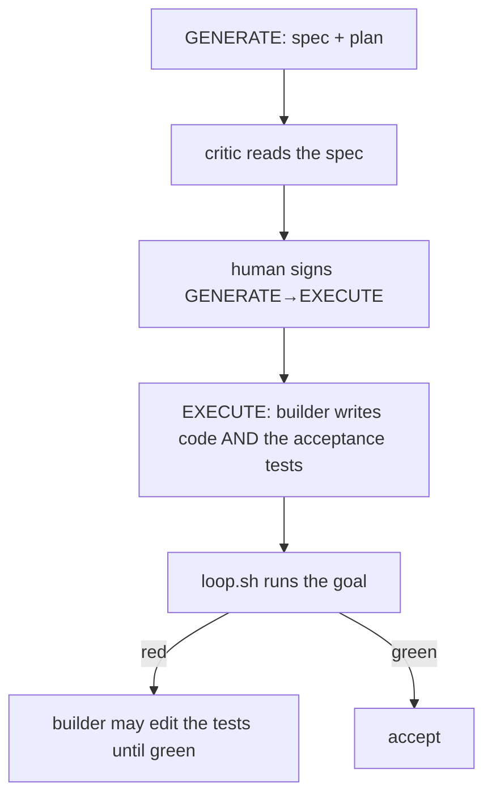
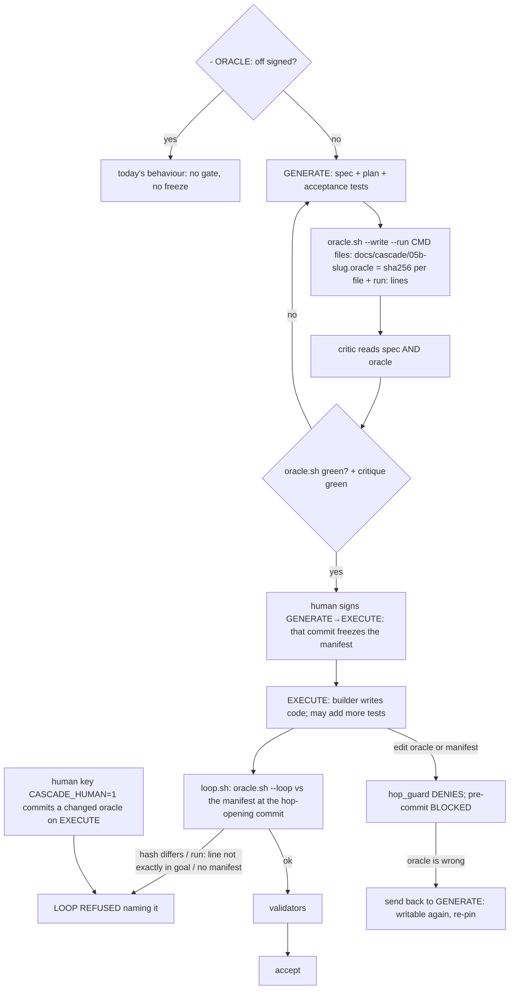

# Stage 05b — t89-frozen-oracle — SPEC (v2, after the critic)

## User story IDs from the PRD

BDD's product is the cascade itself; the stories this slice serves:

- **S-FO1** — As an operator who switches models mid-work, every builder of a slice is judged by the same acceptance
  tests, written and reviewed before the build, which no builder can edit.
- **S-FO2** — As a reviewer at the spec edge, I sign the tests together with the spec: the critic has read both.
- **S-FO3** — As an operator, changing the oracle is a deliberate send-back to GENERATE, never a quiet edit during the
  build.

## The problem, stated as cost

The agent that builds a slice also writes the tests that decide whether it is done. In this repo, t84, t85 and t87's
acceptance files (`tests/ac/t84_progress_watchdog.sh`, `t85_recall_index.sh`, `t87_autopilot_list_retire.sh`) were
each written during EXECUTE by the builder, red twins included (`git log --diff-filter=A --format=%h -- tests/ac/t87*`
→ the EXECUTE commit `90d198d`). The spec critic reads the spec, never the tests. Models are switched mid-work for
usage limits, so the grader changes with the builder: a weaker model can satisfy tests it wrote to its own level.
Nothing stops a builder from editing a failing acceptance test until it passes — `tests/` is writable on every hop
(`.claude/hooks/hop_guard.py:30`), and only `tests/inv/*` (laws) is human-owned (`hop_guard.py:337`,
`.githooks/pre-commit:82-92`).

## Before vs after

Before:



After:



## Benefits and trade-offs

| | Today | After t89 |
|---|---|---|
| Who writes the acceptance tests | the builder, during EXECUTE | the spec writer, during GENERATE; reviewed by the critic |
| A builder editing a failing acceptance test | allowed | denied in session; BLOCKED at commit; `LOOP REFUSED` against the manifest frozen at the hop-opening commit — a consistent rewrite of test and manifest included (C4) |
| Which goal lines count | — | each oracle `run:` command must be a goal `VALIDATOR:` line exactly (whitespace collapsed), so `… \|\| true` or a comment does not count (C5); Gradle/xcodebuild oracles are their exact commands (C1) |
| A model switch mid-EXECUTE | the new model may rewrite the tests | the new model meets the same frozen tests |
| Extra tests the builder adds | allowed | still allowed; they never replace the oracle |
| A wrong oracle | quietly edited | send back to GENERATE (the human's edge), fix, re-pin, re-sign. Even the human's key on EXECUTE does not get past the loop (C2) |
| Cost | — | GENERATE writes tests against interfaces the spec must name exactly; tests for code that does not exist yet must be designed, not discovered |
| Opt-out | — | `- ORACLE: off` signed inside `<EDIT>` in the envelope (the human's), as `DSHARP_GRADLE_HARNESS` |
| Stages 06–09 and 10 | — | unchanged (05b only) |
| Not chosen: freezing by content in hop-state | — | hashes in a per-slice manifest are reviewable in a diff and readable by every gate |
| Not chosen: a second agent writing the tests | — | a fresh-agent author is better still but heavier; freezing first gives most of the value, and t90's switch audit adds the second reader |

## What the slice adds — and the line it must not cross

The line: **an oracle can only make acceptance stricter: it adds a refusal, never a pass. Stages other than 05b,
laws, the receipt and every existing verdict are unchanged. A signed `ORACLE: off` restores today's behaviour.**

### 1. The manifest

`docs/cascade/05b-<slug>.oracle`, committed on the GENERATE hop. Two kinds of line, `#` comments and blank lines
allowed:

```
<64 hex sha256>  <repo-relative path>     one per oracle file (sha256sum format)
run: <command>                            one per oracle command: exactly the goal VALIDATOR line that runs it
```

The `run:` lines are what the goal must hold (C1): a shell oracle is `run: bash tests/ac/x.sh`, a Gradle one
`run: ./gradlew :app:test --tests com.x.AcceptanceTest`. The files must be under a GENERATE-writable path:
`tests/` by default. A product that keeps tests elsewhere lists them in `docs/cascade/generate-writable.txt`, which
**replaces** the defaults, so it must also list `docs/` and `tests/` (`hop_guard.py:90-99`, C1).

### 2. `tests/oracle.sh` (new) and `tests/lib/oracle.py` (new)

Precedence (C9): a signed `- ORACLE: off` — the last such line inside an `<EDIT>` block of `envelope.md`, at HEAD
**and** in the working tree, as `law_harness.py:93-95` reads its switch — wins on every hop: `ORACLE off (signed)`,
exit 0. Otherwise any hop/stage but GENERATE 05b (gate) or EXECUTE 05b (`--loop`) is `ORACLE n/a`, exit 0.

- `bash tests/oracle.sh` — the gate, GENERATE 05b. Checks, one `PASS`/`FAIL` line each (C9): (1) the manifest
  exists (`FAIL  no oracle manifest: docs/cascade/05b-<slug>.oracle`); (2) it lists at least one file; (3) at least
  one `run:` line; then (4…) one check per file: it exists (`FAIL  missing: <path>`) and its sha256 matches
  (`FAIL  hash differs: <path>`). Last line `ORACLE k/n`; exit 0 iff k == n. One file and one `run:` → `ORACLE 4/4`.
- `bash tests/oracle.sh --write --run "<command>" [--run …] <path>…` — writes the manifest (a `#` header, then the hash
  lines, then the `run:` lines). GENERATE 05b only; elsewhere `oracle: --write is for GENERATE (the oracle is frozen
  on EXECUTE)`, exit 2.
- `bash tests/oracle.sh --loop` — EXECUTE 05b. Reads the manifest **as committed at the commit that opened this
  hop** (`affected.hop_base`, `git show <base>:<manifest>`), never the working-tree file (C4). FAILs: `no oracle
  manifest` (none at the base); `cannot find the commit that opened this hop` (no base: fail closed); `missing: <path>`
  / `hash differs: <path>` (working-tree file vs the frozen hash); `run line not in the goal: <command>` (each `run:`
  must equal a column-0 `VALIDATOR:` line of `docs/cascade/goal.md`, whitespace collapsed — not a substring, C5).
  Exit 0 green, 3 otherwise.

### 3. The gates

- **Spec edge.** `stop_guard.spec_gate_red` and `autopilot.py`'s GENERATE→EXECUTE gates run `tests/oracle.sh` beside
  `critique.sh` and `diverge.sh`. `spec_gate_red` keeps lines starting `FAIL`, `CRITIQUE`, `DIVERGE` **and `ORACLE`**,
  so the oracle's own FAIL text reaches the nudge (C6); autopilot names `tests/oracle.sh is red`.
- **Loop.** `tests/loop.sh` makes the call on **one line** (the red twin's anchor, C7):
  `oracle_out="$(bash "$ROOT/tests/oracle.sh" --loop 2>&1)" || oracle_refused "$oracle_out"`, after its hop checks and
  before any validator. `oracle_refused` prints `LOOP REFUSED: the frozen oracle does not hold (t89):`, the FAIL lines,
  `BOTTLENECK` and `WHAT TO DO: restore the oracle file, or send the slice back to GENERATE to change it`; exit 3.
- **Session.** `hop_guard.py`: on EXECUTE 05b, a Write/Edit to a frozen path or the manifest is **denied** — not asked —
  with `'<path>' is part of the frozen oracle for <slug> (t89): send the slice back to GENERATE to change it` (C2). The
  check is one function, `oracle_frozen(root, rel) -> bool`. Other paths under `tests/` are unaffected.
- **Commit.** `.githooks/pre-commit`, after the `CASCADE_HUMAN` exit (`pre-commit:55-57`): on EXECUTE 05b, a staged
  modify, delete or type change (a symlink) of a frozen path or the manifest is `BLOCKED: frozen oracle (t89)` naming
  the file. The human's key lifts it, as it lifts every ownership check, but the loop still refuses the changed oracle
  (C2): the only way to change it is a send-back.
- **Send-back.** On GENERATE the guards do not apply; the sent-back slice edits the oracle and re-runs `--write`, and
  the next GENERATE→EXECUTE commit freezes the new manifest.

### 4. Docs and the critic

AGENTS.md rule 2 becomes "GENERATE stops at spec + plan + the slice's frozen oracle (its acceptance tests and
manifest, t89)" (C3). The critic brief in `docs/cascade/product-e2e-gre-pipeline.md` adds the oracle files and the manifest to what it reads
("do these tests check the spec's acceptance criteria, can each one fail for the right reason?"). `commands/barbar.md`
(both copies) and USAGE.md: GENERATE writes the oracle and runs `oracle.sh --write`; EXECUTE builds against it.

## What the slice must not touch

- Laws (`tests/inv/*`) and their guards; the receipt; stages 06–10; `tests/regress.sh`; any verdict when the oracle
  holds.
- Slices already past GENERATE when the pack is updated: the plugin refreshes a repo only at NONE (t62), so a hop open
  during an upgrade keeps the old scripts until it closes.

## Acceptance criteria — the oracle, written at GENERATE

`tests/ac/t89_frozen_oracle.sh`, written **in this GENERATE hop** and listed in `docs/cascade/05b-t89-frozen-oracle.oracle`
(this slice uses its own rule on itself; the tool does not exist yet, so the manifest is written with `shasum -a 256`).
Scratch repos with the real hooks wired:

- **AC1 — the GENERATE gate.** No manifest → red naming `no oracle manifest`; `--write --run "bash tests/ac/a.sh"
  tests/ac/a.sh` pins the hash and the `run:` line, then `ORACLE 4/4`; an edit → `hash differs`; a gone file → `missing:`.
- **AC2 — the spec edge.** The Stop hook's nudge carries `no oracle manifest`; autopilot says `tests/oracle.sh is red`.
- **AC3 — frozen in session.** On EXECUTE, Edits to the oracle file and to the manifest are `deny` naming `frozen
  oracle`; an Edit to another file under `tests/ac/` gets no decision at all. **Red twin:** `oracle_frozen` returning
  False yields no decision (an empty output — a crashed mutant's generic `ask` does not count, C7).
- **AC4 — frozen at commit (C8).** On EXECUTE: a changed, a deleted and a symlinked oracle file, and a changed
  manifest, are each BLOCKED naming `frozen oracle`; a new extra test lands; the human's `CASCADE_HUMAN=1` commit of a
  changed oracle lands — and the loop then refuses it with `hash differs` (C2).
- **AC5 — the loop.** Intact → n/n. Changed oracle → `LOOP REFUSED` (exit 3), `hash differs`. Oracle **and** manifest
  rewritten consistently after the hop opened → still `hash differs` (C4). Goal without the `run:` line, or with it only
  as `bash tests/ac/a.sh || true` → `run line not in the goal` (C5). No manifest → `no oracle manifest`. **Red twin:**
  the one-line call replaced by `:` (an anchored edit, not a grep) runs the edited oracle to n/n (C7).
- **AC6 — send-back.** `--write` on EXECUTE exits 2; back on GENERATE the oracle is editable and `--write` re-pins it
  (the hash line is read with an exact `^<64 hex>  <path>$` match, C9).
- **AC7 — opt-out and other stages.** `- ORACLE: off` signed → `ORACLE off (signed)` even on EXECUTE, and the loop runs
  without a manifest; EXECUTE 06 without a manifest → the loop runs.

Gate: `bash tests/ac/t89_frozen_oracle.sh`, `bash tests/enforcement.sh` (T89), lint.

## Laws

`bash tests/dsharp_strength.sh` prints `DSHARP 0/0`: NO LAW IN FORCE in this repo. No D# added or changed.

# Stage 05b — PLAN

## Goal

EXECUTE makes the acceptance tests a frozen, hash-pinned oracle written at GENERATE, enforced at the spec edge, in
session, at commit and in the loop — and builds t89 itself against the oracle written now (T89).

## In scope this execute

- [ ] `tests/oracle.sh`, `tests/lib/oracle.py` (new).
- [ ] `tests/loop.sh` — `oracle.sh --loop` before validators.
- [ ] `.claude/hooks/hop_guard.py` — `oracle_frozen()` and its `sign_or_deny`.
- [ ] `.claude/hooks/stop_guard.py` (`spec_gate_red`), `tests/lib/autopilot.py` (GENERATE→EXECUTE gates) — run `oracle.sh`.
- [ ] `.githooks/pre-commit` — the frozen-oracle block.
- [ ] `install.sh` — ships `tests/oracle.sh` (if its `tests/*.sh` list is explicit); `tests/ac/t69_gradle_tuning.sh` parity list.
- [ ] `tests/enforcement.sh` T89; `CONTROL-LINE.md` T89 row.
- [ ] `AGENTS.md` rule 2 (C3); `docs/cascade/product-e2e-gre-pipeline.md` (critic brief, GENERATE step), `commands/barbar.md` + `.claude` copy,
      `USAGE.md`, `CHANGELOG.md` (3.2.0).
- [ ] `docs/cascade/goal.md`: `bash tests/goal.sh reset`, then the oracle plus standing gates.
- [ ] Not touched on EXECUTE: `tests/ac/t89_frozen_oracle.sh` and `docs/cascade/05b-t89-frozen-oracle.oracle` — the oracle.

## Out of scope this execute

- t90 (provenance, switch audit, `handover.sh`), t91 (scorecard).
- A different agent authoring the oracle; mutation scoring.

## Definition of done

- The oracle `bash tests/ac/t89_frozen_oracle.sh` passes **unchanged** (its sha256 matches the manifest); its red
  twins go red; `bash tests/enforcement.sh` exits 0 with T89; lint green; `bash tests/loop.sh` n/n.

## Risks / UNKNOWNs that still block

- **U1 — tests written before the code.** GENERATE must fix exact interfaces (file names, messages, function names
  the red twins patch). A wrong guess is a send-back, which is the intended cost.
- **U2 — Bash edits.** An agent can rewrite an oracle file with a shell command; the session deny does not see it, but
  the commit block and the loop's check against the frozen base manifest do — a consistent rewrite included (C4).

## Ask of you

1. **Required by default for 05b, `- ORACLE: off` as your signed opt-out.** *Default taken.*
3. **`docs/cascade/hop-state.md:33`** says "`GENERATE` writes spec and plan only" — your file. After t89 it should read
   "spec, plan and the slice's frozen oracle". Approve the agent's edit at EXECUTE, or change it yourself (C3).
2. **Version 3.2.0** (new gate). *Default taken.*

## Invariants this hop

- PRESERVE run: no
- /goal set to: n/a — GENERATE; EXECUTE's goal is the frozen oracle + T89 + lint
- /model /effort: as set by the session
- /plan: skipped — this document is the plan
- INVARIANTS I1–I18: held; acceptance only gets stricter (I18)
- Skills: none invoked; brainstorming skipped (brief committed, `4c6b732`)
- critique: C1–C10 answered in `05b-t89-frozen-oracle-critique.md` (spec v2, oracle v2 re-pinned); C3's hop-state
  wording raised as Ask 3
- reads: AGENTS.md, hop-state.md, envelope.md, 05b-briefs.md (t89), hop_guard.py, stop_guard.py, autopilot.py,
  pre-commit, loop.sh, law_harness.py, signed.py, product-e2e-gre-pipeline.md, barbar.md
