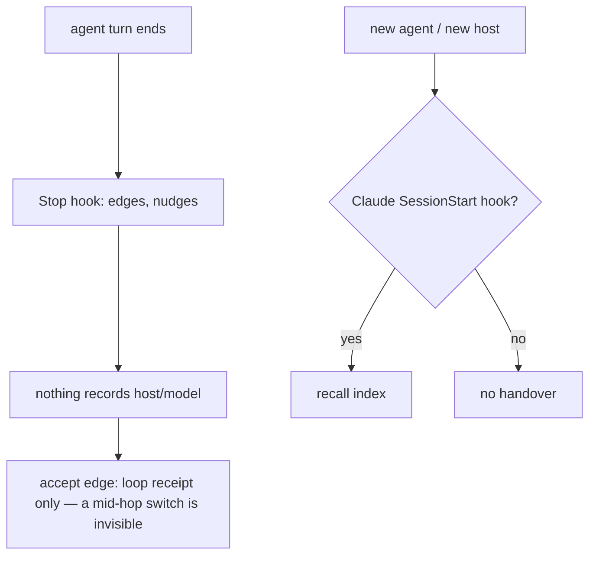
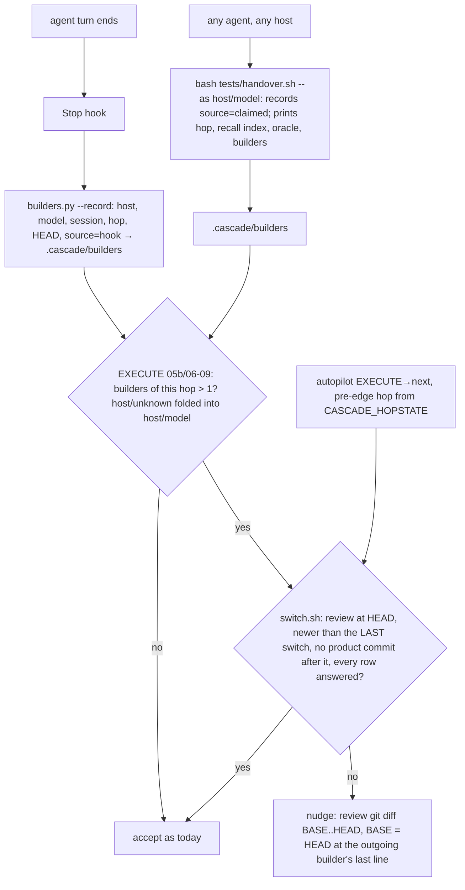

# Stage 05b — t90-provenance-switch-audit — SPEC (v2, after the critic)

## User story IDs from the PRD

BDD's product is the cascade itself; the stories this slice serves:

- **S-PS1** — As an operator who switches models or agents for usage limits, I can see which host and model worked on
  each hop, recorded by the hooks where a host has them and claimed through the handover where it does not.
- **S-PS2** — As an operator, when the builder changed during an EXECUTE hop (05b or 06–09), its accept edge is not
  asked for, and autopilot does not take it, until an independent review of the work since the switch is committed,
  answered, and newer than every switch and every product commit.
- **S-PS3** — As any agent on any host, one command at session start gives me the handover: the hop, the same recall
  index preserve injects, the oracle's real state and who built what.

## The problem, stated as cost

Nothing records who built a hop. Commit trailers name a model only when the agent writes one; hop edges, loop passes
and `decisions.log` record no builder. A slice EXECUTEd partly by one model and finished by another after a usage limit
looks identical to a single-model slice. The handover depends on the host: t85's recall index arrives only through
Claude Code's SessionStart hook (`.claude/hooks/preserve.py`).

What the hooks can see: the Stop event's `transcript_path`, whose assistant entries carry `message.model` (this
session's transcript: `claude-opus-5-5` on every assistant entry), `session_id`, and `BDD_HOOK_HOST` — set to `codex`
or `claude` by the plugin runner (`hooks/run.sh:4`); the repo-local wiring calls the hooks directly
(`.claude/settings.json:39`), so the host defaults to `claude` there, which is correct for that wiring (C1).
`tests/lib/provenance.py` already exists — shared helpers for the spec-edge gates (`critique.py:20`, `diverge.py`) —
so this slice's module is **`tests/lib/builders.py`** and its log **`.cascade/builders`** (C3).

## Before vs after

Before:

After:

## Benefits and trade-offs

| | Today | After t90 |
|---|---|---|
| Who built a hop | unknown | every Stop records host, model, session, hop, HEAD (`source hook`); `handover.sh --as` adds a claimed line on hosts with no Stop hook (C1) |
| A model switch during EXECUTE (05b, 06–09) | invisible | the accept edge and autopilot's edge need a review newer than the **last** switch and the last product commit (C2, C5) |
| What the reviewer reads | — | `git diff <BASE>..HEAD`, BASE = HEAD on the outgoing builder's last line, so the new builder's first turn is included (C6) |
| A host that sometimes reports no model | — | `host/unknown` is folded into the same host's known model: one builder, no false review (C8) |
| Cost | — | one fresh reviewer, only on hops that switched |
| Handover on a host without SessionStart hooks | none | `bash tests/handover.sh --as <host>/<model>`; AGENTS.md makes it the first read |
| Known limit | — | `.cascade/builders` is local and agent-writable, and a claimed line is the agent's word: deleting the log hides a switch (toward today's behaviour, never a false accept of a switched-and-reviewed hop). Hardening (a hash chain, a committed digest) is out of scope |
| Not chosen: commit trailers (the brief asked for one on the edge commit) | — | agent-written; the hook log is the record. Raised as Ask 3 (C1) |
| Not chosen: recording from `tests/loop.sh` (the brief's "every loop pass") | — | a shell cannot see the model; every loop pass ends in a Stop, which can. Raised as Ask 3 (C1) |
| Not chosen: a review on every hop | — | doubles every slice's cost; the switch is where the risk is |

## What the slice adds — and the line it must not cross

The line: **this slice only adds a record and one refusal (a switched hop without a fresh, answered review); no
existing verdict, gate or edge rule loosens. A one-builder hop behaves as today, byte for byte.**

### 1. `tests/lib/builders.py` (new) and `.cascade/builders`

- **Log line** (tab-separated; tabs/newlines in a field become a space; empty → `unknown` for host/model, `-` else; at
  most 5000 lines): `<epoch> <host> <model> <session> <hop> <stage> <slice> <HEAD sha7 or -> <source: hook|claimed>`.
- `builders.py <root> --record <host> <model> <session> [claimed]` — append one line. Best effort, exit 0.
- **The hop it reads** — `CURRENT_HOP/STAGE/SLICE` from `CASCADE_HOPSTATE` (or `CASCADE_ENVELOPE`) when set, the
  hop-state file otherwise, as `oracle.py` does (C4). The hop's lines: same hop, stage and slice, epoch at or after the
  commit time of the hop-opening commit (`affected.hop_base`; it already honours `CASCADE_HOPSTATE`, t81). No base →
  no lines.
- `builders(root: str) -> list[str]` (the red twin's anchor) / `--builders` — the hop's distinct `<host>/<model>` in
  first-seen order, after folding: a `host/unknown` is dropped when the same host has a known model in the hop.
- `switches(root)` / `--switches` — each line whose folded builder differs from the previous line's: `<epoch> <base>`,
  where base is the HEAD on the previous line (the outgoing builder's last Stop).
- `model_of(event: dict) -> str` — `event["model"]` (a string, or a dict's `id`/`display_name`), else the last assistant
  entry's `message.model` in `event["transcript_path"]`, else `$BDD_MODEL`, else `unknown`.

### 2. Recording (`.claude/hooks/stop_guard.py`)

At the start of `judge()`, once a repo root is known: `--record` with `BDD_HOOK_HOST` (default `claude`), `model_of(ev)`,
`ev["session_id"]`. Never changes the hook's output; a failure is silent.

### 3. The switch gate — `tests/switch.sh` (new)

On EXECUTE of stage 05b or 06–09 with a slice (C2), reading the hop as §1:
- one builder or none → `SWITCH none (<builder>)`, exit 0;
- two or more → `docs/cascade/<stage>-<slug>-switch-review.md` must be committed at HEAD and:
  - its adding commit's time ≥ the epoch of the **last** switch (`FAIL  switch review is older than the switch`, C5);
  - no commit after it touches a path outside `docs/cascade/` (`FAIL  work after the review: <n> commit(s)`, C5);
  - a `## Review` table of 1–10 `| R# | severity | finding | evidence |` rows and a `## Dispositions` table answering
    each with `fixed …` / `rejected …` / `human …` (`FAIL  unanswered: R2`);
  - missing → `FAIL  switch review missing: <path> (builders: …)`;
  - prints `SWITCH ok (<builders joined by " → ">)`, or the FAIL lines and `SWITCH red`; exit 0 / 1.
- any other hop or stage → `SWITCH n/a`, exit 0.

### 4. Where it bites

- **Accept edge** — `stop_guard.switch_gate_red(root: str) -> str` (the red twin's anchor: `''` or the FAIL lines). When
  an EXECUTE reply (05b, 06–09) asks for `STITCH NEEDED: accept execute` and `hop_evidence_ok` passes, red → a counted
  nudge: `The builder changed during this hop (<builders>). Dispatch a fresh read-only reviewer over \`git diff
  <BASE>..HEAD\` with the spec and the oracle, commit its rows verbatim to <review path>, answer every row under
  ## Dispositions, then ask for accept again.` — BASE is the first switch's base. Green or no switch → nothing added:
  the hook's output is what it is today.
- **Autopilot** — `tests/lib/autopilot.py`'s EXECUTE→next edge runs `tests/switch.sh` after the loop, with the same
  pre-edge `CASCADE_HOPSTATE` the loop gets (C4); red → refused naming `tests/switch.sh` and its FAIL lines.

### 5. Handover — `tests/handover.sh [--as <host>/<model>]` (new)

`--as` first records a `claimed` line. Then prints: the hop-state lines; `Recall index — …` and the index lines
indented two spaces exactly as `preserve.py` injects them (the same `recall.py` call, C9), or `(no recall index: no
hop running)`; `oracle: ok` / `oracle: FAIL <lines>` / `oracle: n/a` (`oracle.sh` on GENERATE, `--loop` on EXECUTE;
`n/a` when `tests/oracle.sh` is absent); `builders: <a, b, …>`; the last 5 lines of `.cascade/decisions.log`. Exit 0.
AGENTS.md "Read these first" gains item 0: `bash tests/handover.sh --as <your host>/<your model>`.

## What the slice must not touch

- Any existing verdict; the oracle (t89); the loop receipt; laws; `tests/lib/provenance.py` (C3); `preserve.py`'s output.

## Acceptance criteria — the oracle, written at GENERATE

`tests/ac/t90_provenance_switch_audit.sh` (v2), pinned in `docs/cascade/05b-t90-provenance-switch-audit.oracle` with
`bash tests/oracle.sh --write`:

- **AC1 — recording.** host, model, session, hop, HEAD, `hook`; `codex`; event `model` > transcript > `BDD_MODEL` >
  `unknown`.
- **AC2 — builders.** Two models → both, in order; switch red naming the missing review. `claude/unknown` then
  `claude/model-a` → one builder, `SWITCH none` (C8).
- **AC3 — accept.** Switched → nudge naming `builder changed` and BASE = HEAD at model-a's last Stop (C6); one builder →
  **empty output** and no `CRASH` in `decisions.log` (C7). **Red twin:** `switch_gate_red` → `""` gives empty output.
- **AC4 — review.** Answered and after the switch → `SWITCH ok`, accept output empty; unanswered → `unanswered: R2`;
  a later switch A→B→review→C → `older than the switch`; a product commit after the review → `work after the review:
  1 commit` (C5).
- **AC5 — autopilot.** The working tree already on the next hop (as pre-commit sees it) and the pre-edge state passed
  in: refused naming `switch.sh` (C4).
- **AC6 — scope.** One builder → `SWITCH none` (an earlier hop's line ignored); GENERATE → `n/a`; a switched EXECUTE 06
  → red naming `06-a-switch-review.md` (C2).
- **AC7 — handover.** `--as codex/model-x` records one `claimed` line; output has the hop, `oracle: FAIL … no oracle
  manifest` (oracle.sh present, no manifest), `builders: claude/model-a, codex/model-x`, and recall lines **equal** to
  preserve's (C9); NONE → `(no recall index: no hop running)`. **Red twin:** `builders()` keeping only the first.
- **AC8 — presence (labelled):** `install.sh` and `.gitignore` ignore `.cascade/builders` (C10).

Gate: the oracle, `bash tests/enforcement.sh` (T90), lint.

## Laws

`bash tests/dsharp_strength.sh` prints `DSHARP 0/0`: NO LAW IN FORCE in this repo. No D# added or changed.

# Stage 05b — PLAN

## Goal

EXECUTE records the builder on every Stop and every handover, refuses a switched EXECUTE hop's accept and autopilot
edge until a fresh, answered review covers everything since the last switch, and gives every agent one handover
command (T90).

## In scope this execute

- [ ] `tests/lib/builders.py`, `tests/switch.sh`, `tests/handover.sh` (new). `tests/lib/provenance.py` untouched.
- [ ] `.claude/hooks/stop_guard.py` — record on every Stop; `switch_gate_red` at the accept edge.
- [ ] `tests/lib/autopilot.py` — `switch.sh` on the EXECUTE→next edge, with the pre-edge hop state.
- [ ] `install.sh` and `.gitignore` — `.cascade/builders`; `tests/ac/t69_gradle_tuning.sh` parity list (new files).
- [ ] `tests/enforcement.sh` T90; `CONTROL-LINE.md` T90.
- [ ] `AGENTS.md` (read-first item 0), `docs/cascade/product-e2e-gre-pipeline.md` (the switch reviewer's brief),
      `commands/barbar.md` + `.claude` copy, `USAGE.md`, `CHANGELOG.md` (3.3.0) and the version files.
- [ ] `docs/cascade/goal.md`: `bash tests/goal.sh reset`, then the oracle's `run:` line plus standing gates.
- [ ] Not touched on EXECUTE: the oracle `tests/ac/t90_provenance_switch_audit.sh` and its manifest.

## Out of scope this execute

- t91 (scorecard); a hash-chained or committed builder log; commit trailers.

## Definition of done

- The frozen oracle passes unchanged and its red twins go red; `bash tests/enforcement.sh` exits 0 with T90; lint
  green; `bash tests/loop.sh` n/n.

## Risks / UNKNOWNs that still block

- **U1 — claimed lines are the agent's word.** On a host without a Stop hook the only record is what `handover.sh
  --as` is told. AGENTS.md makes it the first command; an agent that skips or lies leaves today's blind spot.
- **U2 — the log is agent-writable.** See the trade-off table.

## Ask of you

1. **Review only on a switch**, not every hop. *Default taken.*
2. **Version 3.3.0.** *Default taken.*
3. **Two deviations from the brief (C1):** no commit trailer on edge commits, and no recording from `tests/loop.sh` —
   the Stop hook (and `handover.sh --as` where there is no Stop hook) is the record. *Default taken; say so if you
   want the trailer anyway.*

## Invariants this hop

- PRESERVE run: no
- /goal set to: n/a — GENERATE; EXECUTE's goal is the frozen oracle + T90 + lint
- /model /effort: as set by the session
- /plan: skipped — this document is the plan
- INVARIANTS I1–I18: held; one more refusal, nothing loosens (I18)
- Skills: none invoked; brainstorming skipped (brief committed, `4c6b732`)
- critique: C1–C10 answered in `05b-t90-provenance-switch-audit-critique.md` (spec v2, oracle v2 re-pinned); C1's
  deviations raised as Ask 3
- reads: AGENTS.md, hop-state.md, envelope.md, 05b-briefs.md (t90), stop_guard.py, autopilot.py, pre-commit, run.sh,
  settings.json, _common.py, preserve.py, recall.py, oracle.py, provenance.py, critique.py, affected.py, install.sh,
  this session's transcript format
