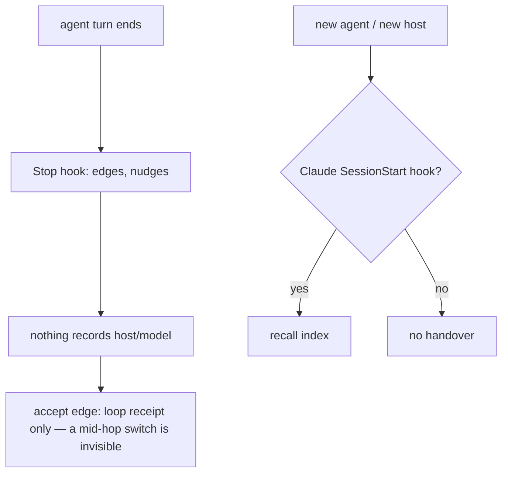
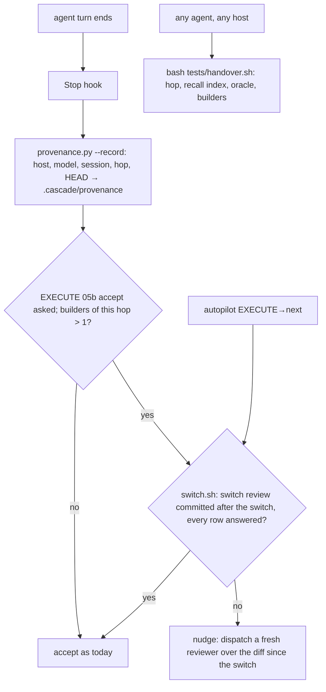

# Stage 05b — t90-provenance-switch-audit — SPEC

## User story IDs from the PRD

BDD's product is the cascade itself; the stories this slice serves:

- **S-PS1** — As an operator who switches models or agents for usage limits, I can see which host and model worked on
  each hop of a slice, recorded by the hooks — not claimed by the agent.
- **S-PS2** — As an operator, when the builder changed during an EXECUTE hop, its accept edge is not asked for until an
  independent fresh-context review of the work since the switch is committed and answered.
- **S-PS3** — As any agent (Claude Code, Codex, another), one command at session start gives me the handover: the hop,
  the recall index, the oracle's state and who built what.

## The problem, stated as cost

Nothing records who built a hop. Commit trailers name a model only when the agent writes one (this session's
commits carry `Co-Authored-By: Claude Opus 5.5` because the harness asked for it); hop edges, loop passes and
`decisions.log` record no builder. A slice EXECUTEd partly by one model and finished by another after a usage limit
looks identical to a single-model slice, so nobody knows which part needs a second look. The handover a new agent gets
depends on the host: t85's recall index arrives through Claude Code's SessionStart hook (`.claude/hooks/preserve.py`),
and an agent without that hook gets nothing unless it knows where to look.

What the hooks can already see: the Stop event's `transcript_path`, whose assistant entries carry `message.model`
(this session's transcript: `claude-opus-5-5` on every assistant entry), `session_id`, and `BDD_HOOK_HOST`
(`hooks/run.sh:4`: `codex` or `claude`). An event may also carry `model` directly.

## Before vs after

Before:

After:

## Benefits and trade-offs

| | Today | After t90 |
|---|---|---|
| Who built a hop | unknown | every Stop records host, model, session, hop and HEAD in `.cascade/provenance` |
| A model switch mid-EXECUTE | invisible | the accept edge needs a committed, answered switch review of the diff since the switch |
| Cost of the extra review | — | only on hops that switched: one fresh reviewer, the same row format as the spec critic |
| Handover on a host without SessionStart hooks | none | `bash tests/handover.sh`; AGENTS.md tells every agent to run it first |
| Where the model comes from | — | the event's `model`, else the transcript's last assistant `message.model`, else `BDD_MODEL`, else `unknown` |
| Known limit | — | `.cascade/provenance` is local and agent-writable: deleting it hides a switch (fails toward today's behaviour, never toward a false accept of a reviewed hop). Hardening it (a hash chain, a committed digest) is out of scope |
| Not chosen: requiring a review on every hop | — | doubles the cost of every slice; the switch is where the risk is |
| Not chosen: commit trailers as the record | — | agent-written; a hook-written log is the better default |

## What the slice adds — and the line it must not cross

The line: **provenance only adds a record and one more refusal (a switched hop without its review); no existing
verdict, gate or edge rule loosens. A hop with one builder behaves as today.**

### 1. `tests/lib/provenance.py` (new)

- `provenance.py <root> --record <host> <model> <session>` appends one tab-separated line to `.cascade/provenance`:
  `<epoch>  <host>  <model>  <session>  <hop>  <stage>  <slice>  <HEAD sha7 or ->`. Fields have tabs and newlines
  replaced by a space; empty becomes `unknown` (host, model) or `-`. Capped at 5000 lines. Best effort: exit 0.
- `provenance.py <root> --builders` (function `builders(root: str) -> list[str]`, the red twin's anchor) prints, one per line in first-seen order, the distinct `<host>/<model>` of the lines
  whose hop, stage and slice equal the current hop and whose epoch is at or after the commit time (`%ct`) of the
  commit that opened the hop (`affected.hop_base`). No base → prints nothing.
- `provenance.py <root> --switched-at` prints the epoch of the first line of this hop whose builder differs from the
  hop's first builder, or nothing.
- `model_of(event: dict) -> str` (importable): `event["model"]` (a string, or a dict's `id`/`display_name`), else the
  last assistant entry's `message.model` in `event["transcript_path"]`, else `$BDD_MODEL`, else `unknown`.

### 2. Recording (`.claude/hooks/stop_guard.py`)

At the start of `judge()`, once a repo root is known, the hook records `BDD_HOOK_HOST` (default `claude`),
`model_of(ev)` and `ev["session_id"]` with `--record`. It never changes the hook's output; a failure is silent.

### 3. The switch gate — `tests/switch.sh` (new)

- On EXECUTE 05b with a slice: `--builders` gives one or none → `SWITCH none (<builder>)`, exit 0. Two or more →
  requires `docs/cascade/05b-<slug>-switch-review.md`:
  - committed at HEAD, and its adding commit's time (`%ct`) at or after `--switched-at` (`FAIL  switch review is older
    than the switch`);
  - a `## Review` table with 1–10 rows `| R# | severity | finding | evidence |`, and a `## Dispositions` table answering
    every R# with `fixed …`, `rejected …` or `human …` (`FAIL  unanswered: R2`);
  - prints `SWITCH ok (<builders joined by " → ">)` or the FAIL lines and `SWITCH red`; exit 0 / 1.
- Missing file → `FAIL  switch review missing: docs/cascade/05b-<slug>-switch-review.md (builders: …)`.
- Any other hop or stage → `SWITCH n/a`, exit 0.

### 4. Where the gate bites

- **Accept edge (`stop_guard.py`, function `switch_gate_red(root: str) -> str`: '' or the FAIL lines — the red twin's
  anchor).** When an EXECUTE 05b reply asks for `STITCH NEEDED: accept execute` and the loop
  evidence is good (`hop_evidence_ok`), the hook runs `tests/switch.sh`; red → a nudge: `The builder changed during
  this hop (<builders>). Dispatch a fresh read-only reviewer over \`git diff <commit at the switch>..HEAD\` with the
  spec and the oracle, commit its rows verbatim to docs/cascade/05b-<slug>-switch-review.md, answer every row under
  ## Dispositions, then ask for accept again.` It is a counted nudge (t63), so the cap tells the human if it repeats.
- **Autopilot (`tests/lib/autopilot.py`).** The EXECUTE→next edge runs `tests/switch.sh` after the loop; red → refused,
  naming the FAIL lines.

### 5. Handover — `tests/handover.sh` (new)

Prints, for any agent: the hop state lines; the recall index (`tests/lib/recall.py`, t85) or `(no recall index: no
hop running)`; the oracle's state (`bash tests/oracle.sh` on GENERATE, `--loop` result on EXECUTE, as `oracle: ok` /
the FAIL lines / `n/a`); `builders: <list>` from `--builders`; the last 5 lines of `.cascade/decisions.log`. Exit 0.
AGENTS.md "Read these first" gains item 0: `bash tests/handover.sh`.

## What the slice must not touch

- Any existing verdict; the oracle (t89), the loop receipt, laws, stages other than 05b.
- `preserve.py`'s output (the handover command is separate).

## Acceptance criteria — the oracle, written at GENERATE

`tests/ac/t90_provenance_switch_audit.sh`, pinned in `docs/cascade/05b-t90-provenance-switch-audit.oracle` with
`bash tests/oracle.sh --write`. Scratch repos; Stop events carry a transcript whose assistant entries name the model:

- **AC1 — recording.** A Stop with a transcript naming `model-a` writes a line with host `claude`, model `model-a`, the
  session and the hop; `BDD_HOOK_HOST=codex` records `codex`; an event `model` field wins over the transcript; neither
  → `unknown`.
- **AC2 — builders and switch.** Two Stops on EXECUTE 05b (`model-a`, then `model-b`) → `--builders` prints
  `claude/model-a` and `claude/model-b`; `switch.sh` exits 1 with `switch review missing`.
- **AC3 — the accept edge.** With a loop receipt for the tree, an accept request on the switched hop is nudged naming
  `builder changed`; the same request on a one-builder hop is not. **Red twin:** a stop_guard without the switch check
  passes the switched hop.
- **AC4 — the review.** A review committed after the switch with every row answered → `SWITCH ok`, and the accept
  passes; an unanswered row → `unanswered: R2`; a review committed before the switch → `older than the switch`.
- **AC5 — autopilot.** On a signed list, the EXECUTE→next edge of a switched hop without a review is refused naming
  `switch.sh`.
- **AC6 — one builder, other hops.** One builder → `SWITCH none`; GENERATE or stage 06 → `SWITCH n/a`; lines from an
  earlier hop of the same slice (before the hop-opening commit) do not count.
- **AC7 — handover.** `handover.sh` prints `CURRENT_HOP: EXECUTE`, the recall index's `spec` line, an `oracle:` line
  and `builders:`; at NONE it prints `(no recall index: no hop running)`. **Red twin:** a `--builders` that returns only
  the first builder makes the switched hop `SWITCH none`.

Gate: the oracle, `bash tests/enforcement.sh` (T90), lint.

## Laws

`bash tests/dsharp_strength.sh` prints `DSHARP 0/0`: NO LAW IN FORCE in this repo. No D# added or changed.

# Stage 05b — PLAN

## Goal

EXECUTE records host and model on every Stop, refuses a switched EXECUTE hop's accept until an independent review of
the post-switch diff is committed and answered, and gives every agent a one-command handover (T90).

## In scope this execute

- [ ] `tests/lib/provenance.py`, `tests/switch.sh`, `tests/handover.sh` (new).
- [ ] `.claude/hooks/stop_guard.py` — record on every Stop; the switch gate at the accept edge.
- [ ] `tests/lib/autopilot.py` — `switch.sh` on the EXECUTE→next edge.
- [ ] `install.sh` / `.gitignore` — `.cascade/provenance` ignored; `tests/ac/t69_gradle_tuning.sh` parity list.
- [ ] `tests/enforcement.sh` T90; `CONTROL-LINE.md` T90.
- [ ] `AGENTS.md` (read-first item 0), `docs/cascade/product-e2e-gre-pipeline.md` (the switch reviewer's brief),
      `commands/barbar.md` + `.claude` copy, `USAGE.md`, `CHANGELOG.md` (3.3.0) and the version files.
- [ ] `docs/cascade/goal.md`: `bash tests/goal.sh reset`, then the oracle's `run:` line plus standing gates.
- [ ] Not touched on EXECUTE: the oracle `tests/ac/t90_provenance_switch_audit.sh` and its manifest.

## Out of scope this execute

- t91 (scorecard), hash-chaining the provenance log, commit trailers.

## Definition of done

- The frozen oracle passes unchanged and its red twins go red; `bash tests/enforcement.sh` exits 0 with T90; lint
  green; `bash tests/loop.sh` n/n.

## Risks / UNKNOWNs that still block

- **U1 — hosts that report no model.** They record `unknown`; two hosts (claude/unknown, codex/unknown) still read as a
  switch, one host with an unreported model reads as one builder.
- **U2 — the log is agent-writable.** Deleting it hides a switch; see the trade-off table.

## Ask of you

1. **Review only on a switch**, not every hop. *Default taken.*
2. **Version 3.3.0.** *Default taken.*

## Invariants this hop

- PRESERVE run: no
- /goal set to: n/a — GENERATE; EXECUTE's goal is the frozen oracle + T90 + lint
- /model /effort: as set by the session
- /plan: skipped — this document is the plan
- INVARIANTS I1–I18: held; one more refusal, nothing loosens (I18)
- Skills: none invoked; brainstorming skipped (brief committed, `4c6b732`)
- critique: pending
- reads: AGENTS.md, hop-state.md, envelope.md, 05b-briefs.md (t90), stop_guard.py, autopilot.py, run.sh, _common.py,
  preserve.py, recall.py, oracle.py, critique.py, affected.py, this session's transcript format
