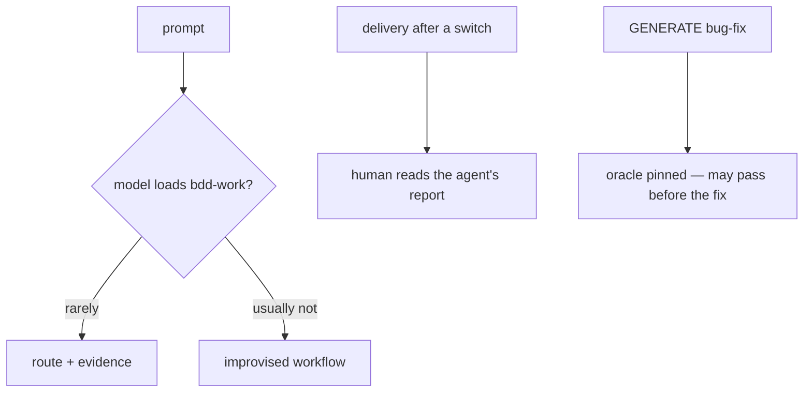
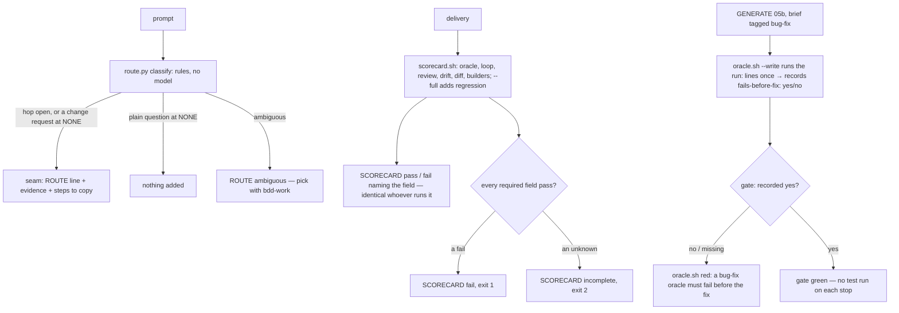

# Stage 05b — t91-scorecard-routing — SPEC (v2, after the critic)

## User story IDs from the PRD

BDD's product is the cascade itself; the stories this slice serves (t91 and t92 merged by the human's call):

- **S-SC1** — As an operator after a model switch, I judge a delivery from one card computed from the tree, the same
  card whoever runs it, instead of from the agent's report.
- **S-RT1** — As an operator, every prompt during a hop carries a route — investigation, bug-fix, feature, refactor,
  verification — computed by code, so a weaker model still starts the right workflow without choosing to load
  `bdd-work`.
- **S-RT2** — As an operator, a bug-fix slice cannot be signed with an oracle that already passes on the unfixed tree.

## The problem, stated as cost

- **No yes/no on a delivery.** t89 (oracle), t84 (loop history, drift) and t90 (builders, switch reviews) each hold a
  piece of the truth in a different file and command. After a switch the human reads the agent's prose to put them
  together — the very report a switched-in model wrote.
- **Routing is opt-in.** `bdd-work` (t82, `skills/bdd-work/SKILL.md`) routes work only when the model loads it; across
  t84–t90 in this repo it was never loaded, and the seam's skill line (`docs/cascade/skill-binding.md`) does not name it.
  pstack's `/poteto-mode` has the same weakness: manual activation, then the model's judgment.
- **A bug-fix oracle can test nothing.** t89 pins tests but does not ask whether they fail before the fix.

## Before vs after

Before:

After:

## Benefits and trade-offs

| | Today | After t91 |
|---|---|---|
| Judging a delivery | the agent's report | `bash tests/scorecard.sh`: one card from the tree, byte-identical whoever runs it |
| A field the tree cannot prove | — | `unknown`, never `pass` |
| Routing | when the model loads `bdd-work` | a `ROUTE` line on every hop prompt and every change request at NONE; `ambiguous` hands back to `bdd-work` |
| Classifier | — | deterministic keyword rules: testable, red-twinnable; maybe 80–90% on real prompts — a misroute costs one advisory line, never a refusal |
| Bug-fix oracle | may pass before the fix | a brief tagged `[bug-fix]` (explicit, like `[diverge]`) needs an oracle that fails on the unfixed tree; keyword detection was rejected: 25 of 35 briefs here contain "fails"/"regression" (C1) |
| Cost | — | `--write` runs the oracle commands **once**, when it pins; the gate reads the recorded result, so a Stop hook never re-runs product tests (C5); the regression field runs only with `--full` |
| A card with unknown required fields | — | `SCORECARD incomplete`, exit 2 — never `pass` (C3) |
| The loop field | — | from the fingerprinted `.cascade/loop-receipt` (the tree it passed on), with `k/n` from the history filtered by hop base (C4) |
| Not chosen: the card in the Stop hook | — | t90's frozen oracle asserts an untouched accept edge has empty output; the card is a command the edge report prints, and the human can run it themselves |
| Not chosen: a model-based classifier | — | latency and cost on every prompt, and a judgment cannot be red-twinned |
| Not chosen: the failing-first rule for every slice | — | a refactor's oracle should pass before and after; only bug-fix is unambiguous |

## What the slice adds — and the line it must not cross

The line: **the card and the route only report; the one new refusal is a bug-fix oracle that already passes. No
existing verdict loosens; t89 and t90's frozen oracles keep passing (both are goal validators of this hop).**

### 1. Scorecard — `tests/scorecard.sh [slug] [--full]` and `tests/lib/scorecard.py` (new)

Slug defaults to the current slice; stage is the current stage (05b default). One line per field, `<field padded to
11> <value>`, then `SCORECARD pass`, `SCORECARD fail` or `SCORECARD incomplete`; exit 0 / 1 / 2. **No timestamps, ages, hosts or paths outside
the repo in the output**, so the same tree prints the same bytes for anyone (S-SC1).

| field | value | required |
|---|---|---|
| `oracle` | `oracle_field(root) -> str` (red-twin anchor): `unknown (no oracle)` only when the oracle is **not due** (`oracle.py --due`, t89); otherwise `pass` when `oracle.py --loop` (EXECUTE) or the gate (GENERATE) is green — run through `tests/lib/oracle.py` directly, so a deleted `tests/oracle.sh` cannot make it unknown (C10) — else `fail <first FAIL line>` | yes |
| `loop` | `pass (LOOP k/n)` when `.cascade/loop-receipt` names this hop and its fingerprint equals `cascade_worktree_sha` now; `fail (tree changed since the last n/n pass)` when a receipt exists but the tree moved; `fail (LOOP k/n)` when this hop's newest history line (hop base and slug match) is below n/n; `unknown (no pass recorded)` otherwise (C4) | yes |
| `review` | `fail unanswered critique: C3` when `05b-<slug>-critique.md` has an unanswered row; `fail switch: <FAIL line>` when `tests/switch.sh` is red; `pass`; `unknown (no critique)` when there is none | yes |
| `drift` | `pass` or `notice <n> path(s): a, b` (t84's `--drift`) | no |
| `diff` | `<n> files, +<a>/-<d> since <base sha7>`, or `unknown (no hop base)` | no |
| `builders` | `a → b` (t90), or `unknown (none recorded)` | no |
| `regression` | with `--full`: `pass` / `fail (<first FAIL>)` from `bash tests/regress.sh`; without: `not run (--full)` | only with `--full` |

Verdict: any required field `fail` → `SCORECARD fail`, exit 1; else any required field `unknown` → `SCORECARD
incomplete`, exit 2 (C3); else `SCORECARD pass`, exit 0. The regression field is required only with `--full`: it runs
the whole suite (minutes), so the edge report prints the card without it and the merge path runs `--full` (C6 —
the brief's "required" is narrowed here, Ask 3).

### 2. Route classifier — `tests/lib/route.py` (new)

`classify(prompt: str) -> tuple[str, list[str]]` (red-twin anchor): the route and the words that matched. Lower-cased
keyword rules, applied in `bdd-work`'s own precedence (`skills/bdd-work/SKILL.md`, "Resolve overlapping intent"):

1. **verification** — a request to check a result: verify, check whether/that/if, confirm, make sure, double-check,
   validate, run the tests, or a question about a result being green/passing (`is/are … green|passing`, `does … pass`);
2. **investigation** — any other question (ends with `?`, or starts with why/how/what/where/which/explain/can you walk/
   how come) — a question about a failure is investigation, not a fix (C8);
3. **bug-fix** — fix, bug, broken, crash(es), error, fail(s/ing), regression, wrong, not working, doesn't work, flaky,
   or a symptom (goes blank, shows … wrong/negative, logged out, red on main);
4. **feature + refactor both** → **ambiguous** (C8: this is the tie, stated explicitly, not a precedence);
5. **feature** — add, build, implement, create, support, introduce, new, enable, allow, make it possible, should be
   able to, I'd like;
6. **refactor** — refactor, rename, extract, restructure, reorganize, clean up, tidy, split, break … into, simplify,
   dedupe, pull … into, move;
7. nothing matched → **ambiguous**.

`route.py "<prompt>"` prints `<route>\t<matched words>`. `route.py --eval <tsv>` scores a labeled file
(`<route>\t<prompt>`, `#` comments) and prints one `<route> k/n` line per route, then `ROUTE EVAL k/n (pct%)`; exit 0
iff ≥ 85% overall **and** every `ambiguous` row is predicted ambiguous (C7, C8). The set has 70 rows: the first 50 and
20 harder ones added after the critic (paraphrases without the rule words, several route words in one prompt).

### 3. The ROUTE line — `.claude/hooks/seam.py`

On UserPromptSubmit, with `ev["prompt"]`:
- **hop open (any class):** append `ROUTE <route> (matched: <words>) — <evidence chain>` and `STEPS (copy into your todo
  list verbatim): 1) … 2) … 3) …` from a fixed table per route (the evidence chains are `bdd-work`'s). Hints:
  GENERATE + bug-fix → `the failing regression test goes in the frozen oracle; it must fail on this tree (t91)`;
  EXECUTE + feature → `out of slice unless the spec names it — brief it instead`; ambiguous → `ROUTE ambiguous — pick
  a route with bdd-work`.
- **NONE:** append the same two lines only for bug-fix, feature or refactor (a change request); nothing for
  investigation, verification or ambiguous.

### 4. The bug-fix oracle rule — `tests/lib/oracle.py`

Opt-in by an explicit tag (C1): a brief written `- <slug>: [bug-fix] …` (like `[diverge]`, t58). For a tagged slice,
`oracle.sh --write` calls `bugfix_oracle_fails(root, runs) -> bool` (red-twin anchor), which runs each `run:` command
once on the current tree — the unfixed product — with a 300 s limit and is true when at least one exits non-zero; the
result goes into the manifest as `# fails-before-fix: yes` or `no`. The GENERATE gate then adds one check: tagged and
not `yes` → `FAIL  a bug-fix oracle must fail on the unfixed tree: every run: line passed` (or `… not recorded: re-run
--write`). The gate never runs the commands itself, so Stop and autopilot gates stay fast (C5). Untagged slices: no
extra check; `ORACLE 4/4` stays `4/4`. Known limit: the recorded line is written at GENERATE by the oracle's author;
it is in the committed manifest diff the critic and the human review, and the hash lines still pin the tests.

### 5. Docs

`commands/barbar.md` (both copies) and USAGE: print `bash tests/scorecard.sh` in every EXECUTE hop report before the
accept edge line, and `bash tests/scorecard.sh --full` before `/barbar merge`. This is prose (Layer 3): the hook cannot
add the card at the edge without breaking t90's frozen oracle, which asserts that an untouched accept edge has empty
hook output; the human can always run the card themselves (C2, Ask 1). `docs/cascade/skill-binding.md` is not changed.

## What the slice must not touch

- Any existing verdict; t89 and t90's frozen oracles — both are goal validators of this hop (C9); the Stop hook's output.

## Acceptance criteria — the oracle, written at GENERATE

`tests/ac/t91_scorecard_routing.sh` and its labeled set `tests/ac/data/t91_routes.tsv`, both pinned in
`docs/cascade/05b-t91-scorecard-routing.oracle`:

- **AC1 — a passing card, identical for anyone** (same checkout; a fresh clone has no receipt and is `incomplete`). An EXECUTE 05b fixture with a green frozen oracle, a `LOOP 1/1` pass,
  an answered critique, one builder: `SCORECARD pass`, exit 0; run again with a different `BDD_HOOK_HOST`/`BDD_MODEL`
  and from another directory: byte-identical.
- **AC2 — failures name the field.** Edited oracle → `oracle      fail`; an unanswered critique row → `review` fail; two
  builders without a review → `review      fail switch`; a last pass `LOOP 1/2` → `loop` fail; an edit after the
  n/n pass → `loop        fail (tree changed …)` (C4); each `SCORECARD fail`, exit 1. `--full` with a failing `REGRESS:` line → `regression  fail`; without it → `not run (--full)`.
- **AC3 — unknown, never pass.** No oracle due, no logs → `oracle`, `loop`, `builders` `unknown`, `SCORECARD
  incomplete`, exit 2 (C3). `tests/oracle.sh` deleted mid-hop → `oracle fail` (C10). **Red twin:** `oracle_field`
  returning `pass` passes an edited oracle.
- **AC4 — the classifier.** `route.py --eval tests/ac/data/t91_routes.tsv` ≥ 85% over 70 rows, and the `ambiguous`
  line reads k/k. **Red twin:**
  `classify` always returning feature fails the bar.
- **AC5 — the ROUTE line.** EXECUTE prompt "the export button crashes on empty input, fix it" → `ROUTE bug-fix` +
  `STEPS`; GENERATE bug-fix prompt → the frozen-oracle hint; NONE "how does the loop work?" → no `ROUTE`; NONE "add a
  dark mode toggle" → `ROUTE feature`.
- **AC6 — the bug-fix oracle rule.** A `[bug-fix]` brief: `--write` records `fails-before-fix: no` for a passing
  oracle (gate red, `must fail on the unfixed tree`) and `yes` for a failing one (green); an **untagged** brief full of
  "fails"/"regression" with a passing oracle keeps `ORACLE 4/4` (C1). **Red twin:** `bugfix_oracle_fails` returning True passes the passing bug-fix oracle.

Gate: the oracle, `bash tests/enforcement.sh` (T91), lint.

## Laws

`bash tests/dsharp_strength.sh` prints `DSHARP 0/0`: NO LAW IN FORCE in this repo. No D# added or changed.

# Stage 05b — PLAN

## Goal

EXECUTE adds the tree-computed delivery scorecard, a deterministic route line on every hop prompt, and the
failing-first rule for bug-fix oracles (T91).

## In scope this execute

- [ ] `tests/scorecard.sh`, `tests/lib/scorecard.py`, `tests/lib/route.py` (new).
- [ ] `.claude/hooks/seam.py` — the ROUTE line.
- [ ] `tests/lib/oracle.py` — the bug-fix rule.
- [ ] `tests/enforcement.sh` T91; `CONTROL-LINE.md` T91; `tests/ac/t69_gradle_tuning.sh` parity list.
- [ ] `commands/barbar.md`, `.claude/commands/barbar.md`, `USAGE.md`, `CHANGELOG.md` (3.4.0) and the version files.
- [ ] `docs/cascade/goal.md`: `bash tests/goal.sh reset`, then the oracle's `run:` line, `bash tests/ac/t89_frozen_oracle.sh`,
      `bash tests/ac/t90_provenance_switch_audit.sh` (C9), plus standing gates.
- [ ] Not touched on EXECUTE: the oracle `tests/ac/t91_scorecard_routing.sh`, `tests/ac/data/t91_routes.tsv`, the manifest.

## Out of scope this execute

- The card inside the Stop hook or the merge gate; a model-based classifier; the cross-model eval (next).

## Definition of done

- The frozen oracle passes unchanged and its red twins go red; t89 and t90's oracles still pass; `bash
  tests/enforcement.sh` exits 0 with T91; lint green; `bash tests/loop.sh` n/n.

## Risks / UNKNOWNs that still block

- **U1 — the labeled set is written by the same agent as the rules** (C7). It is frozen before route.py exists and
  now holds 20 rows chosen to defeat a keyword list; that narrows, not removes, the bias. The cross-model eval later
  brings prompts no rule author wrote.
- **U2 — a misclassified brief** adds or skips the bug-fix rule. Wrongly added, it asks for a failing test, which a
  good feature oracle has anyway; wrongly skipped, the slice is where it is today.

## Ask of you

1. **The card is a command the edge report prints**, not part of the Stop hook (t90's oracle forbids hook output
   there). *Default taken.*
2. **Version 3.4.0.** *Default taken.*
3. **Regression only with `--full`** (C6): the brief made it a required field; running the whole suite on every card
   takes minutes. The edge report shows the card without it, the merge path runs `--full`. *Default taken.*

## Invariants this hop

- PRESERVE run: no
- /goal set to: n/a — GENERATE; EXECUTE's goal is the frozen oracle + T91 + lint
- /model /effort: as set by the session
- /plan: skipped — this document is the plan
- INVARIANTS I1–I18: held; one new refusal, nothing loosens (I18)
- Skills: none invoked; brainstorming skipped (brief committed, `59fcbbf`)
- critique: C1–C10 answered in `05b-t91-scorecard-routing-critique.md` (spec v2, oracle v2 re-pinned); C2 and C6
  raised as Asks 1 and 3
- reads: AGENTS.md, hop-state.md, envelope.md, 05b-briefs.md (t91), skills/bdd-work/SKILL.md, seam.py, oracle.py,
  builders.py, watchdog.py, recall.py, regress.sh, evals/hops/t82-*, pstack's poteto-mode SKILL.md
