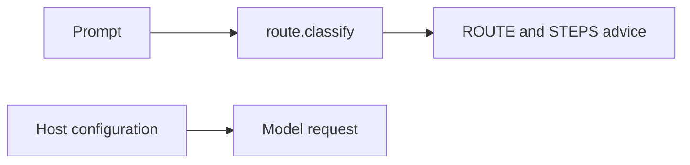
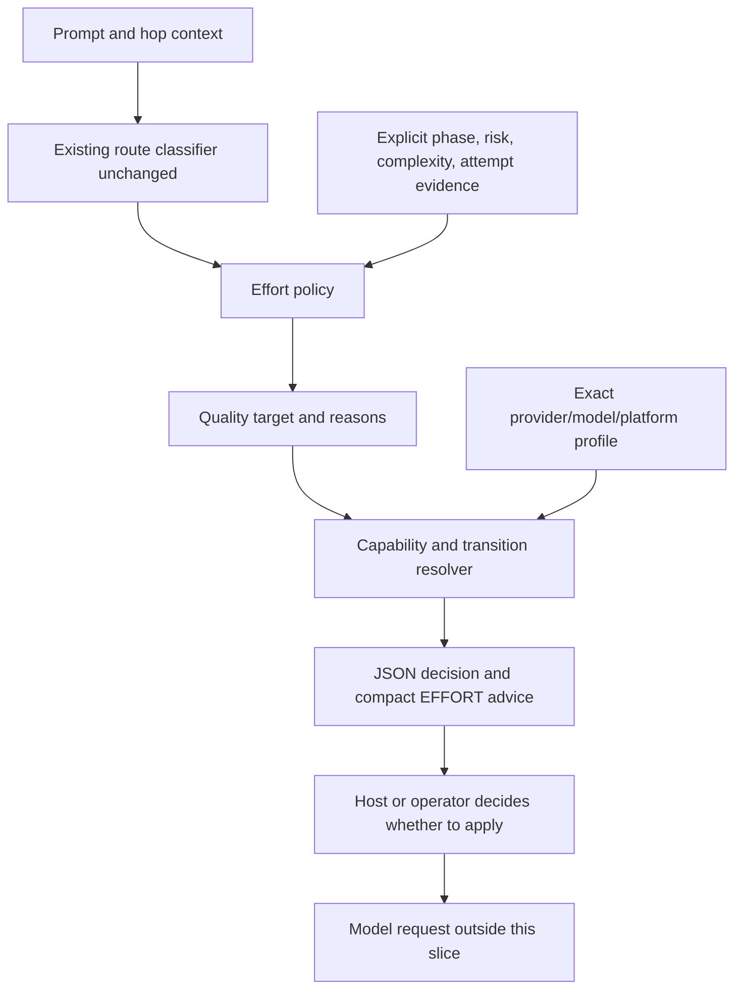

# Stage 05b — t93-adaptive-effort-routing — draft SPEC

Status: requested by the human on 2026-11-04; not accepted, not an active hop. `hop-state.md` still names EXECUTE
05b t91-scorecard-routing. This draft grants no implementation or transition authority. t92 was already folded
into t91, so this proposal uses t93. The paired plan is
[`plans/05b-t93-adaptive-effort-routing.md`](plans/05b-t93-adaptive-effort-routing.md).

## User story IDs from the PRD

This pack's product is the cascade. Proposed slice stories, not claims of accepted PRD requirements:

- S-EF1: As an operator, I get an explainable effort recommendation appropriate to the work's phase, risk and uncertainty.
- S-EF2: As an operator switching foundation models, I get supported provider settings or an explicit unknown/unsupported result.
- S-EF3: As an operator paying for long agent sessions, I can avoid unnecessary configuration churn without trading away correctness.
- S-EF4: As an operator, I can distinguish a recommendation from an effort setting the host actually applied.

## Problem and scope

`tests/lib/route.py:classify()` classifies workflow intent. `.claude/hooks/seam.py:route_lines()` appends ROUTE and
STEPS. Neither chooses effort, calls a model API, owns the host's model configuration, nor receives token/cache
usage. Adding an EFFORT sentence cannot change those facts.

This slice adds a deterministic, offline effort decision and portable CLI alongside the existing classifier.
It emits a proposed provider setting and transition guidance, never applies it. The existing Claude seam gets
one compact advisory line. Other hosts can invoke the same CLI. Automatic API/host adapters, real usage
collection and proof of cost savings are separate work, not silently promised by this slice.

## Approaches considered

| Approach | Benefit | Cost / decision |
|---|---|---|
| Fixed effort per workflow route | Small | Cannot distinguish routine coding from a risky migration; rejected. |
| Deterministic policy plus explicit provider capabilities | Explainable, offline, supports new models without code changes | Requires capability maintenance and structured evidence; selected. |
| Another model judges every prompt and drives API configuration | Potentially more nuanced | Adds inference, latency, credentials and a new execution subsystem; outside this slice. |

## Before vs after

Before:



After:



## Benefits and trade-offs

| Concern | After this slice | Limit |
|---|---|---|
| Quality | Phase defaults plus risk floors and evidence-based escalation | A deterministic policy is not proof of task difficulty. |
| Compatibility | Exact capability profiles for model, provider and platform; unsupported is explicit | Provider names alone never establish model support. |
| Cache reuse | Transition advice distinguishes known reusable-prefix updates, invalidating changes and unknowns | No guaranteed hit rate or access to server KV memory. |
| Operational cost | No inference calls, no new dependencies, no credentials | Actual billing and success rates need external measurements. |
| Trust | Every result says `application_status: not_applied` | Native host adapters remain a later slice. |

## Decision contract

Add `tests/lib/effort.py`, using standard-library frozen dataclasses and enums. Public entry point:

```python
def recommend(context: EffortContext, profile: CapabilityProfile | None) -> EffortDecision:
    ...
```

`EffortContext` carries these validated values; absent optional evidence stays unknown:

| Field | Values / rule |
|---|---|
| `route` | Existing classifier's six route names. |
| `phase` | `spec`, `plan`, `code`, `debug`, `review`, `verify`, `investigate`, `unknown`. Explicit phase wins. |
| `hop`, `stage` | Current context for defaults and output; never transition authority. |
| `complexity` | `simple`, `normal`, `complex`, `unknown`; default unknown. |
| `uncertainty` | `known`, `unknown`, `high`; default unknown. |
| `risk_tags` | Subset of `auth`, `billing`, `credits`, `ownership`, `security`, `privacy`, `concurrency`, `destructive-data`, `irreversible-migration`. Caller-supplied, not extracted from a casual keyword mention. |
| `task_id` | Opaque identifier, at most 128 characters; optional. |
| `previous` | Previous decision's task id, quality target, failure fingerprint, evidence fingerprint. Optional. |
| `failure` | Current nonempty failure fingerprint and evidence fingerprint; absent means no failure evidence. |
| `current_setting` | Observed provider effort value, optional; never infer from a prior recommendation. |
| `override` | Explicit desired provider effort value, optional; never inferred from quoted prompt text. |

Only JSON primitives are accepted by the CLI. Unknown keys, unknown enum values, malformed previous/failure
records, non-string identifiers or identifiers over their limit are input errors. A failure record requires
both fingerprints. Fingerprints are opaque bounded strings (maximum 128 characters each), never raw logs.
No timestamps, transcript reads, environment dumps, hidden history collection or `.cascade` state writes.

Return `EffortDecision` as a versioned JSON object:

```json
{
  "schema_version": 1,
  "route": "feature",
  "phase": "plan",
  "quality_target": "high",
  "reasons": ["risk:billing"],
  "next_action": "continue",
  "resolved_setting": null,
  "compatibility": "unknown",
  "transition": "unknown",
  "cache_effect": "unknown",
  "application_status": "not_applied",
  "warnings": ["No exact capability profile supplied"]
}
```

Quality target is always `low`, `medium` or `high`; these are internal policy levels, not cross-provider
equivalences or a numeric 0–100 scale. All list output is deterministic, deduplicated and sorted. A separate
`state` member returns the bounded current task id, target and failure/evidence fingerprints for an explicit
caller to supply on a later boundary. It is not written to disk by the pack.

## Policy, in precedence order

1. Resolve phase: explicit phase; otherwise GENERATE means spec; EXECUTE stage 10/11 means review; otherwise
   map bug-fix to debug, feature/refactor to code, verification to verify, investigation to investigate,
   ambiguous to unknown. Phase does not change the route or cascade permissions.
2. Default to medium for every phase. Low is permitted only for code/verify/investigate when complexity is
   explicitly simple, uncertainty is explicitly known, risk tags are empty, and there is no failure evidence.
   A simple plan may also use low under exactly those conditions. Spec and review retain medium by default.
3. Any risk tag, complex work or high uncertainty sets a high floor. Debug with failure evidence is high;
   a vague bug report without evidence is medium plus `next_action: investigate`.
4. On the same nonempty task id, a new failure with new nonempty diagnostic evidence raises the prior target
   by one level, capped at high and never below the current floor. The first recorded failure has no proven
   new-evidence delta: recommend investigation and retain the calculated floor.
5. Repeated identical failure and identical evidence on the same task yields `next_action: investigate` and
   `reasons: ["stalled:same-failure-no-new-evidence", ...]`. Do not escalate merely because another attempt ran.
6. Within a task, retain the higher previous target; reset this retention only on a different nonempty task
   id. With no task id, do not reuse previous state. The CLI has no automatic tool-call feedback loop.
7. Preserve an explicit override verbatim when supported by the exact profile. Keep the computed quality
   target visible, warn `override:below-quality-target` when the mapping proves it lower, and never silently
   substitute a different value for an unsupported override. Overrides do not erase risk or stall notices.

Examples required in the operator guide: simple known rename -> low; normal plan -> medium; billing plan ->
high; debugging with a real failure -> high; vague "fix it" -> medium/investigate; repeated unchanged failure
-> investigate without endless escalation; unknown complexity -> medium, never an inferred low.

## Foundation-model compatibility

`bash tests/effort.sh --context <json-file> [--profile <json-file>]` reads at most 64 KiB per file and performs
no network calls. Capability profiles are operator-owned JSON outside the pack's hardcoded policy. The profile
must name an exact provider, model id, API/platform and a source URL plus `verified_on` ISO date. No wildcard
model families, automatic latest aliases, price tables or automatic model substitutions.

Profile schema version 1:

- `provider`, `model`, `platform`, `source_url`, `verified_on`: nonempty strings; source URL must be https.
- `supported_values`: a nonempty unique list of provider setting strings, each at most 64 characters.
- `mapping`: keys low/medium/high, each containing one supported setting or null. A null mapping is
  unsupported, not permission to choose a lower level. Different internal levels may map to the same native value.
- `control`: `reasoning.effort`, `output_config.effort`, `thinkingConfig.thinkingLevel`,
  `thinkingConfig.thinkingBudget`, or `other`. For `other`, profile must supply a nonempty `control_name`.
- `update_mode`: `turn-update`, `request-setting`, `session-only`, or `unknown`.
- `cache_effect`: `preserves-prefix`, `invalidates-prefix`, or `unknown`.

Budget values are represented as strings in this decision protocol; the future host adapter must validate
and convert them for its native API. This slice generates no executable shell commands or API request bodies.
An optional profile is a capability claim supplied by the operator, not independently verified provider support.
Sources and verification dates are returned in the decision for inspection; no claim of current SOTA ranking.

Compatibility is `supported`, `unsupported`, or `unknown`. No profile means unknown. Invalid profiles are
errors, not unknown. A requested low/medium/high that maps to null is unsupported. Explicit override takes
precedence for `resolved_setting`, with the quality target retained. `application_status` is always not_applied.

Document profile examples for OpenAI, Anthropic and Gemini, with explicit source links, dates, exact model/API
selection instructions and no real model ids embedded in policy code. Executable tests use fictional model ids.
Other foundation models work by supplying their own validated profile. Compatibility means the decision contract
works; it does not claim the pack is a provider SDK or that it can alter an arbitrary host's configuration.

## Cache-aware transitions

Resolve only after the quality target and supported setting are known:

| Condition | transition | Rule |
|---|---|---|
| No exact profile or no observed current setting | unknown | Never infer current effort from previous advice. |
| Unsupported target/override | unsupported | Do not recommend a fabricated control. |
| Current setting equals resolved setting | unchanged | No configuration update. |
| Known turn-update plus preserves-prefix | turn-update | Recommend the documented per-turn mechanism. |
| Known request-setting plus preserves-prefix | request-setting | Report the declared capability; no request is sent. |
| Prefix invalidates, or session-only | next-session | Advise a session boundary and warn when current effort is below quality target. |
| Anything else | unknown | Report uncertainty; do not promise cache preservation. |

The prefix-invalidating/session-only rule takes precedence over either update rule. No recommendation lowers
quality_target to save a cache hit. No automatic session restart, compaction, host-global config edit or model
switch. `cache_effect` is copied from the selected capability claim, not measured; unchanged reports unchanged.

Effort affects generated reasoning work; prompt-cache reuse depends on prefix and provider behavior. The pack
does not observe or control GPU KV allocation. It must not label a token count as KV bytes or claim a fixed
percentage saving. Evaluate future adapters using task success, latency, reasoning tokens, uncached input,
cache reads/writes and configured monetary rates; missing telemetry stays unknown. No telemetry collector,
dashboard or monetary estimator in this slice.

## Hook and CLI behavior

- Keep `classify(prompt)` signature, route CLI text/eval output, route precedence, and ROUTE/STEPS bytes unchanged.
- Empty/whitespace prompt: no EFFORT line. Idle questions remain silent. Existing empty-prompt T67 behavior holds.
- On prompts already receiving ROUTE, append at most one deterministic EFFORT line, at most 240 characters.
  Example: `EFFORT recommend=medium applied=unknown phase=code reason=default:code`.
- The seam has only prompt/hop context: it passes no profile, override, risk, complexity or historical evidence.
  It must not invent those inputs. Rich decisions are available through the portable CLI. The hook's recommendation
  is therefore conservative and may remain medium; this limitation is explicit, not hidden sophistication.
- `BDD_EFFORT=off` removes only EFFORT advice, preserving existing seam output byte-for-byte. Missing/invalid helper
  never blocks a prompt and emits a bounded `EFFORT unavailable` notice for nonempty routed prompts.
- CLI success exits 0, including explicit unsupported/unknown decisions; invalid JSON/profile/input exits 2 with
  a bounded error on stderr and no JSON success object. Diagnostics never dump input files or prompts. `--help`
  exits 0. There are no configuration writes, external commands, API calls or side effects in the evaluator.

## Acceptance criteria and proposed oracle

The GENERATE hop must write `tests/ac/t93_adaptive_effort_routing.sh` and
`tests/ac/data/t93_effort_cases.json`, then freeze both under `docs/cascade/05b-t93-adaptive-effort-routing.oracle`.
This draft lists executable checks to build; neither the oracle nor tests are claimed to exist yet.

| AC | Required observation |
|---|---|
| AC1 | Table-driven exact outputs cover every phase, six routes and phase precedence; normal plan is medium, simple known plan low, complex plan high. Unknown signals never choose low. |
| AC2 | Every individual risk tag forces high in all eight phases; low override retains high target plus warning. No whole-word prompt mention becomes a structured risk claim. |
| AC3 | Matching task + failure + changed evidence raises one level; identical failure/evidence investigates without escalation; different task does not inherit effort; same task never automatically downgrades. |
| AC4 | OpenAI-style, Anthropic-style, Gemini level and Gemini budget fictional profiles resolve supported mappings; null mapping and unsupported override stay unsupported; absent profile stays unknown; no silent model fallback. |
| AC5 | All transition rows and precedence are exercised, including invalidating+turn-update -> next-session, already-equal -> unchanged, absent current -> unknown, and high risk never reduced for cache reuse. |
| AC6 | Invalid JSON, oversized files, malformed state, unknown fields/enums, invalid profile source/date/mapping -> exit 2 without input disclosure; application_status always not_applied. Byte-identical output from any cwd and host. |
| AC7 | Real seam event gets one bounded EFFORT line; no line for whitespace or idle question; off restores baseline; missing helper remains nonblocking with a notice; existing ROUTE/STEPS unchanged. |
| AC8 | Standalone install ships new helper and wrapper, rerun is idempotent, plugin/standalone bdd-work copies agree; no dependency or credential needed. |
| AC9 | Red twins: always-low policy fails risk cases; always-high fails simple plan; ignoring task id fails state cases; always-preserves-cache fails transition cases; returning applied fails application-status checks. Each twin must fail for the named assertion. |

Proposed goal validators: `bash tests/ac/t93_adaptive_effort_routing.sh`,
`bash tests/ac/t91_scorecard_routing.sh`, `bash tests/ac/t67_envelope_shards.sh`,
`bash tests/enforcement.sh # standing`, `bash tests/lint.sh # standing`.

## Laws and boundaries

NO LAW IN FORCE in the current envelope. No D# is proposed or modified. No product code, existing acceptance
test, frozen oracle, protected hop field or EDIT block changes in this drafting task. t91's scorecard findings
and stale switch-review gate remain separate work; this draft does not accept or clear them.

## Sources and evidence limits

Checked 2026-11-04. Provider documentation can change; these inform profile examples, not runtime promises:

- [OpenAI reasoning](https://developers.openai.com/api/docs/guides/reasoning): supported per-turn effort updates
  can preserve the original prefix; API/mode and compaction restrictions require exact capability matching.
- [OpenAI prompt caching](https://developers.openai.com/api/docs/guides/prompt-caching): cached prefix reuse and
  reasoning-token generation are distinct mechanisms. The router cannot infer GPU KV memory from API token usage.
- [Anthropic effort](https://platform.claude.com/docs/en/build-with-claude/effort): supported per-message updates
  and top-level updates have different cache consequences; model and platform support matters.
- [Gemini thinking](https://ai.google.dev/gemini-api/docs/thinking): thinking levels and budgets vary by model.
  No Gemini cache-preservation claim is established for this draft; examples must use unknown until verified.

## Review status and open decisions

The human approved preparing this spec and plan, not EXECUTE. Selected MVP is advisory policy plus a portable
decision contract, not automatic effort application. If automatic application is required for this first slice,
split a host adapter into its own spec rather than claiming the seam controls an API it does not own.

Before this can be an accepted GENERATE delivery: the human signs the new GENERATE hop; acceptance tests and
oracle are written and committed; an independent critic checks the tests with the spec; findings are answered;
`bash tests/critique.sh` and `bash tests/oracle.sh` pass. Current draft review cannot substitute for those gates.
