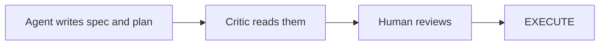
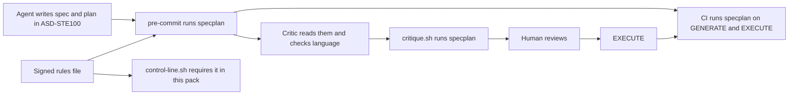

# Stage 05b — t94-specplan-contract — SPEC

Status: the human signed GENERATE 05b t94-specplan-contract at `1b2305c`. This hop writes the spec, the plan and the
frozen oracle. This hop writes no product code. The paired plan is
[`plans/05b-t94-specplan-contract.md`](plans/05b-t94-specplan-contract.md).

## User story IDs from the PRD

This pack's product is the cascade. These are proposed slice stories. They are not accepted PRD requirements.

- S-SP1: As a human, I get a spec and a plan with one clear meaning, from every host and model.
- S-SP2: As a human, I see the allowed scope, the prohibited scope and the checks before a build starts.
- S-SP3: As a human, I can measure the effect of this rule on my own tasks.
- S-SP4: As a human, I pay for less required reading on each hop.
- S-SP5: As a human, I see a plan rejected before coding if it omits a required behavior.

## Problem and scope

The brief states a hypothesis. Ambiguous text in a spec or a plan causes wrong assumptions, unneeded edits and missed checks.
No measured result exists for coding agents, so this slice claims no gain.

The pack has frozen oracles, a spec critic and plan constraints. The pack has no rule for spec language. No field states the prohibited scope. No test compares spec wording.

`AGENTS.md` lists `CONTROL-LINE.md` as required reading. That file holds 38 KB, and its test table holds 32 KB of that amount.

The human decided these items on 2026-11-05:

- ASD-STE100 principles apply to each new spec and plan, on every host. This rule does not wait for the benchmark.
- The attention work and the language work stay in one slice.
- The slice adopts requirement IDs, task traceability and task dependencies from the AICL proposal. It stays in Markdown.

## Sources and evidence limits

The publisher's site refused automated fetches with HTTP 403. This hop did not read the standard. The sources below are secondary:

- [tcworld](https://www.tcworld.info/news/asd-ste100-issue-9-setting-a-standard-for-technical-documentation) states that Issue 9 is the current issue, dated January 2025.
- [ASD Europe](https://www.asd-europe.org/news-media/news-events/news/simplified-technical-english-asd-ste100-issue-9) reports the release of Issue 9.
- [ASD download page](https://www.asd-europe.org/standards-specifications/simplified-technical-english/download-asd-ste-100) is the route to request a copy.

The search results state that ASD holds the copyright and warns against unauthorized distribution. Thus the pack ships no dictionary.

The limits of 20 words and 25 words come from general knowledge. This hop did not verify them against Issue 9. Thus the limits stay in a file that the human signs.

## Approaches considered

| Approach | Decision | Reason |
|---|---|---|
| Rule in prose only | Rejected | Prose binds no host (I18), and the human asked for every AI. |
| Full conformance checker | Rejected | It needs the dictionary, and the pack does not hold a license to ship it. |
| Limits in the code | Rejected | The limits are not verified, and an agent could edit them. |
| Signed rules, script, critic | Chosen | The script checks what it can detect. The critic checks the rest. |
| One gate inside `critique.py` | Rejected | Separate scoring keeps the `CRITIQUE k/n` meaning unchanged. |
| Replace ASD-STE100 with AICL YAML | Rejected | AICL sets structure and not wording, so a statement can stay vague. The pack ships no ASD text, so the license does not block the rule. |
| Separate YAML files for each slice | Rejected | More files cost attention, two copies can diverge and Python's standard library has no YAML parser. |
| Markdown tables with IDs | Chosen | The standard library parses them, and the spec stays one file. |

## Before vs after





## Benefits and trade-offs

| Item | Benefit | Cost |
|---|---|---|
| Contract fields | The human sees the allowed scope and the prohibited scope before the build. | Each spec gets longer. |
| ASD-STE100 rule | Text has fewer possible meanings. This is a hypothesis. | Text can lose detail and can use more tokens. |
| Traceability | A plan that omits a required behavior fails before the build. | Each spec and plan holds one more table. |
| Script check | The check binds every host through git and CI. | The script detects only some rules. It does not prove conformance. |
| Signed rules | The hook blocks an unsigned change to the limits or the off switch. | The human must verify the limits against Issue 9. `--no-verify` skips the hook, and CI cannot see a signature. |
| Benchmark scorer | The human can measure the effect later. | The scorer alone produces no result. Paid runs stay separate. |
| Table move | Required reading drops by about 31 KB. | One more file holds the evidence, and `tests/lint.sh` must follow it. |

## Decision contract

### The check

`bash tests/specplan.sh` runs `tests/lib/specplan.py`. It reads the spec `docs/cascade/<stage>-<slug>.md` and the plan `docs/cascade/plans/<stage>-<slug>.md`, if that plan exists.
The `--index` flag makes it read all files from staged text: hop state, rules, envelope, spec and plan. The check prints `PASS`, `FAIL` and `WARN` lines and then `SPECPLAN k/n`. It exits 0 when k equals n. It exits 1 in other cases.

The check prints `SPECPLAN n/a` and exits 0 in these cases:

- The hop is not GENERATE or EXECUTE.
- The stage is not 05b, and the slice has no spec at that path.
- The repo never held `docs/cascade/specplan-rules.md`.
- The envelope holds `- SPECPLAN: off` inside `<EDIT>`.
- The spec predates the rules.

The language rules apply to each stage with a slice spec. The contract and the traceability apply to 05b only, because other stages have their own shapes. Stages 01 to 04 have no slice id, so the rule stays prose there.

A spec predates the rules when its adding commit is a strict ancestor of the commit that added the rules file. A send-back of an older slice thus needs no rewrite. A spec that is not at HEAD is new.

If the rules file left the repo after it landed, the check fails. A missing file thus cannot turn the check off.

`check_contract(text)`, `check_language(text, rules, name)` and `check_trace(spec, plan)` each return a list of failures. The oracle stubs these three names.

### The rules file

`docs/cascade/specplan-rules.md` holds these lines inside `<EDIT>`:

```
SPECPLAN_MAX_WORDS_PROCEDURE: 20
SPECPLAN_MAX_WORDS_DESCRIPTIVE: 25
SPECPLAN_BANNED: etc. | and/or | as needed | as necessary | if possible | and so on
```

The check reads limits only from `<EDIT>`. A missing, invalid or duplicate limit fails. The file states that the check does not claim conformance. The file also states that the pack does not ship the dictionary.
The banned list is this pack's own list. It is not part of the standard.

`install.sh` seeds this file once and never overwrites it, so a re-install keeps the human's limits.

The hook blocks each staged change to this file unless the human signs. The hook also blocks each staged change to a `SPECPLAN:` line in the envelope. `tests/lib/edit_tags.py` allows a new `<EDIT>` block, so that mechanism alone does not protect these controls.
On EXECUTE the agent writes the proposal. The human runs `bash tests/sign.sh docs/cascade/specplan-rules.md`, because a new file gets no permission dialog.

### Language counting

- A list item or a paragraph sentence counts as one sentence or more.
- A numbered item uses the procedure limit. Other text uses the descriptive limit.
- Inline code counts as one word.
- The count skips fenced blocks, tables, headings, quotes and HTML comments.
- The count reads two table cells: the statement under `## Requirements` and the action under `## Tasks`.
- A requirement statement uses the descriptive limit. A task action uses the procedure limit.
- A banned term fails outside code, in any letter case.
- A possible passive prints `WARN` and does not fail. A regex cannot detect passive voice with enough precision to block a commit.

### The contract

The spec holds `## Execution contract` with `### allowed`, `### prohibited`, `### procedure` and `### acceptance`. Each field holds one list item or more. The procedure uses a numbered list. Each acceptance item holds inline code or starts with `manual:`.

### Traceability

The spec holds `## Requirements`. The plan holds `## Tasks`. If a plan file has no `## Tasks`, the check reads that section from the spec. If a plan file has it, the check ignores the spec's section.

```
| ID | Priority | Statement | Check |
| REQ-1 | MUST | The tool writes one report. | `bash tests/ac/a.sh` |

| ID | Depends on | Verifies | Action |
| T1 | — | REQ-1 | Write the test. |
```

- The priority is MUST, SHOULD or MAY.
- Each MUST holds inline code or `manual:` in its check cell.
- Each MUST has a task that verifies it.
- Each task verifies one known requirement or more.
- Each dependency names a known task. `—` means no dependency.
- A dependency cycle fails.
- A duplicate ID fails.

### The three layers

- `tests/critique.sh` runs the check on GENERATE 05b, after its own score. It exits non-zero if either score fails.
- `.githooks/pre-commit` runs the check with `--index` when a commit stages the spec or the plan. It prints `BLOCKED`. If the rules file exists and the checker does not, the hook also blocks. The check runs before the `CASCADE_HUMAN` exit, so the key does not skip it. A human turns it off with the signed off line.
- `.github/workflows/control-line.yml` runs `bash tests/specplan.sh`.
- `tests/control-line.sh` requires the rules file in this pack. The check itself fails a deleted file in each repo.

Agent hooks get no new code. A git hook binds locally and `--no-verify` skips it, so CI is the backstop for the language and the contract.
CI cannot detect an unsigned off line that a `--no-verify` commit landed. The human's PR review covers this case. The same limit applies to `- ORACLE: off`, and this slice does not change that control.
A spec for another slice meets the check when its own hop opens.

### The benchmark

`bash tests/specbench.sh score FILE` reads one JSON object on each line. Each object holds `task`, `arm`, `run`, `hidden_pass`, `unneeded_lines`, `repairs`, `tokens`, `seconds` and `tool_calls`. It prints this line for each arm, with min, median and max:

```
ARM A runs=4 pass_rate=0.25 unneeded_lines=10/25/40 repairs=0/1.5/3 tokens=1000/1001.5/1003 seconds=60/61.5/63 tool_calls=10/11.5/13
```

The last line is `SPECBENCH report: no gain claimed`. Bad input exits 2 and prints `specbench: input error`. Each task needs each of the arms A, B and C, with two runs or more. `--dry-run` scores `evals/specbench/fixture.jsonl` and calls no model.

`unneeded_lines` counts changed lines outside the scope of the task's reference solution. `evals/specbench/` is pack-only and does not install. In an installed repo, `score` works and `--dry-run` exits 2.
The arms are: A the original request, B controlled language, C controlled language and contract.
`evals/specbench/tasks.tsv` names the task set, with columns `task`, `kind` and `request`. It holds two tasks of each kind: bug-fix, feature, refactor. `evals/spike` can host the paid runs, because it already drives an agent in a container. This slice adds no driver and starts no paid run.

### The attention move

Rows T8 and later move from `CONTROL-LINE.md` to `docs/cascade/control-line-evidence.md`. Rows T1 to T7 stay. `CONTROL-LINE.md` keeps a pointer and the words `red twin`, because `tests/control-line.sh` requires them. The size limit is 12288 bytes.
`tests/lint.sh` reads the newest row from the new file, and it fails if the file does not exist. `tests/i17_dune.sh` reads only rows T1 to T7, so it needs no change. `README.md` updates its pointers, and `CONTROL-LINE.md` keeps its path for `tests/ac/t80_carry_matching.sh`. `install.sh` ships the new file. A `.ignore` file names `evals/stress` and `evals/probes`. These directories stay tracked.

## Requirements

| ID | Priority | Statement | Check |
|---|---|---|---|
| REQ-1 | MUST | The check fails a spec with a missing contract field. | `bash tests/ac/t94_specplan_contract.sh` |
| REQ-2 | MUST | The check fails a spec or plan that breaks a signed language rule. | `bash tests/ac/t94_specplan_contract.sh` |
| REQ-3 | MUST | The check fails a plan that omits a MUST requirement. | `bash tests/ac/t94_specplan_contract.sh` |
| REQ-4 | MUST | The critique, the pre-commit hook and CI each run the check. | `bash tests/ac/t94_specplan_contract.sh` |
| REQ-5 | MUST | The rule text reaches each host through the pipeline doc, and new installs through `AGENTS.md`. | `bash tests/ac/t94_specplan_contract.sh` |
| REQ-6 | MUST | Only the human can change the limits or the off line. | manual: The human confirms the limits against Issue 9. |
| REQ-7 | MUST | The scorer reports each arm and claims no gain. | `bash tests/ac/t94_specplan_contract.sh` |
| REQ-8 | MUST | `CONTROL-LINE.md` holds no T8+ rows and stays at 12 KiB or less. | `bash tests/ac/t94_specplan_contract.sh` |
| REQ-9 | MUST | Existing gates keep their strength. | `bash tests/enforcement.sh` |

## Execution contract

### allowed

- Add `tests/specplan.sh`, `tests/lib/specplan.py`, `tests/specbench.sh`, `tests/lib/specbench.py` and `evals/specbench/`.
- Add `docs/cascade/control-line-evidence.md` and `.ignore`.
- Propose `docs/cascade/specplan-rules.md` for the human's signature.
- Change `tests/critique.sh`, `tests/sign.sh`, `.githooks/pre-commit`, `.github/workflows/control-line.yml`, `tests/control-line.sh`, `tests/lint.sh`, `install.sh` and `tests/enforcement.sh`.
- Change `AGENTS.md`, `CONTROL-LINE.md`, `docs/cascade/product-e2e-gre-pipeline.md`, `README.md`, `USAGE.md` and `CHANGELOG.md`.

### prohibited

- Change a law, a frozen oracle, the hop state or an existing `<EDIT>` block.
- Change `tests/lib/critique.py` scoring.
- Rewrite an accepted spec.
- Ship the ASD-STE100 dictionary or claim conformance.
- Add an instruction compiler, the t88 archive or a stage-order check.
- Start a paid benchmark run.
- Change `VERSION` or a plugin manifest.

### procedure

1. Run `bash tests/goal.sh reset`.
2. Build the check, with its contract, language and trace functions.
3. Propose the rules file for the human's signature.
4. Wire the check into the critique, the pre-commit hook and CI.
5. Add the rule to `AGENTS.md`, the hop shape and the critic brief.
6. Build the benchmark scorer, its fixture and its task set.
7. Move the table, and change `tests/lint.sh` and `install.sh`.
8. Add T94 to `tests/enforcement.sh`, and run `bash tests/ac/t94_specplan_contract.sh`.
9. Run `bash tests/loop.sh`, and stop at the edge.

### acceptance

- `bash tests/ac/t94_specplan_contract.sh` exits 0.
- `bash tests/enforcement.sh` exits 0.
- `bash tests/lint.sh` exits 0.
- manual: The human confirms the signed limits against Issue 9.

## Acceptance criteria and the frozen oracle

The GENERATE hop wrote `tests/ac/t94_specplan_contract.sh` and pinned it in `docs/cascade/05b-t94-specplan-contract.oracle`. On EXECUTE the test is read-only. A scratch reference outside the repo proved that the test can pass. The pinned test is the authority.

| AC | Required observation |
|---|---|
| AC1 | The four fields are required and named. Acceptance needs a command or `manual:`. The procedure is numbered. |
| AC2 | The limits come from the rules file. Code, tables and headings do not count. Banned terms fail. Passive warns. A plan is read. |
| AC3 | Language binds each stage with a slice spec. The contract binds 05b. The check is n/a without rules, when signed off, or for an older spec. EXECUTE checks. A deleted rules file and bad or duplicate limits fail closed. |
| AC4 | The critique, the pre-commit hook and CI carry the check. Each hook read is staged. The key does not skip it. An unrelated commit passes. Only the human can change the rules or the off line. |
| AC5 | `AGENTS.md`, the hop shape and the critic brief carry the rule. The rules claim no conformance. Install ships the files and keeps signed limits. This slice's spec and plan pass in a fixture. |
| AC6 | The scorer gives exact spreads and no winner. Bad input exits 2. `--dry-run` calls no model or network. The task set is complete. |
| AC7 | The table moved. The file is 12 KiB or less. T94 exists. Lint goes red on a missing row or a missing file. Deleting the rules file turns `tests/control-line.sh` red. `.ignore` hides tracked evidence from `rg`. |
| AC8 | With `check_contract`, `check_language` or `check_trace` stubbed, the broken spec passes. |
| AC9 | Each MUST has a check and a task. Each task verifies a real requirement. Dependencies are known and acyclic. Plan tasks win. Statements and actions meet the language rules. |

Proposed goal validators: `bash tests/ac/t94_specplan_contract.sh`, `bash tests/enforcement.sh # standing`, `bash tests/lint.sh # standing`.

## Laws and boundaries

NO LAW IN FORCE. This slice proposes no D# and changes none. The check is a pipeline control. It is not a product law.

## Review status and open decisions

The critic's rows and their answers are in `docs/cascade/05b-t94-specplan-contract-critique.md`. The plan names the human's decisions under `## Ask of you`.
