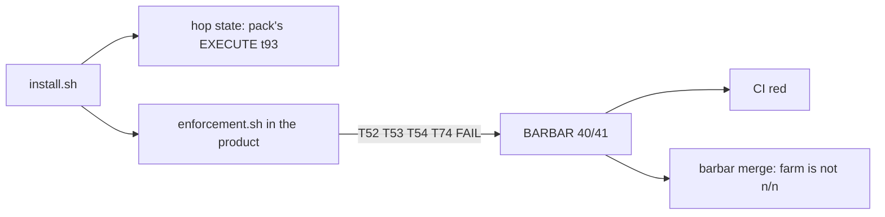
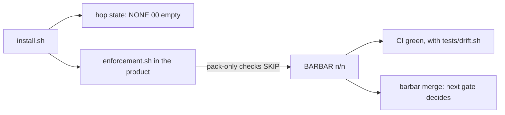

# Stage 05b — t96-install-repairs — SPEC

## Problem and scope

A stress test of tag `3.5.0` on 2026-11-05 found that a clean install cannot reach a merge. In a fresh install:

- `tests/enforcement.sh` fails T52 and T74 in both install modes, and T53 and T54 in plugin mode.
- `tests/barbar.sh` prints `BARBAR 40/41`, so `tests/doctor.sh` is red and `bash tests/barbar.sh merge` prints `farm is not n/n`.
- The hop state is the pack's own: `EXECUTE 05b t93-adaptive-effort-routing`.

The stress test also found these faults:

- `bash_guard.py` denies `--no-verify` and allows `git commit -n`.
- `control-line.yml` runs no drift check.
- A no-plugin upgrade from 3.0.2 stops at `CONFLICT` on an untouched file.
- The workflow time limit is too short.
- The farm leaves untracked files.
- `.codex-plugin/plugin.json` says 3.4.0. `tests/ac/codex_compatibility.sh` detects this and `docs/cascade/regress.md:37` runs that test, so `bash tests/regress.sh` on `main` prints `REGRESS 13/14`. The fault dates from `40027e7`, which changed `VERSION` only. The CI history was not read, so this spec does not say how PR #39 merged.
- `hop_guard.py` lets the agent write its own hook files.

This slice repairs these faults and releases 3.5.1. It does not include the unreleased work on `feat/specplan-refinement`.
It does not include the low-priority findings: odd `CURRENT_HOP` values, validator timeouts, `envelope.md:93`, and invalid hook input.

## Approaches considered

| Approach | Decision | Reason |
|---|---|---|
| Ship the pack-only fixtures to every install | Rejected | Each install then carries tests of the pack itself. T54 tests a linked worktree of the pack, so it cannot run in a product. |
| SKIP the pack-only checks in a product repo, as T93 does | **Chosen** | It is the existing pattern. The pack still runs every check, and a missing fixture in the pack stays a FAIL. |
| Run `install.sh --check` in CI | Rejected | A product repo has no path to `install.sh`. |
| Ship `tests/drift.sh`, which reads the committed `.cascade/manifest` | **Chosen** | It runs with no pack. It detects a softened file, but not a file and hash changed together. |
| Add a pre-commit rule that protects the manifest | Rejected | A changed `version` line must pass for upgrades, so a fake version passes too. The rule also blocks a same-version reinstall (critique C4, C6). |
| Compare the skill with the hash in the old `.cascade/manifest` | Rejected | No version lists the skill in its manifest (critique C3). |
| Keep the hashes of earlier pack copies of the skill in `install.sh` | **Chosen** | The history holds one earlier copy. The oracle reads the history, so a release that changes the skill and omits the hash goes red. |

## Before vs after

Before:

After:

## Benefits and trade-offs

| Item | Benefit | Cost or limit |
|---|---|---|
| Pack-only SKIP | A product repo can pass CI and reach the merge gate. | A product runs fewer suite checks. The pack still runs them. |
| Clean hop seed | A new repo starts idle, and auto-refresh is not blocked. | Repos already on the seeded hop must close it themselves, because the open hop blocks the refresh. The release notes say so. |
| `tests/drift.sh` in CI | CI detects a softened shipped file, stripped agent hooks and ignored enforcement files. | It does not detect a file and its manifest hash changed together, a softened `tests/drift.sh`, or a workflow file with the step removed. Only a comparison with the pack can detect these, and this slice does not add one. |
| Wider `bash_guard.py` rules | More bypass forms are denied. | `bash -c`, `eval`, variable indirection and shell aliases remain open at this layer. The git hooks and CI stay behind them for hop state and pushes. |
| `hop_guard.py` protects its own files | A hook change in an installed repo needs a human, on Claude Code and on Codex. | It applies only where `.cascade/manifest` exists, so pack development is unchanged. Shell writes are not covered; `tests/drift.sh` covers them. |
| `timeout-minutes: 60` | The workflow can finish. It matches the `regress` job. | The GitHub runner time is not measured. A hung job holds a runner for longer. |

## Decision contract

A tree is the pack when `.claude-plugin/plugin.json` has the name `bdd` and `.cascade/manifest` does not exist. A product repo is any other tree.

### Pack-only checks

1. In a product repo, `tests/enforcement.sh` must print `SKIP` for T74, and must not run it.
2. In a product repo with no `.claude/settings.json`, `tests/enforcement.sh` must print `SKIP` for T53.
3. In a product repo with no `.claude/hooks/`, `tests/enforcement.sh` must print `SKIP` for T54.
4. T52 must run in a product repo. Only its `commands/doctor.md` comparison must be limited to the pack.
5. In the pack, these checks must never SKIP. A missing fixture in the pack must be a FAIL.

### Hop seed

6. `docs/cascade/hop-state.template.md` must hold `CURRENT_HOP: NONE`, `CURRENT_STAGE: 00`, `CURRENT_SLICE: empty` and an empty `AUTOPILOT:` line.
7. `install.sh` must copy this template when the repo has no hop state.
8. `install.sh` must keep an existing `docs/cascade/hop-state.md` unchanged.
9. The existing branch for a pre-split envelope must stay unchanged.

### Hook bypass

`bash_guard.py` must deny these forms:

- `git commit` with `-n`, alone or in a short-flag group such as `-an`.
- `git commit` with `--no-verify` or an abbreviation that git accepts, such as `--no-veri`.
- `git -c core.hooksPath=...` before any subcommand, in any letter case.
- `git --config-env=core.hooksPath=...` or `git --config-env core.hooksPath=...` before any subcommand.
- `git config core.hooksPath <other value>`, in any letter case.
- `GIT_CONFIG_COUNT=` or `GIT_CONFIG_PARAMETERS=` before a `git` command, or in an `export`.
- `git -C <dir>` before any of these forms.

`bash_guard.py` must allow these forms: `git push -n`, `git merge -n`, `git log -n 3`, `git -c user.name=x commit -m y`, `git commit --amend -m x`, `git commit -m "add -n flag"`, `git commit -am "add -n flag"`, `git commit -m"fix -n flag"` and `git commit --author "a -n b" -m x`.

### Drift

10. `install.sh` must ship `tests/drift.sh`.
11. `tests/drift.sh` must exit non-zero and name the file when a file in `.cascade/manifest` is missing or has a different hash. It must not check `AGENTS.md`, which the product owns.
12. `tests/drift.sh` must exit non-zero and print `UNWIRED` when a no-plugin repo has a `.claude/settings.json` with no cascade hook entries.
13. `tests/drift.sh` must exit non-zero when git ignores an enforcement path, as `install.sh --check` does.
14. `tests/drift.sh` must exit 0 and print `n/a` in the pack, and must exit non-zero in a product repo with no manifest.
15. `tests/drift.sh` must not read `.cascade/disabled/`. CI is Layer 0, so a disabled repo gets the same verdict.
16. `control-line.yml` must run `bash tests/drift.sh` in the `eval` job.
17. A same-version reinstall must commit through the real pre-commit hook. This slice adds no manifest rule.

### Skill conflict

18. `install.sh` must hold the SHA-256 hash of each earlier pack copy of `.agents/skills/bdd-work/SKILL.md`, and must replace the file when its hash matches.
19. `install.sh` must print `CONFLICT`, exit 1 and keep the file when its hash matches no pack copy.

### Other repairs

20. The `eval` job in `control-line.yml` must have `timeout-minutes: 60`.
21. `install.sh` and the pack `.gitignore` must ignore `evals/fixtures/*/.cascade/`.
22. T96 must run `tests/ac/codex_compatibility.sh`, so that `tests/enforcement.sh` also fails when `.codex-plugin/plugin.json` differs from `VERSION`. The test file must not change. `bash tests/regress.sh` must print `REGRESS n/n` in the pack.
23. In a repo that has `.cascade/manifest`, `hop_guard.py` must require a signature for a write to `.claude/hooks/*`, `.claude/settings.json`, `.claude/settings.local.json`, `.githooks/*` or `.cascade/manifest`, in both install modes. On Codex, `apply_patch` to these paths must be denied.
24. In a repo with no `.cascade/manifest`, `hop_guard.py` must keep its current decision for these paths.

### Release

25. `VERSION`, `.claude-plugin/plugin.json`, `.claude-plugin/marketplace.json` and `.codex-plugin/plugin.json` must say `3.5.1`.
26. `CHANGELOG.md` must start its entries with a dated `## 3.5.1` section. It must tell users on the seeded t93 hop to close that hop themselves.
27. T96 must be added to `tests/enforcement.sh`, and every `T8–T93` text must change to `T8–T96`: `README.md`, `CONTROL-LINE.md`, `INTEGRATION.md`, `control-line.yml` and `tests/enforcement.sh`.

### Files that may change on EXECUTE

`install.sh`, `.gitignore`, `.claude/hooks/bash_guard.py`, `.claude/hooks/hop_guard.py`, `tests/enforcement.sh`, `tests/drift.sh` (new), `docs/cascade/hop-state.template.md` (new), `.github/workflows/control-line.yml`, `VERSION`, `.claude-plugin/plugin.json`, `.claude-plugin/marketplace.json`, `.codex-plugin/plugin.json`, `CHANGELOG.md`, `README.md`, `CONTROL-LINE.md`, `INTEGRATION.md`, `docs/cascade/goal.md`, `docs/cascade/regress.md`.

### Files that must not change on EXECUTE

`tests/ac/t96_install_repairs.sh`, `tests/ac/codex_compatibility.sh`, `docs/cascade/05b-t96-install-repairs.oracle`, `docs/cascade/hop-state.md`, and every `<EDIT>` block.

## Acceptance criteria and the frozen oracle

`bash tests/ac/t96_install_repairs.sh` is the oracle. The brief tags this slice `[bug-fix]`, so the oracle must fail on the unfixed tree.

| AC | Requirement |
|---|---|
| AC1 | Items 6–9: seed, keep and a pre-split envelope. |
| AC2 | The hook bypass list: each deny form and each allow form. |
| AC3 | Items 10–16: drift, including the false-clean and false-red cases. |
| AC4 | Item 17. |
| AC5 | Items 18–19: every earlier copy in the history, a real v3.0.2 install and a user edit. |
| AC6 | Item 20. |
| AC7 | Item 21. |
| AC8 | Items 22, 25 and 26, with a red twin for the Codex check. |
| AC9 | Items 23–24: Write and `apply_patch`, in both install modes. |
| AC10 | Item 5: in a pack copy with the files for T52, T53, T54 and T74 removed, each is a FAIL and none is a SKIP. Slow; runs after AC1–AC9 pass. |
| AC11 | Items 1–4: a fresh clone of each install mode passes every workflow step and `tests/drift.sh`. The farm is n/n, `doctor` exits 0, `barbar merge` does not print `farm is not n/n`, and the tree stays clean. Slow; runs after AC1–AC9 pass. |

`bash tests/regress.sh` for item 22 is a goal line, not part of the oracle, because that suite can run the oracle's own suite.

T96 in `tests/enforcement.sh` runs the oracle with `T96_FAST=1`, which runs AC1–AC9 only, because AC10 and AC11 run `tests/enforcement.sh` again.

## Laws and boundaries

- `NO LAW IN FORCE`: this repo declares no D#.
- This slice weakens no check in the pack. A product repo skips only checks that need files it does not have.
- The merge gate's other refusals stay unchanged. AC11 proves only that the farm no longer blocks the gate.

## Evidence limits

- The stress test replayed the workflow steps on macOS. It did not run on GitHub Linux runners. AC11 has the same limit.
- The 614 s figure came from two product replays that ran at the same time. The pack's own job is longer and was not timed on GitHub, so `timeout-minutes: 60` is a decision, not a measurement.
- The critic's full oracle run took about 98 minutes of wall time on one laptop at low CPU use.
- Versions 3.1 to 3.4 have no tags, so the upgrade from those versions was not run. The history holds two copies of the skill, and item 18 covers both.
- The critic reviewed the spec at `3669b57`. The answers below changed the spec and the oracle, and no second critic has reviewed the changes.
